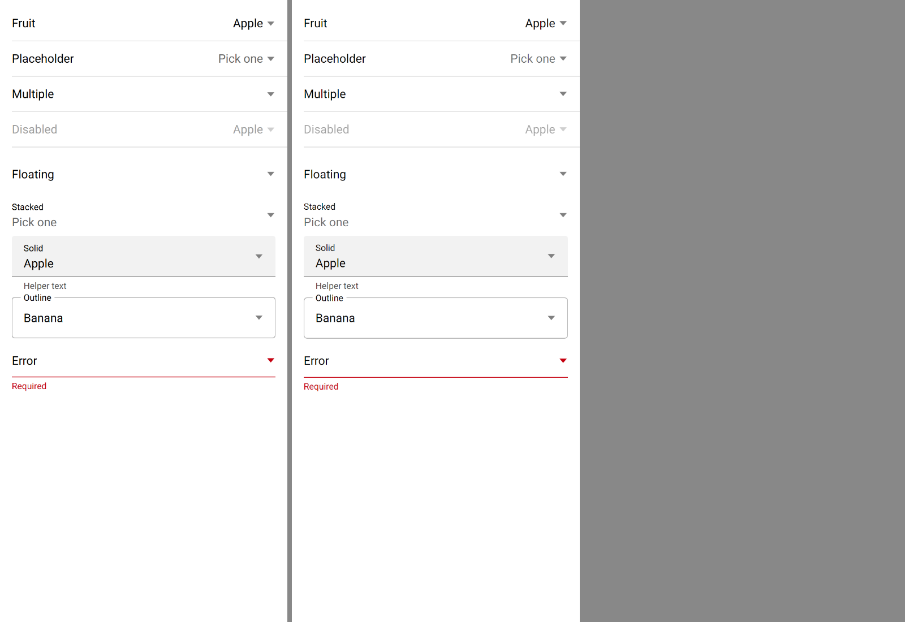
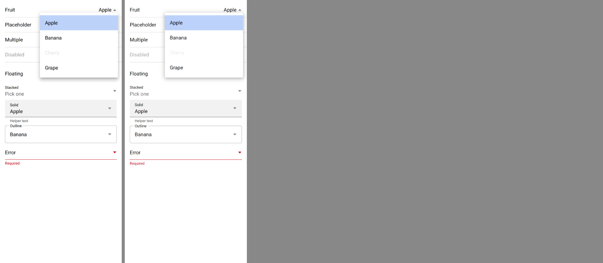
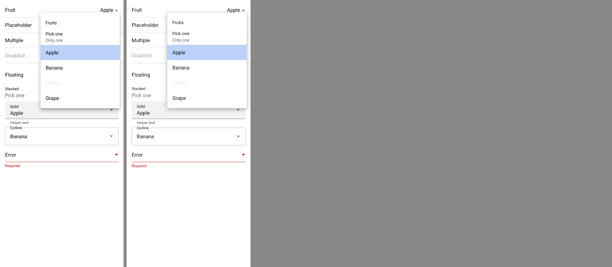
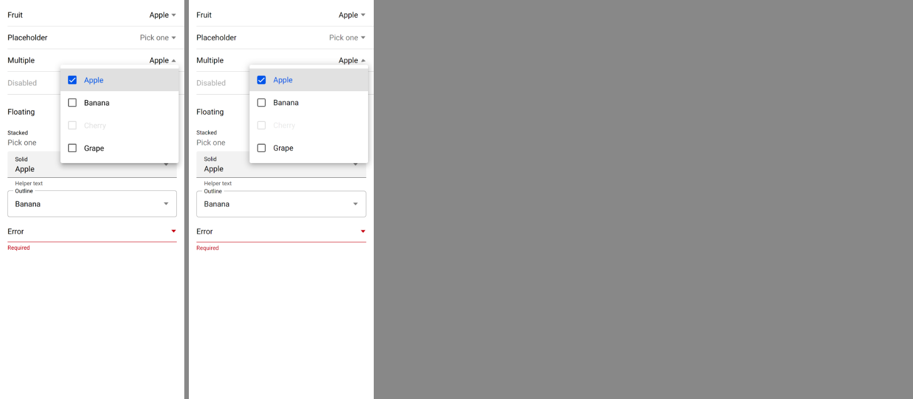
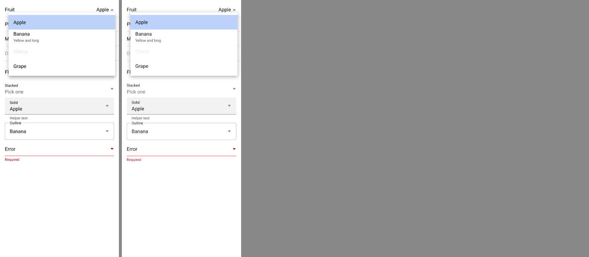
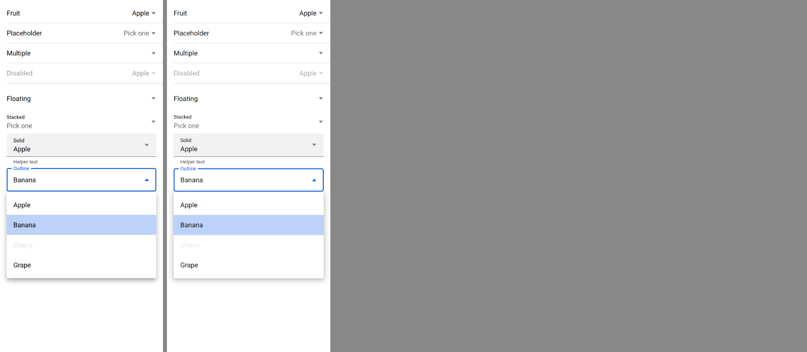
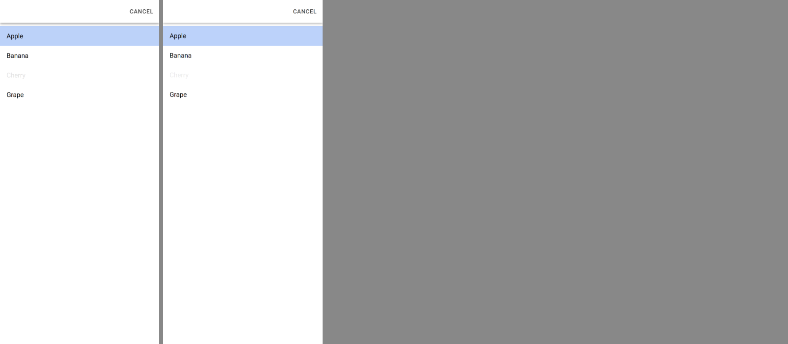
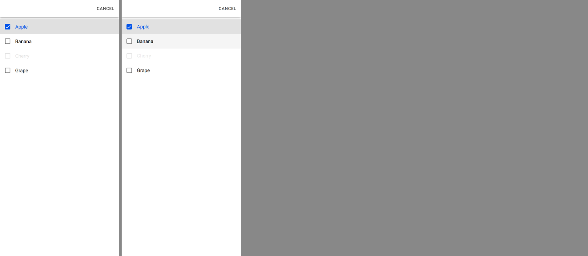
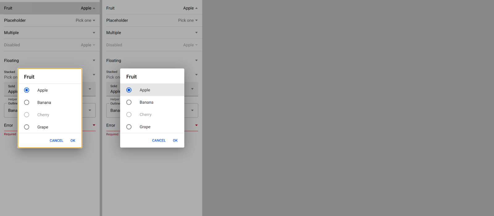
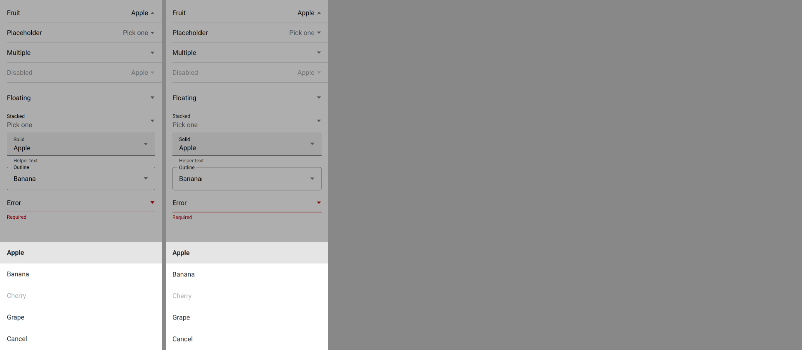

# ion-select — Comparison

Ionic 9.0.11, md, headless Chromium, beside Avonic headless (Skia) at the same size and 2x. A select's interfaces open from a tap,
and their options are JavaScript properties, which `render.js --html` can't drive, so the Ionic side comes from one measurement
script on `render.js`'s phone (390 x 844 at 2x, mobile and touch, Roboto from `tools/fonts/roboto/`), waiting as `render.js` does
(`tools/ionic-ref/settle.js`). It builds a page of selects in an `ion-app`, taps one into its interface where the case says, and
dumps every element's box, colour, opacity and transform, light and shadow DOM, with the focused element. The script isn't in the
repo, as the swarm brief asks; each case's page is the one `AvonicSelectCaptureTests.Page()` builds. The raw output is
[`ref/`](ref/): `<case>.json` and `<case>.png`.

The page: an `ion-list` of four selects in items (`Fruit` with Apple, `Placeholder`, `Multiple`, `Disabled`), then, 16 px in, a
floating, a stacked, a solid one with helper text, an outline one and an invalid one. Each has the options Apple, Banana, Cherry
(disabled) and Grape.

Avonic's frames are `AvonicSelectCaptureTests`, saved in [`compare/`](compare/), each asserting the boxes beside it. Not tried in a
real window: `tools/real-window/drive.ps1` has an `ion-select` section for the batch's runner.

| The page | Popover | Popover with a header, sub header and message |
|---|---|---|
|  |  |  |

| Popover, several values | Popover with a description | Popover covering an outline select |
|---|---|---|
|  |  |  |

| Modal | Modal, several values | Alert | Action sheet |
|---|---|---|---|
|  |  |  |  |

Ionic's on the left of each.

## Visual

Boxes are x, y, width, height in the window, asserted within 0.6 px unless said.

| | Ionic | Avonic | |
|---|---|---|---|
| A select in an item | 16, 9.5, 358 x 44 down its 48 row; the label at 16; the text at the end, its container from 316.22; the icon 13 x 16 at 361 | the same | Match (asserted) |
| An empty text | 2ch wide (17.98): the container 34.98 from 339.02 | the same | Match (asserted) |
| Floating, stacked, solid with helper text, outline, invalid | 56, 56, 75, 56, 64 high | the same | Match (asserted) |
| Floating label at rest | 19 down (`translateY(100%)`), full size, 57.52 wide; the icon in `.select-end` at 361, 228 | the same | Match (asserted) |
| Stacked label | 9.5 down, 0.75: 42.96 x 14.25 | the same | Match (asserted, within 1) |
| Justify start, end; placement end, fixed | the CSS's `justify-content` and `row-reverse`, start and end the writing mode's | the same | Match (asserted, within 1 for end, as Avalonia rounds the label to the half pixel) |
| Solid fill | step 50, a bottom border step 500, focused step 150 and the highlight's border | the same | Match (asserted) |
| Invalid | the icon, the bottom border and the error text rgb(197, 0, 15) | the same | Match (asserted) |
| Disabled | `opacity: 0.38` of the whole | an `OpacityMask` at 0.38 | Match (asserted) |
| Popover | 250 x 208 at 128, 41; four 48 rows from 49; the label at 144, 14.5 down its row | the same; the label 14 down | Match (asserted; the label's line is 18.75 in Avalonia, 19 in Chromium) |
| Popover, checked radio | the item `rgba(primary, 0.08)`; focused `primary` at 0.2 | the same | Match (asserted) |
| Popover, a header, sub header and message | 301 high: the list header 45, the message's item 48 | the same | Match (asserted, within 1.5) |
| Popover, several values | 128, 137; the label after the checkbox at 178 | the same | Match (asserted) |
| Popover, a description | `clamp(250px, 100vw - 40px, 400px)`: 350 at 28; the description 12 px, its text at 44, 126 | the same | Match (asserted) |
| Popover over an outline select | cover: 16, 459, 358 x 208, under it | the same | Match (asserted) |
| Modal | the toolbar's Cancel 74.02 x 32 at 309.98, 12; items from 64, 390 x 48, `lines="none"` | the same | Match (asserted, within 1.5) |
| Modal, several values | the checked item's text primary, its label at 50 | the same | Match (asserted) |
| Alert, action sheet | the alert's and the action sheet's own, compared in their PRs | the same | Match |

## Behaviour

| # | Behaviour | Ionic | Avonic | |
|---|---|---|---|---|
| B1 | Text | `getText`: selected text, or the options' text joined with `", "`, or the placeholder | the same | Match |
| B2 | Options | value or text; a change renders again | the same | Match |
| B3 | `compareWith` | function, property, strict, list option | the same | Match |
| B4 | Open | host click, Enter, Space; not disabled, not twice; not from slotted interactive content | the same | Match |
| B5 | Interface choice | action sheet + multiple, popover with no event: the alert | the same, with Ionic's warning in the log | Match |
| B6 | Expanded | `select-expanded`, the icon turning 180° over 150 ms, the expanded icon, the label floating; `ionDismiss`, then focus back | the same | Match |
| B7 | `setValue` | `ionChange` unless `isValueEqual` | the same | Match |
| B8 | Focus | `has-focus`, `ionFocus`, `ionBlur`; `ion-focusable` | the same | Match |
| B9 | Label | floats when stacked, or floating with a value, focus or open; a floating label's placeholder hidden until it floats | the same | Match |
| B10 | Disabled | 0.38, `interactive-disabled` to the item | the same | Match |
| B11 | Validation | the classes, followed; error text, help text, colours | the same | Match |
| B12 | Layout | flex row and column | `SelectControlPanel` | Match |
| B13 | Fill and shape | solid, outline, round | the same | Match |
| B14 | Highlight | 0 to 1 over 200 ms when focused or open, not in an item or with the outline | the same | Match |
| B15 | Automation | `<button aria-haspopup="dialog" aria-expanded aria-label aria-describedby aria-required aria-invalid>` | a Button with expand and collapse, the name, the help text and required | Match, but `aria-haspopup` and `aria-invalid` have no counterpart: **gap** |
| B16 | Item | a tap on the padding clicks it | the same | Match |
| B17 | Alert | header, radios or checkboxes, Cancel and OK, classes | the same | Match; the option's description, placement and justify aren't passed: **gap** (below) |
| B18 | Action sheet | radio buttons, Cancel | the same | Match; the description isn't passed: **gap** |
| B19 | Popover | at the container, centred, no backdrop; cover; rich width | the same | Match |
| B20 | Modal | header, Close (the select's Cancel), classes | the same | Match |
| B21 | Content | items, checked rules, hidden mark, md defaults, description | the same | Match |
| B22 | Choosing | radio click dismisses; arrows move only; Enter commits then dismisses on its key up; Space; checkboxes stay open | the same | Match; see repeats below |
| B23 | Focus at present | the chosen option's radio, or the first enabled; the alert's and sheet's button a frame later | the same | Match; see below |
| B24 | Interface options | spread | a dictionary by name | **Deliberate** (PLAN) |
| B25 | Changes while open | `updateOverlayOptions` | the same | Match |

## Deliberate differences

- **`interfaceOptions`** is a dictionary of the overlay's property names to values, not a JavaScript object spread into it. See
  the plan; a typed object per interface is for the human to decide.
- **The options are `Items`**, `AvonicSelectOption` controls, not data with a template: there's no `ItemsSource`. An app with a list
  of models makes an option per model (the sample does, in code).
- **No selection at present: the first enabled radio.** `select.js` focuses `ion-radio:not(.radio-disabled)`. Measured with the first
  option disabled ([`ref/popoverNone.json`](ref/popoverNone.json)), Chromium ends with focus on the disabled first radio. At
  will-present Ionic's overlay is still `overlay-hidden` (`display: none`), so `select.js`'s own focus there can't land, and the
  overlay's focus after the animation decides; not worked out further. Avonic's overlay is shown for its animation just after
  will-present, where the select focuses, so `select.js`'s intent holds. With a chosen option both end on it
  ([`ref/popoverGrape.json`](ref/popoverGrape.json), [`ref/modalGrape.json`](ref/modalGrape.json)).
- **The alert's ring.** A frame after the alert's will-present the chosen radio is focused and shown focused, in both. Ionic's alert
  then focuses its wrapper; in the reference that clears the ring ([`ref/alertTrace.json`](ref/alertTrace.json)), because
  focus-visible was still in keyboard mode, which a real `touchstart` ends and the tool's tap didn't. With a finger the ring stays,
  as Avonic's does (`FocusVisible` leaves a ring through focus moved by code). The same keyboard mode puts Ionic's grey on the
  tapped item in the reference's alert frame.

## Known gaps

- **Rich options in the alert and the action sheet.** Ionic 9 renders an option's `description`, `labelPlacement` and `justify` in
  the alert (and the description in the action sheet), through `renderOptionLabel`. `AlertInput` and `ActionSheetButton` on `v2`
  have no such fields, and they're other controls' files: the select passes what they take, so these three show in the popover and
  the modal only. Proposed in the PR, with an issue.
- **`AvonicRadioGroup` has no `inSelectInterface`.** The select's content does it for its own group, in a tunnel handler ahead of
  the group's; proposed in the PR so that the group does it itself.
- **A held Enter.** Avalonia's key events have no repeat flag. A second key down with no key up between is taken as a repeat, and an
  Enter that opened the select is ignored until it comes up, which covers `!ev.repeat`'s two cases.
- **The click's point.** A popover opened by a click is placed by the select's container, as Ionic's; the click's own point
  (`clientX`, `clientY`) isn't kept, which only an `interfaceOptions` `reference: "event"` would read.
- **The rich popover's width** is worked out when it opens, from the window's width; it doesn't follow the window while open, as
  `100vw` would.
- **`aria-haspopup`, `aria-invalid`**: no Avalonia counterpart. The helper and error text's live regions are in the template, at a
  priority an app's style can't beat (#236's).
- **`--ion-item-color`** on a checked checkbox's item: the theme reads the text colour, its fallback.
- Not tried in a real window: `tools/real-window/drive.ps1` has an `ion-select` section for the batch's runner.
