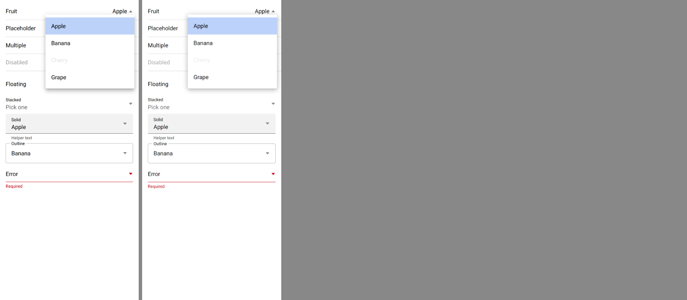

# ion-select

Status: done · [#45](https://github.com/wdcossey/Avonic/issues/45)

`AvonicSelect`, `AvonicSelectOption`, `AvonicSelectModal` and `AvonicSelectPopover`: Ionic's `ion-select`, `ion-select-option`,
`ion-select-modal` and its internal `ion-select-popover`, md. A field that shows the chosen option's text, and opens an interface to
choose: an [`AvonicAlert`](../ion-alert/README.md), an [`AvonicActionSheet`](../ion-action-sheet/README.md), an
[`AvonicPopover`](../ion-popover/README.md) or an [`AvonicModal`](../ion-modal/README.md). Plan: [PLAN.md](PLAN.md); comparison:
[COMPARISON.md](COMPARISON.md).



## Usage

```xml
<c:AvonicItem>
    <c:AvonicSelect Label="Fruit" Placeholder="Pick one" Interface="Popover" IonChange="OnFruit">
        <c:AvonicSelectOption Value="apple">Apple</c:AvonicSelectOption>
        <c:AvonicSelectOption Value="banana" Description="Yellow and long">Banana</c:AvonicSelectOption>
        <c:AvonicSelectOption Value="cherry" IsEnabled="False">Cherry</c:AvonicSelectOption>
    </c:AvonicSelect>
</c:AvonicItem>

<c:AvonicSelect Label="Toppings" LabelPlacement="Floating" Fill="Outline" Multiple="True" />
```

```csharp
toppings.Items.AddRange(models.Select(m => new AvonicSelectOption { Value = m.Id, Content = m.Name }));
toppings.CompareWith = "Id";                                 // or a Func<object?, object?, bool>: current value, then the option's
toppings.InterfaceOptions = new Dictionary<string, object?> { ["header"] = "Toppings", ["cssClass"] = "mine" };
toppings.IonChange += (_, e) => Save((object?[])e.Value!);    // with Multiple, the values are an object?[]

var overlay = await select.Open(PopoverEvent.From(e));       // the interface, presented; null if disabled or open
```

`Value` is two-way and set with `SetCurrentValue` when the user chooses; `IonChange` is raised only then, and only when the value
isn't equal to what it was. An option with no `Value` has its text as its value. Its text is its `Content`: a string, or the text of
the controls in it, white space collapsed.

**Interfaces.** `Alert` (the default): radios, or checkboxes with `Multiple`, and Cancel and OK. `ActionSheet`: a radio button per
option and Cancel; with `Multiple`, the alert. `Popover`: at the select, or as wide as it with a fill or a floating or stacked label;
from `Open()` with no event, the alert. `Modal`: full screen, with a Close button (`CancelText`). Cancel on the alert and the action
sheet (its button, the backdrop, Escape, back) raises `IonCancel`; every dismiss raises `IonDismiss`, and focus comes back.

**`InterfaceOptions`** sets the overlay's properties by name, in Ionic's camelCase or Avonic's PascalCase (`"size"`, `"Side"`); a
string converts as XAML would (`"cover"`). `header` is the alert's header (else the label), the popover's list header and the
modal's title; `subHeader` and `message` the popover's too; `cssClass`, a string or a list, adds classes. A key with no property is
ignored.

## Checklist

From `node tools/ionic-api.js ion-select`, `ion-select-option`, `ion-select-modal`; the reasons for each row are in
[PLAN.md](PLAN.md).

### ion-select props

| ✓ | Ionic | Avonic |
|---|---|---|
| [x] | `cancelText`, `okText` | `CancelText`, `OkText` |
| [x] | `color` | `Color` |
| [x] | `compareWith` | `CompareWith` |
| [x] | `disabled` | `IsEnabled` |
| [x] | `errorText`, `helperText` | `ErrorText`, `HelperText` |
| [x] | `expandedIcon`, `toggleIcon` | `ExpandedIcon`, `ToggleIcon` |
| [x] | `fill`, `shape` | `Fill` (`SelectFill`), `Shape` (`SelectShape`) |
| [x] | `interface`, `interfaceOptions` | `Interface` (`SelectInterface`), `InterfaceOptions` |
| [x] | `justify` | `Justify` (`SelectJustify`) |
| [x] | `label`, `labelPlacement` | `Label`, `LabelPlacement` (`SelectLabelPlacement`) |
| [ ] | `mode` | not exposed (ADR 0001) |
| [x] | `multiple` | `Multiple` |
| [ ] | `name` | not applicable: an HTML form's hidden input |
| [x] | `placeholder`, `selectedText` | `Placeholder`, `SelectedText` |
| [x] | `required` | `Required` |
| [x] | `value` | `Value` |

### ion-select events, methods, slots

| ✓ | Ionic | Avonic |
|---|---|---|
| [x] | `ionChange` | `IonChange`, `SelectChangeEventArgs.Value` |
| [x] | `ionCancel`, `ionDismiss`, `ionFocus`, `ionBlur` | `IonCancel`, `IonDismiss`, `IonFocus`, `IonBlur` |
| [x] | `open(event)` | `Task<AvonicOverlay?> Open(PopoverEvent? ev = null)` |
| [x] | `label`, `start`, `end` slots | `LabelContent`, `StartContent`, `EndContent` (+ templates) |
| [x] | the `ion-select-option` children | `Items` |

### ion-select CSS custom properties

| ✓ | Ionic | Avonic resource key | md default |
|---|---|---|---|
| [x] | `--background` | `Avonic.Select.Background` | unset: transparent; the fill's steps |
| [x] | `--border-color` | `Avonic.Select.BorderColor` | unset: the item border colour; step 500 solid, 300 outline |
| [x] | `--border-radius` | `Avonic.Select.BorderRadius` | unset: 4 with a fill, 16 round, 28 outline round |
| [ ] | `--border-style` | none | not applicable: Avalonia's borders are solid |
| [x] | `--border-width` | `Avonic.Select.BorderWidth` | 1 |
| [x] | `--highlight-color-focused`, `-valid`, `-invalid` | `Avonic.Select.HighlightColorFocused`, `…Valid`, `…Invalid` | unset (primary or the colour), success, danger |
| [x] | `--highlight-height` | `Avonic.Select.HighlightHeight` | 2 |
| [x] | `--padding-top`, `-end`, `-bottom`, `-start` | `Avonic.Select.PaddingTop` and the rest | unset: 0, or 16 at the sides with a fill, 32 outline round |
| [x] | `--placeholder-color`, `--placeholder-opacity` | `Avonic.Select.PlaceholderColor`, `…Opacity` | unset: the text's colour, `Avonic.PlaceholderOpacity` 0.6 |
| [ ] | `--ripple-color` | none | not applicable: md's select has no ripple |
| [ ] | `--select-text-gap`, `--select-text-media-*` | none | not applicable: only with `innerHTMLTemplatesEnabled` |

Not Ionic variables: `Avonic.Select.Md.*` (the fill's and shape's defaults, the disabled mask), `Avonic.SelectPopover.Md.RichContent*`
(the rich popover's `clamp`), and `Avonic.SelectOption.Md.*`, the item rules of the popover's and the modal's options.

### ion-select-option

| ✓ | Ionic | Avonic |
|---|---|---|
| [x] | `value` | `Value` |
| [x] | `disabled` | `IsEnabled` |
| [x] | `description` | `Description` (the popover and the modal) |
| [x] | `labelPlacement`, `justify` | `LabelPlacement` (`SelectOptionLabelPlacement`), `Justify` (`SelectOptionJustify`) (the popover and the modal) |
| [x] | default slot | `Content` |
| [ ] | `start`, `end` slots | not applicable: only with `innerHTMLTemplatesEnabled` |
| [ ] | `mode` | not exposed (ADR 0001) |

### ion-select-modal

| ✓ | Ionic | Avonic |
|---|---|---|
| [x] | `cancelText` | `CancelText`, `"Close"` |
| [x] | `header` | `Header` |
| [x] | `multiple` | `Multiple` |
| [x] | `options` | `Options`, `IList<SelectOverlayOption>` |

`AvonicSelectPopover` (`ion-select-popover`, `@internal`): `Header`, `SubHeader`, `Message`, `Multiple`, `Options`.
`SelectOverlayOption`: `Text`, `Value`, `Disabled`, `Checked`, `CssClass`, `Handler`, `Description`, `LabelPlacement`, `Justify`.

## Behaviours

B1 to B25 in [PLAN.md](PLAN.md), each tested in `AvonicSelectTests`, `AvonicSelectInterfaceTests` and `AvonicSelectCaptureTests`:
the text, the options, `compareWith`, opening and its guards, the interface choice, the expanded state, `setValue`, focus, the label,
disabled, validation, the layout, the fills, the highlight, automation, the item, each interface's options and buttons, the
popover's and the modal's content and keys, focus at present, interface options, and changes while open.

## The parts

`PART_Wrapper` (`.select-wrapper`), `PART_Start` and `PART_End` (the slots), `PART_Control` (`SelectControlPanel`,
`.select-control`), `PART_Label`, `PART_LabelText`, `PART_LabelContent`, `PART_Container` (`.native-wrapper`), `PART_Text`
(`SelectTextBlock`, the text or the placeholder), `PART_Icon` and `PART_EndIcon` (the icon, in `.native-wrapper` or `.select-end`),
`PART_SelectEnd`, `PART_OutlineContainer`, `PART_OutlineStart`, `PART_OutlineNotch`, `PART_NotchSpacer`, `PART_OutlineEnd`,
`PART_Highlight`, `PART_Bottom`, `PART_HelperText`, `PART_ErrorText`. Pseudoclasses: `:select-expanded`, `:has-value`,
`:has-placeholder`, `:has-placeholder-shown`, `:has-focus`, `:label-floating`, `:label-placement-*`, `:fill-*`, `:justify-*`,
`:shape-round`, `:has-expanded-icon`, `:select-disabled`, `:in-item`, `:in-item-color`, `:label-text-wrapper-hidden`,
`:has-bottom`, `:ion-hover`. The popover's and the modal's content: `PART_List`, and the modal's `PART_Cancel`; each option's item
has `select-interface-option` and its option's classes, and `item-radio-checked` or `item-checkbox-checked`.

## Extensions

None.

## Known gaps

From [COMPARISON.md](COMPARISON.md#known-gaps):

- The option's `Description`, `LabelPlacement` and `Justify` show in the popover and the modal, not the alert and the action sheet,
  whose `AlertInput` and `ActionSheetButton` have no such fields yet.
- `aria-haspopup` and `aria-invalid` have no Avalonia counterpart.
- No `ItemsSource` for options: make one `AvonicSelectOption` per model.
- A held Enter is told from a new press without a repeat flag; the click's point isn't kept for a popover; the rich popover's
  width doesn't follow the window while it's open.
- Not tried in a real window yet: `tools/real-window/drive.ps1` has an `ion-select` section.
