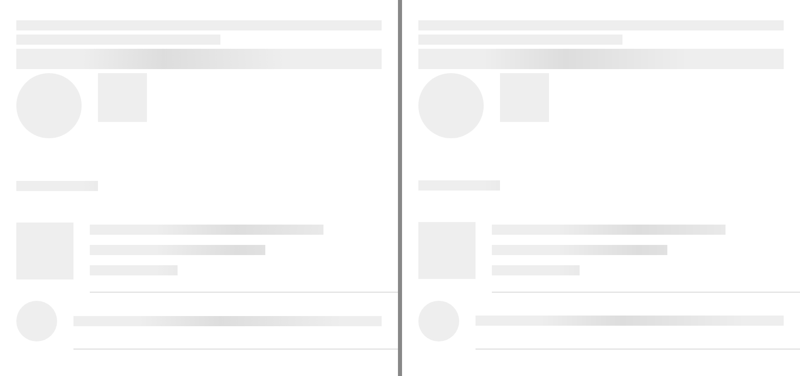
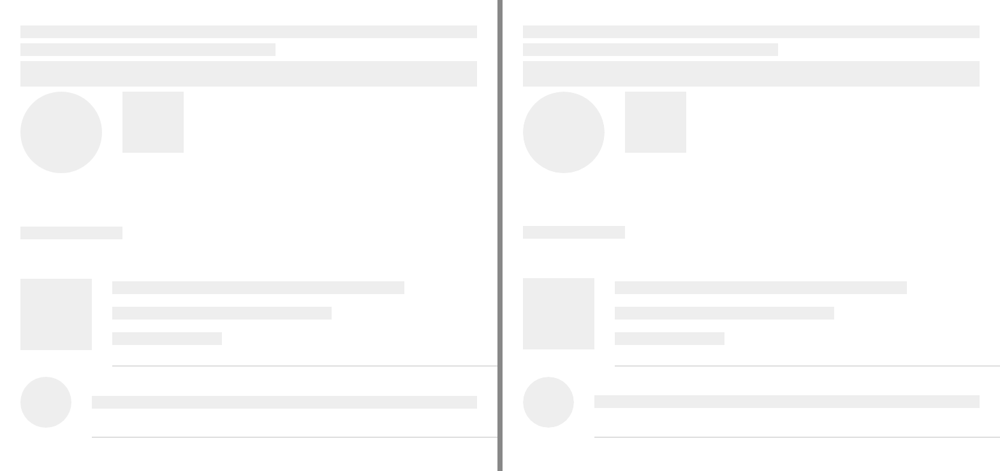

# ion-skeleton-text — Comparison against the web component

> Ionic side (Chromium, md, 390×844@2x) → [`ref/`](ref/). The exact command:
>
> ```
> node tools/ionic-ref/render.js ion-skeleton-text --bare --html '<div style="padding:16px"><ion-skeleton-text></ion-skeleton-text><ion-skeleton-text style="width:200px"></ion-skeleton-text><ion-skeleton-text animated style="height:20px"></ion-skeleton-text><div style="display:flex;gap:16px;align-items:flex-start"><ion-avatar><ion-skeleton-text animated></ion-skeleton-text></ion-avatar><ion-thumbnail><ion-skeleton-text></ion-skeleton-text></ion-thumbnail></div></div><ion-list><ion-list-header><ion-skeleton-text animated style="width: 80px"></ion-skeleton-text></ion-list-header><ion-item><ion-thumbnail slot="start"><ion-skeleton-text animated></ion-skeleton-text></ion-thumbnail><ion-label><h3><ion-skeleton-text animated style="width: 80%"></ion-skeleton-text></h3><p><ion-skeleton-text animated style="width: 60%"></ion-skeleton-text></p><p><ion-skeleton-text animated style="width: 30%"></ion-skeleton-text></p></ion-label></ion-item><ion-item><ion-avatar slot="start"><ion-skeleton-text animated></ion-skeleton-text></ion-avatar><ion-label><ion-skeleton-text animated></ion-skeleton-text></ion-label></ion-item></ion-list>'
> ```
>
> The list is the example in Ionic's skeleton-text docs. `ref/page.png` is that render, with the shimmer wherever it was when it
> was taken. `ref/page-500ms.png` is the same page, `ref/page.html`, with every shimmer paused at 500 ms through the Web Animations
> API (`animation.pause(); animation.currentTime = 500` on each skeleton's `getAnimations()`), and `ref/page-animated-off.png` the
> same with `window.Ionic = { config: { mode: 'md', animated: false } }`, both by a throwaway `playwright-core` script.
>
> Avonic side: `AVONIC_CAPTURE_DIR=… dotnet test` → `AvonicSkeletonTextCaptureTests` (headless Skia, 2×), with `TestClock` at
> 500 ms. It writes `avonic-skeleton-text-page.png` and `avonic-skeleton-text-page-animated-off.png`, as capture tests share the
> folder, which are copied to [`compare/avonic-page.png`](compare/avonic-page.png) and
> [`compare/avonic-page-animated-off.png`](compare/avonic-page-animated-off.png).

## Frames

At 500 ms, the top 370 px of each. Ionic on the left, Avonic on the right:



With `animated: false` in Ionic's config, and `AvonicConfig.Animated` off:



**Match.** From the top: a plain bar, one 200 wide, an animated one 20 high with the band's peak at x 144 on both, then an avatar's
circle and a thumbnail's square; the list header's 80 wide bar; the docs' item with its thumbnail and three lines of 80, 60 and
30 % of the label, 20 apart, with the band at the same x in each; and an item with an avatar and a full line. With the config
off, every bar is plain on both. The list header's bar and the first item's thumbnail are half a pixel higher here, from the list
header's and the item's own layout, which this PR doesn't change.

Two things in the page are set by hand on the Avonic side, as an app would:

- **The top three bars have no margin above the second and third.** CSS collapses the 4 below one block and the 4 above the next
  into 4, so they're 14 apart in Ionic; a `StackPanel` doesn't, which puts plain ones 18 apart.
- **The label's three bars carry the `h3`'s and the `p`'s margins,** 6 above and below the first and 4 above and 6 below the
  others, and their widths are 228.8, 171.6 and 85.8, as Avalonia's `h3` is a `TextBlock`, which can't hold a control, and
  Avalonia has no percentages.

The pixels of the band were also measured on one bar 358 × 20 at 0, 250, 500 and 750 ms, and match within 1 of each channel at
every x measured: see `B5`.

## Behaviours

The numbers are from [PLAN.md](PLAN.md#behaviours). Each has tests in `AvonicSkeletonTextTests`, named after its number.

| # | Behaviour | Ionic | Result |
|---|---|---|---|
| 1 | The box | 358 × 10, margin 4 above and below, at 8, 16 or 40 px, in Roboto or serif; at the top of a taller box | match |
| 2 | `height: inherit` | 50 in a parent 50 high; its own 100 × 30 | match, through the parent's `Height` |
| 3 | Background | `rgba(0, 0, 0, 0.067)`; `--background-rgb` red; `--background` beats it | match, 17/255 on both |
| 4 | Radius | 0; 12 from a parent with 12; `--border-radius: 6px` | match. 6 is drawn at 5 on a bar 10 high on both, and reported as 5 here, as `BorderRadius` clamps it |
| 5 | The shimmer | the red channel at x 0, 32, 64, 100, 144, 200, 264, 300, 357 at four times; `--background` ignored | match within 1 |
| 6 | The global config | read at render: the first attach and a change of `animated` | match |
| 7 | In an avatar or a thumbnail | `in-media`: no margin, fills, the avatar's circle; read at render | match |
| 8 | `ionStyle` | `{"skeleton-text":true}`, and the item's label clips | match, once |
| 9 | `pointer-events: none` | a press goes through | match |
| 10 | Frames | a CSS animation stops under `display: none` and restarts when shown or re-created | match, following `AvonicProgressBar` |
| 11 | Automation | a `span` with a `&nbsp;`: nothing | match: no control or content element |

## Deliberate differences and known gaps

All in [PLAN.md](PLAN.md#deliberate-differences), and the margin collapsing above.

## Real window

Not tried in a real window. The frames above are headless.
