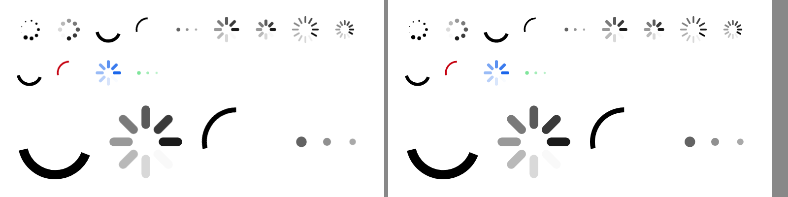
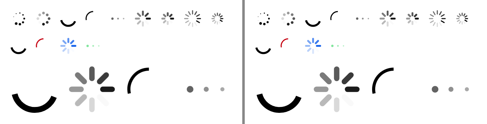

# ion-spinner → `AvonicSpinner` — Comparison

The Ionic frame is from:

```sh
node tools/ionic-ref/render.js ion-spinner --bare --html '<ion-app style="position:static;display:block;contain:none;overflow:visible"><div style="padding:16px;display:flex;flex-direction:column;gap:16px"><div style="display:flex;gap:12px"><ion-spinner name="bubbles"></ion-spinner><ion-spinner name="circles"></ion-spinner><ion-spinner name="circular"></ion-spinner><ion-spinner name="crescent"></ion-spinner><ion-spinner name="dots"></ion-spinner><ion-spinner name="lines"></ion-spinner><ion-spinner name="lines-small"></ion-spinner><ion-spinner name="lines-sharp"></ion-spinner><ion-spinner name="lines-sharp-small"></ion-spinner></div><div style="display:flex;gap:12px"><ion-spinner></ion-spinner><ion-spinner color="danger" name="crescent"></ion-spinner><ion-spinner color="primary" name="lines"></ion-spinner><ion-spinner color="success" name="dots"></ion-spinner></div><div style="display:flex;gap:12px"><ion-spinner style="width:80px;height:80px"></ion-spinner><ion-spinner name="lines" style="width:80px;height:80px"></ion-spinner><ion-spinner name="crescent" style="width:80px;height:80px"></ion-spinner><ion-spinner name="dots" style="width:80px;height:80px"></ion-spinner></div></div></ion-app><script>customElements.whenDefined("ion-spinner").then(async()=>{const all=[...document.querySelectorAll("ion-spinner")];for(const e of all)await e.componentOnReady();requestAnimationFrame(()=>{for(const e of all)for(const a of e.shadowRoot.getAnimations()){a.pause();a.currentTime=350}})})</script>'
```

and Avonic's from `AvonicSpinnerCaptureTests.Reference_Page`, run with `AVONIC_CAPTURE_DIR` set: the same scene, with
`AvonicTheme` installed, headless (Skia), 390 wide at 2×.

**Not tried in a real window.** Headless capture only.

## Comparing an animation at a known instant

The frames of two running animations are never in phase, so both sides are stopped at the same instant, **350 ms**:

- **Ionic:** the `<script>` at the end of the snippet waits for every spinner to render, then pauses each of its Web
  Animations and sets its `currentTime` to 350. That's the same as the CSS animation having run for 350 ms, with each
  element's own `animation-delay`.
- **Avonic:** the test replaces the clock with `TestClock`, shows the page at 0 ms and advances to 350, running every
  frame on the way. The spinner draws whatever instant the clock says, so the frame is exactly 350 ms.

350 ms is a frame where every name shows something: `circular` is halfway through its growth, at a dash of 50.5 from
7.5 along, which a frame at 0 ms, a 1-unit dot, wouldn't show.

## Visual



Ionic on the left, Avonic on the right: [Ionic's page](ref/page.png), [Avonic's](compare/avonic-page.png).

With `AvonicConfig.Animated` off (#87), the same page at 350 ms is the same frame, every byte, as
`AvonicSpinnerCaptureTests.Reference_Page_With_Animated_Off_Is_The_Same_Frame` asserts, since Ionic's spinner doesn't read
`animated`. Its frame is byte for byte [`compare/avonic-page.png`](compare/avonic-page.png). The top 200 px of each, Ionic on the left:



Measured on the two 2× frames, the box of every pixel darker than half, and the sum of the ink:

| Region | Ionic | Avonic |
|---|---|---|
| Row 1, all nine names | 43,33 – 718,85, ink 2104 | 42,33 – 718,86, ink 2109 |
| Row 2, default, danger, primary, success | 34,123 – 284,173, ink 911 | 34,123 – 284,174, ink 910 |
| 80 px circular | 38,302 – 181,363, ink 3147 | 38,302 – 181,363, ink 3149 |
| 80 px lines | 242,215 – 369,296, ink 2814 | 242,215 – 369,296, ink 2812 |
| 80 px crescent | 410,218 – 479,301, ink 1150 | 410,218 – 478,301, ink 1145 |
| 80 px dots | 602,278 – 621,297, ink 350 | 603,278 – 622,297, ink 350 |
| Each of the nine, alone | within 1 device pixel on every edge | ink within 3 % |

The differences are a device pixel of anti-aliasing, at the edges of curves. The colours are the palette's: danger
`#C5000F`, primary `#0054E9`, success `#2DD55B`, as both frames show.

A first try at this scene had the 80 px row at 84 px. Four of those and their gaps are 372 px, 14 more than the row has,
so Ionic's flex items shrank to 80.5 × 84, and a spinner scales by its smaller side. That was the page's layout, not the
spinner, so the reference uses 80 px, which fits.

## Measurements

Every number in the plan and the tests is a computed style in Chromium, from a throwaway script in a temp folder, not the
repo. It loads Ionic 8.8.1 in md mode inside `ion-app`, as `render.js` does, and for each spinner reads the shadow DOM's
elements, then pauses every animation and seeks it to 0, 100, 175, 250, 350, 375, 500, 700, 750, 1000, 1050 and 1400 ms,
reading each `svg`'s `opacity` and `transform` and each `circle`'s `stroke-dasharray` and `stroke-dashoffset`. Another
part leaves the animations running, as a page does, and changes `paused`, `duration` and `name`, and removes and
re-inserts a spinner, reading `currentTime` before and after.

| What | Measured |
|---|---|
| Host | `display: inline-block`, 28 × 28, `role="progressbar"`, classes `md spinner-<name>` |
| `lines` at 0 ms | opacities `1, 0.125, 0.25, 0.375, 0.5, 0.625, 0.75, 0.875`; `svg` transforms `rotate(180deg)`, `rotate(225deg)`, … |
| `bubbles` at 0 ms | scales `1, 0.111, 0.222, … 0.889` |
| `dots` at 0 and 250 ms | scales `1, 0.824, 0.648` and `0.6, 0.424, 0.552`; opacities at 0 `0.9, 0.724, 0.548` |
| `crescent` at 100 ms | `matrix(0.669131, 0.743145, -0.743145, 0.669131, 0, 0)`, which is `rotate(48deg)` |
| `circular`'s `svg` | `matrix(1, 0, 0, 1, 0, 0)` at every time above |
| `circular`'s `circle` | `5.04952px, 200px` / `-0.613563px` at 100 ms; `50.5px` / `-7.5px` at 350; `100px` / `-16.0941px` at 750; `-70px` at 1050; `1px` / `0px` at 1400 |
| `duration` | `2000` → `2s`; `10` → crescent's own `0.75s`; `11` → `0.011s` |
| Colour | `rgb(1, 2, 3)` inherited; `color="danger"` `rgb(197, 0, 15)`; `color="nonsense"` inherits; `--color: rgb(18,52,86)` that; both, danger; `color="danger"` with the page's own `color: rgb(9,9,9)`, that |
| 56 × 28 `dots` | `svg` `left: 17.9062px`, `transform-origin: 28px 14px`, dot radius `6 × 28 / 64` × its scale |
| 28 × 56 `circles` | circle 1's `top: 12.6562px`, `left: 6.32812px`, radius `5 × 28 / 64` |
| `dir="rtl"` | `dots`' positions and matrices the same as in LTR |
| `paused` | `currentTime` 433.3 when paused, still 433.3 300 ms later, then 516.6 100 ms after clearing it |
| `duration` changed to 3000 while running | the same animation, `currentTime` 350 → 400 over 50 ms |
| Removed and re-inserted | `currentTime` 50 ms after re-inserting: 50 |
| `display: none` on the host or an ancestor | no animations while hidden; shown again 100 ms later, `currentTime` 100 |
| Change of name, 100 ms after | `lines` → `lines-small`, `circles` → `lines`: every element 517 ms, carried on. `lines` → `lines-sharp`: the first 8 at 517, the other 4 at 83. `dots` → `bubbles`, `bubbles` → `circles`, `crescent` ↔ `circular`: all 83, started again. A paused one that changes name: all 0 |

## Behaviours

| # | Behaviour | Ionic | Avonic | Result |
|---|---|---|---|---|
| 1 | No name is `circular` | `spinner-circular` | `circular`'s frame | match |
| 2 | Each name's elements, shapes and paint | `spinner-configs.js`, `spinner.css` | the same configs | match |
| 3 | Default durations | 1000, 1400, 750 | the same | match |
| 4 | `duration` over 10, kept time on a change | measured | the same | match |
| 5 | Stagger, clockwise | measured | the same, to 1e-4 | match |
| 6 | `dots` | measured | the same | match |
| 7 | `crescent` | measured | the same | match |
| 8 | `circular` doesn't turn, its arc | measured | the same, to 1e-3 | match |
| 9 | `paused` | freezes and carries on | the same | match |
| 10 | A change of name | per element | per element | match |
| 11 | Leaving the tree, or hidden | restarts | restarts | match |
| 12 | Colour | measured | the same | match |
| 13 | Size | 28 px, scales by the smaller side | the same | match |
| 14 | RTL | not mirrored | not mirrored | match |
| 15 | `role="progressbar"`, inline-block, whole box takes input | | `ProgressBar` peer, `Left` / `Top`, transparent box | match |
| 16 | Frames only while running | a paused CSS animation costs nothing | no frame requested | match |
| 17 | `AvonicConfig.Animated` off | `animated: false` leaves it turning: `spinner.js` doesn't read it | keeps turning | match (#87) |
| 18 | It draws the frame | | pixels at the measured places | match |
| 19 | Host classes | `spinner-<name>`, `spinner-paused` | `:name-<name>`, `:paused` | match |
| 20 | `config.spinner` | read in `render()`: at the first connect and each change of a prop, measured below | `AvonicConfig.Spinner`, read at the first attach and each change of `SpinnerName`, `Paused`, `Duration` or `Color` | match (#87) |

### Measured: when `config.spinner` is read (#87)

In Chromium, with `window.Ionic = { config: { mode: 'md', spinner: 'dots' } }` and `Ionic.config.set('spinner', ...)` at
runtime, reading each spinner's `spinner-*` class and its count of `svg`s 100 ms after each step:

| Step | Spinner with no name |
|---|---|
| Started with `dots` | `spinner-dots`, 3 `svg`s |
| Config set to `crescent`, nothing else | still `dots` |
| Removed and inserted again | still `dots` |
| `display: none`, then shown | still `dots` |
| `paused = true` | `crescent`, 1 `svg` |
| Config `bubbles`, then `duration = 500` | `bubbles`, 9 |
| Config `lines-small`, then `color = 'danger'` | `lines-small`, 8 |
| A class added, after config `lines-sharp` | still `lines-small` |
| Created at `circles`, appended once the config is `dots` | `dots` |
| `paused = true`, then config `bubbles` in the same task | `bubbles`: the render is at the next frame |
| Config `lines`, `paused = false`, then config `crescent` in a `setTimeout` 0 | `crescent` |

A spinner with `name="lines"` stayed `lines` throughout, and setting its `name` to `undefined` once the config was `circles`
gave `circles`. `B20` asserts the same steps.

### Measured: what `animated` reaches (#87)

`grep -r "getBoolean('animated'" node_modules/@ionic/core/dist/collection`, and `config.get('animated'`, in `@ionic/core` 8.8.1:
`utils/tap-click` (the ripple), `accordion`, `menu`, `nav`, `router-outlet`, `searchbar`, `skeleton-text` and `utils/overlays`.
Not `spinner`, `progress-bar` or `content`. `ionic-global.js` sets `animated` to false when `_testing` is on, which is the
other way round: `_testing` reaches `animated`, not `animated` the spinner.

## Deliberate differences

| Difference | Why | Measurement |
|---|---|---|
| A prop's change reads `AvonicConfig.Spinner` at once | Stencil renders at the next frame, so in Ionic a config set after the change, in the same task or the next, still counts, measured: `paused = true` then `config.set('spinner', 'bubbles')` drew bubbles, and so did a set in a `setTimeout` 0 after the change. Here every change of a prop applies at once, as `Paused` and `SpinnerName` already did, so the config is read then. Set it before | the two steps at the end of the table above |
| No `_testing` | Ionic's private config for its own screenshot tests, which pauses every spinner. Avonic's tests have `TestClock` instead | `'spinner-paused': self.paused \|\| config.getBoolean('_testing')` |
| A name outside the nine can't be set | `SpinnerName` is an enum. Ionic falls back to `lines` for an unknown string, and so does a cast out of range here | `SPINNERS[spinnerName] ?? SPINNERS['lines']` |
| A duration that isn't finite is the default | `Infinity > 10` is true in JS, so Ionic writes `animation-duration: Infinityms` and, for the staggered names, `animation-delay: NaNms`, neither valid CSS. Read from the source, not measured: the browser drops both, so the stylesheet's `1s` applies with no stagger, or `0s` for `circular`. Avonic uses the name's own duration and stagger, rather than copy what a bad value happens to do | — |
| `circular`'s `svg` doesn't turn | Not a difference: Chromium doesn't turn it either, as the matrices show. Recorded because the keyframes read as if it did | `matrix(1, 0, 0, 1, 0, 0)` at 12 instants |

## Gaps

None found in the comparison.
