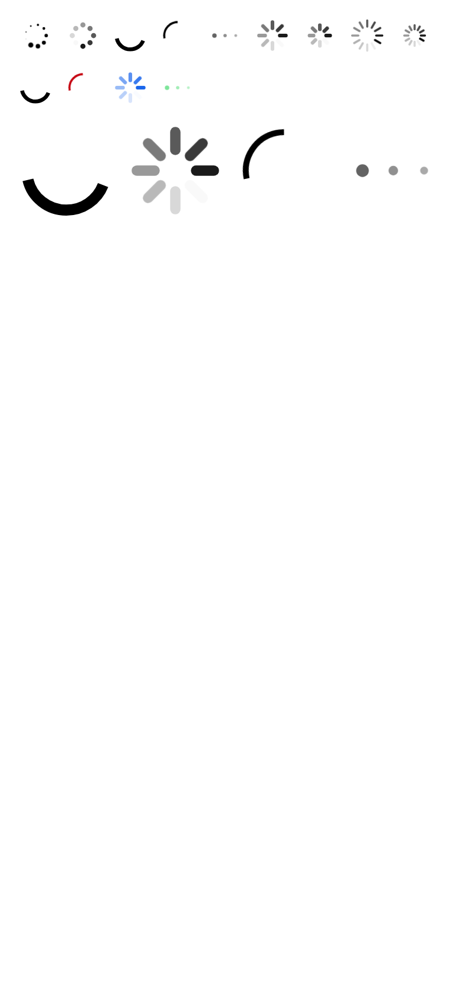

# ion-spinner — reference render (Ionic 8.8.1, md, 390×844@2x)

Generated by `node tools/ionic-ref/render.js ion-spinner --bare --html "<ion-app style=\"position:static;display:block;contain:none;overflow:visible\"><div style=\"padding:16px;display:flex;flex-direction:column;gap:16px\"><div style=\"display:flex;gap:12px\"><ion-spinner name=\"bubbles\"></ion-spinner><ion-spinner name=\"circles\"></ion-spinner><ion-spinner name=\"circular\"></ion-spinner><ion-spinner name=\"crescent\"></ion-spinner><ion-spinner name=\"dots\"></ion-spinner><ion-spinner name=\"lines\"></ion-spinner><ion-spinner name=\"lines-small\"></ion-spinner><ion-spinner name=\"lines-sharp\"></ion-spinner><ion-spinner name=\"lines-sharp-small\"></ion-spinner></div><div style=\"display:flex;gap:12px\"><ion-spinner></ion-spinner><ion-spinner color=\"danger\" name=\"crescent\"></ion-spinner><ion-spinner color=\"primary\" name=\"lines\"></ion-spinner><ion-spinner color=\"success\" name=\"dots\"></ion-spinner></div><div style=\"display:flex;gap:12px\"><ion-spinner style=\"width:80px;height:80px\"></ion-spinner><ion-spinner name=\"lines\" style=\"width:80px;height:80px\"></ion-spinner><ion-spinner name=\"crescent\" style=\"width:80px;height:80px\"></ion-spinner><ion-spinner name=\"dots\" style=\"width:80px;height:80px\"></ion-spinner></div></div></ion-app><script>customElements.whenDefined(\"ion-spinner\").then(async()=>{const all=[...document.querySelectorAll(\"ion-spinner\")];for(const e of all)await e.componentOnReady();requestAnimationFrame(()=>{for(const e of all)for(const a of e.shadowRoot.getAnimations()){a.pause();a.currentTime=350}})})</script>"`

```html
<ion-app style="position:static;display:block;contain:none;overflow:visible"><div style="padding:16px;display:flex;flex-direction:column;gap:16px"><div style="display:flex;gap:12px"><ion-spinner name="bubbles"></ion-spinner><ion-spinner name="circles"></ion-spinner><ion-spinner name="circular"></ion-spinner><ion-spinner name="crescent"></ion-spinner><ion-spinner name="dots"></ion-spinner><ion-spinner name="lines"></ion-spinner><ion-spinner name="lines-small"></ion-spinner><ion-spinner name="lines-sharp"></ion-spinner><ion-spinner name="lines-sharp-small"></ion-spinner></div><div style="display:flex;gap:12px"><ion-spinner></ion-spinner><ion-spinner color="danger" name="crescent"></ion-spinner><ion-spinner color="primary" name="lines"></ion-spinner><ion-spinner color="success" name="dots"></ion-spinner></div><div style="display:flex;gap:12px"><ion-spinner style="width:80px;height:80px"></ion-spinner><ion-spinner name="lines" style="width:80px;height:80px"></ion-spinner><ion-spinner name="crescent" style="width:80px;height:80px"></ion-spinner><ion-spinner name="dots" style="width:80px;height:80px"></ion-spinner></div></div></ion-app><script>customElements.whenDefined("ion-spinner").then(async()=>{const all=[...document.querySelectorAll("ion-spinner")];for(const e of all)await e.componentOnReady();requestAnimationFrame(()=>{for(const e of all)for(const a of e.shadowRoot.getAnimations()){a.pause();a.currentTime=350}})})</script>
```

 

## Element 1

- attributes: `{"name":"bubbles","class":"md spinner-bubbles hydrated","role":"progressbar"}`
- classes: `md spinner-bubbles hydrated`
- rect: `{"x":16,"y":16,"w":28,"h":28}`

### CSS custom properties (resolved)

| var | value |
|---|---|
| `--color` | `(unset)` |

### Host computed

| prop | value |
|---|---|
| display | `block` |
| position | `relative` |
| box-sizing | `border-box` |
| width | `28px` |
| height | `28px` |
| min-height | `auto` |
| min-width | `auto` |
| padding | `0px` |
| margin | `0px` |
| border | `0px none rgb(0, 0, 0)` |
| border-radius | `0px` |
| background-color | `rgba(0, 0, 0, 0)` |
| color | `rgb(0, 0, 0)` |
| font-size | `16px` |
| font-weight | `400` |
| font-family | `Roboto, "Helvetica Neue", sans-serif` |
| line-height | `normal` |
| letter-spacing | `normal` |
| text-transform | `none` |
| opacity | `1` |
| overflow | `visible` |
| contain | `none` |
| pointer-events | `auto` |
| transition | `all` |
| transform | `none` |
| box-shadow | `none` |
| outline | `rgb(0, 0, 0) none 0px` |
| cursor | `auto` |

### DOM tree

```
<ion-spinner>
  #shadow-root
    <svg>
      <circle>
    <svg>
      <circle>
    <svg>
      <circle>
    <svg>
      <circle>
    <svg>
      <circle>
    <svg>
      <circle>
    <svg>
      <circle>
    <svg>
      <circle>
    <svg>
      <circle>
```

## Element 2

- attributes: `{"name":"circles","class":"md spinner-circles hydrated","role":"progressbar"}`
- classes: `md spinner-circles hydrated`
- rect: `{"x":56,"y":16,"w":28,"h":28}`

### CSS custom properties (resolved)

| var | value |
|---|---|
| `--color` | `(unset)` |

### Host computed

| prop | value |
|---|---|
| display | `block` |
| position | `relative` |
| box-sizing | `border-box` |
| width | `28px` |
| height | `28px` |
| min-height | `auto` |
| min-width | `auto` |
| padding | `0px` |
| margin | `0px` |
| border | `0px none rgb(0, 0, 0)` |
| border-radius | `0px` |
| background-color | `rgba(0, 0, 0, 0)` |
| color | `rgb(0, 0, 0)` |
| font-size | `16px` |
| font-weight | `400` |
| font-family | `Roboto, "Helvetica Neue", sans-serif` |
| line-height | `normal` |
| letter-spacing | `normal` |
| text-transform | `none` |
| opacity | `1` |
| overflow | `visible` |
| contain | `none` |
| pointer-events | `auto` |
| transition | `all` |
| transform | `none` |
| box-shadow | `none` |
| outline | `rgb(0, 0, 0) none 0px` |
| cursor | `auto` |

### DOM tree

```
<ion-spinner>
  #shadow-root
    <svg>
      <circle>
    <svg>
      <circle>
    <svg>
      <circle>
    <svg>
      <circle>
    <svg>
      <circle>
    <svg>
      <circle>
    <svg>
      <circle>
    <svg>
      <circle>
```

## Element 3

- attributes: `{"name":"circular","class":"md spinner-circular hydrated","role":"progressbar","style":"animation-duration: 1400ms;"}`
- classes: `md spinner-circular hydrated`
- rect: `{"x":96,"y":16,"w":28,"h":28}`

### CSS custom properties (resolved)

| var | value |
|---|---|
| `--color` | `(unset)` |

### Host computed

| prop | value |
|---|---|
| display | `block` |
| position | `relative` |
| box-sizing | `border-box` |
| width | `28px` |
| height | `28px` |
| min-height | `auto` |
| min-width | `auto` |
| padding | `0px` |
| margin | `0px` |
| border | `0px none rgb(0, 0, 0)` |
| border-radius | `0px` |
| background-color | `rgba(0, 0, 0, 0)` |
| color | `rgb(0, 0, 0)` |
| font-size | `16px` |
| font-weight | `400` |
| font-family | `Roboto, "Helvetica Neue", sans-serif` |
| line-height | `normal` |
| letter-spacing | `normal` |
| text-transform | `none` |
| opacity | `1` |
| overflow | `visible` |
| contain | `none` |
| pointer-events | `auto` |
| transition | `all` |
| transform | `none` |
| box-shadow | `none` |
| outline | `rgb(0, 0, 0) none 0px` |
| cursor | `auto` |

### DOM tree

```
<ion-spinner>
  #shadow-root
    <svg>
      <circle>
```

## Element 4

- attributes: `{"name":"crescent","class":"md spinner-crescent hydrated","role":"progressbar"}`
- classes: `md spinner-crescent hydrated`
- rect: `{"x":136,"y":16,"w":28,"h":28}`

### CSS custom properties (resolved)

| var | value |
|---|---|
| `--color` | `(unset)` |

### Host computed

| prop | value |
|---|---|
| display | `block` |
| position | `relative` |
| box-sizing | `border-box` |
| width | `28px` |
| height | `28px` |
| min-height | `auto` |
| min-width | `auto` |
| padding | `0px` |
| margin | `0px` |
| border | `0px none rgb(0, 0, 0)` |
| border-radius | `0px` |
| background-color | `rgba(0, 0, 0, 0)` |
| color | `rgb(0, 0, 0)` |
| font-size | `16px` |
| font-weight | `400` |
| font-family | `Roboto, "Helvetica Neue", sans-serif` |
| line-height | `normal` |
| letter-spacing | `normal` |
| text-transform | `none` |
| opacity | `1` |
| overflow | `visible` |
| contain | `none` |
| pointer-events | `auto` |
| transition | `all` |
| transform | `none` |
| box-shadow | `none` |
| outline | `rgb(0, 0, 0) none 0px` |
| cursor | `auto` |

### DOM tree

```
<ion-spinner>
  #shadow-root
    <svg>
      <circle>
```

## Element 5

- attributes: `{"name":"dots","class":"md spinner-dots hydrated","role":"progressbar"}`
- classes: `md spinner-dots hydrated`
- rect: `{"x":176,"y":16,"w":28,"h":28}`

### CSS custom properties (resolved)

| var | value |
|---|---|
| `--color` | `(unset)` |

### Host computed

| prop | value |
|---|---|
| display | `block` |
| position | `relative` |
| box-sizing | `border-box` |
| width | `28px` |
| height | `28px` |
| min-height | `auto` |
| min-width | `auto` |
| padding | `0px` |
| margin | `0px` |
| border | `0px none rgb(0, 0, 0)` |
| border-radius | `0px` |
| background-color | `rgba(0, 0, 0, 0)` |
| color | `rgb(0, 0, 0)` |
| font-size | `16px` |
| font-weight | `400` |
| font-family | `Roboto, "Helvetica Neue", sans-serif` |
| line-height | `normal` |
| letter-spacing | `normal` |
| text-transform | `none` |
| opacity | `1` |
| overflow | `visible` |
| contain | `none` |
| pointer-events | `auto` |
| transition | `all` |
| transform | `none` |
| box-shadow | `none` |
| outline | `rgb(0, 0, 0) none 0px` |
| cursor | `auto` |

### DOM tree

```
<ion-spinner>
  #shadow-root
    <svg>
      <circle>
    <svg>
      <circle>
    <svg>
      <circle>
```

## Element 6

- attributes: `{"name":"lines","class":"md spinner-lines hydrated","role":"progressbar"}`
- classes: `md spinner-lines hydrated`
- rect: `{"x":216,"y":16,"w":28,"h":28}`

### CSS custom properties (resolved)

| var | value |
|---|---|
| `--color` | `(unset)` |

### Host computed

| prop | value |
|---|---|
| display | `block` |
| position | `relative` |
| box-sizing | `border-box` |
| width | `28px` |
| height | `28px` |
| min-height | `auto` |
| min-width | `auto` |
| padding | `0px` |
| margin | `0px` |
| border | `0px none rgb(0, 0, 0)` |
| border-radius | `0px` |
| background-color | `rgba(0, 0, 0, 0)` |
| color | `rgb(0, 0, 0)` |
| font-size | `16px` |
| font-weight | `400` |
| font-family | `Roboto, "Helvetica Neue", sans-serif` |
| line-height | `normal` |
| letter-spacing | `normal` |
| text-transform | `none` |
| opacity | `1` |
| overflow | `visible` |
| contain | `none` |
| pointer-events | `auto` |
| transition | `all` |
| transform | `none` |
| box-shadow | `none` |
| outline | `rgb(0, 0, 0) none 0px` |
| cursor | `auto` |

### DOM tree

```
<ion-spinner>
  #shadow-root
    <svg>
      <line>
    <svg>
      <line>
    <svg>
      <line>
    <svg>
      <line>
    <svg>
      <line>
    <svg>
      <line>
    <svg>
      <line>
    <svg>
      <line>
```

## Element 7

- attributes: `{"name":"lines-small","class":"md spinner-lines-small hydrated","role":"progressbar"}`
- classes: `md spinner-lines-small hydrated`
- rect: `{"x":256,"y":16,"w":28,"h":28}`

### CSS custom properties (resolved)

| var | value |
|---|---|
| `--color` | `(unset)` |

### Host computed

| prop | value |
|---|---|
| display | `block` |
| position | `relative` |
| box-sizing | `border-box` |
| width | `28px` |
| height | `28px` |
| min-height | `auto` |
| min-width | `auto` |
| padding | `0px` |
| margin | `0px` |
| border | `0px none rgb(0, 0, 0)` |
| border-radius | `0px` |
| background-color | `rgba(0, 0, 0, 0)` |
| color | `rgb(0, 0, 0)` |
| font-size | `16px` |
| font-weight | `400` |
| font-family | `Roboto, "Helvetica Neue", sans-serif` |
| line-height | `normal` |
| letter-spacing | `normal` |
| text-transform | `none` |
| opacity | `1` |
| overflow | `visible` |
| contain | `none` |
| pointer-events | `auto` |
| transition | `all` |
| transform | `none` |
| box-shadow | `none` |
| outline | `rgb(0, 0, 0) none 0px` |
| cursor | `auto` |

### DOM tree

```
<ion-spinner>
  #shadow-root
    <svg>
      <line>
    <svg>
      <line>
    <svg>
      <line>
    <svg>
      <line>
    <svg>
      <line>
    <svg>
      <line>
    <svg>
      <line>
    <svg>
      <line>
```

## Element 8

- attributes: `{"name":"lines-sharp","class":"md spinner-lines-sharp hydrated","role":"progressbar"}`
- classes: `md spinner-lines-sharp hydrated`
- rect: `{"x":296,"y":16,"w":28,"h":28}`

### CSS custom properties (resolved)

| var | value |
|---|---|
| `--color` | `(unset)` |

### Host computed

| prop | value |
|---|---|
| display | `block` |
| position | `relative` |
| box-sizing | `border-box` |
| width | `28px` |
| height | `28px` |
| min-height | `auto` |
| min-width | `auto` |
| padding | `0px` |
| margin | `0px` |
| border | `0px none rgb(0, 0, 0)` |
| border-radius | `0px` |
| background-color | `rgba(0, 0, 0, 0)` |
| color | `rgb(0, 0, 0)` |
| font-size | `16px` |
| font-weight | `400` |
| font-family | `Roboto, "Helvetica Neue", sans-serif` |
| line-height | `normal` |
| letter-spacing | `normal` |
| text-transform | `none` |
| opacity | `1` |
| overflow | `visible` |
| contain | `none` |
| pointer-events | `auto` |
| transition | `all` |
| transform | `none` |
| box-shadow | `none` |
| outline | `rgb(0, 0, 0) none 0px` |
| cursor | `auto` |

### DOM tree

```
<ion-spinner>
  #shadow-root
    <svg>
      <line>
    <svg>
      <line>
    <svg>
      <line>
    <svg>
      <line>
    <svg>
      <line>
    <svg>
      <line>
    <svg>
      <line>
    <svg>
      <line>
    <svg>
      <line>
    <svg>
      <line>
    <svg>
      <line>
    <svg>
      <line>
```

## Element 9

- attributes: `{"name":"lines-sharp-small","class":"md spinner-lines-sharp-small hydrated","role":"progressbar"}`
- classes: `md spinner-lines-sharp-small hydrated`
- rect: `{"x":336,"y":16,"w":28,"h":28}`

### CSS custom properties (resolved)

| var | value |
|---|---|
| `--color` | `(unset)` |

### Host computed

| prop | value |
|---|---|
| display | `block` |
| position | `relative` |
| box-sizing | `border-box` |
| width | `28px` |
| height | `28px` |
| min-height | `auto` |
| min-width | `auto` |
| padding | `0px` |
| margin | `0px` |
| border | `0px none rgb(0, 0, 0)` |
| border-radius | `0px` |
| background-color | `rgba(0, 0, 0, 0)` |
| color | `rgb(0, 0, 0)` |
| font-size | `16px` |
| font-weight | `400` |
| font-family | `Roboto, "Helvetica Neue", sans-serif` |
| line-height | `normal` |
| letter-spacing | `normal` |
| text-transform | `none` |
| opacity | `1` |
| overflow | `visible` |
| contain | `none` |
| pointer-events | `auto` |
| transition | `all` |
| transform | `none` |
| box-shadow | `none` |
| outline | `rgb(0, 0, 0) none 0px` |
| cursor | `auto` |

### DOM tree

```
<ion-spinner>
  #shadow-root
    <svg>
      <line>
    <svg>
      <line>
    <svg>
      <line>
    <svg>
      <line>
    <svg>
      <line>
    <svg>
      <line>
    <svg>
      <line>
    <svg>
      <line>
    <svg>
      <line>
    <svg>
      <line>
    <svg>
      <line>
    <svg>
      <line>
```

## Element 10

- attributes: `{"class":"md spinner-circular hydrated","role":"progressbar","style":"animation-duration: 1400ms;"}`
- classes: `md spinner-circular hydrated`
- rect: `{"x":16,"y":60,"w":28,"h":28}`

### CSS custom properties (resolved)

| var | value |
|---|---|
| `--color` | `(unset)` |

### Host computed

| prop | value |
|---|---|
| display | `block` |
| position | `relative` |
| box-sizing | `border-box` |
| width | `28px` |
| height | `28px` |
| min-height | `auto` |
| min-width | `auto` |
| padding | `0px` |
| margin | `0px` |
| border | `0px none rgb(0, 0, 0)` |
| border-radius | `0px` |
| background-color | `rgba(0, 0, 0, 0)` |
| color | `rgb(0, 0, 0)` |
| font-size | `16px` |
| font-weight | `400` |
| font-family | `Roboto, "Helvetica Neue", sans-serif` |
| line-height | `normal` |
| letter-spacing | `normal` |
| text-transform | `none` |
| opacity | `1` |
| overflow | `visible` |
| contain | `none` |
| pointer-events | `auto` |
| transition | `all` |
| transform | `none` |
| box-shadow | `none` |
| outline | `rgb(0, 0, 0) none 0px` |
| cursor | `auto` |

### DOM tree

```
<ion-spinner>
  #shadow-root
    <svg>
      <circle>
```

## Element 11

- attributes: `{"color":"danger","name":"crescent","class":"ion-color ion-color-danger md spinner-crescent hydrated","role":"progressbar"}`
- classes: `ion-color ion-color-danger md spinner-crescent hydrated`
- rect: `{"x":56,"y":60,"w":28,"h":28}`

### CSS custom properties (resolved)

| var | value |
|---|---|
| `--color` | `(unset)` |

### Host computed

| prop | value |
|---|---|
| display | `block` |
| position | `relative` |
| box-sizing | `border-box` |
| width | `28px` |
| height | `28px` |
| min-height | `auto` |
| min-width | `auto` |
| padding | `0px` |
| margin | `0px` |
| border | `0px none rgb(197, 0, 15)` |
| border-radius | `0px` |
| background-color | `rgba(0, 0, 0, 0)` |
| color | `rgb(197, 0, 15)` |
| font-size | `16px` |
| font-weight | `400` |
| font-family | `Roboto, "Helvetica Neue", sans-serif` |
| line-height | `normal` |
| letter-spacing | `normal` |
| text-transform | `none` |
| opacity | `1` |
| overflow | `visible` |
| contain | `none` |
| pointer-events | `auto` |
| transition | `all` |
| transform | `none` |
| box-shadow | `none` |
| outline | `rgb(197, 0, 15) none 0px` |
| cursor | `auto` |

### DOM tree

```
<ion-spinner>
  #shadow-root
    <svg>
      <circle>
```

## Element 12

- attributes: `{"color":"primary","name":"lines","class":"ion-color ion-color-primary md spinner-lines hydrated","role":"progressbar"}`
- classes: `ion-color ion-color-primary md spinner-lines hydrated`
- rect: `{"x":96,"y":60,"w":28,"h":28}`

### CSS custom properties (resolved)

| var | value |
|---|---|
| `--color` | `(unset)` |

### Host computed

| prop | value |
|---|---|
| display | `block` |
| position | `relative` |
| box-sizing | `border-box` |
| width | `28px` |
| height | `28px` |
| min-height | `auto` |
| min-width | `auto` |
| padding | `0px` |
| margin | `0px` |
| border | `0px none rgb(0, 84, 233)` |
| border-radius | `0px` |
| background-color | `rgba(0, 0, 0, 0)` |
| color | `rgb(0, 84, 233)` |
| font-size | `16px` |
| font-weight | `400` |
| font-family | `Roboto, "Helvetica Neue", sans-serif` |
| line-height | `normal` |
| letter-spacing | `normal` |
| text-transform | `none` |
| opacity | `1` |
| overflow | `visible` |
| contain | `none` |
| pointer-events | `auto` |
| transition | `all` |
| transform | `none` |
| box-shadow | `none` |
| outline | `rgb(0, 84, 233) none 0px` |
| cursor | `auto` |

### DOM tree

```
<ion-spinner>
  #shadow-root
    <svg>
      <line>
    <svg>
      <line>
    <svg>
      <line>
    <svg>
      <line>
    <svg>
      <line>
    <svg>
      <line>
    <svg>
      <line>
    <svg>
      <line>
```

## Element 13

- attributes: `{"color":"success","name":"dots","class":"ion-color ion-color-success md spinner-dots hydrated","role":"progressbar"}`
- classes: `ion-color ion-color-success md spinner-dots hydrated`
- rect: `{"x":136,"y":60,"w":28,"h":28}`

### CSS custom properties (resolved)

| var | value |
|---|---|
| `--color` | `(unset)` |

### Host computed

| prop | value |
|---|---|
| display | `block` |
| position | `relative` |
| box-sizing | `border-box` |
| width | `28px` |
| height | `28px` |
| min-height | `auto` |
| min-width | `auto` |
| padding | `0px` |
| margin | `0px` |
| border | `0px none rgb(45, 213, 91)` |
| border-radius | `0px` |
| background-color | `rgba(0, 0, 0, 0)` |
| color | `rgb(45, 213, 91)` |
| font-size | `16px` |
| font-weight | `400` |
| font-family | `Roboto, "Helvetica Neue", sans-serif` |
| line-height | `normal` |
| letter-spacing | `normal` |
| text-transform | `none` |
| opacity | `1` |
| overflow | `visible` |
| contain | `none` |
| pointer-events | `auto` |
| transition | `all` |
| transform | `none` |
| box-shadow | `none` |
| outline | `rgb(45, 213, 91) none 0px` |
| cursor | `auto` |

### DOM tree

```
<ion-spinner>
  #shadow-root
    <svg>
      <circle>
    <svg>
      <circle>
    <svg>
      <circle>
```

## Element 14

- attributes: `{"style":"width: 80px; height: 80px; animation-duration: 1400ms;","class":"md spinner-circular hydrated","role":"progressbar"}`
- classes: `md spinner-circular hydrated`
- rect: `{"x":16,"y":104,"w":80,"h":80}`

### CSS custom properties (resolved)

| var | value |
|---|---|
| `--color` | `(unset)` |

### Host computed

| prop | value |
|---|---|
| display | `block` |
| position | `relative` |
| box-sizing | `border-box` |
| width | `80px` |
| height | `80px` |
| min-height | `auto` |
| min-width | `auto` |
| padding | `0px` |
| margin | `0px` |
| border | `0px none rgb(0, 0, 0)` |
| border-radius | `0px` |
| background-color | `rgba(0, 0, 0, 0)` |
| color | `rgb(0, 0, 0)` |
| font-size | `16px` |
| font-weight | `400` |
| font-family | `Roboto, "Helvetica Neue", sans-serif` |
| line-height | `normal` |
| letter-spacing | `normal` |
| text-transform | `none` |
| opacity | `1` |
| overflow | `visible` |
| contain | `none` |
| pointer-events | `auto` |
| transition | `all` |
| transform | `none` |
| box-shadow | `none` |
| outline | `rgb(0, 0, 0) none 0px` |
| cursor | `auto` |

### DOM tree

```
<ion-spinner>
  #shadow-root
    <svg>
      <circle>
```

## Element 15

- attributes: `{"name":"lines","style":"width:80px;height:80px","class":"md spinner-lines hydrated","role":"progressbar"}`
- classes: `md spinner-lines hydrated`
- rect: `{"x":108,"y":104,"w":80,"h":80}`

### CSS custom properties (resolved)

| var | value |
|---|---|
| `--color` | `(unset)` |

### Host computed

| prop | value |
|---|---|
| display | `block` |
| position | `relative` |
| box-sizing | `border-box` |
| width | `80px` |
| height | `80px` |
| min-height | `auto` |
| min-width | `auto` |
| padding | `0px` |
| margin | `0px` |
| border | `0px none rgb(0, 0, 0)` |
| border-radius | `0px` |
| background-color | `rgba(0, 0, 0, 0)` |
| color | `rgb(0, 0, 0)` |
| font-size | `16px` |
| font-weight | `400` |
| font-family | `Roboto, "Helvetica Neue", sans-serif` |
| line-height | `normal` |
| letter-spacing | `normal` |
| text-transform | `none` |
| opacity | `1` |
| overflow | `visible` |
| contain | `none` |
| pointer-events | `auto` |
| transition | `all` |
| transform | `none` |
| box-shadow | `none` |
| outline | `rgb(0, 0, 0) none 0px` |
| cursor | `auto` |

### DOM tree

```
<ion-spinner>
  #shadow-root
    <svg>
      <line>
    <svg>
      <line>
    <svg>
      <line>
    <svg>
      <line>
    <svg>
      <line>
    <svg>
      <line>
    <svg>
      <line>
    <svg>
      <line>
```

## Element 16

- attributes: `{"name":"crescent","style":"width:80px;height:80px","class":"md spinner-crescent hydrated","role":"progressbar"}`
- classes: `md spinner-crescent hydrated`
- rect: `{"x":200,"y":104,"w":80,"h":80}`

### CSS custom properties (resolved)

| var | value |
|---|---|
| `--color` | `(unset)` |

### Host computed

| prop | value |
|---|---|
| display | `block` |
| position | `relative` |
| box-sizing | `border-box` |
| width | `80px` |
| height | `80px` |
| min-height | `auto` |
| min-width | `auto` |
| padding | `0px` |
| margin | `0px` |
| border | `0px none rgb(0, 0, 0)` |
| border-radius | `0px` |
| background-color | `rgba(0, 0, 0, 0)` |
| color | `rgb(0, 0, 0)` |
| font-size | `16px` |
| font-weight | `400` |
| font-family | `Roboto, "Helvetica Neue", sans-serif` |
| line-height | `normal` |
| letter-spacing | `normal` |
| text-transform | `none` |
| opacity | `1` |
| overflow | `visible` |
| contain | `none` |
| pointer-events | `auto` |
| transition | `all` |
| transform | `none` |
| box-shadow | `none` |
| outline | `rgb(0, 0, 0) none 0px` |
| cursor | `auto` |

### DOM tree

```
<ion-spinner>
  #shadow-root
    <svg>
      <circle>
```

## Element 17

- attributes: `{"name":"dots","style":"width:80px;height:80px","class":"md spinner-dots hydrated","role":"progressbar"}`
- classes: `md spinner-dots hydrated`
- rect: `{"x":292,"y":104,"w":80,"h":80}`

### CSS custom properties (resolved)

| var | value |
|---|---|
| `--color` | `(unset)` |

### Host computed

| prop | value |
|---|---|
| display | `block` |
| position | `relative` |
| box-sizing | `border-box` |
| width | `80px` |
| height | `80px` |
| min-height | `auto` |
| min-width | `auto` |
| padding | `0px` |
| margin | `0px` |
| border | `0px none rgb(0, 0, 0)` |
| border-radius | `0px` |
| background-color | `rgba(0, 0, 0, 0)` |
| color | `rgb(0, 0, 0)` |
| font-size | `16px` |
| font-weight | `400` |
| font-family | `Roboto, "Helvetica Neue", sans-serif` |
| line-height | `normal` |
| letter-spacing | `normal` |
| text-transform | `none` |
| opacity | `1` |
| overflow | `visible` |
| contain | `none` |
| pointer-events | `auto` |
| transition | `all` |
| transform | `none` |
| box-shadow | `none` |
| outline | `rgb(0, 0, 0) none 0px` |
| cursor | `auto` |

### DOM tree

```
<ion-spinner>
  #shadow-root
    <svg>
      <circle>
    <svg>
      <circle>
    <svg>
      <circle>
```
