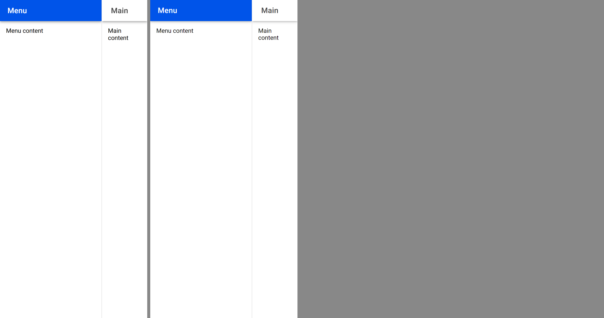
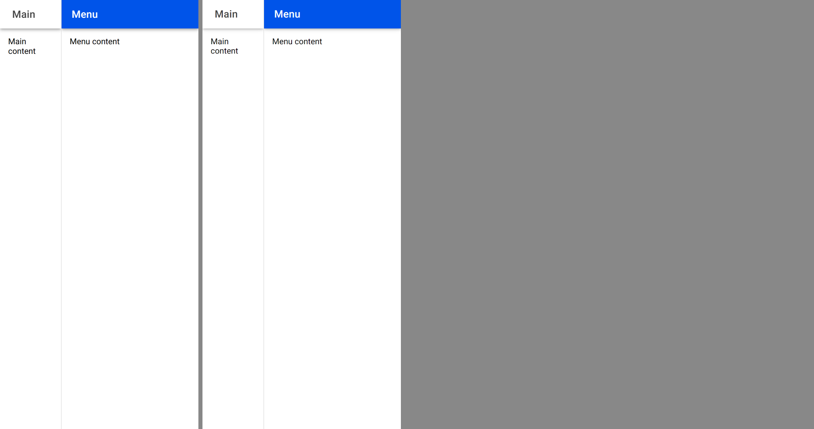
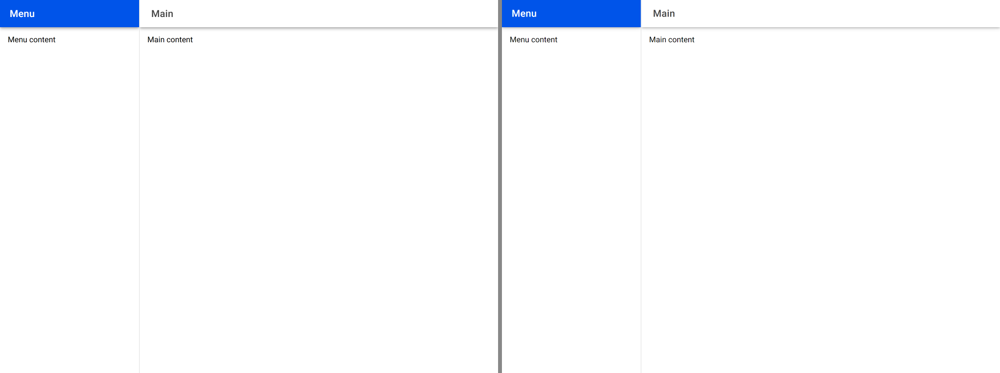
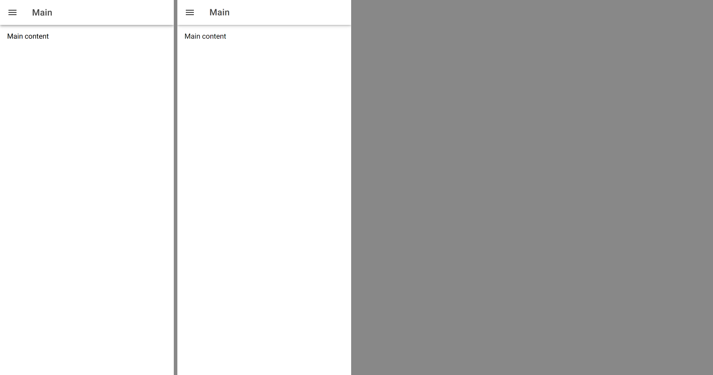

# ion-split-pane — Comparison

Reference render (the page in `ref/page.png`, `dump.json`, `README.md`):

```
node tools/ionic-ref/render.js ion-split-pane --bare --html '<ion-app><ion-split-pane content-id="main" when="xs"><ion-menu content-id="main"><ion-header><ion-toolbar color="primary"><ion-title>Menu</ion-title></ion-toolbar></ion-header><ion-content class="ion-padding">Menu content</ion-content></ion-menu><div class="ion-page" id="main"><ion-header><ion-toolbar><ion-buttons slot="start"><ion-menu-button></ion-menu-button></ion-buttons><ion-title>Main</ion-title></ion-toolbar></ion-header><ion-content class="ion-padding">Main content</ion-content></div></ion-split-pane></ion-app>'
```

Two throwaway scripts on `render.js`'s phone (`tools/ionic-ref/phone.js`, `settle.js` and the Roboto in `tools/fonts/roboto/`), each
run as `node <script> <repo> <outdir>`, not kept in the repo:

| Script | Output |
|---|---|
| `measure.js` | [`ref/measurements.txt`](ref/measurements.txt): S1 to S23, each scene's classes, boxes, computed `display`, `position`, `order`, widths, borders, `overflow`, `box-shadow`, the menu's inner box and the menu buttons, and every `ionSplitPaneVisible` and `ionDidClose` with its time; and the frames `phone-hidden.png`, `phone-xs.png`, `phone-xs-end.png`, `phone-xs-rtl.png`, `wide-visible.png` (1024 x 768) and `wide-two.png` |
| `mq.js` | [`ref/media-queries.txt`](ref/media-queries.txt): `matchMedia(q).matches` for 59 queries at 600 x 800 |

Avonic's frames are from `AvonicSplitPaneCaptureTests` (headless Skia, 2x), with `AVONIC_CAPTURE_DIR` set; side by side with
`node tools/ionic-ref/side.js`.

## Visual

| Scene | Ionic (left) and Avonic (right) | Result |
|---|---|---|
| S3: 390, `when="xs"` |  | Match: the side 270 with its 1 px border at 269, the main from 270 |
| S4: `side="end"` |  | Match: the main 0 to 120, the border at 120, the side from 121 |
| S11: right to left |  | Match |
| S2: 1024 x 768, the default `when` |  | Match, but for rounding: the side is 287 with its border, the main from 287, where Chromium's are 286.72 (asserted) |
| S1: 390, the default `when` |  | Match: hidden, the menu button shown |

The toolbars' shadows: Ionic's menu clips its own (`contain: strict`) and the main's shows over nothing; Avonic's are the same.

## Behaviour

| # | Behaviour | Ionic | Avonic | Result |
|---|---|---|---|---|
| B1 | Default `when` | Hidden at 390; at 1024 the menu 286.72 (28%), the main from 286.72 | The same, rounded to 287 | Match (rounding, below) |
| | `ionDidClose(gesture)` at the first load in a visible pane | 3 (S2: `onSplitPaneChanged`, `componentDidLoad`, the end of `connectedCallback`) | 2 (`Connect` and the first load) | Deliberate difference: neither is a real close; not asserted |
| B2 | The event | Once per change, at load too (S2, S5) | The same (asserted) | Match |
| B3 | Shortcuts | `md` from 768 (S5) | Each of `xs` to `xl` at its breakpoint, through `GridViewport` | Match |
| B4 | Media queries | `matchMedia` (S6, media-queries.txt) | `MediaQuery`: 54 of the 59 rows at 600 x 800 the same, 5 gaps below; all 10 rows at 992 x 800 (unparsed brackets, exponents) | Match, gaps recorded |
| B5 | `when` values | `true`, `false`, `never`, `''`, garbage (S8) | The same; `null` hides it | Match |
| B6 | `disabled` | Hides it, reads the window again when enabled | The same; the children stay enabled | Match |
| B7 | The main | `split-pane-main` at connect; a warning with none (S14) | `:split-pane-main` at attach, the warning | Match, but S20 (below) |
| B8 | Side widths | 270 at 390; 277.75, 336, 392; 195, 156, 304 (S3, S12, S13) | The same, rounded | Match |
| B9 | The border | 1 px `rgba(0, 0, 0, 0.13)` inside the side at its inline end; at the start for the end side; mirrored (S3, S4, S11) | The same, drawn by the split pane (asserted by pixel) | Match |
| B10 | End sides and two sides | After the main; either side of it (S4, S17) | The same, whatever their order in `Items` | Match |
| B11 | The menu in the pane | Closes with `gesture`, `open()` false, inactive; active again below (S9, S23) | The same; its swipe off | Match |
| B12 | A disabled menu | Hidden, the main fills (S10) | The same | Match |
| B13 | A menu in the main | Ordinary (S16) | The same; a nested split pane's menu is its own side | Match |
| B14 | Menu button, toggle | Hidden with the pane, `autoHide="false"` not (S2, S19) | The same | Match |
| B15 | The main clips | `overflow: hidden` while visible, which an app's rule beats | `ClipToBounds` while visible, bound to each item before it's styled, so an app's style beats it | Match |
| B16 | Another child | In the row at its width, shrinking (S15) | The same while visible, shrunk to the room left; fills while hidden | Deliberate difference (below) |
| B17 | A wrapped menu | Gets the side's rules (menu.md.css's comment) | Laid out as the side | Match |
| B18 | Attached again | The menu reads the pane once, at load | At every attach | Deliberate difference (below) |
| B19 | Automation | No role | `NoneAutomationPeer` | Match |

## Deliberate differences

| What | Ionic | Avonic | Why |
|---|---|---|---|
| `disabled` | `disabled` | `Disabled`, not `IsEnabled` | `IsEnabled` false would disable every control in the app |
| `when="true"` | An HTML attribute is a string: a media query matching nothing (S7) | `True` and `False` in XAML are booleans | As a framework's binding passes them; no Avonic app means the media query `true` |
| The old main after attaching again with another `contentId` | Keeps `split-pane-main`: two mains share the room (S20) | Loses it | An Ionic bug: Ionic warns that there can be only one ([ADR 0005](../../decisions/0005-dont-copy-an-ionic-bug.md)) |
| The menu reads the pane's state | Once, at `componentDidLoad` | At every attach | A menu here is detached and attached again with its page far more often, and hears nothing while away |
| The menu hears `ionSplitPaneVisible` | Unless an app stops it before `body` | Even when an app marked it handled | An app's `Handled` isn't `stopPropagation()` to most code that sets it |
| The border | `border-inline-end` on the menu | Drawn by the split pane inside the side's width | The menu's template has no host border; the line is the same |
| Another child, hidden | In the flex row (a plain `div`) or over it (an `.ion-page`) | Fills the split pane | Avalonia has no `position`; the menu and a main fill it in Ionic too |
| Rounding | Chromium lays out in 1/64 px | The side's width rounded to the device's pixels | So that the side, its border and the main meet on pixels, which Avalonia's layout rounding would otherwise round apart |
| The push type's content shadow (S22) | Drawn over the side's last 12 px, by a light-DOM rule that beats the split pane's `box-shadow: none` | Not drawn there: the menu draws it in its own template, which clips it | Likely an accident in Ionic, and Avalonia can't draw past the menu here |

## Gaps

- **`MediaQuery` doesn't read** `calc()` in a query, or the device's features: `min-device-width`, `min-resolution`,
  `-webkit-min-device-pixel-ratio`, `display-mode`, which Chromium matches at 600 x 800, and `hover`, `pointer`, `prefers-*`, which it
  doesn't. Each is false, and unknown to `not`. Pinned by `B4_Gaps_Chromium_Matches_These_And_Avonic_Doesnt`.
- Not tried in a real window. `tools/real-window/drive.ps1` has an `ion-split-pane` section, not run.
