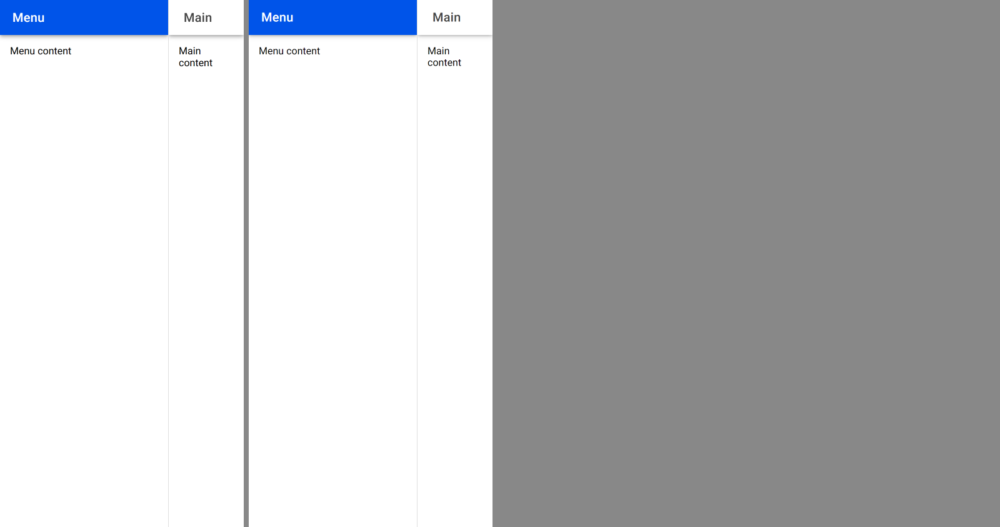
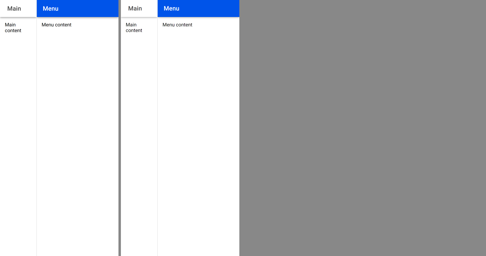

# ion-split-pane

Status: done · [#78](https://github.com/wdcossey/Avonic/issues/78)

`AvonicSplitPane`: Ionic's `ion-split-pane`, md. It holds a side `AvonicMenu` and the main content, and while `When` matches the
window it shows the menu beside the main content, where the menu can't open or close and its menu buttons hide; below that, the
menu is an ordinary one. A tablet in landscape, or any window from 992 wide by default. Plan: [PLAN.md](PLAN.md); comparison:
[COMPARISON.md](COMPARISON.md).

| At 390, `When="xs"` | The end side | Right to left |
|---|---|---|
|  |  |  |

## Usage

The menu and the main content are its items, the menu first, as in Ionic. `ContentId` names the main content, one of its own
items; the menu's `ContentId` names it too:

```xml
<c:AvonicSplitPane ContentId="MainContent" When="md">
    <c:AvonicMenu ContentId="MainContent">
        <c:AvonicContent>
            <c:AvonicList>
                <c:AvonicMenuToggle>
                    <c:AvonicItem Button="True" Content="Inbox" />
                </c:AvonicMenuToggle>
            </c:AvonicList>
        </c:AvonicContent>
    </c:AvonicMenu>

    <DockPanel Name="MainContent">
        <c:AvonicHeader DockPanel.Dock="Top">
            <c:AvonicToolbar>
                <c:AvonicToolbar.StartContent>
                    <c:AvonicButtons>
                        <!-- Hidden while the side shows, as its menu can't open then. -->
                        <c:AvonicMenuButton />
                    </c:AvonicButtons>
                </c:AvonicToolbar.StartContent>
                <c:AvonicTitle Content="Page" />
            </c:AvonicToolbar>
        </c:AvonicHeader>
        <c:AvonicContent />
    </DockPanel>
</c:AvonicSplitPane>
```

`When` takes `True` or `False`, a shortcut (`xs`, `sm`, `md`, `lg`, `xl`, the grid's breakpoints, or `never`) or a CSS media query
such as `(min-width: 600px) and (orientation: landscape)`, matched against the window. `Disabled="True"` never shows the side, and
leaves everything in the split pane enabled. A menu with `Side="End"` goes after the main content, and a menu wrapped in another
control is a side too.

```csharp
pane.IonSplitPaneVisible += (_, e) => Debug.WriteLine(e.Visible);
pane.When = "(min-width: 768px)";
pane.When = true;
```

## Checklist

From `node tools/ionic-api.js ion-split-pane`. Every row is in [PLAN.md](PLAN.md#fidelity-checklist), with its notes.

| ✓ | Ionic | Avonic |
|---|---|---|
| [x] | `contentId` | `ContentId` |
| [x] | `disabled` | `Disabled` (not `IsEnabled`, which would disable the app) |
| [x] | `when` | `When`, a `SplitPaneWhen`: `bool` or `string` |
| [x] | `ionSplitPaneVisible` | `IonSplitPaneVisible`, `SplitPaneVisibleEventArgs.Visible` |
| [x] | default slot | `Items` |
| [x] | `--border` | `Avonic.SplitPane.BorderWidth`, `Avonic.SplitPane.BorderColor` |
| [x] | `--side-max-width` | `Avonic.SplitPane.SideMaxWidth` |
| [x] | `--side-min-width` | `Avonic.SplitPane.SideMinWidth` |
| [x] | `--side-width` | `Avonic.SplitPane.SideWidth` |

## Behaviour

- **`When`**: a boolean is the state; a shortcut follows the grid's breakpoint for the window (`GridViewport`); a media query is
  matched against the window's size by `MediaQuery`, Media Queries 4 as far as a split pane needs (lists, `not`, `only`, media
  types, `and`, `or`, `width`, `height`, `orientation`, `aspect-ratio`, the range forms, `px`, `em`, `rem` and the absolute
  units), checked against Chromium's `matchMedia`; `never`, an empty string and a malformed query hide it. It's followed while the
  split pane is attached.
- **`IonSplitPaneVisible`** when the state changes, and only then: at the first attach too, if it shows.
- **The main content**, the item named `ContentId`, gets `:split-pane-main` when the split pane is attached, and a warning is
  logged if there's none. While the side shows it takes what's left of the row (`flex: 1`) and clips (`overflow: hidden`).
- **The side**: a menu in the split pane and not in its main content. While the side shows it's `clamp(SideWidth, SideMinWidth,
  SideMaxWidth)` of the split pane's width, the maximum then the minimum, so 270 up to 964 wide and 28% from there, rounded to the
  device's pixels; at the start (`order: -1`), or the end for `Side="End"`, mirrored in right to left; its border inside that width
  at its inline end (start) or start (end). A disabled menu isn't shown, and the main content fills the row.
- **The menu** in the side isn't active: `IsActive()` and `Open()` are false, its swipe is off, and one that was open closes at once
  with `IonDidClose` and the `gesture` role. Below the breakpoint it's an ordinary menu again, closed. Its menu buttons and toggles
  (`AutoHide`) hide while it's in the side.
- **Another item** sits in the row at its own width while the side shows, and fills the split pane while it doesn't.
- **Automation**: no role of its own, as Ionic's host has none.

## Resource keys

A size takes a number (px) or a CSS string: a percentage of the split pane's width, `px`, `vw`, `vh`, `calc()`, `min()` or `auto`.

| Ionic | Key (`Tokens/SplitPane.axaml`) | md |
|---|---|---|
| `--side-width` | `Avonic.SplitPane.SideWidth` | `100%`; `CssUnset`: the menu's own `Avonic.Menu.Width` |
| `--side-min-width` | `Avonic.SplitPane.SideMinWidth` | 270 |
| `--side-max-width` | `Avonic.SplitPane.SideMaxWidth` | `28%` |
| `--border` | `Avonic.SplitPane.BorderWidth`, `Avonic.SplitPane.BorderColor` | 1; unset: `Avonic.ItemBorderColorBrush` |

## Extensions

None.

## Known gaps

- **Media features of the device** (`device-width`, `resolution`, `-webkit-device-pixel-ratio`, `hover`, `pointer`,
  `prefers-*`, `display-mode`) and `calc()` in a query aren't read: a query with one is false. See
  [COMPARISON.md](COMPARISON.md#gaps).
- **Avalonia rounds the layout** to the device's pixels, so the side at 1024 is 287 wide, where Chromium's is 286.72.
- **The push type's content shadow** isn't drawn over the side's last 12 px, as Ionic's is by accident.
- **An app's plain style** for the main content's `ClipToBounds`, made before the split pane finds its main, loses to the split
  pane's value, where an app's rule beats Ionic's `::slotted`.
- Not tried in a real window: `tools/real-window/drive.ps1` has an `ion-split-pane` section, not run.
