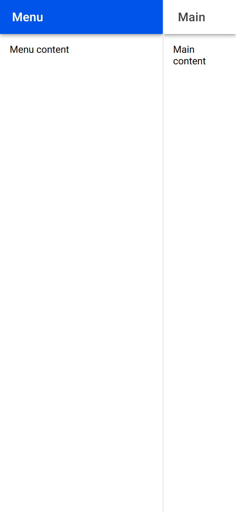

# ion-split-pane — reference render (Ionic 9.0.11, md, 390×844@2x)

Generated by `node tools/ionic-ref/render.js ion-split-pane --bare --html "<ion-app><ion-split-pane content-id=\"main\" when=\"xs\"><ion-menu content-id=\"main\"><ion-header><ion-toolbar color=\"primary\"><ion-title>Menu</ion-title></ion-toolbar></ion-header><ion-content class=\"ion-padding\">Menu content</ion-content></ion-menu><div class=\"ion-page\" id=\"main\"><ion-header><ion-toolbar><ion-buttons slot=\"start\"><ion-menu-button></ion-menu-button></ion-buttons><ion-title>Main</ion-title></ion-toolbar></ion-header><ion-content class=\"ion-padding\">Main content</ion-content></div></ion-split-pane></ion-app>"`

```html
<ion-app><ion-split-pane content-id="main" when="xs"><ion-menu content-id="main"><ion-header><ion-toolbar color="primary"><ion-title>Menu</ion-title></ion-toolbar></ion-header><ion-content class="ion-padding">Menu content</ion-content></ion-menu><div class="ion-page" id="main"><ion-header><ion-toolbar><ion-buttons slot="start"><ion-menu-button></ion-menu-button></ion-buttons><ion-title>Main</ion-title></ion-toolbar></ion-header><ion-content class="ion-padding">Main content</ion-content></div></ion-split-pane></ion-app>
```

 

## Element 1

- attributes: `{"content-id":"main","when":"xs","class":"md split-pane-md split-pane-visible hydrated"}`
- classes: `md split-pane-md split-pane-visible hydrated`
- rect: `{"x":0,"y":0,"w":390,"h":844}`

### CSS custom properties (resolved)

| var | value |
|---|---|
| `--border` | `1px solid rgba(0, 0, 0, 0.13)` |
| `--side-max-width` | `28%` |
| `--side-min-width` | `270px` |
| `--side-width` | `100%` |

### Host computed

| prop | value |
|---|---|
| display | `flex` |
| position | `absolute` |
| box-sizing | `border-box` |
| width | `390px` |
| height | `844px` |
| min-height | `0px` |
| min-width | `0px` |
| padding | `0px` |
| margin | `0px` |
| border | `0px none rgb(0, 0, 0)` |
| border-radius | `0px` |
| background-color | `rgba(0, 0, 0, 0)` |
| color | `rgb(0, 0, 0)` |
| font-size | `16px` |
| font-weight | `400` |
| font-family | `Roboto, "Helvetica Neue", sans-serif` |
| line-height | `normal` |
| letter-spacing | `normal` |
| text-transform | `none` |
| opacity | `1` |
| overflow | `visible` |
| contain | `strict` |
| pointer-events | `auto` |
| transition | `all` |
| transform | `none` |
| box-shadow | `none` |
| outline | `rgb(0, 0, 0) none 0px` |
| cursor | `auto` |

### DOM tree

```
<ion-split-pane>
  #shadow-root
    <slot name="">
  <ion-menu.md.menu-type-overlay.menu-enabled.menu-side-start.menu-pane-visible.split-pane-side.hydrated>
    #shadow-root
      <div.menu-inner part="container">
        <slot name="">
      <ion-backdrop.menu-backdrop.md.backdrop-no-tappable.hydrated part="backdrop">
        #shadow-root
    <ion-header.md.header-md.header-collapse-none.hydrated>
      <ion-toolbar.ion-color.ion-color-primary.md.in-toolbar.hydrated.toolbar-title-default>
        #shadow-root
          <div.toolbar-background part="background">
          <div.toolbar-container part="container">
            <slot name="start">
            <slot name="secondary">
            <div.toolbar-content part="content">
              <slot name="">
            <slot name="primary">
            <slot name="end">
        <ion-title.md.title-default.hydrated>
          #shadow-root
            <div.toolbar-title>
              <slot name="">
    <ion-content.ion-padding.md.content-ltr.hydrated>
      #shadow-root
        <div#background-content part="background">
        <div.inner-scroll.scroll-y part="scroll">
          <slot name="">
        <slot name="fixed">
  <div#main.ion-page.split-pane-main.menu-content.menu-content-overlay>
    <ion-header.md.header-md.header-collapse-none.hydrated>
      <ion-toolbar.md.in-toolbar.hydrated.toolbar-title-default>
        #shadow-root
          <div.toolbar-background part="background">
          <div.toolbar-container part="container">
            <slot name="start">
            <slot name="secondary">
            <div.toolbar-content part="content">
              <slot name="">
            <slot name="primary">
            <slot name="end">
        <ion-buttons.buttons-first-slot.sc-ion-buttons-md-h.md.sc-ion-buttons-md.sc-ion-buttons-md-s.hydrated slot="start">
          <ion-menu-button.md.button.menu-button-hidden.in-toolbar.ion-activatable.ion-focusable.hydrated>
            #shadow-root
              <button.button-native part="native">
                <span.button-inner>
                  <slot name="">
                    <ion-icon.md.hydrated part="icon">
                      #shadow-root
                        <div.icon-inner>
                          <svg>
                            <path>
                <ion-ripple-effect.md.unbounded.hydrated>
                  #shadow-root
        <ion-title.md.title-default.hydrated>
          #shadow-root
            <div.toolbar-title>
              <slot name="">
    <ion-content.ion-padding.md.content-ltr.hydrated>
      #shadow-root
        <div#background-content part="background">
        <div.inner-scroll.scroll-y part="scroll">
          <slot name="">
        <slot name="fixed">
```
