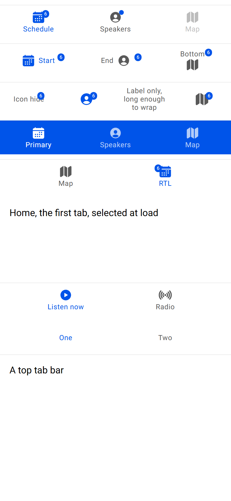

# ion-tabs family — Comparison against the web components

> Ionic side (Chromium, md, 390×844@2x) → [`ref/`](ref/). The exact command:
>
> ```
> node tools/ionic-ref/render.js ion-tab-bar --bare --html "<ion-app style=\"position:static;display:block;contain:none;overflow:visible\"><div style=\"display:flex;flex-direction:column;gap:8px;padding:8px 0\"><ion-tab-bar selected-tab=\"a\"><ion-tab-button tab=\"a\"><ion-icon name=\"calendar\"></ion-icon><ion-label>Schedule</ion-label><ion-badge>6</ion-badge></ion-tab-button><ion-tab-button tab=\"b\"><ion-icon name=\"person-circle\"></ion-icon><ion-label>Speakers</ion-label><ion-badge></ion-badge></ion-tab-button><ion-tab-button tab=\"c\" disabled><ion-icon name=\"map\"></ion-icon><ion-label>Map</ion-label></ion-tab-button></ion-tab-bar><ion-tab-bar selected-tab=\"a\"><ion-tab-button tab=\"a\" layout=\"icon-start\"><ion-icon name=\"calendar\"></ion-icon><ion-label>Start</ion-label><ion-badge>6</ion-badge></ion-tab-button><ion-tab-button tab=\"b\" layout=\"icon-end\"><ion-icon name=\"person-circle\"></ion-icon><ion-label>End</ion-label><ion-badge>6</ion-badge></ion-tab-button><ion-tab-button tab=\"c\" layout=\"icon-bottom\"><ion-icon name=\"map\"></ion-icon><ion-label>Bottom</ion-label><ion-badge>6</ion-badge></ion-tab-button></ion-tab-bar><ion-tab-bar selected-tab=\"b\"><ion-tab-button tab=\"a\" layout=\"icon-hide\"><ion-icon name=\"calendar\"></ion-icon><ion-label>Icon hide</ion-label><ion-badge>6</ion-badge></ion-tab-button><ion-tab-button tab=\"b\" layout=\"label-hide\"><ion-icon name=\"person-circle\"></ion-icon><ion-label>Label hide</ion-label><ion-badge>6</ion-badge></ion-tab-button><ion-tab-button tab=\"c\"><ion-label>Label only, long enough to wrap</ion-label></ion-tab-button><ion-tab-button tab=\"d\"><ion-icon name=\"map\"></ion-icon><ion-badge>6</ion-badge></ion-tab-button></ion-tab-bar><ion-tab-bar color=\"primary\" selected-tab=\"a\"><ion-tab-button tab=\"a\"><ion-icon name=\"calendar\"></ion-icon><ion-label>Primary</ion-label></ion-tab-button><ion-tab-button tab=\"b\"><ion-icon name=\"person-circle\"></ion-icon><ion-label>Speakers</ion-label></ion-tab-button><ion-tab-button tab=\"c\"><ion-icon name=\"map\"></ion-icon><ion-label>Map</ion-label></ion-tab-button></ion-tab-bar><div dir=\"rtl\"><ion-tab-bar selected-tab=\"a\"><ion-tab-button tab=\"a\"><ion-icon name=\"calendar\"></ion-icon><ion-label>RTL</ion-label><ion-badge>6</ion-badge></ion-tab-button><ion-tab-button tab=\"b\"><ion-icon name=\"map\"></ion-icon><ion-label>Map</ion-label></ion-tab-button></ion-tab-bar></div><div style=\"position:relative;height:200px\"><ion-tabs><ion-tab tab=\"home\"><div style=\"padding:16px\">Home, the first tab, selected at load</div></ion-tab><ion-tab tab=\"radio\"><div style=\"padding:16px\">Radio</div></ion-tab><ion-tab-bar slot=\"bottom\"><ion-tab-button tab=\"home\"><ion-icon name=\"play-circle\"></ion-icon><ion-label>Listen now</ion-label></ion-tab-button><ion-tab-button tab=\"radio\"><ion-icon name=\"radio\"></ion-icon><ion-label>Radio</ion-label></ion-tab-button></ion-tab-bar></ion-tabs></div><div style=\"position:relative;height:120px\"><ion-tabs><ion-tab-bar slot=\"top\"><ion-tab-button tab=\"one\"><ion-label>One</ion-label></ion-tab-button><ion-tab-button tab=\"two\"><ion-label>Two</ion-label></ion-tab-button></ion-tab-bar><ion-tab tab=\"one\"><div style=\"padding:16px\">A top tab bar</div></ion-tab><ion-tab tab=\"two\"><div style=\"padding:16px\">Two</div></ion-tab></ion-tabs></div></div></ion-app>" --out docs/components/ion-tabs/ref
> ```
>
> Avonic side: `AVONIC_CAPTURE_DIR=… dotnet test` → `AvonicTabsCaptureTests` (headless Skia, 2×) →
> [`compare/avonic-page.png`](compare/avonic-page.png); [`compare/side.png`](compare/side.png) is the two side by side. Not tried
> in a real window, nor on a device.
>
> The behaviours were measured with throwaway Playwright scripts on two more pages, wrapped in `ion-app`, at 390 wide: an app's
> page (`ion-tabs` with three tabs and a bar of four buttons, one with a badge and one disabled) and a page of bars (every layout,
> an empty badge, a colour, the top slot, RTL, one button, a long label, `translucent`). Mouse clicks were real clicks; the keys
> were pressed with the page focused.

## Frames

| Ionic | Avonic |
|---|---|
|  |  |

Rows from the top: icon-top buttons with a badge, an empty badge and a disabled button; icon-start, icon-end and icon-bottom with
badges; icon-hide, label-hide, a label only that wraps, and an icon only; a primary bar; an RTL bar; `ion-tabs` 200 high with a
bottom bar, which selected its first tab; `ion-tabs` 120 high with a top bar.

**Match.** Every box measured below is the same to half a pixel, which is what layout rounds to at 2×. Visible differences:

- **The badges** are half a pixel lower in places, and the wrapped label half a pixel higher: rounding.

## Measurements

| What | Ionic | Avonic |
|---|---|---|
| A bar | 57 high: 56 inside a 1 px top border, `rgba(0, 0, 0, 0.07)` | 57; the same border |
| Four buttons | 97.5 wide each | 97.5 |
| One button | 168 wide at x 111 | 168 at 111 |
| A long label beside two short ones | 168, 111, 111 | 168, 111, 111 |
| icon-top | icon 22 at y 9, label at y 33; badge 12 × 13 at (71, 8) in a button 130 wide | the same, to 0.5 |
| icon-bottom | label at 10, icon at 24; badge at (86.2, 8) | the same, to 0.5 |
| icon-start, icon-end | icon at 17, label at 21, 6 apart; badge at (96.8, 16) | the same, to 0.5 |
| icon-hide | label at 21; badge at (63.45, 16) in a button 97.5 wide | the same, to 0.5 |
| label-hide, icon only | icon 24 at y 16; badge at 50% + 6, y 16 | the same, to 0.5 |
| An empty badge | 8 × 8 at (71, 8) | the same |
| RTL | the first button on the right, from 195; its badge at x 261 | 195; 261 |
| A colour | the bar `rgb(0, 84, 233)`, its text `rgba(255, 255, 255, 0.7)`; a selected button white; the ripple white | the same |
| `translucent`, with `--background: red` on a button | the button's background `rgba(0, 0, 0, 0)` | transparent |
| A selected button | `rgb(0, 84, 233)`; others `rgb(89, 89, 89)` | the same |
| Disabled | opacity 0.4 | 0.4 |
| The page in `ion-tabs` | 787 high over a bar at y 787 | 787, 787 |

## Behaviours

| # | Behaviour | Result |
|---|---|---|
| T1 | At load the first tab is selected, with both events, and the bar is told | Match |
| T2 | A click selects the button's tab; again changes nothing | Match |
| T3 | `Select` is false for a missing tab, the selected one, or during a selection | Match. Ionic's `select` is async, and a second call during the first is refused; here it's sync, so that's a call from a handler |
| T4 | Will, the new tab and the bar, the old tab hidden, Did; neither bubbles | Match |
| T5 | `GetSelected`, `GetTab` | Match |
| T6 | Only the first bar is told; a tab with no id leaves it | Match |
| T7 | The slots stack; the default slot takes the rest | Match |
| A1 | A tab is hidden until it's active | Match. Hidden at style priority, where Ionic's is `!important`: see the README |
| A2 | `Component` is built once, at the first activation, as a page | Match, for a `Control` or a `Type`. With content as well, the content stays, where Ionic appends both |
| A3 | `SetActive` shows the tab and hides no other | Match |
| A4 | A tab is a pane named by its button | Match |
| B1 | `SelectedTab` marks the buttons from the load on | Match |
| B2 | A bar alone selects nothing on a click | Match |
| B3 | The buttons share the width, 168 at most, their min-content at least, centred | Match |
| B4 | 56 high in a 1 px border; the top slot; the safe areas | Match |
| B5 | A colour | Match |
| B6 | `Translucent` | Match |
| B7 | A tab list | Match |
| N1 | A click raises the internal click if it has a tab and is enabled | Match |
| N2 | Not focusable; Enter and Space released on it click | Match |
| N3, N4 | Disabled at 0.4; selected in the selected colour | Match |
| N5, N7 | A label only wraps; an icon only is 24 | Match |
| N6, N8 | The layouts and the badge | Match, to half a pixel |
| N9 | Activatable, an unbounded ripple in the selected colour | Match |
| N10 | A mouse over it: the selected colour | Match. Touch gives none, as `any-hover` doesn't on a phone |
| N11 | Focused: the focused background | Match, for a button an app has made focusable |
| N12 | A tab item, selected, named by its text | Match |
| — | The bar hides while the keyboard is open | **Gap**: not implemented. See the README |
