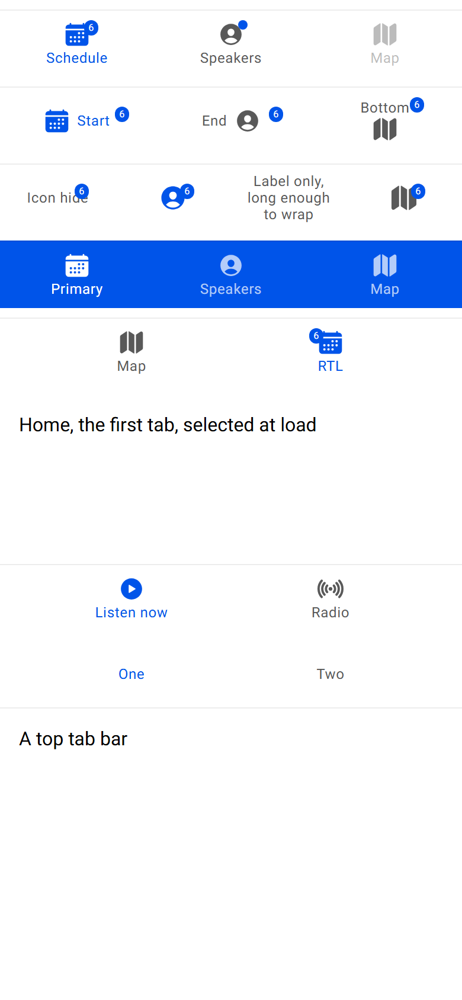
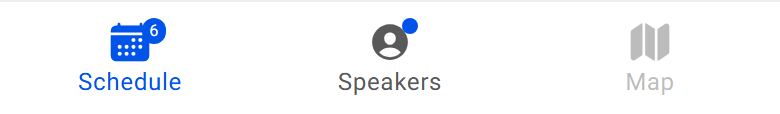

# ion-tab-bar — reference render (Ionic 8.8.1, md, 390×844@2x)

Generated by `node tools/ionic-ref/render.js ion-tab-bar --bare --html "<ion-app style=\"position:static;display:block;contain:none;overflow:visible\"><div style=\"display:flex;flex-direction:column;gap:8px;padding:8px 0\"><ion-tab-bar selected-tab=\"a\"><ion-tab-button tab=\"a\"><ion-icon name=\"calendar\"></ion-icon><ion-label>Schedule</ion-label><ion-badge>6</ion-badge></ion-tab-button><ion-tab-button tab=\"b\"><ion-icon name=\"person-circle\"></ion-icon><ion-label>Speakers</ion-label><ion-badge></ion-badge></ion-tab-button><ion-tab-button tab=\"c\" disabled><ion-icon name=\"map\"></ion-icon><ion-label>Map</ion-label></ion-tab-button></ion-tab-bar><ion-tab-bar selected-tab=\"a\"><ion-tab-button tab=\"a\" layout=\"icon-start\"><ion-icon name=\"calendar\"></ion-icon><ion-label>Start</ion-label><ion-badge>6</ion-badge></ion-tab-button><ion-tab-button tab=\"b\" layout=\"icon-end\"><ion-icon name=\"person-circle\"></ion-icon><ion-label>End</ion-label><ion-badge>6</ion-badge></ion-tab-button><ion-tab-button tab=\"c\" layout=\"icon-bottom\"><ion-icon name=\"map\"></ion-icon><ion-label>Bottom</ion-label><ion-badge>6</ion-badge></ion-tab-button></ion-tab-bar><ion-tab-bar selected-tab=\"b\"><ion-tab-button tab=\"a\" layout=\"icon-hide\"><ion-icon name=\"calendar\"></ion-icon><ion-label>Icon hide</ion-label><ion-badge>6</ion-badge></ion-tab-button><ion-tab-button tab=\"b\" layout=\"label-hide\"><ion-icon name=\"person-circle\"></ion-icon><ion-label>Label hide</ion-label><ion-badge>6</ion-badge></ion-tab-button><ion-tab-button tab=\"c\"><ion-label>Label only, long enough to wrap</ion-label></ion-tab-button><ion-tab-button tab=\"d\"><ion-icon name=\"map\"></ion-icon><ion-badge>6</ion-badge></ion-tab-button></ion-tab-bar><ion-tab-bar color=\"primary\" selected-tab=\"a\"><ion-tab-button tab=\"a\"><ion-icon name=\"calendar\"></ion-icon><ion-label>Primary</ion-label></ion-tab-button><ion-tab-button tab=\"b\"><ion-icon name=\"person-circle\"></ion-icon><ion-label>Speakers</ion-label></ion-tab-button><ion-tab-button tab=\"c\"><ion-icon name=\"map\"></ion-icon><ion-label>Map</ion-label></ion-tab-button></ion-tab-bar><div dir=\"rtl\"><ion-tab-bar selected-tab=\"a\"><ion-tab-button tab=\"a\"><ion-icon name=\"calendar\"></ion-icon><ion-label>RTL</ion-label><ion-badge>6</ion-badge></ion-tab-button><ion-tab-button tab=\"b\"><ion-icon name=\"map\"></ion-icon><ion-label>Map</ion-label></ion-tab-button></ion-tab-bar></div><div style=\"position:relative;height:200px\"><ion-tabs><ion-tab tab=\"home\"><div style=\"padding:16px\">Home, the first tab, selected at load</div></ion-tab><ion-tab tab=\"radio\"><div style=\"padding:16px\">Radio</div></ion-tab><ion-tab-bar slot=\"bottom\"><ion-tab-button tab=\"home\"><ion-icon name=\"play-circle\"></ion-icon><ion-label>Listen now</ion-label></ion-tab-button><ion-tab-button tab=\"radio\"><ion-icon name=\"radio\"></ion-icon><ion-label>Radio</ion-label></ion-tab-button></ion-tab-bar></ion-tabs></div><div style=\"position:relative;height:120px\"><ion-tabs><ion-tab-bar slot=\"top\"><ion-tab-button tab=\"one\"><ion-label>One</ion-label></ion-tab-button><ion-tab-button tab=\"two\"><ion-label>Two</ion-label></ion-tab-button></ion-tab-bar><ion-tab tab=\"one\"><div style=\"padding:16px\">A top tab bar</div></ion-tab><ion-tab tab=\"two\"><div style=\"padding:16px\">Two</div></ion-tab></ion-tabs></div></div></ion-app>" --out docs/components/ion-tabs/ref`

```html
<ion-app style="position:static;display:block;contain:none;overflow:visible"><div style="display:flex;flex-direction:column;gap:8px;padding:8px 0"><ion-tab-bar selected-tab="a"><ion-tab-button tab="a"><ion-icon name="calendar"></ion-icon><ion-label>Schedule</ion-label><ion-badge>6</ion-badge></ion-tab-button><ion-tab-button tab="b"><ion-icon name="person-circle"></ion-icon><ion-label>Speakers</ion-label><ion-badge></ion-badge></ion-tab-button><ion-tab-button tab="c" disabled><ion-icon name="map"></ion-icon><ion-label>Map</ion-label></ion-tab-button></ion-tab-bar><ion-tab-bar selected-tab="a"><ion-tab-button tab="a" layout="icon-start"><ion-icon name="calendar"></ion-icon><ion-label>Start</ion-label><ion-badge>6</ion-badge></ion-tab-button><ion-tab-button tab="b" layout="icon-end"><ion-icon name="person-circle"></ion-icon><ion-label>End</ion-label><ion-badge>6</ion-badge></ion-tab-button><ion-tab-button tab="c" layout="icon-bottom"><ion-icon name="map"></ion-icon><ion-label>Bottom</ion-label><ion-badge>6</ion-badge></ion-tab-button></ion-tab-bar><ion-tab-bar selected-tab="b"><ion-tab-button tab="a" layout="icon-hide"><ion-icon name="calendar"></ion-icon><ion-label>Icon hide</ion-label><ion-badge>6</ion-badge></ion-tab-button><ion-tab-button tab="b" layout="label-hide"><ion-icon name="person-circle"></ion-icon><ion-label>Label hide</ion-label><ion-badge>6</ion-badge></ion-tab-button><ion-tab-button tab="c"><ion-label>Label only, long enough to wrap</ion-label></ion-tab-button><ion-tab-button tab="d"><ion-icon name="map"></ion-icon><ion-badge>6</ion-badge></ion-tab-button></ion-tab-bar><ion-tab-bar color="primary" selected-tab="a"><ion-tab-button tab="a"><ion-icon name="calendar"></ion-icon><ion-label>Primary</ion-label></ion-tab-button><ion-tab-button tab="b"><ion-icon name="person-circle"></ion-icon><ion-label>Speakers</ion-label></ion-tab-button><ion-tab-button tab="c"><ion-icon name="map"></ion-icon><ion-label>Map</ion-label></ion-tab-button></ion-tab-bar><div dir="rtl"><ion-tab-bar selected-tab="a"><ion-tab-button tab="a"><ion-icon name="calendar"></ion-icon><ion-label>RTL</ion-label><ion-badge>6</ion-badge></ion-tab-button><ion-tab-button tab="b"><ion-icon name="map"></ion-icon><ion-label>Map</ion-label></ion-tab-button></ion-tab-bar></div><div style="position:relative;height:200px"><ion-tabs><ion-tab tab="home"><div style="padding:16px">Home, the first tab, selected at load</div></ion-tab><ion-tab tab="radio"><div style="padding:16px">Radio</div></ion-tab><ion-tab-bar slot="bottom"><ion-tab-button tab="home"><ion-icon name="play-circle"></ion-icon><ion-label>Listen now</ion-label></ion-tab-button><ion-tab-button tab="radio"><ion-icon name="radio"></ion-icon><ion-label>Radio</ion-label></ion-tab-button></ion-tab-bar></ion-tabs></div><div style="position:relative;height:120px"><ion-tabs><ion-tab-bar slot="top"><ion-tab-button tab="one"><ion-label>One</ion-label></ion-tab-button><ion-tab-button tab="two"><ion-label>Two</ion-label></ion-tab-button></ion-tab-bar><ion-tab tab="one"><div style="padding:16px">A top tab bar</div></ion-tab><ion-tab tab="two"><div style="padding:16px">Two</div></ion-tab></ion-tabs></div></div></ion-app>
```

 

## Element 1

- attributes: `{"selected-tab":"a","role":"tablist","class":"md hydrated"}`
- classes: `md hydrated`
- rect: `{"x":0,"y":8,"w":390,"h":57}`

### CSS custom properties (resolved)

| var | value |
|---|---|
| `--background` | `#fff` |
| `--border` | `1px solid rgba(0, 0, 0, 0.07)` |
| `--color` | `#595959` |

### Host computed

| prop | value |
|---|---|
| display | `flex` |
| position | `static` |
| box-sizing | `content-box` |
| width | `390px` |
| height | `56px` |
| min-height | `auto` |
| min-width | `auto` |
| padding | `0px` |
| margin | `0px` |
| border-radius | `0px` |
| background-color | `rgb(255, 255, 255)` |
| color | `rgb(89, 89, 89)` |
| font-size | `16px` |
| font-weight | `400` |
| font-family | `Roboto, "Helvetica Neue", sans-serif` |
| line-height | `normal` |
| letter-spacing | `normal` |
| text-transform | `none` |
| opacity | `1` |
| overflow | `visible` |
| contain | `strict` |
| pointer-events | `auto` |
| transition | `all` |
| transform | `none` |
| box-shadow | `none` |
| outline | `rgb(89, 89, 89) none 0px` |
| cursor | `auto` |

### DOM tree

```
<ion-tab-bar>
  #shadow-root
    <slot name="">
  <ion-tab-button#tab-button-a.md.tab-has-label.tab-has-icon.tab-layout-icon-top.ion-activatable.ion-selectable.ion-focusable.hydrated.tab-selected>
    #shadow-root
      <a.button-native part="native">
        <span.button-inner>
          <slot name="">
        <ion-ripple-effect.md.unbounded.hydrated>
          #shadow-root
    <ion-icon.md.hydrated>
      #shadow-root
        <div.icon-inner>
          <svg>
            <path>
    <ion-label.sc-ion-label-md-h.md.sc-ion-label-md.sc-ion-label-md-s.hydrated>
    <ion-badge.md.hydrated>
      #shadow-root
        <slot name="">
  <ion-tab-button#tab-button-b.md.tab-has-label.tab-has-icon.tab-layout-icon-top.ion-activatable.ion-selectable.ion-focusable.hydrated>
    #shadow-root
      <a.button-native part="native">
        <span.button-inner>
          <slot name="">
        <ion-ripple-effect.md.unbounded.hydrated>
          #shadow-root
    <ion-icon.md.hydrated>
      #shadow-root
        <div.icon-inner>
          <svg>
            <path>
    <ion-label.sc-ion-label-md-h.md.sc-ion-label-md.sc-ion-label-md-s.hydrated>
    <ion-badge.md.hydrated>
      #shadow-root
        <slot name="">
  <ion-tab-button#tab-button-c.md.tab-disabled.tab-has-label.tab-has-icon.tab-layout-icon-top.ion-activatable.ion-selectable.ion-focusable.hydrated>
    #shadow-root
      <a.button-native part="native">
        <span.button-inner>
          <slot name="">
        <ion-ripple-effect.md.unbounded.hydrated>
          #shadow-root
    <ion-icon.md.hydrated>
      #shadow-root
        <div.icon-inner>
          <svg>
            <path>
    <ion-label.sc-ion-label-md-h.md.sc-ion-label-md.sc-ion-label-md-s.hydrated>
```

## Element 2

- attributes: `{"selected-tab":"a","role":"tablist","class":"md hydrated"}`
- classes: `md hydrated`
- rect: `{"x":0,"y":73,"w":390,"h":57}`

### CSS custom properties (resolved)

| var | value |
|---|---|
| `--background` | `#fff` |
| `--border` | `1px solid rgba(0, 0, 0, 0.07)` |
| `--color` | `#595959` |

### Host computed

| prop | value |
|---|---|
| display | `flex` |
| position | `static` |
| box-sizing | `content-box` |
| width | `390px` |
| height | `56px` |
| min-height | `auto` |
| min-width | `auto` |
| padding | `0px` |
| margin | `0px` |
| border-radius | `0px` |
| background-color | `rgb(255, 255, 255)` |
| color | `rgb(89, 89, 89)` |
| font-size | `16px` |
| font-weight | `400` |
| font-family | `Roboto, "Helvetica Neue", sans-serif` |
| line-height | `normal` |
| letter-spacing | `normal` |
| text-transform | `none` |
| opacity | `1` |
| overflow | `visible` |
| contain | `strict` |
| pointer-events | `auto` |
| transition | `all` |
| transform | `none` |
| box-shadow | `none` |
| outline | `rgb(89, 89, 89) none 0px` |
| cursor | `auto` |

### DOM tree

```
<ion-tab-bar>
  #shadow-root
    <slot name="">
  <ion-tab-button#tab-button-a.md.tab-has-label.tab-has-icon.tab-layout-icon-start.ion-activatable.ion-selectable.ion-focusable.hydrated.tab-selected>
    #shadow-root
      <a.button-native part="native">
        <span.button-inner>
          <slot name="">
        <ion-ripple-effect.md.unbounded.hydrated>
          #shadow-root
    <ion-icon.md.hydrated>
      #shadow-root
        <div.icon-inner>
          <svg>
            <path>
    <ion-label.sc-ion-label-md-h.md.sc-ion-label-md.sc-ion-label-md-s.hydrated>
    <ion-badge.md.hydrated>
      #shadow-root
        <slot name="">
  <ion-tab-button#tab-button-b.md.tab-has-label.tab-has-icon.tab-layout-icon-end.ion-activatable.ion-selectable.ion-focusable.hydrated>
    #shadow-root
      <a.button-native part="native">
        <span.button-inner>
          <slot name="">
        <ion-ripple-effect.md.unbounded.hydrated>
          #shadow-root
    <ion-icon.md.hydrated>
      #shadow-root
        <div.icon-inner>
          <svg>
            <path>
    <ion-label.sc-ion-label-md-h.md.sc-ion-label-md.sc-ion-label-md-s.hydrated>
    <ion-badge.md.hydrated>
      #shadow-root
        <slot name="">
  <ion-tab-button#tab-button-c.md.tab-has-label.tab-has-icon.tab-layout-icon-bottom.ion-activatable.ion-selectable.ion-focusable.hydrated>
    #shadow-root
      <a.button-native part="native">
        <span.button-inner>
          <slot name="">
        <ion-ripple-effect.md.unbounded.hydrated>
          #shadow-root
    <ion-icon.md.hydrated>
      #shadow-root
        <div.icon-inner>
          <svg>
            <path>
    <ion-label.sc-ion-label-md-h.md.sc-ion-label-md.sc-ion-label-md-s.hydrated>
    <ion-badge.md.hydrated>
      #shadow-root
        <slot name="">
```

## Element 3

- attributes: `{"selected-tab":"b","role":"tablist","class":"md hydrated"}`
- classes: `md hydrated`
- rect: `{"x":0,"y":138,"w":390,"h":57}`

### CSS custom properties (resolved)

| var | value |
|---|---|
| `--background` | `#fff` |
| `--border` | `1px solid rgba(0, 0, 0, 0.07)` |
| `--color` | `#595959` |

### Host computed

| prop | value |
|---|---|
| display | `flex` |
| position | `static` |
| box-sizing | `content-box` |
| width | `390px` |
| height | `56px` |
| min-height | `auto` |
| min-width | `auto` |
| padding | `0px` |
| margin | `0px` |
| border-radius | `0px` |
| background-color | `rgb(255, 255, 255)` |
| color | `rgb(89, 89, 89)` |
| font-size | `16px` |
| font-weight | `400` |
| font-family | `Roboto, "Helvetica Neue", sans-serif` |
| line-height | `normal` |
| letter-spacing | `normal` |
| text-transform | `none` |
| opacity | `1` |
| overflow | `visible` |
| contain | `strict` |
| pointer-events | `auto` |
| transition | `all` |
| transform | `none` |
| box-shadow | `none` |
| outline | `rgb(89, 89, 89) none 0px` |
| cursor | `auto` |

### DOM tree

```
<ion-tab-bar>
  #shadow-root
    <slot name="">
  <ion-tab-button#tab-button-a.md.tab-has-label.tab-has-icon.tab-layout-icon-hide.ion-activatable.ion-selectable.ion-focusable.hydrated>
    #shadow-root
      <a.button-native part="native">
        <span.button-inner>
          <slot name="">
        <ion-ripple-effect.md.unbounded.hydrated>
          #shadow-root
    <ion-icon.md.hydrated>
      #shadow-root
        <div.icon-inner>
          <svg>
            <path>
    <ion-label.sc-ion-label-md-h.md.sc-ion-label-md.sc-ion-label-md-s.hydrated>
    <ion-badge.md.hydrated>
      #shadow-root
        <slot name="">
  <ion-tab-button#tab-button-b.md.tab-has-label.tab-has-icon.tab-layout-label-hide.ion-activatable.ion-selectable.ion-focusable.hydrated.tab-selected>
    #shadow-root
      <a.button-native part="native">
        <span.button-inner>
          <slot name="">
        <ion-ripple-effect.md.unbounded.hydrated>
          #shadow-root
    <ion-icon.md.hydrated>
      #shadow-root
        <div.icon-inner>
          <svg>
            <path>
    <ion-label.sc-ion-label-md-h.md.sc-ion-label-md.sc-ion-label-md-s.hydrated>
    <ion-badge.md.hydrated>
      #shadow-root
        <slot name="">
  <ion-tab-button#tab-button-c.md.tab-has-label.tab-has-label-only.tab-layout-icon-top.ion-activatable.ion-selectable.ion-focusable.hydrated>
    #shadow-root
      <a.button-native part="native">
        <span.button-inner>
          <slot name="">
        <ion-ripple-effect.md.unbounded.hydrated>
          #shadow-root
    <ion-label.sc-ion-label-md-h.md.sc-ion-label-md.sc-ion-label-md-s.hydrated>
  <ion-tab-button#tab-button-d.md.tab-has-icon.tab-has-icon-only.tab-layout-icon-top.ion-activatable.ion-selectable.ion-focusable.hydrated>
    #shadow-root
      <a.button-native part="native">
        <span.button-inner>
          <slot name="">
        <ion-ripple-effect.md.unbounded.hydrated>
          #shadow-root
    <ion-icon.md.hydrated>
      #shadow-root
        <div.icon-inner>
          <svg>
            <path>
    <ion-badge.md.hydrated>
      #shadow-root
        <slot name="">
```

## Element 4

- attributes: `{"color":"primary","selected-tab":"a","role":"tablist","class":"ion-color ion-color-primary md hydrated"}`
- classes: `ion-color ion-color-primary md hydrated`
- rect: `{"x":0,"y":203,"w":390,"h":57}`

### CSS custom properties (resolved)

| var | value |
|---|---|
| `--background` | `#fff` |
| `--border` | `1px solid rgba(0, 0, 0, 0.07)` |
| `--color` | `#595959` |

### Host computed

| prop | value |
|---|---|
| display | `flex` |
| position | `static` |
| box-sizing | `content-box` |
| width | `390px` |
| height | `56px` |
| min-height | `auto` |
| min-width | `auto` |
| padding | `0px` |
| margin | `0px` |
| border-radius | `0px` |
| background-color | `rgb(0, 84, 233)` |
| color | `rgba(255, 255, 255, 0.7)` |
| font-size | `16px` |
| font-weight | `400` |
| font-family | `Roboto, "Helvetica Neue", sans-serif` |
| line-height | `normal` |
| letter-spacing | `normal` |
| text-transform | `none` |
| opacity | `1` |
| overflow | `visible` |
| contain | `strict` |
| pointer-events | `auto` |
| transition | `all` |
| transform | `none` |
| box-shadow | `none` |
| outline | `rgba(255, 255, 255, 0.7) none 0px` |
| cursor | `auto` |

### DOM tree

```
<ion-tab-bar>
  #shadow-root
    <slot name="">
  <ion-tab-button#tab-button-a.md.tab-has-label.tab-has-icon.tab-layout-icon-top.ion-activatable.ion-selectable.ion-focusable.hydrated.tab-selected>
    #shadow-root
      <a.button-native part="native">
        <span.button-inner>
          <slot name="">
        <ion-ripple-effect.md.unbounded.hydrated>
          #shadow-root
    <ion-icon.md.hydrated>
      #shadow-root
        <div.icon-inner>
          <svg>
            <path>
    <ion-label.sc-ion-label-md-h.md.sc-ion-label-md.sc-ion-label-md-s.hydrated>
  <ion-tab-button#tab-button-b.md.tab-has-label.tab-has-icon.tab-layout-icon-top.ion-activatable.ion-selectable.ion-focusable.hydrated>
    #shadow-root
      <a.button-native part="native">
        <span.button-inner>
          <slot name="">
        <ion-ripple-effect.md.unbounded.hydrated>
          #shadow-root
    <ion-icon.md.hydrated>
      #shadow-root
        <div.icon-inner>
          <svg>
            <path>
    <ion-label.sc-ion-label-md-h.md.sc-ion-label-md.sc-ion-label-md-s.hydrated>
  <ion-tab-button#tab-button-c.md.tab-has-label.tab-has-icon.tab-layout-icon-top.ion-activatable.ion-selectable.ion-focusable.hydrated>
    #shadow-root
      <a.button-native part="native">
        <span.button-inner>
          <slot name="">
        <ion-ripple-effect.md.unbounded.hydrated>
          #shadow-root
    <ion-icon.md.hydrated>
      #shadow-root
        <div.icon-inner>
          <svg>
            <path>
    <ion-label.sc-ion-label-md-h.md.sc-ion-label-md.sc-ion-label-md-s.hydrated>
```

## Element 5

- attributes: `{"selected-tab":"a","role":"tablist","class":"md hydrated"}`
- classes: `md hydrated`
- rect: `{"x":0,"y":268,"w":390,"h":57}`

### CSS custom properties (resolved)

| var | value |
|---|---|
| `--background` | `#fff` |
| `--border` | `1px solid rgba(0, 0, 0, 0.07)` |
| `--color` | `#595959` |

### Host computed

| prop | value |
|---|---|
| display | `flex` |
| position | `static` |
| box-sizing | `content-box` |
| width | `390px` |
| height | `56px` |
| min-height | `0px` |
| min-width | `0px` |
| padding | `0px` |
| margin | `0px` |
| border-radius | `0px` |
| background-color | `rgb(255, 255, 255)` |
| color | `rgb(89, 89, 89)` |
| font-size | `16px` |
| font-weight | `400` |
| font-family | `Roboto, "Helvetica Neue", sans-serif` |
| line-height | `normal` |
| letter-spacing | `normal` |
| text-transform | `none` |
| opacity | `1` |
| overflow | `visible` |
| contain | `strict` |
| pointer-events | `auto` |
| transition | `all` |
| transform | `none` |
| box-shadow | `none` |
| outline | `rgb(89, 89, 89) none 0px` |
| cursor | `auto` |

### DOM tree

```
<ion-tab-bar>
  #shadow-root
    <slot name="">
  <ion-tab-button#tab-button-a.md.tab-has-label.tab-has-icon.tab-layout-icon-top.ion-activatable.ion-selectable.ion-focusable.hydrated.tab-selected>
    #shadow-root
      <a.button-native part="native">
        <span.button-inner>
          <slot name="">
        <ion-ripple-effect.md.unbounded.hydrated>
          #shadow-root
    <ion-icon.md.hydrated>
      #shadow-root
        <div.icon-inner>
          <svg>
            <path>
    <ion-label.sc-ion-label-md-h.md.sc-ion-label-md.sc-ion-label-md-s.hydrated>
    <ion-badge.md.hydrated>
      #shadow-root
        <slot name="">
  <ion-tab-button#tab-button-b.md.tab-has-label.tab-has-icon.tab-layout-icon-top.ion-activatable.ion-selectable.ion-focusable.hydrated>
    #shadow-root
      <a.button-native part="native">
        <span.button-inner>
          <slot name="">
        <ion-ripple-effect.md.unbounded.hydrated>
          #shadow-root
    <ion-icon.md.hydrated>
      #shadow-root
        <div.icon-inner>
          <svg>
            <path>
    <ion-label.sc-ion-label-md-h.md.sc-ion-label-md.sc-ion-label-md-s.hydrated>
```

## Element 6

- attributes: `{"slot":"bottom","role":"tablist","class":"md hydrated"}`
- classes: `md hydrated`
- rect: `{"x":0,"y":476,"w":390,"h":57}`

### CSS custom properties (resolved)

| var | value |
|---|---|
| `--background` | `#fff` |
| `--border` | `1px solid rgba(0, 0, 0, 0.07)` |
| `--color` | `#595959` |

### Host computed

| prop | value |
|---|---|
| display | `flex` |
| position | `static` |
| box-sizing | `content-box` |
| width | `390px` |
| height | `56px` |
| min-height | `auto` |
| min-width | `auto` |
| padding | `0px` |
| margin | `0px` |
| border-radius | `0px` |
| background-color | `rgb(255, 255, 255)` |
| color | `rgb(89, 89, 89)` |
| font-size | `16px` |
| font-weight | `400` |
| font-family | `Roboto, "Helvetica Neue", sans-serif` |
| line-height | `normal` |
| letter-spacing | `normal` |
| text-transform | `none` |
| opacity | `1` |
| overflow | `visible` |
| contain | `strict` |
| pointer-events | `auto` |
| transition | `all` |
| transform | `none` |
| box-shadow | `none` |
| outline | `rgb(89, 89, 89) none 0px` |
| cursor | `auto` |

### DOM tree

```
<ion-tab-bar>
  #shadow-root
    <slot name="">
  <ion-tab-button#tab-button-home.md.tab-has-label.tab-has-icon.tab-layout-icon-top.ion-activatable.ion-selectable.ion-focusable.hydrated.tab-selected>
    #shadow-root
      <a.button-native part="native">
        <span.button-inner>
          <slot name="">
        <ion-ripple-effect.md.unbounded.hydrated>
          #shadow-root
    <ion-icon.md.hydrated>
      #shadow-root
        <div.icon-inner>
          <svg>
            <path>
    <ion-label.sc-ion-label-md-h.md.sc-ion-label-md.sc-ion-label-md-s.hydrated>
  <ion-tab-button#tab-button-radio.md.tab-has-label.tab-has-icon.tab-layout-icon-top.ion-activatable.ion-selectable.ion-focusable.hydrated>
    #shadow-root
      <a.button-native part="native">
        <span.button-inner>
          <slot name="">
        <ion-ripple-effect.md.unbounded.hydrated>
          #shadow-root
    <ion-icon.md.hydrated>
      #shadow-root
        <div.icon-inner>
          <svg>
            <circle>
            <path>
            <path>
            <path>
    <ion-label.sc-ion-label-md-h.md.sc-ion-label-md.sc-ion-label-md-s.hydrated>
```

## Element 7

- attributes: `{"slot":"top","role":"tablist","class":"md hydrated"}`
- classes: `md hydrated`
- rect: `{"x":0,"y":541,"w":390,"h":57}`

### CSS custom properties (resolved)

| var | value |
|---|---|
| `--background` | `#fff` |
| `--border` | `1px solid rgba(0, 0, 0, 0.07)` |
| `--color` | `#595959` |

### Host computed

| prop | value |
|---|---|
| display | `flex` |
| position | `static` |
| box-sizing | `content-box` |
| width | `390px` |
| height | `56px` |
| min-height | `auto` |
| min-width | `auto` |
| padding | `0px` |
| margin | `0px` |
| border-radius | `0px` |
| background-color | `rgb(255, 255, 255)` |
| color | `rgb(89, 89, 89)` |
| font-size | `16px` |
| font-weight | `400` |
| font-family | `Roboto, "Helvetica Neue", sans-serif` |
| line-height | `normal` |
| letter-spacing | `normal` |
| text-transform | `none` |
| opacity | `1` |
| overflow | `visible` |
| contain | `strict` |
| pointer-events | `auto` |
| transition | `all` |
| transform | `none` |
| box-shadow | `none` |
| outline | `rgb(89, 89, 89) none 0px` |
| cursor | `auto` |

### DOM tree

```
<ion-tab-bar>
  #shadow-root
    <slot name="">
  <ion-tab-button#tab-button-one.md.tab-has-label.tab-has-label-only.tab-layout-icon-top.ion-activatable.ion-selectable.ion-focusable.hydrated.tab-selected>
    #shadow-root
      <a.button-native part="native">
        <span.button-inner>
          <slot name="">
        <ion-ripple-effect.md.unbounded.hydrated>
          #shadow-root
    <ion-label.sc-ion-label-md-h.md.sc-ion-label-md.sc-ion-label-md-s.hydrated>
  <ion-tab-button#tab-button-two.md.tab-has-label.tab-has-label-only.tab-layout-icon-top.ion-activatable.ion-selectable.ion-focusable.hydrated>
    #shadow-root
      <a.button-native part="native">
        <span.button-inner>
          <slot name="">
        <ion-ripple-effect.md.unbounded.hydrated>
          #shadow-root
    <ion-label.sc-ion-label-md-h.md.sc-ion-label-md.sc-ion-label-md-s.hydrated>
```
