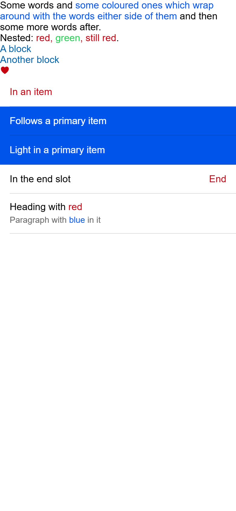
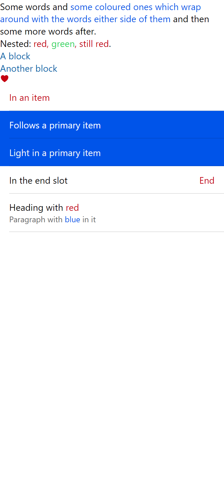

# ion-text — Comparison against the web component

> Ionic side (Chromium, md, 390×844@2x) → [`ref/`](ref/). The exact command:
>
> ```
> node tools/ionic-ref/render.js ion-text --bare --html '<div>Some words and <ion-text color="primary">some coloured ones which wrap around with the words either side of them</ion-text> and then some more words after.</div><div>Nested: <ion-text color="danger">red, <ion-text color="success">green</ion-text>, <ion-text>still red</ion-text></ion-text>.</div><ion-text color="secondary"><div>A block</div><div>Another block</div></ion-text><div><ion-text color="danger"><ion-icon name="heart"></ion-icon></ion-text></div><ion-item><ion-text color="danger">In an item</ion-text></ion-item><ion-item color="primary"><ion-text>Follows a primary item</ion-text></ion-item><ion-item color="primary"><ion-text color="light">Light in a primary item</ion-text></ion-item><ion-item><ion-label>In the end slot</ion-label><ion-text slot="end" color="danger">End</ion-text></ion-item><ion-item><ion-label><h2>Heading with <ion-text color="danger">red</ion-text></h2><p>Paragraph with <ion-text color="primary">blue</ion-text> in it</p></ion-label></ion-item>'
> ```
>
> Avonic side: `AVONIC_CAPTURE_DIR=… dotnet test` → `AvonicTextCaptureTests` (headless Skia, 2×) → [`compare/`](compare/).
> The capture sets the page to 16 px with the theme's font, which is what the web page's body is, because this control
> inherits them. Measurements for the behaviours came from a separate scene, wrapped in `ion-app`, at 390 wide.

## Frames

| Ionic | Avonic |
|---|---|
|  |  |

Rows from the top: a sentence that wraps, nested spans, a box around two blocks, a box around an icon, in an item, plain in a
primary item, light in a primary item, in the end slot, and spans in a label's `h2` and `p`.

**Match,** apart from text. Roboto isn't installed on this machine, so Chromium uses Arial and Avalonia uses Segoe UI,
so the lines are taller and the words fall a little differently, though the three lines of the sentence break in the same
places here.

## Found here, not by the tests

Nothing in the frames needed a fix. A test did find the automation gap below, because I'd assumed `TextBlock.Text` holds
the words of its inlines. It's empty. Code review found the stub's `Wrap` stopping `.ion-text-nowrap`, which is fixed.

## Behaviours

The numbers are from [PLAN.md](PLAN.md#behaviours). Each has tests in `AvonicTextTests`, named after its number, for both
types where both apply.

| # | Behaviour | Ionic | Result |
|---|---|---|---|
| 1 | With no colour it does nothing | 30 px serif `rgb(1, 2, 3)` from its parent | match |
| 2 | `color` paints the text | `rgb(197, 0, 15)` | match, and the span's checked in pixels |
| 3 | An unknown colour inherits, or shows a coloured ancestor's base | `rgb(1, 2, 3)`; `rgb(197, 0, 15)` in a danger one; `rgb(0, 84, 233)` in a primary item | match |
| 4 | Nested | `rgb(197, 0, 15)`, `rgb(45, 213, 91)` | match |
| 5 | Everything inside takes the colour | `h1`, `p`, `div`, `ion-icon` all coloured | match |
| 6 | In a sentence it flows and wraps | 3 boxes for one `ion-text`, in a 72 high `p` | match: the same height as one run of the same words, with colour on each line |
| 7 | In an item: the item's colour, or its own | white in a primary item; `rgb(197, 0, 15)` | match |
| 8 | In a slot: its margins, centred, as wide as its text | `16 0 0 0`, y = 34.59 of 88, 80.92 wide | match. Unlike a note, it isn't at the top |
| 9 | Long text wraps and grows the item | 358 wide, item 55 | match in the default slot. The start and end slots have the same gap as a long [note](../ion-note/PLAN.md#deliberate-differences) |
| 10 | In a label's `p` | 14 px, line height 20, its own colour | match, with the span inside the `TextBlock` |
| 11 | A tap on it doesn't forward, and a tap beside it does | | match, against a stub toggle |
| 12 | A button item's name includes its text | native `<button>` | match for `AvonicText`. **Gap** for words in inlines. See the plan |
| 13 | A change of `Color` repaints | `reflect` | match, and the span's checked in pixels |
| 14 | In a nowrap label | `white-space: nowrap`, cut off by the label | match, with the class on the box or on a label. See the plan |

## Deliberate differences and known gaps

All in [PLAN.md](PLAN.md#deliberate-differences).

## Real window

Tried on Windows at 125%, with `tools/real-window`, on 2026-11-06. Not on real touch hardware. The page draws as the frames do. It takes no input, so nothing else was driven. The sample
page's XAML compiles, including text mixed with spans, and `DiscoveryTests` creates it, but no test compares that page.
