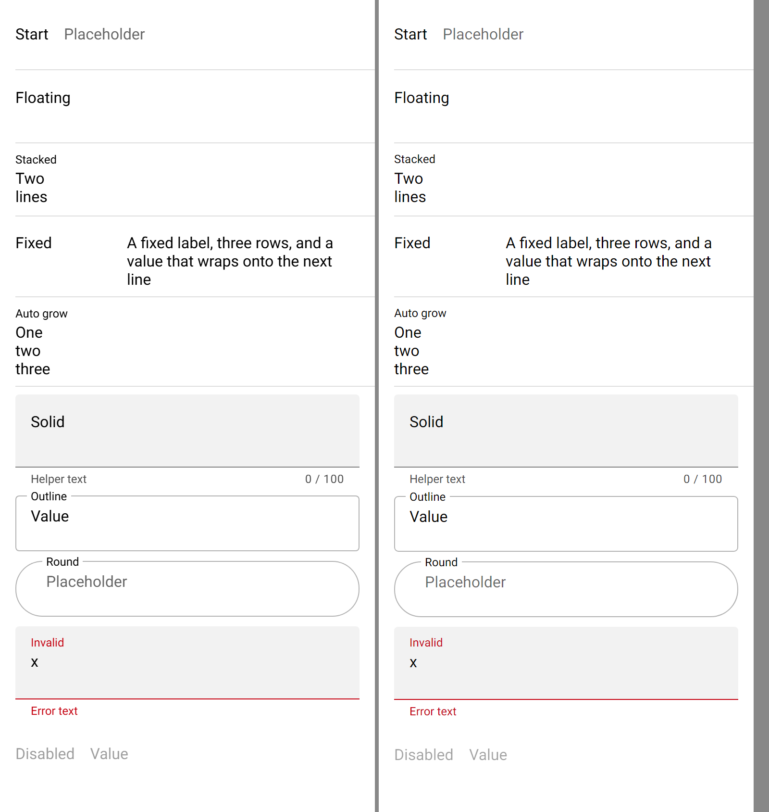
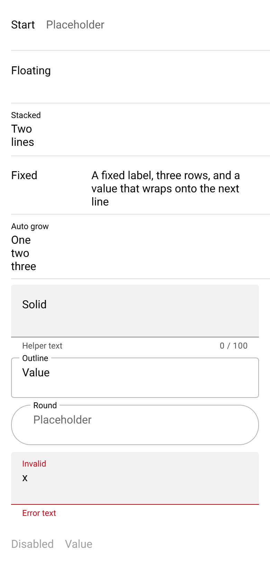
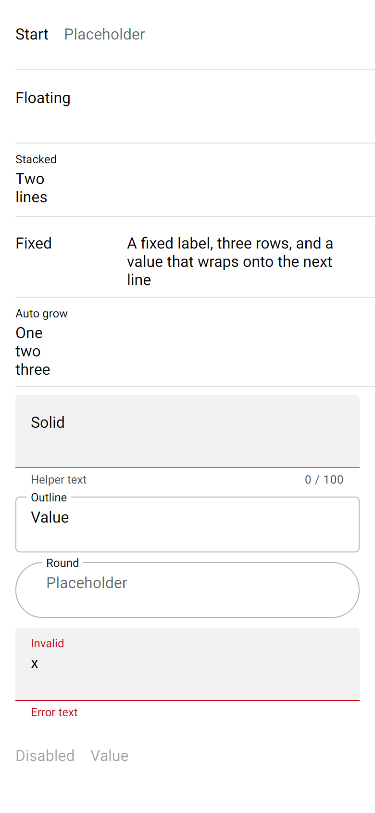

# ion-textarea — Comparison against the web component

> Ionic side: `node tools/ionic-ref/render.js ion-textarea --bare --html '<the snippet below>'` (Chromium, md, 390×844@2x) → [`ref/`](ref/).
> `ref/README.md` holds the exact command, and `ref/page.html` the page.
> Avonic side: `AVONIC_CAPTURE_DIR=… dotnet test` → `AvonicTextareaCaptureTests.Reference_Page` (headless Skia, 2×) → [`compare/`](compare/).
> Not tried in a real window (queued), or on a device.

```html
<ion-app style="position:static;display:block;contain:none;overflow:visible"><ion-list>
<ion-item><ion-textarea label="Start" placeholder="Placeholder"></ion-textarea></ion-item>
<ion-item><ion-textarea label="Floating" label-placement="floating"></ion-textarea></ion-item>
<ion-item><ion-textarea label="Stacked" label-placement="stacked" value="Two&#10;lines"></ion-textarea></ion-item>
<ion-item><ion-textarea label="Fixed" label-placement="fixed" rows="3" value="A fixed label, three rows, and a value that wraps onto the next line"></ion-textarea></ion-item>
<ion-item><ion-textarea label="Auto grow" label-placement="floating" auto-grow value="One&#10;two&#10;three"></ion-textarea></ion-item>
</ion-list><div style="padding:0 16px;display:flex;flex-direction:column;gap:10px">
<ion-textarea fill="solid" label="Solid" label-placement="floating" helper-text="Helper text" counter maxlength="100"></ion-textarea>
<ion-textarea fill="outline" label="Outline" label-placement="floating" value="Value"></ion-textarea>
<ion-textarea fill="outline" shape="round" label="Round" label-placement="stacked" placeholder="Placeholder"></ion-textarea>
<ion-textarea class="ion-touched ion-invalid" fill="solid" label="Invalid" label-placement="floating" helper-text="Helper" error-text="Error text" value="x"></ion-textarea>
<ion-textarea label="Disabled" disabled value="Value"></ion-textarea>
<ion-textarea placeholder="Cols 20" cols="20"></ion-textarea>
</div></ion-app>
```

(One line in the real command.) `Reference_Page` lays out the same content; the textareas outside the list sit in a 10 px
`StackPanel` with the page's 16 px Roboto. The last one is below the 844 px frame on both sides.

The behaviours were measured with throwaway Playwright scripts against pages of textareas with ids (a mouse and keyboard in a
desktop context for the events; a mobile context, 390 wide at 2×, for the boxes): the events of typing, Enter, blur, a value
set in code while focused, `clearOnEdit` with Shift, Enter and an arrow, `maxlength`, `autoGrow` as lines are typed, deleted and
set, `rows` 1, 2 and 4, `cols` 10, 20 and 40 with and without `autoGrow`, `wrap="off"`, and the boxes of every placement, fill,
shape and a slotted button. The numbers are in [PLAN.md](PLAN.md) and the tests. The colours of focus, hover, validity and RTL
come from the same rules as `ion-input`'s, word for word in `textarea.md.css`, and their tests reuse the input's measurements.

## Frames

Ionic on the left, Avonic on the right:



| Ionic | Avonic |
|---|---|
|  |  |

The rows line up to a pixel down to the solid field's bottom text: every box is the same height, as the field's lines are
Chromium's `line-height: normal` (19 px for 16 px Roboto, where Avalonia's own is 18.75; see `TextareaNativeInput`). From
there Avonic is 1 px lower: a 12 px line under a field is 15 high in Avalonia and 14 in Chromium, as for `ion-input`.

## Behaviours

| # | Behaviour | Result |
|---|---|---|
| 1 | `IonFocus`, then `IonInput` per edit | Match |
| 2 | Enter types `\n` and raises only `IonInput` | Match. The line break is a line feed on every platform, as in Chromium, where Avalonia's `TextBox` would type `\r\n` on Windows |
| 3 | Blur raises `IonChange` when the value isn't what it was at focus, also when set in code meanwhile, then `IonBlur` | Match |
| 4 | A value in code raises nothing; an `IonInput` handler can replace it | Match |
| 5 | `Debounce` | Match, on `AvonicConfig`'s clock |
| 6 | `ClearOnEdit`: Shift doesn't count; Enter clears and then types; an arrow clears; once per focus | Match. Text with no key down (a soft keyboard) also clears, as for the input |
| 7 | A click in the label focuses the field; not on the bottom or a slotted button | Match. **Difference** as the input's: while focused, Chromium blurs and refocuses |
| 8 | `SetFocus()`, `GetInputElement()` | Match |
| 9 | An item's padding tap focuses the textarea | Match |
| 10 | Rows: 45, 64, 102 for 1, 2, 4; a longer value scrolls inside | Match to 0.5 px |
| 11 | `AutoGrow`: 45, 64, 83, back to 64, 102 when set in code; never under `Rows` | Match |
| 12 | `Cols`: 84, 164, 324; full width with `AutoGrow` | Match in a phone viewport. See the gaps for other platforms |
| 13 | `Wrap="Off"`; line breaks as line feeds; an unfocused field at its first lines | Match: one line, scrolling sideways. A pasted CR LF or CR becomes LF, with the caret after it. A value set in code leaves an unfocused field at its first lines, though the caret is at the end |
| 14 | Row placements: the label 45 high at the top, its text 18 down, 16 from the field; end; fixed 100; at most 200 | Match to 0.8 px |
| 15 | Column placements: 75 high, the label on the field and raised, the field 8 under it (12 with the outline, 58 high); hidden until focus or a value | Match to 0.8 px |
| 16 | 44 and 56 minimums, on the wrapper and `.textarea-wrapper-inner` | Match |
| 17 | The highlight | Match |
| 18 | Highlight colours on the highlight, caret, label and bottom border | Match |
| 19 | Solid: rest, hover (mouse and pen only), focus | Match |
| 20 | Outline and round shapes | Match |
| 21 | The bottom, error text, the counter and its formatter | Match; the bottom's text 1 px taller |
| 22 | Slots at the top, with the field's padding, 16 from it; 8 (12) lower in a column; a button `0 0 4 16` | Match |
| 23 | Disabled (0.38 as one, through an `OpacityMask`) and read-only | Match |
| 24 | Placeholder at 0.6 | Match |
| 25 | `Inputmode`, `Enterkeyhint`, `Autocapitalize`, multi-line, `Maxlength` | Set and tested on the `TextBox`. **Not tried with a soft keyboard**: there's no device |
| 26 | Autofocus | Match |
| 27 | Automation name, help text and required | Set on the native textarea and tested; no screen reader tried |
| 28 | RTL | Match, by the input's numbers (the same rules) |

## Deliberate differences and gaps

- **`cols` on other platforms.** The width is `cols` × the `x` glyph's advance, rounded, + 4, which is what Chromium on Windows
  does in a phone viewport (it takes `x` when the font reports no average width, and keeps 4 px for a mobile overlay scroll bar;
  15 in a desktop context). Chromium on Android reads the font's own average width (Roboto's is 9.07 px at 16 px), so a real
  phone would be wider. Not measured on a phone.
- **A click on the label while the field has focus** keeps focus; Chromium blurs and focuses again, as for the input.
- **An icon-only `ion-button` in a slot**: `textarea.md.css` makes it 40 px round with 8 px padding; it keeps its own look, as in
  `ion-input` (Chromium's slotted button in the reference is 40 × 40; Avonic's is the default button's size).
- **An app's `--background` and `--border-color` with a fill**, and **`--padding-top` when floating or stacked**: a resource key
  has no specificity, so the app's key wins at rest, where Ionic's host-class rule would beat `ion-textarea { … }`.
- **`:host-context(ion-item) { align-self: baseline }`** isn't applied: the textarea sits in an item as any child does. Alone in
  an item, as measured, the box is the same.
- **`:host-context(ion-item)[slot=start|end] { width: auto }`**: a textarea in an item's start or end slot still stretches.
- **The notch's `max-width`** for a label wider than the field isn't applied.
- **Bottom text** is 1 px taller (Avalonia's line height for 12 px Roboto); a row's label text is 18.75 high, not 19, as the label
  isn't the field and keeps Avalonia's own line height. Neither changes a box above.
- **Touch scrolling** inside a textarea that's inside a page that scrolls is untried: there's no device here.
- **The soft keyboard, IME composition, and haptics** are untested. A value set during composition is written at once, as
  `textarea.js` does (it has no `isComposing` check, unlike `input.js`), tested with a preedit set by hand.
