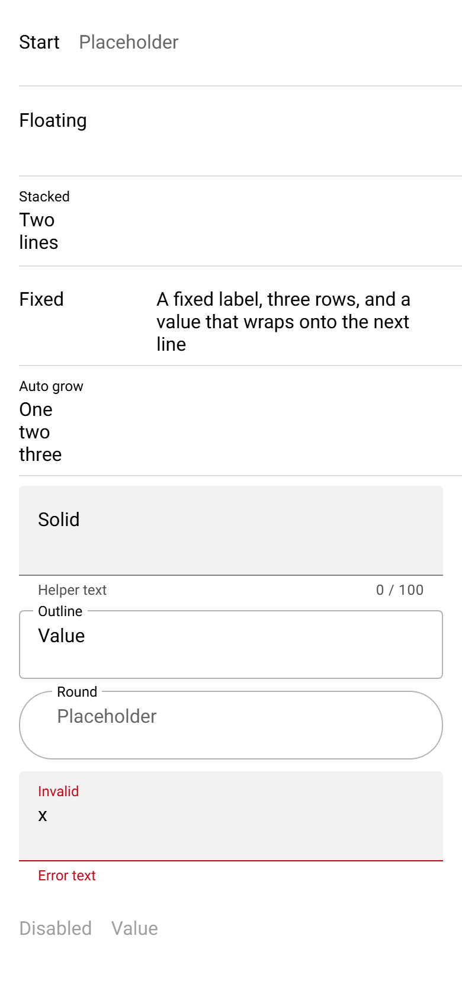

# ion-textarea — reference render (Ionic 8.8.1, md, 390×844@2x)

Generated by `node tools/ionic-ref/render.js ion-textarea --bare --html "<ion-app style=\"position:static;display:block;contain:none;overflow:visible\"><ion-list><ion-item><ion-textarea label=\"Start\" placeholder=\"Placeholder\"></ion-textarea></ion-item><ion-item><ion-textarea label=\"Floating\" label-placement=\"floating\"></ion-textarea></ion-item><ion-item><ion-textarea label=\"Stacked\" label-placement=\"stacked\" value=\"Two&#10;lines\"></ion-textarea></ion-item><ion-item><ion-textarea label=\"Fixed\" label-placement=\"fixed\" rows=\"3\" value=\"A fixed label, three rows, and a value that wraps onto the next line\"></ion-textarea></ion-item><ion-item><ion-textarea label=\"Auto grow\" label-placement=\"floating\" auto-grow value=\"One&#10;two&#10;three\"></ion-textarea></ion-item></ion-list><div style=\"padding:0 16px;display:flex;flex-direction:column;gap:10px\"><ion-textarea fill=\"solid\" label=\"Solid\" label-placement=\"floating\" helper-text=\"Helper text\" counter maxlength=\"100\"></ion-textarea><ion-textarea fill=\"outline\" label=\"Outline\" label-placement=\"floating\" value=\"Value\"></ion-textarea><ion-textarea fill=\"outline\" shape=\"round\" label=\"Round\" label-placement=\"stacked\" placeholder=\"Placeholder\"></ion-textarea><ion-textarea class=\"ion-touched ion-invalid\" fill=\"solid\" label=\"Invalid\" label-placement=\"floating\" helper-text=\"Helper\" error-text=\"Error text\" value=\"x\"></ion-textarea><ion-textarea label=\"Disabled\" disabled value=\"Value\"></ion-textarea><ion-textarea placeholder=\"Cols 20\" cols=\"20\"></ion-textarea></div></ion-app>"`

```html
<ion-app style="position:static;display:block;contain:none;overflow:visible"><ion-list><ion-item><ion-textarea label="Start" placeholder="Placeholder"></ion-textarea></ion-item><ion-item><ion-textarea label="Floating" label-placement="floating"></ion-textarea></ion-item><ion-item><ion-textarea label="Stacked" label-placement="stacked" value="Two&#10;lines"></ion-textarea></ion-item><ion-item><ion-textarea label="Fixed" label-placement="fixed" rows="3" value="A fixed label, three rows, and a value that wraps onto the next line"></ion-textarea></ion-item><ion-item><ion-textarea label="Auto grow" label-placement="floating" auto-grow value="One&#10;two&#10;three"></ion-textarea></ion-item></ion-list><div style="padding:0 16px;display:flex;flex-direction:column;gap:10px"><ion-textarea fill="solid" label="Solid" label-placement="floating" helper-text="Helper text" counter maxlength="100"></ion-textarea><ion-textarea fill="outline" label="Outline" label-placement="floating" value="Value"></ion-textarea><ion-textarea fill="outline" shape="round" label="Round" label-placement="stacked" placeholder="Placeholder"></ion-textarea><ion-textarea class="ion-touched ion-invalid" fill="solid" label="Invalid" label-placement="floating" helper-text="Helper" error-text="Error text" value="x"></ion-textarea><ion-textarea label="Disabled" disabled value="Value"></ion-textarea><ion-textarea placeholder="Cols 20" cols="20"></ion-textarea></div></ion-app>
```

 

## Element 1

- attributes: `{"label":"Start","placeholder":"Placeholder","class":"sc-ion-textarea-md-h md textarea-label-placement-start sc-ion-textarea-md hydrated"}`
- classes: `sc-ion-textarea-md-h md textarea-label-placement-start sc-ion-textarea-md hydrated`
- rect: `{"x":16,"y":8,"w":358,"h":64}`

### CSS custom properties (resolved)

| var | value |
|---|---|
| `--background` | `(unset)` |
| `--border-color` | `rgba(0, 0, 0, 0.13)` |
| `--border-radius` | `0` |
| `--border-style` | `solid` |
| `--border-width` | `1px` |
| `--color` | `(unset)` |
| `--highlight-color-focused` | `#0054e9` |
| `--highlight-color-invalid` | `#c5000f` |
| `--highlight-color-valid` | `#2dd55b` |
| `--highlight-height` | `2px` |
| `--padding-bottom` | `8px` |
| `--padding-end` | `0px` |
| `--padding-start` | `0px` |
| `--padding-top` | `18px` |
| `--placeholder-color` | `(unset)` |
| `--placeholder-font-style` | `(unset)` |
| `--placeholder-font-weight` | `(unset)` |
| `--placeholder-opacity` | `0.6` |

### Host computed

| prop | value |
|---|---|
| display | `block` |
| position | `relative` |
| box-sizing | `border-box` |
| width | `358px` |
| height | `64px` |
| min-height | `44px` |
| min-width | `auto` |
| padding | `0px` |
| margin | `0px` |
| border | `0px none rgb(0, 0, 0)` |
| border-radius | `0px` |
| background-color | `rgba(0, 0, 0, 0)` |
| color | `rgb(0, 0, 0)` |
| font-size | `16px` |
| font-weight | `400` |
| font-family | `Roboto, "Helvetica Neue", sans-serif` |
| line-height | `normal` |
| letter-spacing | `normal` |
| text-transform | `none` |
| opacity | `1` |
| overflow | `visible` |
| contain | `none` |
| pointer-events | `auto` |
| transition | `all` |
| transform | `none` |
| box-shadow | `none` |
| outline | `rgb(0, 0, 0) none 0px` |
| cursor | `auto` |

### DOM tree

```
<ion-textarea>

```

## Element 2

- attributes: `{"label":"Floating","label-placement":"floating","class":"sc-ion-textarea-md-h md textarea-label-placement-floating sc-ion-textarea-md hydrated"}`
- classes: `sc-ion-textarea-md-h md textarea-label-placement-floating sc-ion-textarea-md hydrated`
- rect: `{"x":16,"y":73,"w":358,"h":75}`

### CSS custom properties (resolved)

| var | value |
|---|---|
| `--background` | `(unset)` |
| `--border-color` | `rgba(0, 0, 0, 0.13)` |
| `--border-radius` | `0` |
| `--border-style` | `solid` |
| `--border-width` | `1px` |
| `--color` | `(unset)` |
| `--highlight-color-focused` | `#0054e9` |
| `--highlight-color-invalid` | `#c5000f` |
| `--highlight-color-valid` | `#2dd55b` |
| `--highlight-height` | `2px` |
| `--padding-bottom` | `8px` |
| `--padding-end` | `0px` |
| `--padding-start` | `0px` |
| `--padding-top` | `0px` |
| `--placeholder-color` | `(unset)` |
| `--placeholder-font-style` | `(unset)` |
| `--placeholder-font-weight` | `(unset)` |
| `--placeholder-opacity` | `0.6` |

### Host computed

| prop | value |
|---|---|
| display | `block` |
| position | `relative` |
| box-sizing | `border-box` |
| width | `358px` |
| height | `75px` |
| min-height | `56px` |
| min-width | `auto` |
| padding | `0px` |
| margin | `0px` |
| border | `0px none rgb(0, 0, 0)` |
| border-radius | `0px` |
| background-color | `rgba(0, 0, 0, 0)` |
| color | `rgb(0, 0, 0)` |
| font-size | `16px` |
| font-weight | `400` |
| font-family | `Roboto, "Helvetica Neue", sans-serif` |
| line-height | `normal` |
| letter-spacing | `normal` |
| text-transform | `none` |
| opacity | `1` |
| overflow | `visible` |
| contain | `none` |
| pointer-events | `auto` |
| transition | `all` |
| transform | `none` |
| box-shadow | `none` |
| outline | `rgb(0, 0, 0) none 0px` |
| cursor | `auto` |

### DOM tree

```
<ion-textarea>

```

## Element 3

- attributes: `{"label":"Stacked","label-placement":"stacked","value":"Two\nlines","class":"sc-ion-textarea-md-h md has-value label-floating textarea-label-placement-stacked sc-ion-textarea-md hydrated"}`
- classes: `sc-ion-textarea-md-h md has-value label-floating textarea-label-placement-stacked sc-ion-textarea-md hydrated`
- rect: `{"x":16,"y":149,"w":358,"h":75}`

### CSS custom properties (resolved)

| var | value |
|---|---|
| `--background` | `(unset)` |
| `--border-color` | `rgba(0, 0, 0, 0.13)` |
| `--border-radius` | `0` |
| `--border-style` | `solid` |
| `--border-width` | `1px` |
| `--color` | `(unset)` |
| `--highlight-color-focused` | `#0054e9` |
| `--highlight-color-invalid` | `#c5000f` |
| `--highlight-color-valid` | `#2dd55b` |
| `--highlight-height` | `2px` |
| `--padding-bottom` | `8px` |
| `--padding-end` | `0px` |
| `--padding-start` | `0px` |
| `--padding-top` | `0px` |
| `--placeholder-color` | `(unset)` |
| `--placeholder-font-style` | `(unset)` |
| `--placeholder-font-weight` | `(unset)` |
| `--placeholder-opacity` | `0.6` |

### Host computed

| prop | value |
|---|---|
| display | `block` |
| position | `relative` |
| box-sizing | `border-box` |
| width | `358px` |
| height | `75px` |
| min-height | `56px` |
| min-width | `auto` |
| padding | `0px` |
| margin | `0px` |
| border | `0px none rgb(0, 0, 0)` |
| border-radius | `0px` |
| background-color | `rgba(0, 0, 0, 0)` |
| color | `rgb(0, 0, 0)` |
| font-size | `16px` |
| font-weight | `400` |
| font-family | `Roboto, "Helvetica Neue", sans-serif` |
| line-height | `normal` |
| letter-spacing | `normal` |
| text-transform | `none` |
| opacity | `1` |
| overflow | `visible` |
| contain | `none` |
| pointer-events | `auto` |
| transition | `all` |
| transform | `none` |
| box-shadow | `none` |
| outline | `rgb(0, 0, 0) none 0px` |
| cursor | `auto` |

### DOM tree

```
<ion-textarea>

```

## Element 4

- attributes: `{"label":"Fixed","label-placement":"fixed","rows":"3","value":"A fixed label, three rows, and a value that wraps onto the next line","class":"sc-ion-textarea-md-h md has-value textarea-label-placement-fixed sc-ion-textarea-md hydrated"}`
- classes: `sc-ion-textarea-md-h md has-value textarea-label-placement-fixed sc-ion-textarea-md hydrated`
- rect: `{"x":16,"y":225,"w":358,"h":83}`

### CSS custom properties (resolved)

| var | value |
|---|---|
| `--background` | `(unset)` |
| `--border-color` | `rgba(0, 0, 0, 0.13)` |
| `--border-radius` | `0` |
| `--border-style` | `solid` |
| `--border-width` | `1px` |
| `--color` | `(unset)` |
| `--highlight-color-focused` | `#0054e9` |
| `--highlight-color-invalid` | `#c5000f` |
| `--highlight-color-valid` | `#2dd55b` |
| `--highlight-height` | `2px` |
| `--padding-bottom` | `8px` |
| `--padding-end` | `0px` |
| `--padding-start` | `0px` |
| `--padding-top` | `18px` |
| `--placeholder-color` | `(unset)` |
| `--placeholder-font-style` | `(unset)` |
| `--placeholder-font-weight` | `(unset)` |
| `--placeholder-opacity` | `0.6` |

### Host computed

| prop | value |
|---|---|
| display | `block` |
| position | `relative` |
| box-sizing | `border-box` |
| width | `358px` |
| height | `83px` |
| min-height | `44px` |
| min-width | `auto` |
| padding | `0px` |
| margin | `0px` |
| border | `0px none rgb(0, 0, 0)` |
| border-radius | `0px` |
| background-color | `rgba(0, 0, 0, 0)` |
| color | `rgb(0, 0, 0)` |
| font-size | `16px` |
| font-weight | `400` |
| font-family | `Roboto, "Helvetica Neue", sans-serif` |
| line-height | `normal` |
| letter-spacing | `normal` |
| text-transform | `none` |
| opacity | `1` |
| overflow | `visible` |
| contain | `none` |
| pointer-events | `auto` |
| transition | `all` |
| transform | `none` |
| box-shadow | `none` |
| outline | `rgb(0, 0, 0) none 0px` |
| cursor | `auto` |

### DOM tree

```
<ion-textarea>

```

## Element 5

- attributes: `{"label":"Auto grow","label-placement":"floating","auto-grow":"","value":"One\ntwo\nthree","class":"sc-ion-textarea-md-h md has-value label-floating textarea-label-placement-floating sc-ion-textarea-md hydrated"}`
- classes: `sc-ion-textarea-md-h md has-value label-floating textarea-label-placement-floating sc-ion-textarea-md hydrated`
- rect: `{"x":16,"y":309,"w":358,"h":92}`

### CSS custom properties (resolved)

| var | value |
|---|---|
| `--background` | `(unset)` |
| `--border-color` | `rgba(0, 0, 0, 0.13)` |
| `--border-radius` | `0` |
| `--border-style` | `solid` |
| `--border-width` | `1px` |
| `--color` | `(unset)` |
| `--highlight-color-focused` | `#0054e9` |
| `--highlight-color-invalid` | `#c5000f` |
| `--highlight-color-valid` | `#2dd55b` |
| `--highlight-height` | `2px` |
| `--padding-bottom` | `8px` |
| `--padding-end` | `0px` |
| `--padding-start` | `0px` |
| `--padding-top` | `0px` |
| `--placeholder-color` | `(unset)` |
| `--placeholder-font-style` | `(unset)` |
| `--placeholder-font-weight` | `(unset)` |
| `--placeholder-opacity` | `0.6` |

### Host computed

| prop | value |
|---|---|
| display | `block` |
| position | `relative` |
| box-sizing | `border-box` |
| width | `358px` |
| height | `92px` |
| min-height | `56px` |
| min-width | `auto` |
| padding | `0px` |
| margin | `0px` |
| border | `0px none rgb(0, 0, 0)` |
| border-radius | `0px` |
| background-color | `rgba(0, 0, 0, 0)` |
| color | `rgb(0, 0, 0)` |
| font-size | `16px` |
| font-weight | `400` |
| font-family | `Roboto, "Helvetica Neue", sans-serif` |
| line-height | `normal` |
| letter-spacing | `normal` |
| text-transform | `none` |
| opacity | `1` |
| overflow | `visible` |
| contain | `none` |
| pointer-events | `auto` |
| transition | `all` |
| transform | `none` |
| box-shadow | `none` |
| outline | `rgb(0, 0, 0) none 0px` |
| cursor | `auto` |

### DOM tree

```
<ion-textarea>

```

## Element 6

- attributes: `{"fill":"solid","label":"Solid","label-placement":"floating","helper-text":"Helper text","counter":"","maxlength":"100","class":"sc-ion-textarea-md-h md textarea-fill-solid textarea-label-placement-floating sc-ion-textarea-md hydrated"}`
- classes: `sc-ion-textarea-md-h md textarea-fill-solid textarea-label-placement-floating sc-ion-textarea-md hydrated`
- rect: `{"x":16,"y":410,"w":358,"h":95}`

### CSS custom properties (resolved)

| var | value |
|---|---|
| `--background` | `#f2f2f2` |
| `--border-color` | `gray` |
| `--border-radius` | `4px` |
| `--border-style` | `solid` |
| `--border-width` | `1px` |
| `--color` | `(unset)` |
| `--highlight-color-focused` | `#0054e9` |
| `--highlight-color-invalid` | `#c5000f` |
| `--highlight-color-valid` | `#2dd55b` |
| `--highlight-height` | `2px` |
| `--padding-bottom` | `8px` |
| `--padding-end` | `16px` |
| `--padding-start` | `16px` |
| `--padding-top` | `0px` |
| `--placeholder-color` | `(unset)` |
| `--placeholder-font-style` | `(unset)` |
| `--placeholder-font-weight` | `(unset)` |
| `--placeholder-opacity` | `0.6` |

### Host computed

| prop | value |
|---|---|
| display | `block` |
| position | `relative` |
| box-sizing | `border-box` |
| width | `358px` |
| height | `95px` |
| min-height | `56px` |
| min-width | `auto` |
| padding | `0px` |
| margin | `0px` |
| border | `0px none rgb(0, 0, 0)` |
| border-radius | `0px` |
| background-color | `rgba(0, 0, 0, 0)` |
| color | `rgb(0, 0, 0)` |
| font-size | `16px` |
| font-weight | `400` |
| font-family | `Roboto, "Helvetica Neue", sans-serif` |
| line-height | `normal` |
| letter-spacing | `normal` |
| text-transform | `none` |
| opacity | `1` |
| overflow | `visible` |
| contain | `none` |
| pointer-events | `auto` |
| transition | `all` |
| transform | `none` |
| box-shadow | `none` |
| outline | `rgb(0, 0, 0) none 0px` |
| cursor | `auto` |

### DOM tree

```
<ion-textarea>

```

## Element 7

- attributes: `{"fill":"outline","label":"Outline","label-placement":"floating","value":"Value","class":"sc-ion-textarea-md-h md has-value label-floating textarea-fill-outline textarea-label-placement-floating sc-ion-textarea-md hydrated"}`
- classes: `sc-ion-textarea-md-h md has-value label-floating textarea-fill-outline textarea-label-placement-floating sc-ion-textarea-md hydrated`
- rect: `{"x":16,"y":515,"w":358,"h":58}`

### CSS custom properties (resolved)

| var | value |
|---|---|
| `--background` | `(unset)` |
| `--border-color` | `#b3b3b3` |
| `--border-radius` | `4px` |
| `--border-style` | `solid` |
| `--border-width` | `1px` |
| `--color` | `(unset)` |
| `--highlight-color-focused` | `#0054e9` |
| `--highlight-color-invalid` | `#c5000f` |
| `--highlight-color-valid` | `#2dd55b` |
| `--highlight-height` | `2px` |
| `--padding-bottom` | `8px` |
| `--padding-end` | `16px` |
| `--padding-start` | `16px` |
| `--padding-top` | `0px` |
| `--placeholder-color` | `(unset)` |
| `--placeholder-font-style` | `(unset)` |
| `--placeholder-font-weight` | `(unset)` |
| `--placeholder-opacity` | `0.6` |

### Host computed

| prop | value |
|---|---|
| display | `block` |
| position | `relative` |
| box-sizing | `border-box` |
| width | `358px` |
| height | `58px` |
| min-height | `56px` |
| min-width | `auto` |
| padding | `0px` |
| margin | `0px` |
| border | `0px none rgb(0, 0, 0)` |
| border-radius | `0px` |
| background-color | `rgba(0, 0, 0, 0)` |
| color | `rgb(0, 0, 0)` |
| font-size | `16px` |
| font-weight | `400` |
| font-family | `Roboto, "Helvetica Neue", sans-serif` |
| line-height | `normal` |
| letter-spacing | `normal` |
| text-transform | `none` |
| opacity | `1` |
| overflow | `visible` |
| contain | `none` |
| pointer-events | `auto` |
| transition | `all` |
| transform | `none` |
| box-shadow | `none` |
| outline | `rgb(0, 0, 0) none 0px` |
| cursor | `auto` |

### DOM tree

```
<ion-textarea>

```

## Element 8

- attributes: `{"fill":"outline","shape":"round","label":"Round","label-placement":"stacked","placeholder":"Placeholder","class":"sc-ion-textarea-md-h md label-floating textarea-fill-outline textarea-shape-round textarea-label-placement-stacked sc-ion-textarea-md hydrated"}`
- classes: `sc-ion-textarea-md-h md label-floating textarea-fill-outline textarea-shape-round textarea-label-placement-stacked sc-ion-textarea-md hydrated`
- rect: `{"x":16,"y":583,"w":358,"h":58}`

### CSS custom properties (resolved)

| var | value |
|---|---|
| `--background` | `(unset)` |
| `--border-color` | `#b3b3b3` |
| `--border-radius` | `28px` |
| `--border-style` | `solid` |
| `--border-width` | `1px` |
| `--color` | `(unset)` |
| `--highlight-color-focused` | `#0054e9` |
| `--highlight-color-invalid` | `#c5000f` |
| `--highlight-color-valid` | `#2dd55b` |
| `--highlight-height` | `2px` |
| `--padding-bottom` | `8px` |
| `--padding-end` | `32px` |
| `--padding-start` | `32px` |
| `--padding-top` | `0px` |
| `--placeholder-color` | `(unset)` |
| `--placeholder-font-style` | `(unset)` |
| `--placeholder-font-weight` | `(unset)` |
| `--placeholder-opacity` | `0.6` |

### Host computed

| prop | value |
|---|---|
| display | `block` |
| position | `relative` |
| box-sizing | `border-box` |
| width | `358px` |
| height | `58px` |
| min-height | `56px` |
| min-width | `auto` |
| padding | `0px` |
| margin | `0px` |
| border | `0px none rgb(0, 0, 0)` |
| border-radius | `0px` |
| background-color | `rgba(0, 0, 0, 0)` |
| color | `rgb(0, 0, 0)` |
| font-size | `16px` |
| font-weight | `400` |
| font-family | `Roboto, "Helvetica Neue", sans-serif` |
| line-height | `normal` |
| letter-spacing | `normal` |
| text-transform | `none` |
| opacity | `1` |
| overflow | `visible` |
| contain | `none` |
| pointer-events | `auto` |
| transition | `all` |
| transform | `none` |
| box-shadow | `none` |
| outline | `rgb(0, 0, 0) none 0px` |
| cursor | `auto` |

### DOM tree

```
<ion-textarea>

```

## Element 9

- attributes: `{"class":"ion-touched ion-invalid sc-ion-textarea-md-h md has-value label-floating textarea-fill-solid textarea-label-placement-floating sc-ion-textarea-md hydrated","fill":"solid","label":"Invalid","label-placement":"floating","helper-text":"Helper","error-text":"Error text","value":"x"}`
- classes: `ion-touched ion-invalid sc-ion-textarea-md-h md has-value label-floating textarea-fill-solid textarea-label-placement-floating sc-ion-textarea-md hydrated`
- rect: `{"x":16,"y":651,"w":358,"h":95}`

### CSS custom properties (resolved)

| var | value |
|---|---|
| `--background` | `#f2f2f2` |
| `--border-color` | `#c5000f` |
| `--border-radius` | `4px` |
| `--border-style` | `solid` |
| `--border-width` | `1px` |
| `--color` | `(unset)` |
| `--highlight-color-focused` | `#0054e9` |
| `--highlight-color-invalid` | `#c5000f` |
| `--highlight-color-valid` | `#2dd55b` |
| `--highlight-height` | `2px` |
| `--padding-bottom` | `8px` |
| `--padding-end` | `16px` |
| `--padding-start` | `16px` |
| `--padding-top` | `0px` |
| `--placeholder-color` | `(unset)` |
| `--placeholder-font-style` | `(unset)` |
| `--placeholder-font-weight` | `(unset)` |
| `--placeholder-opacity` | `0.6` |

### Host computed

| prop | value |
|---|---|
| display | `block` |
| position | `relative` |
| box-sizing | `border-box` |
| width | `358px` |
| height | `95px` |
| min-height | `56px` |
| min-width | `auto` |
| padding | `0px` |
| margin | `0px` |
| border | `0px none rgb(0, 0, 0)` |
| border-radius | `0px` |
| background-color | `rgba(0, 0, 0, 0)` |
| color | `rgb(0, 0, 0)` |
| font-size | `16px` |
| font-weight | `400` |
| font-family | `Roboto, "Helvetica Neue", sans-serif` |
| line-height | `normal` |
| letter-spacing | `normal` |
| text-transform | `none` |
| opacity | `1` |
| overflow | `visible` |
| contain | `none` |
| pointer-events | `auto` |
| transition | `all` |
| transform | `none` |
| box-shadow | `none` |
| outline | `rgb(0, 0, 0) none 0px` |
| cursor | `auto` |

### DOM tree

```
<ion-textarea>

```

## Element 10

- attributes: `{"label":"Disabled","disabled":"","value":"Value","class":"sc-ion-textarea-md-h md has-value textarea-label-placement-start textarea-disabled sc-ion-textarea-md hydrated"}`
- classes: `sc-ion-textarea-md-h md has-value textarea-label-placement-start textarea-disabled sc-ion-textarea-md hydrated`
- rect: `{"x":16,"y":756,"w":358,"h":64}`

### CSS custom properties (resolved)

| var | value |
|---|---|
| `--background` | `(unset)` |
| `--border-color` | `rgba(0, 0, 0, 0.13)` |
| `--border-radius` | `0` |
| `--border-style` | `solid` |
| `--border-width` | `1px` |
| `--color` | `(unset)` |
| `--highlight-color-focused` | `#0054e9` |
| `--highlight-color-invalid` | `#c5000f` |
| `--highlight-color-valid` | `#2dd55b` |
| `--highlight-height` | `2px` |
| `--padding-bottom` | `8px` |
| `--padding-end` | `0px` |
| `--padding-start` | `0px` |
| `--padding-top` | `18px` |
| `--placeholder-color` | `(unset)` |
| `--placeholder-font-style` | `(unset)` |
| `--placeholder-font-weight` | `(unset)` |
| `--placeholder-opacity` | `0.6` |

### Host computed

| prop | value |
|---|---|
| display | `block` |
| position | `relative` |
| box-sizing | `border-box` |
| width | `358px` |
| height | `64px` |
| min-height | `44px` |
| min-width | `auto` |
| padding | `0px` |
| margin | `0px` |
| border | `0px none rgb(0, 0, 0)` |
| border-radius | `0px` |
| background-color | `rgba(0, 0, 0, 0)` |
| color | `rgb(0, 0, 0)` |
| font-size | `16px` |
| font-weight | `400` |
| font-family | `Roboto, "Helvetica Neue", sans-serif` |
| line-height | `normal` |
| letter-spacing | `normal` |
| text-transform | `none` |
| opacity | `0.38` |
| overflow | `visible` |
| contain | `none` |
| pointer-events | `auto` |
| transition | `all` |
| transform | `none` |
| box-shadow | `none` |
| outline | `rgb(0, 0, 0) none 0px` |
| cursor | `auto` |

### DOM tree

```
<ion-textarea>

```

## Element 11

- attributes: `{"placeholder":"Cols 20","cols":"20","class":"sc-ion-textarea-md-h md textarea-label-placement-start sc-ion-textarea-md hydrated"}`
- classes: `sc-ion-textarea-md-h md textarea-label-placement-start sc-ion-textarea-md hydrated`
- rect: `{"x":16,"y":830,"w":164,"h":64}`

### CSS custom properties (resolved)

| var | value |
|---|---|
| `--background` | `(unset)` |
| `--border-color` | `rgba(0, 0, 0, 0.13)` |
| `--border-radius` | `0` |
| `--border-style` | `solid` |
| `--border-width` | `1px` |
| `--color` | `(unset)` |
| `--highlight-color-focused` | `#0054e9` |
| `--highlight-color-invalid` | `#c5000f` |
| `--highlight-color-valid` | `#2dd55b` |
| `--highlight-height` | `2px` |
| `--padding-bottom` | `8px` |
| `--padding-end` | `0px` |
| `--padding-start` | `0px` |
| `--padding-top` | `18px` |
| `--placeholder-color` | `(unset)` |
| `--placeholder-font-style` | `(unset)` |
| `--placeholder-font-weight` | `(unset)` |
| `--placeholder-opacity` | `0.6` |

### Host computed

| prop | value |
|---|---|
| display | `block` |
| position | `relative` |
| box-sizing | `border-box` |
| width | `164px` |
| height | `64px` |
| min-height | `44px` |
| min-width | `auto` |
| padding | `0px` |
| margin | `0px` |
| border | `0px none rgb(0, 0, 0)` |
| border-radius | `0px` |
| background-color | `rgba(0, 0, 0, 0)` |
| color | `rgb(0, 0, 0)` |
| font-size | `16px` |
| font-weight | `400` |
| font-family | `Roboto, "Helvetica Neue", sans-serif` |
| line-height | `normal` |
| letter-spacing | `normal` |
| text-transform | `none` |
| opacity | `1` |
| overflow | `visible` |
| contain | `none` |
| pointer-events | `auto` |
| transition | `all` |
| transform | `none` |
| box-shadow | `none` |
| outline | `rgb(0, 0, 0) none 0px` |
| cursor | `auto` |

### DOM tree

```
<ion-textarea>

```
