# ion-toast — Comparison

Ionic 9.0.11, md, headless Chromium, beside Avonic headless (Skia) at the same size and 2x. A toast's buttons are a JavaScript
property, which `render.js --html` can't set, so the Ionic side comes from one measurement script on `render.js`'s phone (390 x 844
at 2x, mobile and touch, Roboto from `tools/fonts/roboto/`) and at 1024 x 768, which waits as `render.js` does
(`tools/ionic-ref/settle.js`). It builds an `ion-app` page with a heading, a paragraph and two buttons, makes each `ion-toast` in
script, presents it and reads it once the present has resolved. The raw output is [`ref/layout.json`](ref/layout.json) (every box,
colour, font and animation of each case), [`ref/behaviour.json`](ref/behaviour.json) (events and their times, the enter and leave
frames with the animation's own `currentTime`, real keys, taps, hovers and drags) and [`ref/extra.json`](ref/extra.json) (Tab, a tap
through, a render while presented), with a frame of each case in [`ref/`](ref/). The script isn't in the repo, as the swarm brief asks;
its cases are the `M` rows of PLAN.md's Measured section.

Avonic's frames are `AvonicToastCaptureTests`, saved in [`compare/`](compare/), each asserting the boxes beside them. Not tried in a
real window: `tools/real-window/drive.ps1` has an `ion-toast` section for the batch's runner.

| Message only, bottom | Header, icon, Undo, Dismiss | Stacked |
|---|---|---|
|  | 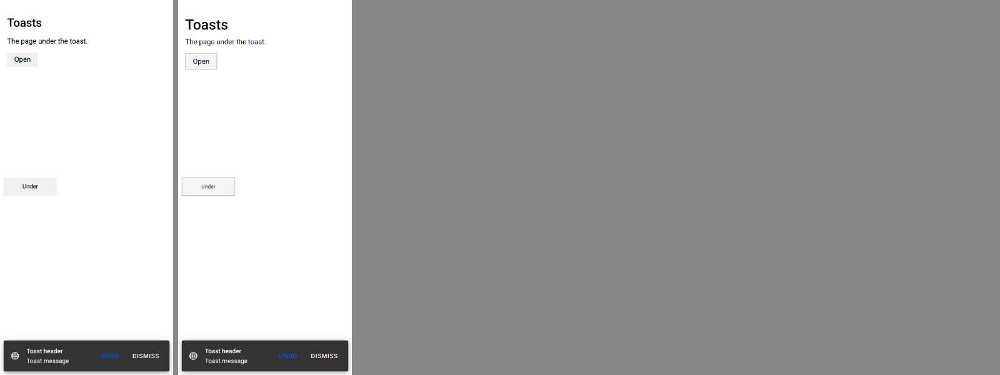 | 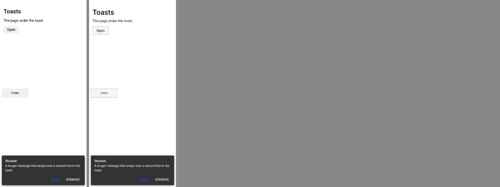 |

| Top | Middle | Icon-only cancel |
|---|---|---|
| 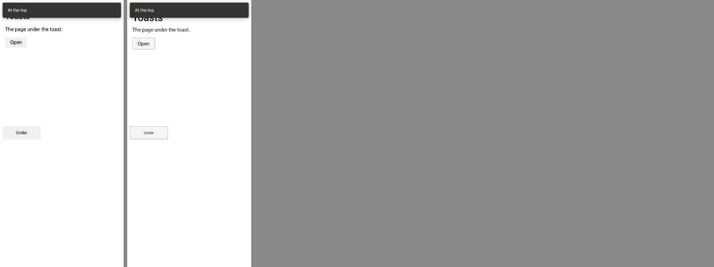 | 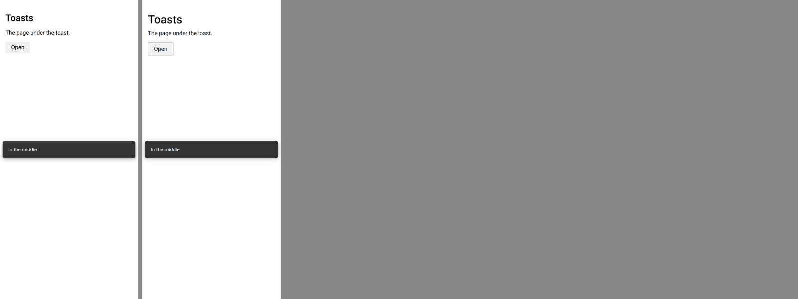 | 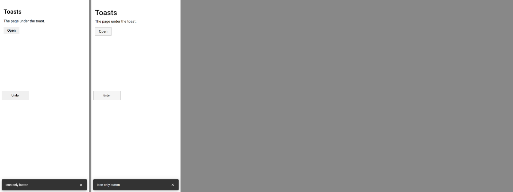 |

| `color="primary"` | `color="danger"`, an icon | Start buttons |
|---|---|---|
| 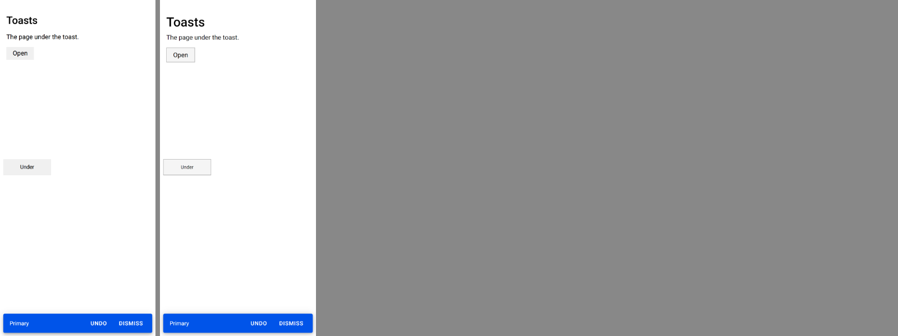 | 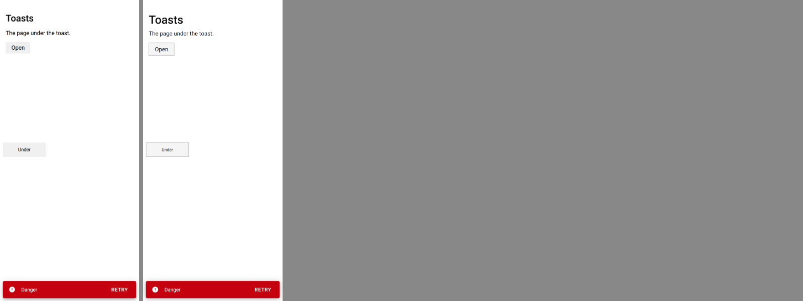 |  |

| Stacked, a start button | A long message | Tablet, 1024 x 768 |
|---|---|---|
| 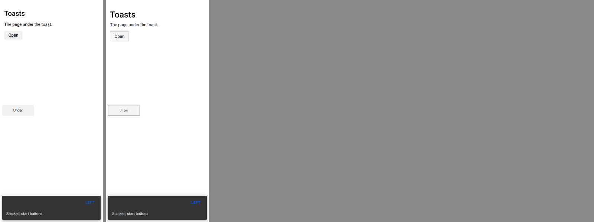 | 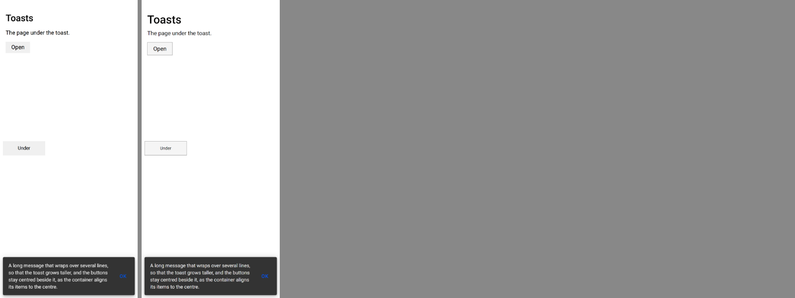 | 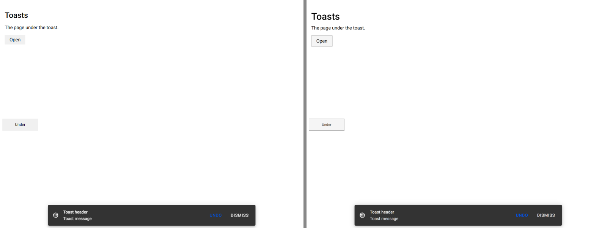 |

| RTL, `--start: 20px`, `--end: 40px` |
|---|
| 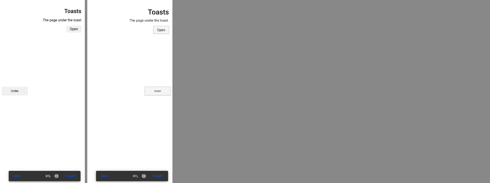 |

Ionic's on the left of each. The page under the toast differs a little (Ionic's `h1` from `typography.css`, the native buttons); the
toast is what's compared.

## Visual

Boxes are x, y, width, height in the window, with the render transform (`getBoundingClientRect`), asserted by the capture tests and
`AvonicToastTests` within 0.5 px unless said.

| | Ionic | Avonic | |
|---|---|---|---|
| Basic: wrapper, message | 8, 788, 374 x 48; 24, 802, 342 x 20 | the same | Match (asserted) |
| Colours, radius, shadow | `#333333`, `#f2f2f2`, 4, md's three shadows | the same keys; the shadow through `{b:CssShadow}` | Match (asserted; the shadow by eye) |
| Header, icon, two buttons | wrapper 70 high; icon 19.59 at 24, 791.2; content from 43.59, 168.53 wide; buttons 71.25 and 90.63 x 36 at 212.13 | icon 20 wide, content from 44, 167.5 wide; buttons within 1 px | Match within 1.1 px (asserted): Avalonia rounds each box up to the device pixel, 0.5 px at 2x |
| Button text | 14 px, 500, 0.84 px apart, uppercase; Undo `#0054e9`, Dismiss `#e6e6e6`; text 16 high (`line-height: normal`) | the same; `LineHeight` 16 where Avalonia's own would be 16.41 | Match |
| Stacked | wrapper 134 high; content 90 the whole row; the end group a line of its own, its buttons at its end, 8 below | the same | Match (asserted) |
| Top; middle | 8, 8; 8, 398 | the same | Match (asserted) |
| Icon-only cancel | 36 x 36 at 338, 794, round; the content 330 wide | the same | Match (asserted) |
| `color` | primary: `#0054e9`, text and both buttons white; danger `#c5000f` with a white icon | the same | Match (asserted, B18) |
| Start buttons | baseline: start 16, content 81.22, end 299.22; stacked: the start group a line above, 8 above it, its button at the end | the same within 1 px | Match (asserted) |
| A long message | 4 lines, 108 high; OK centred beside it | the same | Match (asserted) |
| Tablet | 700 wide at 162 | the same | Match (asserted) |
| Custom sizes and a border | 83, 752, 204 x 84; content 48 centred in 80 | the same | Match (asserted, B4) |
| RTL | 40 to 370; the start group on the right | the same | Match (asserted) |
| Anchors | above the footer at 732 (`translateY(-64px)`); below the header at its bottom + 8 | the same | Match (asserted, B6) |
| Safe areas 30 / 20 | top 38, bottom 768 | the same | Match (asserted, B5) |
| `--white-space: nowrap` | one line, cut at the wrapper's end | the same (`TextWrapping.NoWrap`, the container clips) | Match (B20) |
| Hover with a mouse | `rgba(0, 84, 233, 0.08)`; a cancel button `rgba(255, 255, 255, 0.08)`; a pointer cursor | the same | Match (asserted, B19) |
| An empty `header` or `message` (`""`, or only spaces) | an empty `div`: 0 high, the header's 2 px margin | not shown | Match for the message (B24); 2 px short with an empty header, as Avalonia's empty `TextBlock` is a line high, so it's hidden |

## Behaviour

| Behaviour | Ionic | Avonic | |
|---|---|---|---|
| Enter | 400 ms on the curve, opacity 0.01 to 1; the transform set at once | the same, frame by frame (0.2894 at 50 ms, as Chromium) | Match (B1) |
| Leave | 300 ms, 0.99 to 0; the transform kept | the same | Match (B2) |
| Events | the four, in order, with data and role | the same | Match (B3) |
| Duration | `timeout` 1000 after the present resolved | the same, on the clock | Match (B7) |
| `toastDuration` config | the default | `AvonicConfig.ToastDuration`, at style priority | Match (B7) |
| Buttons, handlers, cancel | M20 | the same | Match (B8 to B10) |
| Focus | none taken or given back; `keyboardClose` focuses the host | the same | Match (B11) |
| A click on its button over an alert | focus back to the alert's | the same | Match (B11) |
| A tap beside the wrapper | reaches the page | the same | Match (B12) |
| Escape, back on a toast | nothing | nothing | Match (B12) |
| Escape over an alert with a toast on top | nothing | the alert is dismissed | Deliberate: an Ionic bug, `docs/infra/ionic-issues.md` (B12) |
| Tab from the page | never reaches the buttons | reaches them after the page's last | Deliberate: an Ionic bug, `docs/infra/ionic-issues.md` (B21) |
| Stacking | 60000 + the index; a later toast over an earlier, in the same place | the same | Match (B13) |
| A toast over an open menu | the menu's focus trap is off while it shows (`menu.handleFocus` takes every overlay) | the same: `AvonicMenu` defers to the top overlay, toasts included | Match, Ionic's, left as the menu has it; its back skips a toast, as the overlays' own |
| Swipe at the bottom and the top | 1:1 after 10 px; under half back, over it out and `gesture` with no leave; the release played over a 200 ms animation from the step, or faster with a flick | the same, on the clock: 20 px back in 36 ms, 50 px out in 57 ms | Match (B14) |
| Swipe in the middle | either way, a quarter | the same | Match (B15) |
| `swipeGesture` while presented | made and destroyed | the same | Match (B16) |
| `swipeGesture` set during the enter | `presented` is already true: a gesture is made then, and another at the end of the present, the first never destroyed | made at the end of the present only | Deliberate: Ionic's would leak a gesture |
| The swipe's animation after a dismiss by other means | held on the wrapper at the present's place | destroyed with the gesture | Deliberate: no difference to see; Ionic's would hold an old place over a later present at another position |
| Live region | `role="status"`, `aria-live="polite"`, the text `aria-hidden` until the enter has finished | `LiveSetting` `Polite` on the content, the text `AccessibilityView` `Raw` until then | Match (B21); `aria-atomic` has no counterpart; no screen reader tried |
| Automation names | buttons by text or `aria-label`; `htmlAttributes` `id` | the same; the toast a `Group` (Ionic's host has no role) | Match (B21) |
| A render while presented | follows at once; a new position moves it by its class and keeps the present's transform | the same | Match (B23) |
| Re-presented at another position | keeps the other's inline style | the middle clears the transform | Deliberate: an Ionic bug, `docs/infra/ionic-issues.md` (B1) |
| Inline, `trigger`, `isOpen` | moved to `ion-app`, back after | moved to the overlay host, back after | Match (B22) |
| Safe area while presented | `calc(… var(--ion-safe-area-…))` follows the variable | read once, at present | Gap: a safe area that changes while a toast is up moves Ionic's; Avonic's keeps its place until it's presented again |
| White space | `normal` collapses runs, `pre-line` keeps breaks | the same, by `ToastContent.WhiteSpaceText` | Match (B20); `break-spaces` is kept as `pre-wrap` |
| Button groups too wide for the line | `flex-shrink` down to their min-content | not shrunk; clipped | Gap: not reached by any measured case; a button's text wraps in Chromium before it's cut here |
| Message as HTML | with `innerHTMLTemplatesEnabled` only | plain text | Deliberate, as the alert |
| `duration` too long for a timer (over 2^31 - 1 ms, `Infinity`) | a browser's `setTimeout` overflows past 2^31 - 1 ms and fires at once (not measured) | never dismissed by itself | Deliberate: a `TimeSpan` can't hold it, and "forever" is what an app means (B7) |

## Not tried

- A real window: `drive.ps1`'s `ion-toast` section (the trigger, a click through to the page beside a toast, Escape, the icon-only and
  cancel buttons by name, a handler returning false, touch swipes in the middle and on a stacked toast, a duration's timeout) is for
  the batch's runner.
- A screen reader's announcement of the live region; a phone.
