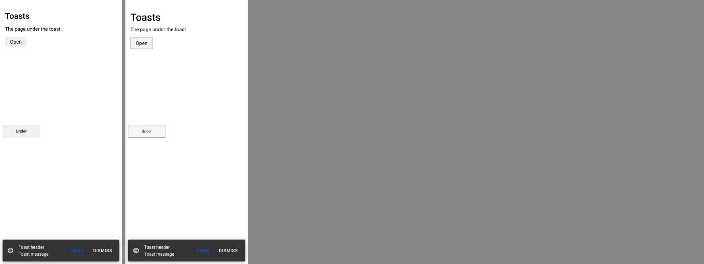

# ion-toast

Status: done · [#38](https://github.com/wdcossey/Avonic/issues/38)

`AvonicToast`, Ionic's `ion-toast`, md: a short message at the bottom, the top or the middle of the window, over every other overlay,
with no backdrop, which doesn't take focus or block the page, on the [overlay system](../../infra/overlays/README.md). Plan:
[PLAN.md](PLAN.md); comparison: [COMPARISON.md](COMPARISON.md).



## Usage

In code, as Ionic's `toastController.create`:

```csharp
var toast = new AvonicToast
{
    Message = "The photo is in your library.",
    Duration = 3000,                                   // 0, the default, keeps it until it's dismissed
    Buttons = [new ToastButton { Text = "Undo", Handler = () => Undo() }, new ToastButton { Text = "Dismiss", Role = "cancel" }],
};
await toast.Present();
var (_, role) = await toast.OnDidDismiss();           // "timeout", "cancel", "gesture", or a button's role
```

In a page, opened by a trigger or `IsOpen`:

```xml
<c:AvonicButton Name="Save" Content="Save" />
<c:AvonicToast Trigger="Save" Header="Saved" Message="The photo is in your library." Icon="checkmark-circle"
               Position="Top" ToastSwipeGesture="Vertical">
    <c:AvonicToast.Buttons>
        <c:ToastButton Text="Undo" />
        <c:ToastButton Icon="close" Role="cancel" />
    </c:AvonicToast.Buttons>
</c:AvonicToast>
```

`Position` is `Bottom` (the default), `Top` or `Middle`: 8 from the edge and its safe area (`Avonic.SafeAreaTop`,
`Avonic.SafeAreaBottom`), or, with `PositionAnchor` (a control, or its name), 8 beyond the anchor's edge. `Layout="Stacked"` puts the
buttons on a line of their own. A button's `Handler` runs before the dismiss: return `false` (or a `Task` of it) to keep the toast
open; anything else dismisses with the button's `Role`, and no data. A `cancel` (or `backdrop`) button dismisses at once, and the
first `cancel` button's handler runs whenever the toast is dismissed with one of those roles. A string is a plain button. With
`ToastSwipeGesture="Vertical"` a swipe dismisses it with the `gesture` role: down at the bottom, up at the top, either way in the
middle. `AvonicConfig.ToastDuration` is every toast's default `Duration`.

A toast takes no focus (`KeyboardClose` is `false`, unlike the other overlays), traps none, isn't dismissed by Escape or back, and lets
the page under it take input beside it. Its content is a polite live region.

## Checklist

From `node tools/ionic-api.js ion-toast`; the reasons for each row are in [PLAN.md](PLAN.md).

### Props

| ✓ | Ionic | Avonic |
|---|---|---|
| [x] | `animated`, `enterAnimation`, `leaveAnimation` | the overlay's; the builders get a `ToastPresentOptions` |
| [x] | `buttons` | `Buttons`, `IList<ToastButton>` |
| [x] | `color` | `Color` |
| [x] | `cssClass` | `CssClass` |
| [x] | `duration` | `Duration`, ms; default `AvonicConfig.ToastDuration` |
| [x] | `header`, `message` | `Header`, `Message` (plain text) |
| [x] | `htmlAttributes` | `HtmlAttributes`: `id`, `aria-label` |
| [x] | `icon` | `Icon` |
| [x] | `isOpen`, `trigger` | the overlay's |
| [x] | `keyboardClose` | the overlay's, `false` by default |
| [x] | `layout` | `Layout`: `Baseline`, `Stacked` |
| [ ] | `mode` | not exposed (ADR 0001) |
| [x] | `position` | `Position`: `Bottom`, `Top`, `Middle` |
| [x] | `positionAnchor` | `PositionAnchor`: a `Control` or a name |
| [x] | `swipeGesture` | `ToastSwipeGesture`: `ToastSwipeGestureDirection.Vertical` or null |
| [ ] | `translucent` | not applicable: ios only |

`ToastButton`: `Text`, `Icon`, `Side` (`ToastButtonSide.Start`, or the end), `Role`, `HtmlAttributes` (`aria-label`), `Handler`.

### Events and methods

| ✓ | Ionic | Avonic |
|---|---|---|
| [x] | `ionToastWillPresent`, `ionToastDidPresent`, `ionToastWillDismiss`, `ionToastDidDismiss` | `IonToastWillPresent` and the rest, each before the generic one |
| [x] | `willPresent`, `didPresent`, `willDismiss`, `didDismiss` | the overlay's |
| [x] | `present()`, `dismiss()`, `onDidDismiss()`, `onWillDismiss()` | the overlay's |

### Parts

| ✓ | Ionic | Avonic |
|---|---|---|
| [x] | `wrapper`, `container`, `content`, `header`, `message`, `icon` | `PART_Wrapper` (placed by `PART_Panel`, a `ToastPanel`), `PART_Container` (a `ToastContainer`), `PART_Content` (a `ToastContent`), `PART_Header`, `PART_Message`, `PART_Icon` |
| [x] | `button`, `button cancel` | `ToastNativeButton`, in `PART_StartButtons` or `PART_EndButtons`, with its own `ControlTheme`; `:cancel` for `button cancel`, and `:role-<role>`, `:icon-only`, `:in-color` |

### CSS custom properties

| ✓ | Ionic | Avonic resource key | md default |
|---|---|---|---|
| [x] | `--background` | `Avonic.Toast.Background` | unset: `Avonic.BackgroundColorStep800Brush` |
| [x] | `--color` | `Avonic.Toast.Color` | unset: `Avonic.TextColorStep950Brush` |
| [x] | `--button-color` | `Avonic.Toast.ButtonColor` | unset: `Avonic.Color.PrimaryBrush` |
| [x] | `--border-color` | `Avonic.Toast.BorderColor` | unset: the toast's `Foreground` |
| [x] | `--border-radius` | `Avonic.Toast.BorderRadius` | 4 |
| [x] | `--border-style` | `Avonic.Toast.BorderStyle` | `none` |
| [x] | `--border-width` | `Avonic.Toast.BorderWidth` | 0 |
| [x] | `--box-shadow` | `Avonic.Toast.BoxShadow` | md's three shadows |
| [x] | `--start`, `--end` | `Avonic.Toast.Start`, `Avonic.Toast.End` | 8 |
| [x] | `--width`, `--min-width` | `Avonic.Toast.Width`, `Avonic.Toast.MinWidth` | `auto` |
| [x] | `--max-width` | `Avonic.Toast.MaxWidth` | 700 |
| [x] | `--height`, `--min-height`, `--max-height` | `Avonic.Toast.Height`, `.MinHeight`, `.MaxHeight` | `auto` |
| [x] | `--white-space` | `Avonic.Toast.WhiteSpace` | `normal` |

A size takes a number (px) or a CSS string: px, `%`, `vw` and `vh` (of the window), a sum or difference, `calc()`, `min(a, b)`,
`auto`; sizes are content-box, as CSS's, so a border adds to them. Not Ionic variables, md's literals as keys:
`Avonic.Toast.Md.ButtonCancelColor`, `Avonic.Toast.Md.ButtonBackgroundHover`, `Avonic.Toast.Md.ButtonCancelBackgroundHover`.

## Behaviours

B1 to B24 in [PLAN.md](PLAN.md), each tested in `AvonicToastTests` and `AvonicToastCaptureTests` on the test clock: md's enter and
leave frame by frame, where the present puts it (edges, middle, safe areas, anchors, sizes, RTL), the events, the duration and its
config, buttons and their handlers, the cancel handler, focus, input beside it, Escape, stacking, the swipe at each position, the
layouts, colours, hover and ripple, white space, automation and Tab, `IsOpen` and `Trigger`, and changes while presented.

## Extensions

None. `Present(TopLevel)` is the overlay's.

## Known gaps

- **Safe areas** are read at present; Ionic's `calc()` follows a change while the toast is up.
- **An empty `Header`** (`""`) isn't shown, where Ionic's empty `div` keeps its 2 px margin.
- **Button groups** don't shrink below their buttons when a line is too narrow (CSS's `flex-shrink`); they're clipped.
- **`aria-atomic`** has no Avalonia counterpart; the live region isn't tried with a screen reader.
- **Not copied** ([ionic-issues.md](../../infra/ionic-issues.md)): Ionic's Tab never reaches a toast's buttons; a toast on top stops
  Escape and back dismissing the overlay under it; a toast presented again at another position keeps the old position's inline style.
- Not tried in a real window: `tools/real-window/drive.ps1` has an `ion-toast` section for the batch's runner.
