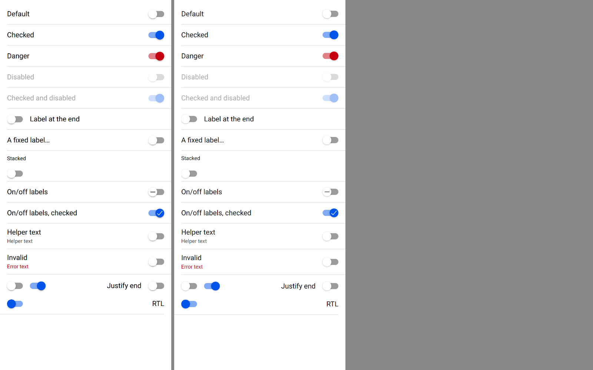
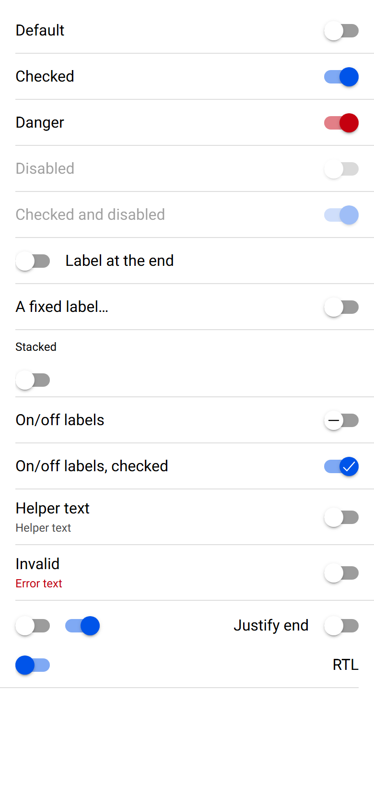
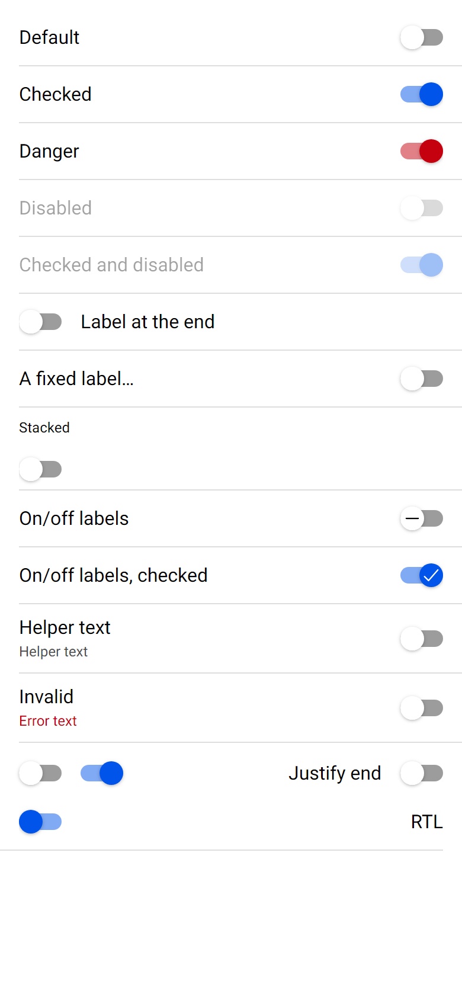

# ion-toggle — Comparison against the web component

> Ionic side: `node tools/ionic-ref/render.js ion-toggle --bare --html '<the snippet below>'` (Chromium, md, 390×844@2x) → [`ref/`](ref/).
> The snippet wraps itself in `ion-app`, with `position:static;display:block;contain:none;overflow:visible`. `ref/README.md` holds the
> exact command, and `ref/page.html` the page.
> Avonic side: `AVONIC_CAPTURE_DIR=… dotnet test` → `AvonicToggleCaptureTests.Reference_Page` (headless Skia, 2×) → [`compare/`](compare/).
> Not tried in a real window, or on a device.

```html
<ion-app style="position:static;display:block;contain:none;overflow:visible"><ion-list>
<ion-item><ion-toggle>Default</ion-toggle></ion-item>
<ion-item><ion-toggle checked>Checked</ion-toggle></ion-item>
<ion-item><ion-toggle checked color="danger">Danger</ion-toggle></ion-item>
<ion-item><ion-toggle disabled>Disabled</ion-toggle></ion-item>
<ion-item><ion-toggle checked disabled>Checked and disabled</ion-toggle></ion-item>
<ion-item><ion-toggle label-placement="end">Label at the end</ion-toggle></ion-item>
<ion-item><ion-toggle label-placement="fixed">A fixed label that is far too long</ion-toggle></ion-item>
<ion-item><ion-toggle label-placement="stacked" alignment="start">Stacked</ion-toggle></ion-item>
<ion-item><ion-toggle enable-on-off-labels>On/off labels</ion-toggle></ion-item>
<ion-item><ion-toggle enable-on-off-labels checked>On/off labels, checked</ion-toggle></ion-item>
<ion-item><ion-toggle helper-text="Helper text">Helper text</ion-toggle></ion-item>
<ion-item><ion-toggle class="ion-touched ion-invalid" helper-text="Helper text" error-text="Error text">Invalid</ion-toggle></ion-item>
</ion-list>
<div style="padding:8px 16px;display:flex;gap:16px;align-items:center"><ion-toggle></ion-toggle><ion-toggle checked></ion-toggle><ion-toggle justify="end" style="flex:1">Justify end</ion-toggle></div>
<ion-item dir="rtl"><ion-toggle dir="rtl" checked>RTL</ion-toggle></ion-item></ion-app>
```

(One line in the real command.) `Reference_Page` lays out the same content: the row of three is a `DockPanel` at 16 px Roboto,
the page's font, which an item would otherwise give.

The behaviours were measured with throwaway Playwright scripts against a page of toggles with ids, a mouse in a desktop context
and CDP touch events in a mobile one, and Chromium's accessibility tree through CDP. The numbers are in [PLAN.md](PLAN.md).

## Frames

Ionic on the left, Avonic on the right:



| Ionic | Avonic |
|---|---|
|  |  |

Sampled at 2×, the colours agree within 1 in each channel: the unchecked track `156,156,156` on both, the checked track
`127,169,244` and `128,170,244`, the danger track `226,127,135` and `226,128,135`, and the handles exactly. Layout agrees to the
rounding of a pixel: the track at 338, 16.5 in an item, the stacked label's box and its 16 px gap, the fixed label's 100 px.

### Found here, and fixed

- **The handle was clipped** outside an item, where it hangs 3 px over a 14 px toggle: a `ContentControl` clips by default.
- **Disabled, the track showed through the handle.** CSS's `opacity: 0.38` fades the toggle as one picture; Avalonia's `Opacity`
  fades each part on its own, so the white handle let the grey track through: 233 where Chromium has 255. An `OpacityMask` is a
  group, so the theme fades with one, `Avonic.Toggle.Md.DisabledMask`. Recorded for Avalonia.
- **A checked toggle slid into place when it was first shown.** The handle's travel was bound to the track's `Bounds`, which a
  layout fills in after the first frame, and the transition then ran. It's bound to the track's set `Width` now.

## Behaviours

| # | Behaviour | Ionic | Avonic | Result |
|---|---|---|---|---|
| 1 | A click on the label, the track, the gap, the row's end | flips, one `ionChange` with `checked` and `value` | the same | match |
| 1 | A double click | flips twice | the same | match |
| 1 | A tap; a finger moved 30 px from the label | flips and focuses; nothing | the same | match |
| 2 | `checked` set in code | no `ionChange` | the same | match |
| 3 | Space; held, repeating; Enter | flips on key down; flips each repeat; nothing | the same | match |
| 4 | Disabled: click, Space, drag, Tab | nothing, not a tab stop, 0.38 as a group | the same | match |
| 4 | In a disabled item | the item fades, the toggle adds nothing | the same | match |
| 5 | A mouse drag on the track | captures at 5, flips at 16 from the press, back at −6 | the same | match |
| 5 | A finger's drag on the track | flips at 27 px from the press | flips at 16 | deliberate difference, below |
| 5 | Leaving the track mid-drag | still dragging | the same | match |
| 6 | A mouse drag from the label | no gesture, a click on release | the same | match |
| 7 | A click 50 ms after a drag; 400 ms after | dropped; flips | the same | match |
| 8 | The drag's start | focuses, `toggle-activated` until the end | focuses, `:activated` | match |
| 9 | RTL, `dir` on the document or the toggle | handle at the right when off, a drag left turns it on | the same | match |
| 9 | RTL, `dir` on an ancestor only | layout mirrored, handle and drag LTR | RTL throughout | deliberate difference, below |
| 10 | Focus: a press, a tap, Tab; focus in the label | `ionFocus`, `ionBlur`; neither | the same | match |
| 11 | Keyboard focus | Chromium's ring, `outline: auto 1px` | the base theme's adorner | deliberate difference, below |
| 12 | A tap on the item's padding; on a disabled toggle's | flips; nothing | the same | match |
| 13 | In an item | fills the row, 47 high, label margins 10, stacked 10 and 16, track 10 off the bottom | the same | match |
| 14 | No label | label part hidden, track at the row's start | the same | match |
| 15 | Placements start, end, fixed, stacked | as in the frames | the same | match |
| 15 | A long stacked label | its box `100% / 0.75` wide, drawn the row's width | its box up to 4 px narrower: a trimmed `TextBlock` is as wide as it draws | match, within 4 px |
| 16 | Justify start, end, space-between; alignment start | packs; fills the width | the same | match |
| 17 | Outside an item | inline-block, as wide as its content, the handle over its edge | the same | match |
| 18 | A long label | one line, ellipsis, track in place | the same | match |
| 19 | Helper text; `ion-touched` and `ion-invalid`; neither | helper at 12 px; error in danger instead; no bottom | the same | match |
| 20 | Colours, a `Color`, the tokens | as measured | the same, by pixel | match |
| 21 | Transitions | 160 ms `cubic-bezier(.4, 0, .2, 1)` for the handle, 160 ms `ease` for the track | the same | match |
| 22 | On/off labels | `remove-outline`, `checkmark-outline`, 18 px, black, then the contrast | the same | match |
| 23 | Accessibility | `switch`, named "Helper Helper text", "Helper" when invalid, "" with no label; `aria-labelledby` beats `aria-label` | a toggle-pattern button, the same names, the hint as help text, announced when it changes | match; `aria-required` and `aria-invalid` are a gap |
| 24 | In an item's start or end slot | no margin | the same | match |

## Deliberate differences

- **A finger flips the toggle 16 px into a drag, where Chromium takes 27.** Ionic's gesture captures at 5 px and flips 10 px
  later, which a mouse shows: 16. Chromium holds a finger's `touchmove`s back until it's 15 px from the press, so Ionic first
  hears of the finger at 16 px, captures there, and flips at 27. That's Chromium's input pipeline, not Ionic, and Avalonia has
  no such slop, so Avonic follows Ionic's code.
- **RTL from an ancestor.** Ionic's `isRTL` reads only the toggle's own `dir` and the document's. A `dir="rtl"` between them
  mirrors the layout, as CSS direction inherits, but leaves the handle and the drag in LTR: measured, the checked handle sat at
  the right of the track, and a drag left of 25 px didn't flip it. Avalonia's `FlowDirection` inherits and can't say where it
  came from, so RTL is RTL throughout, as Ionic is with `dir` on the document. The frame uses `dir` on the toggle for that reason.
- **The focus ring** is the platform's on both sides: Chromium's dark ring, and here the base theme's adorner, which the theme
  leaves alone, as Ionic leaves the outline alone.

## Gaps

- **Mid-transition colours.** Avalonia's `BrushTransition` blends colour and opacity apart, where CSS blends premultiplied sRGB.
  The first review probed Avalonia 12.1.4 halfway from the unchecked to the checked track: `#0000BC` at 0.445, where CSS gives
  about `rgb(0, 0, 143)` at 0.445. The ends match; the track is a brighter blue for part of the 160 ms. Not compared by frame.
- **An item that met its toggle disabled** doesn't forward a tap on its padding once the toggle is enabled, until something
  else makes it look again: `AvonicItem` only makes its native button when it first has an enabled control. Ionic looks at every
  click. It's the item's, so it's under "Proposed for shared files" in the PR.
- `aria-required` and `aria-invalid`: Avalonia 12's automation has neither.
- A control as the label always counts as one; Ionic hides the label part when the slot has no text, an icon alone included.
- Not tried in a real window, or on a device.
