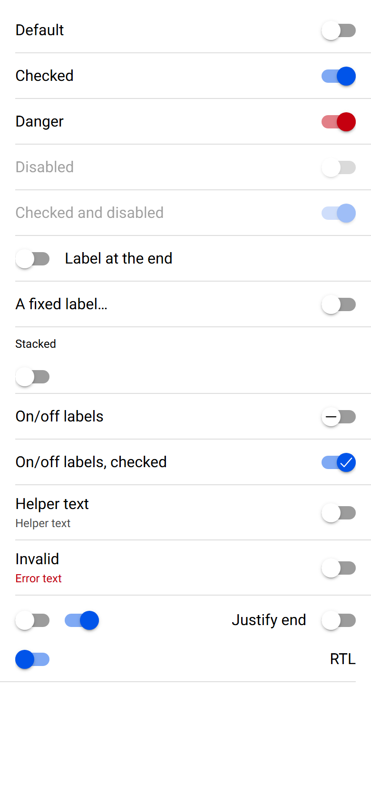
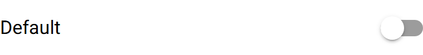

# ion-toggle — reference render (Ionic 8.8.1, md, 390×844@2x)

Generated by `node tools/ionic-ref/render.js ion-toggle --bare --html "<ion-app style=\"position:static;display:block;contain:none;overflow:visible\"><ion-list><ion-item><ion-toggle>Default</ion-toggle></ion-item><ion-item><ion-toggle checked>Checked</ion-toggle></ion-item><ion-item><ion-toggle checked color=\"danger\">Danger</ion-toggle></ion-item><ion-item><ion-toggle disabled>Disabled</ion-toggle></ion-item><ion-item><ion-toggle checked disabled>Checked and disabled</ion-toggle></ion-item><ion-item><ion-toggle label-placement=\"end\">Label at the end</ion-toggle></ion-item><ion-item><ion-toggle label-placement=\"fixed\">A fixed label that is far too long</ion-toggle></ion-item><ion-item><ion-toggle label-placement=\"stacked\" alignment=\"start\">Stacked</ion-toggle></ion-item><ion-item><ion-toggle enable-on-off-labels>On/off labels</ion-toggle></ion-item><ion-item><ion-toggle enable-on-off-labels checked>On/off labels, checked</ion-toggle></ion-item><ion-item><ion-toggle helper-text=\"Helper text\">Helper text</ion-toggle></ion-item><ion-item><ion-toggle class=\"ion-touched ion-invalid\" helper-text=\"Helper text\" error-text=\"Error text\">Invalid</ion-toggle></ion-item></ion-list><div style=\"padding:8px 16px;display:flex;gap:16px;align-items:center\"><ion-toggle></ion-toggle><ion-toggle checked></ion-toggle><ion-toggle justify=\"end\" style=\"flex:1\">Justify end</ion-toggle></div><ion-item dir=\"rtl\"><ion-toggle dir=\"rtl\" checked>RTL</ion-toggle></ion-item></ion-app>"`

```html
<ion-app style="position:static;display:block;contain:none;overflow:visible"><ion-list><ion-item><ion-toggle>Default</ion-toggle></ion-item><ion-item><ion-toggle checked>Checked</ion-toggle></ion-item><ion-item><ion-toggle checked color="danger">Danger</ion-toggle></ion-item><ion-item><ion-toggle disabled>Disabled</ion-toggle></ion-item><ion-item><ion-toggle checked disabled>Checked and disabled</ion-toggle></ion-item><ion-item><ion-toggle label-placement="end">Label at the end</ion-toggle></ion-item><ion-item><ion-toggle label-placement="fixed">A fixed label that is far too long</ion-toggle></ion-item><ion-item><ion-toggle label-placement="stacked" alignment="start">Stacked</ion-toggle></ion-item><ion-item><ion-toggle enable-on-off-labels>On/off labels</ion-toggle></ion-item><ion-item><ion-toggle enable-on-off-labels checked>On/off labels, checked</ion-toggle></ion-item><ion-item><ion-toggle helper-text="Helper text">Helper text</ion-toggle></ion-item><ion-item><ion-toggle class="ion-touched ion-invalid" helper-text="Helper text" error-text="Error text">Invalid</ion-toggle></ion-item></ion-list><div style="padding:8px 16px;display:flex;gap:16px;align-items:center"><ion-toggle></ion-toggle><ion-toggle checked></ion-toggle><ion-toggle justify="end" style="flex:1">Justify end</ion-toggle></div><ion-item dir="rtl"><ion-toggle dir="rtl" checked>RTL</ion-toggle></ion-item></ion-app>
```

 

## Element 1

- attributes: `{"role":"switch","aria-checked":"false","aria-labelledby":"ion-tg-14-lbl","tabindex":"0","class":"md in-item toggle-label-placement-start toggle-ltr hydrated"}`
- classes: `md in-item toggle-label-placement-start toggle-ltr hydrated`
- rect: `{"x":16,"y":8,"w":358,"h":47}`

### CSS custom properties (resolved)

| var | value |
|---|---|
| `--border-radius` | `14px` |
| `--handle-background` | `#ffffff` |
| `--handle-background-checked` | `#0054e9` |
| `--handle-border-radius` | `50%` |
| `--handle-box-shadow` | `0 3px 1px -2px rgba(0, 0, 0, 0.2), 0 2px 2px 0 rgba(0, 0, 0, 0.14), 0 1px 5px 0 rgba(0, 0, 0, 0.12)` |
| `--handle-height` | `20px` |
| `--handle-max-height` | `calc(100% + 6px)` |
| `--handle-spacing` | `0` |
| `--handle-transition` | `transform 160ms cubic-bezier(0.4, 0, 0.2, 1), background-color 160ms cubic-bezier(0.4, 0, 0.2, 1)` |
| `--handle-width` | `20px` |
| `--track-background` | `rgba(0, 0, 0, 0.39)` |
| `--track-background-checked` | `rgba(0,84,233, 0.5)` |

### Host computed

| prop | value |
|---|---|
| display | `block` |
| position | `relative` |
| box-sizing | `content-box` |
| width | `358px` |
| height | `47px` |
| min-height | `auto` |
| min-width | `auto` |
| padding | `0px` |
| margin | `0px` |
| border | `0px none rgb(0, 0, 0)` |
| border-radius | `0px` |
| background-color | `rgba(0, 0, 0, 0)` |
| color | `rgb(0, 0, 0)` |
| font-size | `16px` |
| font-weight | `400` |
| font-family | `Roboto, "Helvetica Neue", sans-serif` |
| line-height | `normal` |
| letter-spacing | `normal` |
| text-transform | `none` |
| opacity | `1` |
| overflow | `visible` |
| contain | `none` |
| pointer-events | `auto` |
| transition | `all` |
| transform | `none` |
| box-shadow | `none` |
| outline | `rgb(0, 0, 0) none 0px` |
| cursor | `pointer` |

### Shadow parts

#### part="label" (`div`) rect `{"x":16,"y":22,"w":51.2,"h":19}`

| prop | value |
|---|---|
| display | `block` |
| position | `static` |
| box-sizing | `content-box` |
| width | `51.2031px` |
| height | `19px` |
| min-height | `auto` |
| min-width | `auto` |
| padding | `0px` |
| margin | `10px 16px 10px 0px` |
| border | `0px none rgb(0, 0, 0)` |
| border-radius | `0px` |
| background-color | `rgba(0, 0, 0, 0)` |
| color | `rgb(0, 0, 0)` |
| font-size | `16px` |
| font-weight | `400` |
| font-family | `Roboto, "Helvetica Neue", sans-serif` |
| line-height | `normal` |
| letter-spacing | `normal` |
| text-transform | `none` |
| opacity | `1` |
| overflow | `hidden` |
| contain | `none` |
| pointer-events | `auto` |
| transition | `all` |
| transform | `none` |
| box-shadow | `none` |
| outline | `rgb(0, 0, 0) none 0px` |
| cursor | `pointer` |

#### part="track" (`div`) rect `{"x":338,"y":24.5,"w":36,"h":14}`

| prop | value |
|---|---|
| display | `block` |
| position | `relative` |
| box-sizing | `content-box` |
| width | `36px` |
| height | `14px` |
| min-height | `auto` |
| min-width | `auto` |
| padding | `0px` |
| margin | `0px` |
| border | `0px none rgb(0, 0, 0)` |
| border-radius | `14px` |
| background-color | `rgba(0, 0, 0, 0.39)` |
| color | `rgb(0, 0, 0)` |
| font-size | `16px` |
| font-weight | `400` |
| font-family | `Roboto, "Helvetica Neue", sans-serif` |
| line-height | `normal` |
| letter-spacing | `normal` |
| text-transform | `none` |
| opacity | `1` |
| overflow | `visible` |
| contain | `none` |
| pointer-events | `auto` |
| transition | `background-color 0.16s` |
| transform | `none` |
| box-shadow | `none` |
| outline | `rgb(0, 0, 0) none 0px` |
| cursor | `pointer` |

#### part="handle" (`div`) rect `{"x":338,"y":21.5,"w":20,"h":20}`

| prop | value |
|---|---|
| display | `flex` |
| position | `absolute` |
| box-sizing | `content-box` |
| width | `20px` |
| height | `20px` |
| min-height | `0px` |
| min-width | `0px` |
| padding | `0px` |
| margin | `0px` |
| border | `0px none rgb(0, 0, 0)` |
| border-radius | `50%` |
| background-color | `rgb(255, 255, 255)` |
| color | `rgb(0, 0, 0)` |
| font-size | `16px` |
| font-weight | `400` |
| font-family | `Roboto, "Helvetica Neue", sans-serif` |
| line-height | `normal` |
| letter-spacing | `normal` |
| text-transform | `none` |
| opacity | `1` |
| overflow | `visible` |
| contain | `strict` |
| pointer-events | `auto` |
| transition | `transform 0.16s cubic-bezier(0.4, 0, 0.2, 1), background-color 0.16s cubic-bezier(0.4, 0, 0.2, 1)` |
| transform | `none` |
| box-shadow | `rgba(0, 0, 0, 0.2) 0px 3px 1px -2px, rgba(0, 0, 0, 0.14) 0px 2px 2px 0px, rgba(0, 0, 0, 0.12) 0px 1px 5px 0px` |
| outline | `rgb(0, 0, 0) none 0px` |
| cursor | `pointer` |

### DOM tree

```
<ion-toggle>
  #shadow-root
    <label.toggle-wrapper>
      <input#ion-tg-14>
      <div#ion-tg-14-lbl.label-text-wrapper part="label">
        <slot name="">
      <div.native-wrapper>
        <div.toggle-icon part="track">
          <div.toggle-icon-wrapper>
            <div.toggle-inner part="handle">
  <input.aux-input>
```

## Element 2

- attributes: `{"checked":"","role":"switch","aria-checked":"true","aria-labelledby":"ion-tg-7-lbl","tabindex":"0","class":"md in-item toggle-checked toggle-label-placement-start toggle-ltr hydrated"}`
- classes: `md in-item toggle-checked toggle-label-placement-start toggle-ltr hydrated`
- rect: `{"x":16,"y":56,"w":358,"h":47}`

### CSS custom properties (resolved)

| var | value |
|---|---|
| `--border-radius` | `14px` |
| `--handle-background` | `#ffffff` |
| `--handle-background-checked` | `#0054e9` |
| `--handle-border-radius` | `50%` |
| `--handle-box-shadow` | `0 3px 1px -2px rgba(0, 0, 0, 0.2), 0 2px 2px 0 rgba(0, 0, 0, 0.14), 0 1px 5px 0 rgba(0, 0, 0, 0.12)` |
| `--handle-height` | `20px` |
| `--handle-max-height` | `calc(100% + 6px)` |
| `--handle-spacing` | `0` |
| `--handle-transition` | `transform 160ms cubic-bezier(0.4, 0, 0.2, 1), background-color 160ms cubic-bezier(0.4, 0, 0.2, 1)` |
| `--handle-width` | `20px` |
| `--track-background` | `rgba(0, 0, 0, 0.39)` |
| `--track-background-checked` | `rgba(0,84,233, 0.5)` |

### Host computed

| prop | value |
|---|---|
| display | `block` |
| position | `relative` |
| box-sizing | `content-box` |
| width | `358px` |
| height | `47px` |
| min-height | `auto` |
| min-width | `auto` |
| padding | `0px` |
| margin | `0px` |
| border | `0px none rgb(0, 0, 0)` |
| border-radius | `0px` |
| background-color | `rgba(0, 0, 0, 0)` |
| color | `rgb(0, 0, 0)` |
| font-size | `16px` |
| font-weight | `400` |
| font-family | `Roboto, "Helvetica Neue", sans-serif` |
| line-height | `normal` |
| letter-spacing | `normal` |
| text-transform | `none` |
| opacity | `1` |
| overflow | `visible` |
| contain | `none` |
| pointer-events | `auto` |
| transition | `all` |
| transform | `none` |
| box-shadow | `none` |
| outline | `rgb(0, 0, 0) none 0px` |
| cursor | `pointer` |

### Shadow parts

#### part="label" (`div`) rect `{"x":16,"y":70,"w":61.55,"h":19}`

| prop | value |
|---|---|
| display | `block` |
| position | `static` |
| box-sizing | `content-box` |
| width | `61.5469px` |
| height | `19px` |
| min-height | `auto` |
| min-width | `auto` |
| padding | `0px` |
| margin | `10px 16px 10px 0px` |
| border | `0px none rgb(0, 0, 0)` |
| border-radius | `0px` |
| background-color | `rgba(0, 0, 0, 0)` |
| color | `rgb(0, 0, 0)` |
| font-size | `16px` |
| font-weight | `400` |
| font-family | `Roboto, "Helvetica Neue", sans-serif` |
| line-height | `normal` |
| letter-spacing | `normal` |
| text-transform | `none` |
| opacity | `1` |
| overflow | `hidden` |
| contain | `none` |
| pointer-events | `auto` |
| transition | `all` |
| transform | `none` |
| box-shadow | `none` |
| outline | `rgb(0, 0, 0) none 0px` |
| cursor | `pointer` |

#### part="track" (`div`) rect `{"x":338,"y":72.5,"w":36,"h":14}`

| prop | value |
|---|---|
| display | `block` |
| position | `relative` |
| box-sizing | `content-box` |
| width | `36px` |
| height | `14px` |
| min-height | `auto` |
| min-width | `auto` |
| padding | `0px` |
| margin | `0px` |
| border | `0px none rgb(0, 0, 0)` |
| border-radius | `14px` |
| background-color | `rgba(0, 84, 233, 0.5)` |
| color | `rgb(0, 0, 0)` |
| font-size | `16px` |
| font-weight | `400` |
| font-family | `Roboto, "Helvetica Neue", sans-serif` |
| line-height | `normal` |
| letter-spacing | `normal` |
| text-transform | `none` |
| opacity | `1` |
| overflow | `visible` |
| contain | `none` |
| pointer-events | `auto` |
| transition | `background-color 0.16s` |
| transform | `none` |
| box-shadow | `none` |
| outline | `rgb(0, 0, 0) none 0px` |
| cursor | `pointer` |

#### part="handle" (`div`) rect `{"x":354,"y":69.5,"w":20,"h":20}`

| prop | value |
|---|---|
| display | `flex` |
| position | `absolute` |
| box-sizing | `content-box` |
| width | `20px` |
| height | `20px` |
| min-height | `0px` |
| min-width | `0px` |
| padding | `0px` |
| margin | `0px` |
| border | `0px none rgb(255, 255, 255)` |
| border-radius | `50%` |
| background-color | `rgb(0, 84, 233)` |
| color | `rgb(255, 255, 255)` |
| font-size | `16px` |
| font-weight | `400` |
| font-family | `Roboto, "Helvetica Neue", sans-serif` |
| line-height | `normal` |
| letter-spacing | `normal` |
| text-transform | `none` |
| opacity | `1` |
| overflow | `visible` |
| contain | `strict` |
| pointer-events | `auto` |
| transition | `transform 0.16s cubic-bezier(0.4, 0, 0.2, 1), background-color 0.16s cubic-bezier(0.4, 0, 0.2, 1)` |
| transform | `none` |
| box-shadow | `rgba(0, 0, 0, 0.2) 0px 3px 1px -2px, rgba(0, 0, 0, 0.14) 0px 2px 2px 0px, rgba(0, 0, 0, 0.12) 0px 1px 5px 0px` |
| outline | `rgb(255, 255, 255) none 0px` |
| cursor | `pointer` |

### DOM tree

```
<ion-toggle>
  #shadow-root
    <label.toggle-wrapper>
      <input#ion-tg-7>
      <div#ion-tg-7-lbl.label-text-wrapper part="label">
        <slot name="">
      <div.native-wrapper>
        <div.toggle-icon part="track">
          <div.toggle-icon-wrapper>
            <div.toggle-inner part="handle">
  <input.aux-input>
```

## Element 3

- attributes: `{"checked":"","color":"danger","role":"switch","aria-checked":"true","aria-labelledby":"ion-tg-0-lbl","tabindex":"0","class":"ion-color ion-color-danger md in-item toggle-checked toggle-label-placement-start toggle-ltr hydrated"}`
- classes: `ion-color ion-color-danger md in-item toggle-checked toggle-label-placement-start toggle-ltr hydrated`
- rect: `{"x":16,"y":104,"w":358,"h":47}`

### CSS custom properties (resolved)

| var | value |
|---|---|
| `--border-radius` | `14px` |
| `--handle-background` | `#ffffff` |
| `--handle-background-checked` | `#0054e9` |
| `--handle-border-radius` | `50%` |
| `--handle-box-shadow` | `0 3px 1px -2px rgba(0, 0, 0, 0.2), 0 2px 2px 0 rgba(0, 0, 0, 0.14), 0 1px 5px 0 rgba(0, 0, 0, 0.12)` |
| `--handle-height` | `20px` |
| `--handle-max-height` | `calc(100% + 6px)` |
| `--handle-spacing` | `0` |
| `--handle-transition` | `transform 160ms cubic-bezier(0.4, 0, 0.2, 1), background-color 160ms cubic-bezier(0.4, 0, 0.2, 1)` |
| `--handle-width` | `20px` |
| `--track-background` | `rgba(0, 0, 0, 0.39)` |
| `--track-background-checked` | `rgba(0,84,233, 0.5)` |

### Host computed

| prop | value |
|---|---|
| display | `block` |
| position | `relative` |
| box-sizing | `content-box` |
| width | `358px` |
| height | `47px` |
| min-height | `auto` |
| min-width | `auto` |
| padding | `0px` |
| margin | `0px` |
| border | `0px none rgb(0, 0, 0)` |
| border-radius | `0px` |
| background-color | `rgba(0, 0, 0, 0)` |
| color | `rgb(0, 0, 0)` |
| font-size | `16px` |
| font-weight | `400` |
| font-family | `Roboto, "Helvetica Neue", sans-serif` |
| line-height | `normal` |
| letter-spacing | `normal` |
| text-transform | `none` |
| opacity | `1` |
| overflow | `visible` |
| contain | `none` |
| pointer-events | `auto` |
| transition | `all` |
| transform | `none` |
| box-shadow | `none` |
| outline | `rgb(0, 0, 0) none 0px` |
| cursor | `pointer` |

### Shadow parts

#### part="label" (`div`) rect `{"x":16,"y":118,"w":50.94,"h":19}`

| prop | value |
|---|---|
| display | `block` |
| position | `static` |
| box-sizing | `content-box` |
| width | `50.9375px` |
| height | `19px` |
| min-height | `auto` |
| min-width | `auto` |
| padding | `0px` |
| margin | `10px 16px 10px 0px` |
| border | `0px none rgb(0, 0, 0)` |
| border-radius | `0px` |
| background-color | `rgba(0, 0, 0, 0)` |
| color | `rgb(0, 0, 0)` |
| font-size | `16px` |
| font-weight | `400` |
| font-family | `Roboto, "Helvetica Neue", sans-serif` |
| line-height | `normal` |
| letter-spacing | `normal` |
| text-transform | `none` |
| opacity | `1` |
| overflow | `hidden` |
| contain | `none` |
| pointer-events | `auto` |
| transition | `all` |
| transform | `none` |
| box-shadow | `none` |
| outline | `rgb(0, 0, 0) none 0px` |
| cursor | `pointer` |

#### part="track" (`div`) rect `{"x":338,"y":120.5,"w":36,"h":14}`

| prop | value |
|---|---|
| display | `block` |
| position | `relative` |
| box-sizing | `content-box` |
| width | `36px` |
| height | `14px` |
| min-height | `auto` |
| min-width | `auto` |
| padding | `0px` |
| margin | `0px` |
| border | `0px none rgb(0, 0, 0)` |
| border-radius | `14px` |
| background-color | `rgba(197, 0, 15, 0.5)` |
| color | `rgb(0, 0, 0)` |
| font-size | `16px` |
| font-weight | `400` |
| font-family | `Roboto, "Helvetica Neue", sans-serif` |
| line-height | `normal` |
| letter-spacing | `normal` |
| text-transform | `none` |
| opacity | `1` |
| overflow | `visible` |
| contain | `none` |
| pointer-events | `auto` |
| transition | `background-color 0.16s` |
| transform | `none` |
| box-shadow | `none` |
| outline | `rgb(0, 0, 0) none 0px` |
| cursor | `pointer` |

#### part="handle" (`div`) rect `{"x":354,"y":117.5,"w":20,"h":20}`

| prop | value |
|---|---|
| display | `flex` |
| position | `absolute` |
| box-sizing | `content-box` |
| width | `20px` |
| height | `20px` |
| min-height | `0px` |
| min-width | `0px` |
| padding | `0px` |
| margin | `0px` |
| border | `0px none rgb(255, 255, 255)` |
| border-radius | `50%` |
| background-color | `rgb(197, 0, 15)` |
| color | `rgb(255, 255, 255)` |
| font-size | `16px` |
| font-weight | `400` |
| font-family | `Roboto, "Helvetica Neue", sans-serif` |
| line-height | `normal` |
| letter-spacing | `normal` |
| text-transform | `none` |
| opacity | `1` |
| overflow | `visible` |
| contain | `strict` |
| pointer-events | `auto` |
| transition | `transform 0.16s cubic-bezier(0.4, 0, 0.2, 1), background-color 0.16s cubic-bezier(0.4, 0, 0.2, 1)` |
| transform | `none` |
| box-shadow | `rgba(0, 0, 0, 0.2) 0px 3px 1px -2px, rgba(0, 0, 0, 0.14) 0px 2px 2px 0px, rgba(0, 0, 0, 0.12) 0px 1px 5px 0px` |
| outline | `rgb(255, 255, 255) none 0px` |
| cursor | `pointer` |

### DOM tree

```
<ion-toggle>
  #shadow-root
    <label.toggle-wrapper>
      <input#ion-tg-0>
      <div#ion-tg-0-lbl.label-text-wrapper part="label">
        <slot name="">
      <div.native-wrapper>
        <div.toggle-icon part="track">
          <div.toggle-icon-wrapper>
            <div.toggle-inner part="handle">
  <input.aux-input>
```

## Element 4

- attributes: `{"disabled":"","role":"switch","aria-checked":"false","aria-labelledby":"ion-tg-3-lbl","aria-disabled":"true","class":"md in-item toggle-disabled toggle-label-placement-start toggle-ltr hydrated"}`
- classes: `md in-item toggle-disabled toggle-label-placement-start toggle-ltr hydrated`
- rect: `{"x":16,"y":152,"w":358,"h":47}`

### CSS custom properties (resolved)

| var | value |
|---|---|
| `--border-radius` | `14px` |
| `--handle-background` | `#ffffff` |
| `--handle-background-checked` | `#0054e9` |
| `--handle-border-radius` | `50%` |
| `--handle-box-shadow` | `0 3px 1px -2px rgba(0, 0, 0, 0.2), 0 2px 2px 0 rgba(0, 0, 0, 0.14), 0 1px 5px 0 rgba(0, 0, 0, 0.12)` |
| `--handle-height` | `20px` |
| `--handle-max-height` | `calc(100% + 6px)` |
| `--handle-spacing` | `0` |
| `--handle-transition` | `transform 160ms cubic-bezier(0.4, 0, 0.2, 1), background-color 160ms cubic-bezier(0.4, 0, 0.2, 1)` |
| `--handle-width` | `20px` |
| `--track-background` | `rgba(0, 0, 0, 0.39)` |
| `--track-background-checked` | `rgba(0,84,233, 0.5)` |

### Host computed

| prop | value |
|---|---|
| display | `block` |
| position | `relative` |
| box-sizing | `content-box` |
| width | `358px` |
| height | `47px` |
| min-height | `auto` |
| min-width | `auto` |
| padding | `0px` |
| margin | `0px` |
| border | `0px none rgb(0, 0, 0)` |
| border-radius | `0px` |
| background-color | `rgba(0, 0, 0, 0)` |
| color | `rgb(0, 0, 0)` |
| font-size | `16px` |
| font-weight | `400` |
| font-family | `Roboto, "Helvetica Neue", sans-serif` |
| line-height | `normal` |
| letter-spacing | `normal` |
| text-transform | `none` |
| opacity | `0.38` |
| overflow | `visible` |
| contain | `none` |
| pointer-events | `none` |
| transition | `all` |
| transform | `none` |
| box-shadow | `none` |
| outline | `rgb(0, 0, 0) none 0px` |
| cursor | `pointer` |

### Shadow parts

#### part="label" (`div`) rect `{"x":16,"y":166,"w":61.73,"h":19}`

| prop | value |
|---|---|
| display | `block` |
| position | `static` |
| box-sizing | `content-box` |
| width | `61.7344px` |
| height | `19px` |
| min-height | `auto` |
| min-width | `auto` |
| padding | `0px` |
| margin | `10px 16px 10px 0px` |
| border | `0px none rgb(0, 0, 0)` |
| border-radius | `0px` |
| background-color | `rgba(0, 0, 0, 0)` |
| color | `rgb(0, 0, 0)` |
| font-size | `16px` |
| font-weight | `400` |
| font-family | `Roboto, "Helvetica Neue", sans-serif` |
| line-height | `normal` |
| letter-spacing | `normal` |
| text-transform | `none` |
| opacity | `1` |
| overflow | `hidden` |
| contain | `none` |
| pointer-events | `none` |
| transition | `all` |
| transform | `none` |
| box-shadow | `none` |
| outline | `rgb(0, 0, 0) none 0px` |
| cursor | `pointer` |

#### part="track" (`div`) rect `{"x":338,"y":168.5,"w":36,"h":14}`

| prop | value |
|---|---|
| display | `block` |
| position | `relative` |
| box-sizing | `content-box` |
| width | `36px` |
| height | `14px` |
| min-height | `auto` |
| min-width | `auto` |
| padding | `0px` |
| margin | `0px` |
| border | `0px none rgb(0, 0, 0)` |
| border-radius | `14px` |
| background-color | `rgba(0, 0, 0, 0.39)` |
| color | `rgb(0, 0, 0)` |
| font-size | `16px` |
| font-weight | `400` |
| font-family | `Roboto, "Helvetica Neue", sans-serif` |
| line-height | `normal` |
| letter-spacing | `normal` |
| text-transform | `none` |
| opacity | `1` |
| overflow | `visible` |
| contain | `none` |
| pointer-events | `none` |
| transition | `background-color 0.16s` |
| transform | `none` |
| box-shadow | `none` |
| outline | `rgb(0, 0, 0) none 0px` |
| cursor | `pointer` |

#### part="handle" (`div`) rect `{"x":338,"y":165.5,"w":20,"h":20}`

| prop | value |
|---|---|
| display | `flex` |
| position | `absolute` |
| box-sizing | `content-box` |
| width | `20px` |
| height | `20px` |
| min-height | `0px` |
| min-width | `0px` |
| padding | `0px` |
| margin | `0px` |
| border | `0px none rgb(0, 0, 0)` |
| border-radius | `50%` |
| background-color | `rgb(255, 255, 255)` |
| color | `rgb(0, 0, 0)` |
| font-size | `16px` |
| font-weight | `400` |
| font-family | `Roboto, "Helvetica Neue", sans-serif` |
| line-height | `normal` |
| letter-spacing | `normal` |
| text-transform | `none` |
| opacity | `1` |
| overflow | `visible` |
| contain | `strict` |
| pointer-events | `none` |
| transition | `transform 0.16s cubic-bezier(0.4, 0, 0.2, 1), background-color 0.16s cubic-bezier(0.4, 0, 0.2, 1)` |
| transform | `none` |
| box-shadow | `rgba(0, 0, 0, 0.2) 0px 3px 1px -2px, rgba(0, 0, 0, 0.14) 0px 2px 2px 0px, rgba(0, 0, 0, 0.12) 0px 1px 5px 0px` |
| outline | `rgb(0, 0, 0) none 0px` |
| cursor | `pointer` |

### DOM tree

```
<ion-toggle>
  #shadow-root
    <label.toggle-wrapper>
      <input#ion-tg-3>
      <div#ion-tg-3-lbl.label-text-wrapper part="label">
        <slot name="">
      <div.native-wrapper>
        <div.toggle-icon part="track">
          <div.toggle-icon-wrapper>
            <div.toggle-inner part="handle">
  <input.aux-input>
```

## Element 5

- attributes: `{"checked":"","disabled":"","role":"switch","aria-checked":"true","aria-labelledby":"ion-tg-6-lbl","aria-disabled":"true","class":"md in-item toggle-checked toggle-disabled toggle-label-placement-start toggle-ltr hydrated"}`
- classes: `md in-item toggle-checked toggle-disabled toggle-label-placement-start toggle-ltr hydrated`
- rect: `{"x":16,"y":200,"w":358,"h":47}`

### CSS custom properties (resolved)

| var | value |
|---|---|
| `--border-radius` | `14px` |
| `--handle-background` | `#ffffff` |
| `--handle-background-checked` | `#0054e9` |
| `--handle-border-radius` | `50%` |
| `--handle-box-shadow` | `0 3px 1px -2px rgba(0, 0, 0, 0.2), 0 2px 2px 0 rgba(0, 0, 0, 0.14), 0 1px 5px 0 rgba(0, 0, 0, 0.12)` |
| `--handle-height` | `20px` |
| `--handle-max-height` | `calc(100% + 6px)` |
| `--handle-spacing` | `0` |
| `--handle-transition` | `transform 160ms cubic-bezier(0.4, 0, 0.2, 1), background-color 160ms cubic-bezier(0.4, 0, 0.2, 1)` |
| `--handle-width` | `20px` |
| `--track-background` | `rgba(0, 0, 0, 0.39)` |
| `--track-background-checked` | `rgba(0,84,233, 0.5)` |

### Host computed

| prop | value |
|---|---|
| display | `block` |
| position | `relative` |
| box-sizing | `content-box` |
| width | `358px` |
| height | `47px` |
| min-height | `auto` |
| min-width | `auto` |
| padding | `0px` |
| margin | `0px` |
| border | `0px none rgb(0, 0, 0)` |
| border-radius | `0px` |
| background-color | `rgba(0, 0, 0, 0)` |
| color | `rgb(0, 0, 0)` |
| font-size | `16px` |
| font-weight | `400` |
| font-family | `Roboto, "Helvetica Neue", sans-serif` |
| line-height | `normal` |
| letter-spacing | `normal` |
| text-transform | `none` |
| opacity | `0.38` |
| overflow | `visible` |
| contain | `none` |
| pointer-events | `none` |
| transition | `all` |
| transform | `none` |
| box-shadow | `none` |
| outline | `rgb(0, 0, 0) none 0px` |
| cursor | `pointer` |

### Shadow parts

#### part="label" (`div`) rect `{"x":16,"y":214,"w":156.31,"h":19}`

| prop | value |
|---|---|
| display | `block` |
| position | `static` |
| box-sizing | `content-box` |
| width | `156.312px` |
| height | `19px` |
| min-height | `auto` |
| min-width | `auto` |
| padding | `0px` |
| margin | `10px 16px 10px 0px` |
| border | `0px none rgb(0, 0, 0)` |
| border-radius | `0px` |
| background-color | `rgba(0, 0, 0, 0)` |
| color | `rgb(0, 0, 0)` |
| font-size | `16px` |
| font-weight | `400` |
| font-family | `Roboto, "Helvetica Neue", sans-serif` |
| line-height | `normal` |
| letter-spacing | `normal` |
| text-transform | `none` |
| opacity | `1` |
| overflow | `hidden` |
| contain | `none` |
| pointer-events | `none` |
| transition | `all` |
| transform | `none` |
| box-shadow | `none` |
| outline | `rgb(0, 0, 0) none 0px` |
| cursor | `pointer` |

#### part="track" (`div`) rect `{"x":338,"y":216.5,"w":36,"h":14}`

| prop | value |
|---|---|
| display | `block` |
| position | `relative` |
| box-sizing | `content-box` |
| width | `36px` |
| height | `14px` |
| min-height | `auto` |
| min-width | `auto` |
| padding | `0px` |
| margin | `0px` |
| border | `0px none rgb(0, 0, 0)` |
| border-radius | `14px` |
| background-color | `rgba(0, 84, 233, 0.5)` |
| color | `rgb(0, 0, 0)` |
| font-size | `16px` |
| font-weight | `400` |
| font-family | `Roboto, "Helvetica Neue", sans-serif` |
| line-height | `normal` |
| letter-spacing | `normal` |
| text-transform | `none` |
| opacity | `1` |
| overflow | `visible` |
| contain | `none` |
| pointer-events | `none` |
| transition | `background-color 0.16s` |
| transform | `none` |
| box-shadow | `none` |
| outline | `rgb(0, 0, 0) none 0px` |
| cursor | `pointer` |

#### part="handle" (`div`) rect `{"x":354,"y":213.5,"w":20,"h":20}`

| prop | value |
|---|---|
| display | `flex` |
| position | `absolute` |
| box-sizing | `content-box` |
| width | `20px` |
| height | `20px` |
| min-height | `0px` |
| min-width | `0px` |
| padding | `0px` |
| margin | `0px` |
| border | `0px none rgb(255, 255, 255)` |
| border-radius | `50%` |
| background-color | `rgb(0, 84, 233)` |
| color | `rgb(255, 255, 255)` |
| font-size | `16px` |
| font-weight | `400` |
| font-family | `Roboto, "Helvetica Neue", sans-serif` |
| line-height | `normal` |
| letter-spacing | `normal` |
| text-transform | `none` |
| opacity | `1` |
| overflow | `visible` |
| contain | `strict` |
| pointer-events | `none` |
| transition | `transform 0.16s cubic-bezier(0.4, 0, 0.2, 1), background-color 0.16s cubic-bezier(0.4, 0, 0.2, 1)` |
| transform | `none` |
| box-shadow | `rgba(0, 0, 0, 0.2) 0px 3px 1px -2px, rgba(0, 0, 0, 0.14) 0px 2px 2px 0px, rgba(0, 0, 0, 0.12) 0px 1px 5px 0px` |
| outline | `rgb(255, 255, 255) none 0px` |
| cursor | `pointer` |

### DOM tree

```
<ion-toggle>
  #shadow-root
    <label.toggle-wrapper>
      <input#ion-tg-6>
      <div#ion-tg-6-lbl.label-text-wrapper part="label">
        <slot name="">
      <div.native-wrapper>
        <div.toggle-icon part="track">
          <div.toggle-icon-wrapper>
            <div.toggle-inner part="handle">
  <input.aux-input>
```

## Element 6

- attributes: `{"label-placement":"end","role":"switch","aria-checked":"false","aria-labelledby":"ion-tg-10-lbl","tabindex":"0","class":"md in-item toggle-label-placement-end toggle-ltr hydrated"}`
- classes: `md in-item toggle-label-placement-end toggle-ltr hydrated`
- rect: `{"x":16,"y":248,"w":358,"h":47}`

### CSS custom properties (resolved)

| var | value |
|---|---|
| `--border-radius` | `14px` |
| `--handle-background` | `#ffffff` |
| `--handle-background-checked` | `#0054e9` |
| `--handle-border-radius` | `50%` |
| `--handle-box-shadow` | `0 3px 1px -2px rgba(0, 0, 0, 0.2), 0 2px 2px 0 rgba(0, 0, 0, 0.14), 0 1px 5px 0 rgba(0, 0, 0, 0.12)` |
| `--handle-height` | `20px` |
| `--handle-max-height` | `calc(100% + 6px)` |
| `--handle-spacing` | `0` |
| `--handle-transition` | `transform 160ms cubic-bezier(0.4, 0, 0.2, 1), background-color 160ms cubic-bezier(0.4, 0, 0.2, 1)` |
| `--handle-width` | `20px` |
| `--track-background` | `rgba(0, 0, 0, 0.39)` |
| `--track-background-checked` | `rgba(0,84,233, 0.5)` |

### Host computed

| prop | value |
|---|---|
| display | `block` |
| position | `relative` |
| box-sizing | `content-box` |
| width | `358px` |
| height | `47px` |
| min-height | `auto` |
| min-width | `auto` |
| padding | `0px` |
| margin | `0px` |
| border | `0px none rgb(0, 0, 0)` |
| border-radius | `0px` |
| background-color | `rgba(0, 0, 0, 0)` |
| color | `rgb(0, 0, 0)` |
| font-size | `16px` |
| font-weight | `400` |
| font-family | `Roboto, "Helvetica Neue", sans-serif` |
| line-height | `normal` |
| letter-spacing | `normal` |
| text-transform | `none` |
| opacity | `1` |
| overflow | `visible` |
| contain | `none` |
| pointer-events | `auto` |
| transition | `all` |
| transform | `none` |
| box-shadow | `none` |
| outline | `rgb(0, 0, 0) none 0px` |
| cursor | `pointer` |

### Shadow parts

#### part="label" (`div`) rect `{"x":68,"y":262,"w":113.41,"h":19}`

| prop | value |
|---|---|
| display | `block` |
| position | `static` |
| box-sizing | `content-box` |
| width | `113.406px` |
| height | `19px` |
| min-height | `auto` |
| min-width | `auto` |
| padding | `0px` |
| margin | `10px 0px 10px 16px` |
| border | `0px none rgb(0, 0, 0)` |
| border-radius | `0px` |
| background-color | `rgba(0, 0, 0, 0)` |
| color | `rgb(0, 0, 0)` |
| font-size | `16px` |
| font-weight | `400` |
| font-family | `Roboto, "Helvetica Neue", sans-serif` |
| line-height | `normal` |
| letter-spacing | `normal` |
| text-transform | `none` |
| opacity | `1` |
| overflow | `hidden` |
| contain | `none` |
| pointer-events | `auto` |
| transition | `all` |
| transform | `none` |
| box-shadow | `none` |
| outline | `rgb(0, 0, 0) none 0px` |
| cursor | `pointer` |

#### part="track" (`div`) rect `{"x":16,"y":264.5,"w":36,"h":14}`

| prop | value |
|---|---|
| display | `block` |
| position | `relative` |
| box-sizing | `content-box` |
| width | `36px` |
| height | `14px` |
| min-height | `auto` |
| min-width | `auto` |
| padding | `0px` |
| margin | `0px` |
| border | `0px none rgb(0, 0, 0)` |
| border-radius | `14px` |
| background-color | `rgba(0, 0, 0, 0.39)` |
| color | `rgb(0, 0, 0)` |
| font-size | `16px` |
| font-weight | `400` |
| font-family | `Roboto, "Helvetica Neue", sans-serif` |
| line-height | `normal` |
| letter-spacing | `normal` |
| text-transform | `none` |
| opacity | `1` |
| overflow | `visible` |
| contain | `none` |
| pointer-events | `auto` |
| transition | `background-color 0.16s` |
| transform | `none` |
| box-shadow | `none` |
| outline | `rgb(0, 0, 0) none 0px` |
| cursor | `pointer` |

#### part="handle" (`div`) rect `{"x":16,"y":261.5,"w":20,"h":20}`

| prop | value |
|---|---|
| display | `flex` |
| position | `absolute` |
| box-sizing | `content-box` |
| width | `20px` |
| height | `20px` |
| min-height | `0px` |
| min-width | `0px` |
| padding | `0px` |
| margin | `0px` |
| border | `0px none rgb(0, 0, 0)` |
| border-radius | `50%` |
| background-color | `rgb(255, 255, 255)` |
| color | `rgb(0, 0, 0)` |
| font-size | `16px` |
| font-weight | `400` |
| font-family | `Roboto, "Helvetica Neue", sans-serif` |
| line-height | `normal` |
| letter-spacing | `normal` |
| text-transform | `none` |
| opacity | `1` |
| overflow | `visible` |
| contain | `strict` |
| pointer-events | `auto` |
| transition | `transform 0.16s cubic-bezier(0.4, 0, 0.2, 1), background-color 0.16s cubic-bezier(0.4, 0, 0.2, 1)` |
| transform | `none` |
| box-shadow | `rgba(0, 0, 0, 0.2) 0px 3px 1px -2px, rgba(0, 0, 0, 0.14) 0px 2px 2px 0px, rgba(0, 0, 0, 0.12) 0px 1px 5px 0px` |
| outline | `rgb(0, 0, 0) none 0px` |
| cursor | `pointer` |

### DOM tree

```
<ion-toggle>
  #shadow-root
    <label.toggle-wrapper>
      <input#ion-tg-10>
      <div#ion-tg-10-lbl.label-text-wrapper part="label">
        <slot name="">
      <div.native-wrapper>
        <div.toggle-icon part="track">
          <div.toggle-icon-wrapper>
            <div.toggle-inner part="handle">
  <input.aux-input>
```

## Element 7

- attributes: `{"label-placement":"fixed","role":"switch","aria-checked":"false","aria-labelledby":"ion-tg-9-lbl","tabindex":"0","class":"md in-item toggle-label-placement-fixed toggle-ltr hydrated"}`
- classes: `md in-item toggle-label-placement-fixed toggle-ltr hydrated`
- rect: `{"x":16,"y":296,"w":358,"h":47}`

### CSS custom properties (resolved)

| var | value |
|---|---|
| `--border-radius` | `14px` |
| `--handle-background` | `#ffffff` |
| `--handle-background-checked` | `#0054e9` |
| `--handle-border-radius` | `50%` |
| `--handle-box-shadow` | `0 3px 1px -2px rgba(0, 0, 0, 0.2), 0 2px 2px 0 rgba(0, 0, 0, 0.14), 0 1px 5px 0 rgba(0, 0, 0, 0.12)` |
| `--handle-height` | `20px` |
| `--handle-max-height` | `calc(100% + 6px)` |
| `--handle-spacing` | `0` |
| `--handle-transition` | `transform 160ms cubic-bezier(0.4, 0, 0.2, 1), background-color 160ms cubic-bezier(0.4, 0, 0.2, 1)` |
| `--handle-width` | `20px` |
| `--track-background` | `rgba(0, 0, 0, 0.39)` |
| `--track-background-checked` | `rgba(0,84,233, 0.5)` |

### Host computed

| prop | value |
|---|---|
| display | `block` |
| position | `relative` |
| box-sizing | `content-box` |
| width | `358px` |
| height | `47px` |
| min-height | `auto` |
| min-width | `auto` |
| padding | `0px` |
| margin | `0px` |
| border | `0px none rgb(0, 0, 0)` |
| border-radius | `0px` |
| background-color | `rgba(0, 0, 0, 0)` |
| color | `rgb(0, 0, 0)` |
| font-size | `16px` |
| font-weight | `400` |
| font-family | `Roboto, "Helvetica Neue", sans-serif` |
| line-height | `normal` |
| letter-spacing | `normal` |
| text-transform | `none` |
| opacity | `1` |
| overflow | `visible` |
| contain | `none` |
| pointer-events | `auto` |
| transition | `all` |
| transform | `none` |
| box-shadow | `none` |
| outline | `rgb(0, 0, 0) none 0px` |
| cursor | `pointer` |

### Shadow parts

#### part="label" (`div`) rect `{"x":16,"y":310,"w":100,"h":19}`

| prop | value |
|---|---|
| display | `block` |
| position | `static` |
| box-sizing | `content-box` |
| width | `100px` |
| height | `19px` |
| min-height | `auto` |
| min-width | `100px` |
| padding | `0px` |
| margin | `10px 16px 10px 0px` |
| border | `0px none rgb(0, 0, 0)` |
| border-radius | `0px` |
| background-color | `rgba(0, 0, 0, 0)` |
| color | `rgb(0, 0, 0)` |
| font-size | `16px` |
| font-weight | `400` |
| font-family | `Roboto, "Helvetica Neue", sans-serif` |
| line-height | `normal` |
| letter-spacing | `normal` |
| text-transform | `none` |
| opacity | `1` |
| overflow | `hidden` |
| contain | `none` |
| pointer-events | `auto` |
| transition | `all` |
| transform | `none` |
| box-shadow | `none` |
| outline | `rgb(0, 0, 0) none 0px` |
| cursor | `pointer` |

#### part="track" (`div`) rect `{"x":338,"y":312.5,"w":36,"h":14}`

| prop | value |
|---|---|
| display | `block` |
| position | `relative` |
| box-sizing | `content-box` |
| width | `36px` |
| height | `14px` |
| min-height | `auto` |
| min-width | `auto` |
| padding | `0px` |
| margin | `0px` |
| border | `0px none rgb(0, 0, 0)` |
| border-radius | `14px` |
| background-color | `rgba(0, 0, 0, 0.39)` |
| color | `rgb(0, 0, 0)` |
| font-size | `16px` |
| font-weight | `400` |
| font-family | `Roboto, "Helvetica Neue", sans-serif` |
| line-height | `normal` |
| letter-spacing | `normal` |
| text-transform | `none` |
| opacity | `1` |
| overflow | `visible` |
| contain | `none` |
| pointer-events | `auto` |
| transition | `background-color 0.16s` |
| transform | `none` |
| box-shadow | `none` |
| outline | `rgb(0, 0, 0) none 0px` |
| cursor | `pointer` |

#### part="handle" (`div`) rect `{"x":338,"y":309.5,"w":20,"h":20}`

| prop | value |
|---|---|
| display | `flex` |
| position | `absolute` |
| box-sizing | `content-box` |
| width | `20px` |
| height | `20px` |
| min-height | `0px` |
| min-width | `0px` |
| padding | `0px` |
| margin | `0px` |
| border | `0px none rgb(0, 0, 0)` |
| border-radius | `50%` |
| background-color | `rgb(255, 255, 255)` |
| color | `rgb(0, 0, 0)` |
| font-size | `16px` |
| font-weight | `400` |
| font-family | `Roboto, "Helvetica Neue", sans-serif` |
| line-height | `normal` |
| letter-spacing | `normal` |
| text-transform | `none` |
| opacity | `1` |
| overflow | `visible` |
| contain | `strict` |
| pointer-events | `auto` |
| transition | `transform 0.16s cubic-bezier(0.4, 0, 0.2, 1), background-color 0.16s cubic-bezier(0.4, 0, 0.2, 1)` |
| transform | `none` |
| box-shadow | `rgba(0, 0, 0, 0.2) 0px 3px 1px -2px, rgba(0, 0, 0, 0.14) 0px 2px 2px 0px, rgba(0, 0, 0, 0.12) 0px 1px 5px 0px` |
| outline | `rgb(0, 0, 0) none 0px` |
| cursor | `pointer` |

### DOM tree

```
<ion-toggle>
  #shadow-root
    <label.toggle-wrapper>
      <input#ion-tg-9>
      <div#ion-tg-9-lbl.label-text-wrapper part="label">
        <slot name="">
      <div.native-wrapper>
        <div.toggle-icon part="track">
          <div.toggle-icon-wrapper>
            <div.toggle-inner part="handle">
  <input.aux-input>
```

## Element 8

- attributes: `{"label-placement":"stacked","alignment":"start","role":"switch","aria-checked":"false","aria-labelledby":"ion-tg-2-lbl","tabindex":"0","class":"md in-item toggle-alignment-start toggle-label-placement-stacked toggle-ltr hydrated"}`
- classes: `md in-item toggle-alignment-start toggle-label-placement-stacked toggle-ltr hydrated`
- rect: `{"x":16,"y":344,"w":358,"h":69}`

### CSS custom properties (resolved)

| var | value |
|---|---|
| `--border-radius` | `14px` |
| `--handle-background` | `#ffffff` |
| `--handle-background-checked` | `#0054e9` |
| `--handle-border-radius` | `50%` |
| `--handle-box-shadow` | `0 3px 1px -2px rgba(0, 0, 0, 0.2), 0 2px 2px 0 rgba(0, 0, 0, 0.14), 0 1px 5px 0 rgba(0, 0, 0, 0.12)` |
| `--handle-height` | `20px` |
| `--handle-max-height` | `calc(100% + 6px)` |
| `--handle-spacing` | `0` |
| `--handle-transition` | `transform 160ms cubic-bezier(0.4, 0, 0.2, 1), background-color 160ms cubic-bezier(0.4, 0, 0.2, 1)` |
| `--handle-width` | `20px` |
| `--track-background` | `rgba(0, 0, 0, 0.39)` |
| `--track-background-checked` | `rgba(0,84,233, 0.5)` |

### Host computed

| prop | value |
|---|---|
| display | `block` |
| position | `relative` |
| box-sizing | `content-box` |
| width | `358px` |
| height | `69px` |
| min-height | `auto` |
| min-width | `auto` |
| padding | `0px` |
| margin | `0px` |
| border | `0px none rgb(0, 0, 0)` |
| border-radius | `0px` |
| background-color | `rgba(0, 0, 0, 0)` |
| color | `rgb(0, 0, 0)` |
| font-size | `16px` |
| font-weight | `400` |
| font-family | `Roboto, "Helvetica Neue", sans-serif` |
| line-height | `normal` |
| letter-spacing | `normal` |
| text-transform | `none` |
| opacity | `1` |
| overflow | `visible` |
| contain | `none` |
| pointer-events | `auto` |
| transition | `all` |
| transform | `none` |
| box-shadow | `none` |
| outline | `rgb(0, 0, 0) none 0px` |
| cursor | `pointer` |

### Shadow parts

#### part="label" (`div`) rect `{"x":16,"y":354,"w":42.96,"h":14.25}`

| prop | value |
|---|---|
| display | `block` |
| position | `static` |
| box-sizing | `content-box` |
| width | `57.2812px` |
| height | `19px` |
| min-height | `auto` |
| min-width | `auto` |
| padding | `0px` |
| margin | `10px 0px 16px` |
| border | `0px none rgb(0, 0, 0)` |
| border-radius | `0px` |
| background-color | `rgba(0, 0, 0, 0)` |
| color | `rgb(0, 0, 0)` |
| font-size | `16px` |
| font-weight | `400` |
| font-family | `Roboto, "Helvetica Neue", sans-serif` |
| line-height | `normal` |
| letter-spacing | `normal` |
| text-transform | `none` |
| opacity | `1` |
| overflow | `hidden` |
| contain | `none` |
| pointer-events | `auto` |
| transition | `all` |
| transform | `matrix(0.75, 0, 0, 0.75, 0, 0)` |
| box-shadow | `none` |
| outline | `rgb(0, 0, 0) none 0px` |
| cursor | `pointer` |

#### part="track" (`div`) rect `{"x":16,"y":389,"w":36,"h":14}`

| prop | value |
|---|---|
| display | `block` |
| position | `relative` |
| box-sizing | `content-box` |
| width | `36px` |
| height | `14px` |
| min-height | `auto` |
| min-width | `auto` |
| padding | `0px` |
| margin | `0px` |
| border | `0px none rgb(0, 0, 0)` |
| border-radius | `14px` |
| background-color | `rgba(0, 0, 0, 0.39)` |
| color | `rgb(0, 0, 0)` |
| font-size | `16px` |
| font-weight | `400` |
| font-family | `Roboto, "Helvetica Neue", sans-serif` |
| line-height | `normal` |
| letter-spacing | `normal` |
| text-transform | `none` |
| opacity | `1` |
| overflow | `visible` |
| contain | `none` |
| pointer-events | `auto` |
| transition | `background-color 0.16s` |
| transform | `none` |
| box-shadow | `none` |
| outline | `rgb(0, 0, 0) none 0px` |
| cursor | `pointer` |

#### part="handle" (`div`) rect `{"x":16,"y":386,"w":20,"h":20}`

| prop | value |
|---|---|
| display | `flex` |
| position | `absolute` |
| box-sizing | `content-box` |
| width | `20px` |
| height | `20px` |
| min-height | `0px` |
| min-width | `0px` |
| padding | `0px` |
| margin | `0px` |
| border | `0px none rgb(0, 0, 0)` |
| border-radius | `50%` |
| background-color | `rgb(255, 255, 255)` |
| color | `rgb(0, 0, 0)` |
| font-size | `16px` |
| font-weight | `400` |
| font-family | `Roboto, "Helvetica Neue", sans-serif` |
| line-height | `normal` |
| letter-spacing | `normal` |
| text-transform | `none` |
| opacity | `1` |
| overflow | `visible` |
| contain | `strict` |
| pointer-events | `auto` |
| transition | `transform 0.16s cubic-bezier(0.4, 0, 0.2, 1), background-color 0.16s cubic-bezier(0.4, 0, 0.2, 1)` |
| transform | `none` |
| box-shadow | `rgba(0, 0, 0, 0.2) 0px 3px 1px -2px, rgba(0, 0, 0, 0.14) 0px 2px 2px 0px, rgba(0, 0, 0, 0.12) 0px 1px 5px 0px` |
| outline | `rgb(0, 0, 0) none 0px` |
| cursor | `pointer` |

### DOM tree

```
<ion-toggle>
  #shadow-root
    <label.toggle-wrapper>
      <input#ion-tg-2>
      <div#ion-tg-2-lbl.label-text-wrapper part="label">
        <slot name="">
      <div.native-wrapper>
        <div.toggle-icon part="track">
          <div.toggle-icon-wrapper>
            <div.toggle-inner part="handle">
  <input.aux-input>
```

## Element 9

- attributes: `{"enable-on-off-labels":"","role":"switch","aria-checked":"false","aria-labelledby":"ion-tg-4-lbl","tabindex":"0","class":"md in-item toggle-label-placement-start toggle-ltr hydrated"}`
- classes: `md in-item toggle-label-placement-start toggle-ltr hydrated`
- rect: `{"x":16,"y":414,"w":358,"h":47}`

### CSS custom properties (resolved)

| var | value |
|---|---|
| `--border-radius` | `14px` |
| `--handle-background` | `#ffffff` |
| `--handle-background-checked` | `#0054e9` |
| `--handle-border-radius` | `50%` |
| `--handle-box-shadow` | `0 3px 1px -2px rgba(0, 0, 0, 0.2), 0 2px 2px 0 rgba(0, 0, 0, 0.14), 0 1px 5px 0 rgba(0, 0, 0, 0.12)` |
| `--handle-height` | `20px` |
| `--handle-max-height` | `calc(100% + 6px)` |
| `--handle-spacing` | `0` |
| `--handle-transition` | `transform 160ms cubic-bezier(0.4, 0, 0.2, 1), background-color 160ms cubic-bezier(0.4, 0, 0.2, 1)` |
| `--handle-width` | `20px` |
| `--track-background` | `rgba(0, 0, 0, 0.39)` |
| `--track-background-checked` | `rgba(0,84,233, 0.5)` |

### Host computed

| prop | value |
|---|---|
| display | `block` |
| position | `relative` |
| box-sizing | `content-box` |
| width | `358px` |
| height | `47px` |
| min-height | `auto` |
| min-width | `auto` |
| padding | `0px` |
| margin | `0px` |
| border | `0px none rgb(0, 0, 0)` |
| border-radius | `0px` |
| background-color | `rgba(0, 0, 0, 0)` |
| color | `rgb(0, 0, 0)` |
| font-size | `16px` |
| font-weight | `400` |
| font-family | `Roboto, "Helvetica Neue", sans-serif` |
| line-height | `normal` |
| letter-spacing | `normal` |
| text-transform | `none` |
| opacity | `1` |
| overflow | `visible` |
| contain | `none` |
| pointer-events | `auto` |
| transition | `all` |
| transform | `none` |
| box-shadow | `none` |
| outline | `rgb(0, 0, 0) none 0px` |
| cursor | `pointer` |

### Shadow parts

#### part="label" (`div`) rect `{"x":16,"y":428,"w":92.88,"h":19}`

| prop | value |
|---|---|
| display | `block` |
| position | `static` |
| box-sizing | `content-box` |
| width | `92.875px` |
| height | `19px` |
| min-height | `auto` |
| min-width | `auto` |
| padding | `0px` |
| margin | `10px 16px 10px 0px` |
| border | `0px none rgb(0, 0, 0)` |
| border-radius | `0px` |
| background-color | `rgba(0, 0, 0, 0)` |
| color | `rgb(0, 0, 0)` |
| font-size | `16px` |
| font-weight | `400` |
| font-family | `Roboto, "Helvetica Neue", sans-serif` |
| line-height | `normal` |
| letter-spacing | `normal` |
| text-transform | `none` |
| opacity | `1` |
| overflow | `hidden` |
| contain | `none` |
| pointer-events | `auto` |
| transition | `all` |
| transform | `none` |
| box-shadow | `none` |
| outline | `rgb(0, 0, 0) none 0px` |
| cursor | `pointer` |

#### part="track" (`div`) rect `{"x":338,"y":430.5,"w":36,"h":14}`

| prop | value |
|---|---|
| display | `block` |
| position | `relative` |
| box-sizing | `content-box` |
| width | `36px` |
| height | `14px` |
| min-height | `auto` |
| min-width | `auto` |
| padding | `0px` |
| margin | `0px` |
| border | `0px none rgb(0, 0, 0)` |
| border-radius | `14px` |
| background-color | `rgba(0, 0, 0, 0.39)` |
| color | `rgb(0, 0, 0)` |
| font-size | `16px` |
| font-weight | `400` |
| font-family | `Roboto, "Helvetica Neue", sans-serif` |
| line-height | `normal` |
| letter-spacing | `normal` |
| text-transform | `none` |
| opacity | `1` |
| overflow | `visible` |
| contain | `none` |
| pointer-events | `auto` |
| transition | `background-color 0.16s` |
| transform | `none` |
| box-shadow | `none` |
| outline | `rgb(0, 0, 0) none 0px` |
| cursor | `pointer` |

#### part="handle" (`div`) rect `{"x":338,"y":427.5,"w":20,"h":20}`

| prop | value |
|---|---|
| display | `flex` |
| position | `absolute` |
| box-sizing | `content-box` |
| width | `20px` |
| height | `20px` |
| min-height | `0px` |
| min-width | `0px` |
| padding | `0px` |
| margin | `0px` |
| border | `0px none rgb(0, 0, 0)` |
| border-radius | `50%` |
| background-color | `rgb(255, 255, 255)` |
| color | `rgb(0, 0, 0)` |
| font-size | `16px` |
| font-weight | `400` |
| font-family | `Roboto, "Helvetica Neue", sans-serif` |
| line-height | `normal` |
| letter-spacing | `normal` |
| text-transform | `none` |
| opacity | `1` |
| overflow | `visible` |
| contain | `strict` |
| pointer-events | `auto` |
| transition | `transform 0.16s cubic-bezier(0.4, 0, 0.2, 1), background-color 0.16s cubic-bezier(0.4, 0, 0.2, 1)` |
| transform | `none` |
| box-shadow | `rgba(0, 0, 0, 0.2) 0px 3px 1px -2px, rgba(0, 0, 0, 0.14) 0px 2px 2px 0px, rgba(0, 0, 0, 0.12) 0px 1px 5px 0px` |
| outline | `rgb(0, 0, 0) none 0px` |
| cursor | `pointer` |

### DOM tree

```
<ion-toggle>
  #shadow-root
    <label.toggle-wrapper>
      <input#ion-tg-4>
      <div#ion-tg-4-lbl.label-text-wrapper part="label">
        <slot name="">
      <div.native-wrapper>
        <div.toggle-icon part="track">
          <div.toggle-icon-wrapper>
            <div.toggle-inner part="handle">
              <ion-icon.toggle-switch-icon.md.hydrated>
                #shadow-root
                  <div.icon-inner>
                    <svg>
                      <path>
  <input.aux-input>
```

## Element 10

- attributes: `{"enable-on-off-labels":"","checked":"","role":"switch","aria-checked":"true","aria-labelledby":"ion-tg-11-lbl","tabindex":"0","class":"md in-item toggle-checked toggle-label-placement-start toggle-ltr hydrated"}`
- classes: `md in-item toggle-checked toggle-label-placement-start toggle-ltr hydrated`
- rect: `{"x":16,"y":462,"w":358,"h":47}`

### CSS custom properties (resolved)

| var | value |
|---|---|
| `--border-radius` | `14px` |
| `--handle-background` | `#ffffff` |
| `--handle-background-checked` | `#0054e9` |
| `--handle-border-radius` | `50%` |
| `--handle-box-shadow` | `0 3px 1px -2px rgba(0, 0, 0, 0.2), 0 2px 2px 0 rgba(0, 0, 0, 0.14), 0 1px 5px 0 rgba(0, 0, 0, 0.12)` |
| `--handle-height` | `20px` |
| `--handle-max-height` | `calc(100% + 6px)` |
| `--handle-spacing` | `0` |
| `--handle-transition` | `transform 160ms cubic-bezier(0.4, 0, 0.2, 1), background-color 160ms cubic-bezier(0.4, 0, 0.2, 1)` |
| `--handle-width` | `20px` |
| `--track-background` | `rgba(0, 0, 0, 0.39)` |
| `--track-background-checked` | `rgba(0,84,233, 0.5)` |

### Host computed

| prop | value |
|---|---|
| display | `block` |
| position | `relative` |
| box-sizing | `content-box` |
| width | `358px` |
| height | `47px` |
| min-height | `auto` |
| min-width | `auto` |
| padding | `0px` |
| margin | `0px` |
| border | `0px none rgb(0, 0, 0)` |
| border-radius | `0px` |
| background-color | `rgba(0, 0, 0, 0)` |
| color | `rgb(0, 0, 0)` |
| font-size | `16px` |
| font-weight | `400` |
| font-family | `Roboto, "Helvetica Neue", sans-serif` |
| line-height | `normal` |
| letter-spacing | `normal` |
| text-transform | `none` |
| opacity | `1` |
| overflow | `visible` |
| contain | `none` |
| pointer-events | `auto` |
| transition | `all` |
| transform | `none` |
| box-shadow | `none` |
| outline | `rgb(0, 0, 0) none 0px` |
| cursor | `pointer` |

### Shadow parts

#### part="label" (`div`) rect `{"x":16,"y":476,"w":159.5,"h":19}`

| prop | value |
|---|---|
| display | `block` |
| position | `static` |
| box-sizing | `content-box` |
| width | `159.5px` |
| height | `19px` |
| min-height | `auto` |
| min-width | `auto` |
| padding | `0px` |
| margin | `10px 16px 10px 0px` |
| border | `0px none rgb(0, 0, 0)` |
| border-radius | `0px` |
| background-color | `rgba(0, 0, 0, 0)` |
| color | `rgb(0, 0, 0)` |
| font-size | `16px` |
| font-weight | `400` |
| font-family | `Roboto, "Helvetica Neue", sans-serif` |
| line-height | `normal` |
| letter-spacing | `normal` |
| text-transform | `none` |
| opacity | `1` |
| overflow | `hidden` |
| contain | `none` |
| pointer-events | `auto` |
| transition | `all` |
| transform | `none` |
| box-shadow | `none` |
| outline | `rgb(0, 0, 0) none 0px` |
| cursor | `pointer` |

#### part="track" (`div`) rect `{"x":338,"y":478.5,"w":36,"h":14}`

| prop | value |
|---|---|
| display | `block` |
| position | `relative` |
| box-sizing | `content-box` |
| width | `36px` |
| height | `14px` |
| min-height | `auto` |
| min-width | `auto` |
| padding | `0px` |
| margin | `0px` |
| border | `0px none rgb(0, 0, 0)` |
| border-radius | `14px` |
| background-color | `rgba(0, 84, 233, 0.5)` |
| color | `rgb(0, 0, 0)` |
| font-size | `16px` |
| font-weight | `400` |
| font-family | `Roboto, "Helvetica Neue", sans-serif` |
| line-height | `normal` |
| letter-spacing | `normal` |
| text-transform | `none` |
| opacity | `1` |
| overflow | `visible` |
| contain | `none` |
| pointer-events | `auto` |
| transition | `background-color 0.16s` |
| transform | `none` |
| box-shadow | `none` |
| outline | `rgb(0, 0, 0) none 0px` |
| cursor | `pointer` |

#### part="handle" (`div`) rect `{"x":354,"y":475.5,"w":20,"h":20}`

| prop | value |
|---|---|
| display | `flex` |
| position | `absolute` |
| box-sizing | `content-box` |
| width | `20px` |
| height | `20px` |
| min-height | `0px` |
| min-width | `0px` |
| padding | `0px` |
| margin | `0px` |
| border | `0px none rgb(255, 255, 255)` |
| border-radius | `50%` |
| background-color | `rgb(0, 84, 233)` |
| color | `rgb(255, 255, 255)` |
| font-size | `16px` |
| font-weight | `400` |
| font-family | `Roboto, "Helvetica Neue", sans-serif` |
| line-height | `normal` |
| letter-spacing | `normal` |
| text-transform | `none` |
| opacity | `1` |
| overflow | `visible` |
| contain | `strict` |
| pointer-events | `auto` |
| transition | `transform 0.16s cubic-bezier(0.4, 0, 0.2, 1), background-color 0.16s cubic-bezier(0.4, 0, 0.2, 1)` |
| transform | `none` |
| box-shadow | `rgba(0, 0, 0, 0.2) 0px 3px 1px -2px, rgba(0, 0, 0, 0.14) 0px 2px 2px 0px, rgba(0, 0, 0, 0.12) 0px 1px 5px 0px` |
| outline | `rgb(255, 255, 255) none 0px` |
| cursor | `pointer` |

### DOM tree

```
<ion-toggle>
  #shadow-root
    <label.toggle-wrapper>
      <input#ion-tg-11>
      <div#ion-tg-11-lbl.label-text-wrapper part="label">
        <slot name="">
      <div.native-wrapper>
        <div.toggle-icon part="track">
          <div.toggle-icon-wrapper>
            <div.toggle-inner part="handle">
              <ion-icon.toggle-switch-icon.toggle-switch-icon-checked.md.hydrated>
                #shadow-root
                  <div.icon-inner>
                    <svg>
                      <path>
  <input.aux-input>
```

## Element 11

- attributes: `{"helper-text":"Helper text","role":"switch","aria-checked":"false","aria-describedby":"ion-tg-13-helper-text","aria-labelledby":"ion-tg-13-lbl","tabindex":"0","class":"md in-item toggle-label-placement-start toggle-ltr hydrated"}`
- classes: `md in-item toggle-label-placement-start toggle-ltr hydrated`
- rect: `{"x":16,"y":510,"w":358,"h":57}`

### CSS custom properties (resolved)

| var | value |
|---|---|
| `--border-radius` | `14px` |
| `--handle-background` | `#ffffff` |
| `--handle-background-checked` | `#0054e9` |
| `--handle-border-radius` | `50%` |
| `--handle-box-shadow` | `0 3px 1px -2px rgba(0, 0, 0, 0.2), 0 2px 2px 0 rgba(0, 0, 0, 0.14), 0 1px 5px 0 rgba(0, 0, 0, 0.12)` |
| `--handle-height` | `20px` |
| `--handle-max-height` | `calc(100% + 6px)` |
| `--handle-spacing` | `0` |
| `--handle-transition` | `transform 160ms cubic-bezier(0.4, 0, 0.2, 1), background-color 160ms cubic-bezier(0.4, 0, 0.2, 1)` |
| `--handle-width` | `20px` |
| `--track-background` | `rgba(0, 0, 0, 0.39)` |
| `--track-background-checked` | `rgba(0,84,233, 0.5)` |

### Host computed

| prop | value |
|---|---|
| display | `block` |
| position | `relative` |
| box-sizing | `content-box` |
| width | `358px` |
| height | `57px` |
| min-height | `auto` |
| min-width | `auto` |
| padding | `0px` |
| margin | `0px` |
| border | `0px none rgb(0, 0, 0)` |
| border-radius | `0px` |
| background-color | `rgba(0, 0, 0, 0)` |
| color | `rgb(0, 0, 0)` |
| font-size | `16px` |
| font-weight | `400` |
| font-family | `Roboto, "Helvetica Neue", sans-serif` |
| line-height | `normal` |
| letter-spacing | `normal` |
| text-transform | `none` |
| opacity | `1` |
| overflow | `visible` |
| contain | `none` |
| pointer-events | `auto` |
| transition | `all` |
| transform | `none` |
| box-shadow | `none` |
| outline | `rgb(0, 0, 0) none 0px` |
| cursor | `pointer` |

### Shadow parts

#### part="label" (`div`) rect `{"x":16,"y":520,"w":77.55,"h":37}`

| prop | value |
|---|---|
| display | `block` |
| position | `static` |
| box-sizing | `content-box` |
| width | `77.5469px` |
| height | `37px` |
| min-height | `auto` |
| min-width | `auto` |
| padding | `0px` |
| margin | `10px 16px 10px 0px` |
| border | `0px none rgb(0, 0, 0)` |
| border-radius | `0px` |
| background-color | `rgba(0, 0, 0, 0)` |
| color | `rgb(0, 0, 0)` |
| font-size | `16px` |
| font-weight | `400` |
| font-family | `Roboto, "Helvetica Neue", sans-serif` |
| line-height | `normal` |
| letter-spacing | `normal` |
| text-transform | `none` |
| opacity | `1` |
| overflow | `hidden` |
| contain | `none` |
| pointer-events | `auto` |
| transition | `all` |
| transform | `none` |
| box-shadow | `none` |
| outline | `rgb(0, 0, 0) none 0px` |
| cursor | `pointer` |

#### part="supporting-text helper-text" (`div`) rect `{"x":16,"y":543,"w":58.16,"h":14}`

| prop | value |
|---|---|
| display | `block` |
| position | `static` |
| box-sizing | `content-box` |
| width | `58.1562px` |
| height | `14px` |
| min-height | `auto` |
| min-width | `auto` |
| padding | `0px` |
| margin | `0px` |
| border | `0px none rgb(77, 77, 77)` |
| border-radius | `0px` |
| background-color | `rgba(0, 0, 0, 0)` |
| color | `rgb(77, 77, 77)` |
| font-size | `12px` |
| font-weight | `400` |
| font-family | `Roboto, "Helvetica Neue", sans-serif` |
| line-height | `normal` |
| letter-spacing | `normal` |
| text-transform | `none` |
| opacity | `1` |
| overflow | `visible` |
| contain | `none` |
| pointer-events | `auto` |
| transition | `all` |
| transform | `none` |
| box-shadow | `none` |
| outline | `rgb(77, 77, 77) none 0px` |
| cursor | `pointer` |

#### part="supporting-text error-text" (`div`) rect `{"x":0,"y":0,"w":0,"h":0}`

| prop | value |
|---|---|
| display | `none` |
| position | `static` |
| box-sizing | `content-box` |
| width | `auto` |
| height | `auto` |
| min-height | `0px` |
| min-width | `0px` |
| padding | `0px` |
| margin | `0px` |
| border | `0px none rgb(197, 0, 15)` |
| border-radius | `0px` |
| background-color | `rgba(0, 0, 0, 0)` |
| color | `rgb(197, 0, 15)` |
| font-size | `12px` |
| font-weight | `400` |
| font-family | `Roboto, "Helvetica Neue", sans-serif` |
| line-height | `normal` |
| letter-spacing | `normal` |
| text-transform | `none` |
| opacity | `1` |
| overflow | `visible` |
| contain | `none` |
| pointer-events | `auto` |
| transition | `all` |
| transform | `none` |
| box-shadow | `none` |
| outline | `rgb(197, 0, 15) none 0px` |
| cursor | `pointer` |

#### part="track" (`div`) rect `{"x":338,"y":531.5,"w":36,"h":14}`

| prop | value |
|---|---|
| display | `block` |
| position | `relative` |
| box-sizing | `content-box` |
| width | `36px` |
| height | `14px` |
| min-height | `auto` |
| min-width | `auto` |
| padding | `0px` |
| margin | `0px` |
| border | `0px none rgb(0, 0, 0)` |
| border-radius | `14px` |
| background-color | `rgba(0, 0, 0, 0.39)` |
| color | `rgb(0, 0, 0)` |
| font-size | `16px` |
| font-weight | `400` |
| font-family | `Roboto, "Helvetica Neue", sans-serif` |
| line-height | `normal` |
| letter-spacing | `normal` |
| text-transform | `none` |
| opacity | `1` |
| overflow | `visible` |
| contain | `none` |
| pointer-events | `auto` |
| transition | `background-color 0.16s` |
| transform | `none` |
| box-shadow | `none` |
| outline | `rgb(0, 0, 0) none 0px` |
| cursor | `pointer` |

#### part="handle" (`div`) rect `{"x":338,"y":528.5,"w":20,"h":20}`

| prop | value |
|---|---|
| display | `flex` |
| position | `absolute` |
| box-sizing | `content-box` |
| width | `20px` |
| height | `20px` |
| min-height | `0px` |
| min-width | `0px` |
| padding | `0px` |
| margin | `0px` |
| border | `0px none rgb(0, 0, 0)` |
| border-radius | `50%` |
| background-color | `rgb(255, 255, 255)` |
| color | `rgb(0, 0, 0)` |
| font-size | `16px` |
| font-weight | `400` |
| font-family | `Roboto, "Helvetica Neue", sans-serif` |
| line-height | `normal` |
| letter-spacing | `normal` |
| text-transform | `none` |
| opacity | `1` |
| overflow | `visible` |
| contain | `strict` |
| pointer-events | `auto` |
| transition | `transform 0.16s cubic-bezier(0.4, 0, 0.2, 1), background-color 0.16s cubic-bezier(0.4, 0, 0.2, 1)` |
| transform | `none` |
| box-shadow | `rgba(0, 0, 0, 0.2) 0px 3px 1px -2px, rgba(0, 0, 0, 0.14) 0px 2px 2px 0px, rgba(0, 0, 0, 0.12) 0px 1px 5px 0px` |
| outline | `rgb(0, 0, 0) none 0px` |
| cursor | `pointer` |

### DOM tree

```
<ion-toggle>
  #shadow-root
    <label.toggle-wrapper>
      <input#ion-tg-13>
      <div#ion-tg-13-lbl.label-text-wrapper part="label">
        <slot name="">
        <div.toggle-bottom>
          <div#ion-tg-13-helper-text.helper-text part="supporting-text helper-text">
          <div#ion-tg-13-error-text.error-text part="supporting-text error-text">
      <div.native-wrapper>
        <div.toggle-icon part="track">
          <div.toggle-icon-wrapper>
            <div.toggle-inner part="handle">
  <input.aux-input>
```

## Element 12

- attributes: `{"class":"ion-touched ion-invalid md in-item toggle-label-placement-start toggle-ltr hydrated","helper-text":"Helper text","error-text":"Error text","role":"switch","aria-checked":"false","aria-describedby":"ion-tg-12-error-text","aria-invalid":"true","aria-labelledby":"ion-tg-12-lbl","tabindex":"0"}`
- classes: `ion-touched ion-invalid md in-item toggle-label-placement-start toggle-ltr hydrated`
- rect: `{"x":16,"y":568,"w":358,"h":57}`

### CSS custom properties (resolved)

| var | value |
|---|---|
| `--border-radius` | `14px` |
| `--handle-background` | `#ffffff` |
| `--handle-background-checked` | `#0054e9` |
| `--handle-border-radius` | `50%` |
| `--handle-box-shadow` | `0 3px 1px -2px rgba(0, 0, 0, 0.2), 0 2px 2px 0 rgba(0, 0, 0, 0.14), 0 1px 5px 0 rgba(0, 0, 0, 0.12)` |
| `--handle-height` | `20px` |
| `--handle-max-height` | `calc(100% + 6px)` |
| `--handle-spacing` | `0` |
| `--handle-transition` | `transform 160ms cubic-bezier(0.4, 0, 0.2, 1), background-color 160ms cubic-bezier(0.4, 0, 0.2, 1)` |
| `--handle-width` | `20px` |
| `--track-background` | `rgba(0, 0, 0, 0.39)` |
| `--track-background-checked` | `rgba(0,84,233, 0.5)` |

### Host computed

| prop | value |
|---|---|
| display | `block` |
| position | `relative` |
| box-sizing | `content-box` |
| width | `358px` |
| height | `57px` |
| min-height | `auto` |
| min-width | `auto` |
| padding | `0px` |
| margin | `0px` |
| border | `0px none rgb(0, 0, 0)` |
| border-radius | `0px` |
| background-color | `rgba(0, 0, 0, 0)` |
| color | `rgb(0, 0, 0)` |
| font-size | `16px` |
| font-weight | `400` |
| font-family | `Roboto, "Helvetica Neue", sans-serif` |
| line-height | `normal` |
| letter-spacing | `normal` |
| text-transform | `none` |
| opacity | `1` |
| overflow | `visible` |
| contain | `none` |
| pointer-events | `auto` |
| transition | `all` |
| transform | `none` |
| box-shadow | `none` |
| outline | `rgb(0, 0, 0) none 0px` |
| cursor | `pointer` |

### Shadow parts

#### part="label" (`div`) rect `{"x":16,"y":578,"w":48.89,"h":37}`

| prop | value |
|---|---|
| display | `block` |
| position | `static` |
| box-sizing | `content-box` |
| width | `48.8906px` |
| height | `37px` |
| min-height | `auto` |
| min-width | `auto` |
| padding | `0px` |
| margin | `10px 16px 10px 0px` |
| border | `0px none rgb(0, 0, 0)` |
| border-radius | `0px` |
| background-color | `rgba(0, 0, 0, 0)` |
| color | `rgb(0, 0, 0)` |
| font-size | `16px` |
| font-weight | `400` |
| font-family | `Roboto, "Helvetica Neue", sans-serif` |
| line-height | `normal` |
| letter-spacing | `normal` |
| text-transform | `none` |
| opacity | `1` |
| overflow | `hidden` |
| contain | `none` |
| pointer-events | `auto` |
| transition | `all` |
| transform | `none` |
| box-shadow | `none` |
| outline | `rgb(0, 0, 0) none 0px` |
| cursor | `pointer` |

#### part="supporting-text helper-text" (`div`) rect `{"x":0,"y":0,"w":0,"h":0}`

| prop | value |
|---|---|
| display | `none` |
| position | `static` |
| box-sizing | `content-box` |
| width | `auto` |
| height | `auto` |
| min-height | `0px` |
| min-width | `0px` |
| padding | `0px` |
| margin | `0px` |
| border | `0px none rgb(77, 77, 77)` |
| border-radius | `0px` |
| background-color | `rgba(0, 0, 0, 0)` |
| color | `rgb(77, 77, 77)` |
| font-size | `12px` |
| font-weight | `400` |
| font-family | `Roboto, "Helvetica Neue", sans-serif` |
| line-height | `normal` |
| letter-spacing | `normal` |
| text-transform | `none` |
| opacity | `1` |
| overflow | `visible` |
| contain | `none` |
| pointer-events | `auto` |
| transition | `all` |
| transform | `none` |
| box-shadow | `none` |
| outline | `rgb(77, 77, 77) none 0px` |
| cursor | `pointer` |

#### part="supporting-text error-text" (`div`) rect `{"x":16,"y":601,"w":48.89,"h":14}`

| prop | value |
|---|---|
| display | `block` |
| position | `static` |
| box-sizing | `content-box` |
| width | `48.8906px` |
| height | `14px` |
| min-height | `auto` |
| min-width | `auto` |
| padding | `0px` |
| margin | `0px` |
| border | `0px none rgb(197, 0, 15)` |
| border-radius | `0px` |
| background-color | `rgba(0, 0, 0, 0)` |
| color | `rgb(197, 0, 15)` |
| font-size | `12px` |
| font-weight | `400` |
| font-family | `Roboto, "Helvetica Neue", sans-serif` |
| line-height | `normal` |
| letter-spacing | `normal` |
| text-transform | `none` |
| opacity | `1` |
| overflow | `visible` |
| contain | `none` |
| pointer-events | `auto` |
| transition | `all` |
| transform | `none` |
| box-shadow | `none` |
| outline | `rgb(197, 0, 15) none 0px` |
| cursor | `pointer` |

#### part="track" (`div`) rect `{"x":338,"y":589.5,"w":36,"h":14}`

| prop | value |
|---|---|
| display | `block` |
| position | `relative` |
| box-sizing | `content-box` |
| width | `36px` |
| height | `14px` |
| min-height | `auto` |
| min-width | `auto` |
| padding | `0px` |
| margin | `0px` |
| border | `0px none rgb(0, 0, 0)` |
| border-radius | `14px` |
| background-color | `rgba(0, 0, 0, 0.39)` |
| color | `rgb(0, 0, 0)` |
| font-size | `16px` |
| font-weight | `400` |
| font-family | `Roboto, "Helvetica Neue", sans-serif` |
| line-height | `normal` |
| letter-spacing | `normal` |
| text-transform | `none` |
| opacity | `1` |
| overflow | `visible` |
| contain | `none` |
| pointer-events | `auto` |
| transition | `background-color 0.16s` |
| transform | `none` |
| box-shadow | `none` |
| outline | `rgb(0, 0, 0) none 0px` |
| cursor | `pointer` |

#### part="handle" (`div`) rect `{"x":338,"y":586.5,"w":20,"h":20}`

| prop | value |
|---|---|
| display | `flex` |
| position | `absolute` |
| box-sizing | `content-box` |
| width | `20px` |
| height | `20px` |
| min-height | `0px` |
| min-width | `0px` |
| padding | `0px` |
| margin | `0px` |
| border | `0px none rgb(0, 0, 0)` |
| border-radius | `50%` |
| background-color | `rgb(255, 255, 255)` |
| color | `rgb(0, 0, 0)` |
| font-size | `16px` |
| font-weight | `400` |
| font-family | `Roboto, "Helvetica Neue", sans-serif` |
| line-height | `normal` |
| letter-spacing | `normal` |
| text-transform | `none` |
| opacity | `1` |
| overflow | `visible` |
| contain | `strict` |
| pointer-events | `auto` |
| transition | `transform 0.16s cubic-bezier(0.4, 0, 0.2, 1), background-color 0.16s cubic-bezier(0.4, 0, 0.2, 1)` |
| transform | `none` |
| box-shadow | `rgba(0, 0, 0, 0.2) 0px 3px 1px -2px, rgba(0, 0, 0, 0.14) 0px 2px 2px 0px, rgba(0, 0, 0, 0.12) 0px 1px 5px 0px` |
| outline | `rgb(0, 0, 0) none 0px` |
| cursor | `pointer` |

### DOM tree

```
<ion-toggle>
  #shadow-root
    <label.toggle-wrapper>
      <input#ion-tg-12>
      <div#ion-tg-12-lbl.label-text-wrapper part="label">
        <slot name="">
        <div.toggle-bottom>
          <div#ion-tg-12-helper-text.helper-text part="supporting-text helper-text">
          <div#ion-tg-12-error-text.error-text part="supporting-text error-text">
      <div.native-wrapper>
        <div.toggle-icon part="track">
          <div.toggle-icon-wrapper>
            <div.toggle-inner part="handle">
  <input.aux-input>
```

## Element 13

- attributes: `{"role":"switch","aria-checked":"false","tabindex":"0","class":"md toggle-label-placement-start toggle-ltr hydrated"}`
- classes: `md toggle-label-placement-start toggle-ltr hydrated`
- rect: `{"x":16,"y":644.5,"w":36,"h":14}`

### CSS custom properties (resolved)

| var | value |
|---|---|
| `--border-radius` | `14px` |
| `--handle-background` | `#ffffff` |
| `--handle-background-checked` | `#0054e9` |
| `--handle-border-radius` | `50%` |
| `--handle-box-shadow` | `0 3px 1px -2px rgba(0, 0, 0, 0.2), 0 2px 2px 0 rgba(0, 0, 0, 0.14), 0 1px 5px 0 rgba(0, 0, 0, 0.12)` |
| `--handle-height` | `20px` |
| `--handle-max-height` | `calc(100% + 6px)` |
| `--handle-spacing` | `0` |
| `--handle-transition` | `transform 160ms cubic-bezier(0.4, 0, 0.2, 1), background-color 160ms cubic-bezier(0.4, 0, 0.2, 1)` |
| `--handle-width` | `20px` |
| `--track-background` | `rgba(0, 0, 0, 0.39)` |
| `--track-background-checked` | `rgba(0,84,233, 0.5)` |

### Host computed

| prop | value |
|---|---|
| display | `block` |
| position | `relative` |
| box-sizing | `content-box` |
| width | `36px` |
| height | `14px` |
| min-height | `auto` |
| min-width | `auto` |
| padding | `0px` |
| margin | `0px` |
| border | `0px none rgb(0, 0, 0)` |
| border-radius | `0px` |
| background-color | `rgba(0, 0, 0, 0)` |
| color | `rgb(0, 0, 0)` |
| font-size | `16px` |
| font-weight | `400` |
| font-family | `Roboto, "Helvetica Neue", sans-serif` |
| line-height | `normal` |
| letter-spacing | `normal` |
| text-transform | `none` |
| opacity | `1` |
| overflow | `visible` |
| contain | `none` |
| pointer-events | `auto` |
| transition | `all` |
| transform | `none` |
| box-shadow | `none` |
| outline | `rgb(0, 0, 0) none 0px` |
| cursor | `pointer` |

### Shadow parts

#### part="label" (`div`) rect `{"x":0,"y":0,"w":0,"h":0}`

| prop | value |
|---|---|
| display | `none` |
| position | `static` |
| box-sizing | `content-box` |
| width | `auto` |
| height | `auto` |
| min-height | `0px` |
| min-width | `0px` |
| padding | `0px` |
| margin | `0px 16px 0px 0px` |
| border | `0px none rgb(0, 0, 0)` |
| border-radius | `0px` |
| background-color | `rgba(0, 0, 0, 0)` |
| color | `rgb(0, 0, 0)` |
| font-size | `16px` |
| font-weight | `400` |
| font-family | `Roboto, "Helvetica Neue", sans-serif` |
| line-height | `normal` |
| letter-spacing | `normal` |
| text-transform | `none` |
| opacity | `1` |
| overflow | `hidden` |
| contain | `none` |
| pointer-events | `auto` |
| transition | `all` |
| transform | `none` |
| box-shadow | `none` |
| outline | `rgb(0, 0, 0) none 0px` |
| cursor | `pointer` |

#### part="track" (`div`) rect `{"x":16,"y":644.5,"w":36,"h":14}`

| prop | value |
|---|---|
| display | `block` |
| position | `relative` |
| box-sizing | `content-box` |
| width | `36px` |
| height | `14px` |
| min-height | `auto` |
| min-width | `auto` |
| padding | `0px` |
| margin | `0px` |
| border | `0px none rgb(0, 0, 0)` |
| border-radius | `14px` |
| background-color | `rgba(0, 0, 0, 0.39)` |
| color | `rgb(0, 0, 0)` |
| font-size | `16px` |
| font-weight | `400` |
| font-family | `Roboto, "Helvetica Neue", sans-serif` |
| line-height | `normal` |
| letter-spacing | `normal` |
| text-transform | `none` |
| opacity | `1` |
| overflow | `visible` |
| contain | `none` |
| pointer-events | `auto` |
| transition | `background-color 0.16s` |
| transform | `none` |
| box-shadow | `none` |
| outline | `rgb(0, 0, 0) none 0px` |
| cursor | `pointer` |

#### part="handle" (`div`) rect `{"x":16,"y":641.5,"w":20,"h":20}`

| prop | value |
|---|---|
| display | `flex` |
| position | `absolute` |
| box-sizing | `content-box` |
| width | `20px` |
| height | `20px` |
| min-height | `0px` |
| min-width | `0px` |
| padding | `0px` |
| margin | `0px` |
| border | `0px none rgb(0, 0, 0)` |
| border-radius | `50%` |
| background-color | `rgb(255, 255, 255)` |
| color | `rgb(0, 0, 0)` |
| font-size | `16px` |
| font-weight | `400` |
| font-family | `Roboto, "Helvetica Neue", sans-serif` |
| line-height | `normal` |
| letter-spacing | `normal` |
| text-transform | `none` |
| opacity | `1` |
| overflow | `visible` |
| contain | `strict` |
| pointer-events | `auto` |
| transition | `transform 0.16s cubic-bezier(0.4, 0, 0.2, 1), background-color 0.16s cubic-bezier(0.4, 0, 0.2, 1)` |
| transform | `none` |
| box-shadow | `rgba(0, 0, 0, 0.2) 0px 3px 1px -2px, rgba(0, 0, 0, 0.14) 0px 2px 2px 0px, rgba(0, 0, 0, 0.12) 0px 1px 5px 0px` |
| outline | `rgb(0, 0, 0) none 0px` |
| cursor | `pointer` |

### DOM tree

```
<ion-toggle>
  #shadow-root
    <label.toggle-wrapper>
      <input#ion-tg-15>
      <div#ion-tg-15-lbl.label-text-wrapper.label-text-wrapper-hidden part="label">
        <slot name="">
      <div.native-wrapper>
        <div.toggle-icon part="track">
          <div.toggle-icon-wrapper>
            <div.toggle-inner part="handle">
  <input.aux-input>
```

## Element 14

- attributes: `{"checked":"","role":"switch","aria-checked":"true","tabindex":"0","class":"md toggle-checked toggle-label-placement-start toggle-ltr hydrated"}`
- classes: `md toggle-checked toggle-label-placement-start toggle-ltr hydrated`
- rect: `{"x":68,"y":644.5,"w":36,"h":14}`

### CSS custom properties (resolved)

| var | value |
|---|---|
| `--border-radius` | `14px` |
| `--handle-background` | `#ffffff` |
| `--handle-background-checked` | `#0054e9` |
| `--handle-border-radius` | `50%` |
| `--handle-box-shadow` | `0 3px 1px -2px rgba(0, 0, 0, 0.2), 0 2px 2px 0 rgba(0, 0, 0, 0.14), 0 1px 5px 0 rgba(0, 0, 0, 0.12)` |
| `--handle-height` | `20px` |
| `--handle-max-height` | `calc(100% + 6px)` |
| `--handle-spacing` | `0` |
| `--handle-transition` | `transform 160ms cubic-bezier(0.4, 0, 0.2, 1), background-color 160ms cubic-bezier(0.4, 0, 0.2, 1)` |
| `--handle-width` | `20px` |
| `--track-background` | `rgba(0, 0, 0, 0.39)` |
| `--track-background-checked` | `rgba(0,84,233, 0.5)` |

### Host computed

| prop | value |
|---|---|
| display | `block` |
| position | `relative` |
| box-sizing | `content-box` |
| width | `36px` |
| height | `14px` |
| min-height | `auto` |
| min-width | `auto` |
| padding | `0px` |
| margin | `0px` |
| border | `0px none rgb(0, 0, 0)` |
| border-radius | `0px` |
| background-color | `rgba(0, 0, 0, 0)` |
| color | `rgb(0, 0, 0)` |
| font-size | `16px` |
| font-weight | `400` |
| font-family | `Roboto, "Helvetica Neue", sans-serif` |
| line-height | `normal` |
| letter-spacing | `normal` |
| text-transform | `none` |
| opacity | `1` |
| overflow | `visible` |
| contain | `none` |
| pointer-events | `auto` |
| transition | `all` |
| transform | `none` |
| box-shadow | `none` |
| outline | `rgb(0, 0, 0) none 0px` |
| cursor | `pointer` |

### Shadow parts

#### part="label" (`div`) rect `{"x":0,"y":0,"w":0,"h":0}`

| prop | value |
|---|---|
| display | `none` |
| position | `static` |
| box-sizing | `content-box` |
| width | `auto` |
| height | `auto` |
| min-height | `0px` |
| min-width | `0px` |
| padding | `0px` |
| margin | `0px 16px 0px 0px` |
| border | `0px none rgb(0, 0, 0)` |
| border-radius | `0px` |
| background-color | `rgba(0, 0, 0, 0)` |
| color | `rgb(0, 0, 0)` |
| font-size | `16px` |
| font-weight | `400` |
| font-family | `Roboto, "Helvetica Neue", sans-serif` |
| line-height | `normal` |
| letter-spacing | `normal` |
| text-transform | `none` |
| opacity | `1` |
| overflow | `hidden` |
| contain | `none` |
| pointer-events | `auto` |
| transition | `all` |
| transform | `none` |
| box-shadow | `none` |
| outline | `rgb(0, 0, 0) none 0px` |
| cursor | `pointer` |

#### part="track" (`div`) rect `{"x":68,"y":644.5,"w":36,"h":14}`

| prop | value |
|---|---|
| display | `block` |
| position | `relative` |
| box-sizing | `content-box` |
| width | `36px` |
| height | `14px` |
| min-height | `auto` |
| min-width | `auto` |
| padding | `0px` |
| margin | `0px` |
| border | `0px none rgb(0, 0, 0)` |
| border-radius | `14px` |
| background-color | `rgba(0, 84, 233, 0.5)` |
| color | `rgb(0, 0, 0)` |
| font-size | `16px` |
| font-weight | `400` |
| font-family | `Roboto, "Helvetica Neue", sans-serif` |
| line-height | `normal` |
| letter-spacing | `normal` |
| text-transform | `none` |
| opacity | `1` |
| overflow | `visible` |
| contain | `none` |
| pointer-events | `auto` |
| transition | `background-color 0.16s` |
| transform | `none` |
| box-shadow | `none` |
| outline | `rgb(0, 0, 0) none 0px` |
| cursor | `pointer` |

#### part="handle" (`div`) rect `{"x":84,"y":641.5,"w":20,"h":20}`

| prop | value |
|---|---|
| display | `flex` |
| position | `absolute` |
| box-sizing | `content-box` |
| width | `20px` |
| height | `20px` |
| min-height | `0px` |
| min-width | `0px` |
| padding | `0px` |
| margin | `0px` |
| border | `0px none rgb(255, 255, 255)` |
| border-radius | `50%` |
| background-color | `rgb(0, 84, 233)` |
| color | `rgb(255, 255, 255)` |
| font-size | `16px` |
| font-weight | `400` |
| font-family | `Roboto, "Helvetica Neue", sans-serif` |
| line-height | `normal` |
| letter-spacing | `normal` |
| text-transform | `none` |
| opacity | `1` |
| overflow | `visible` |
| contain | `strict` |
| pointer-events | `auto` |
| transition | `transform 0.16s cubic-bezier(0.4, 0, 0.2, 1), background-color 0.16s cubic-bezier(0.4, 0, 0.2, 1)` |
| transform | `none` |
| box-shadow | `rgba(0, 0, 0, 0.2) 0px 3px 1px -2px, rgba(0, 0, 0, 0.14) 0px 2px 2px 0px, rgba(0, 0, 0, 0.12) 0px 1px 5px 0px` |
| outline | `rgb(255, 255, 255) none 0px` |
| cursor | `pointer` |

### DOM tree

```
<ion-toggle>
  #shadow-root
    <label.toggle-wrapper>
      <input#ion-tg-8>
      <div#ion-tg-8-lbl.label-text-wrapper.label-text-wrapper-hidden part="label">
        <slot name="">
      <div.native-wrapper>
        <div.toggle-icon part="track">
          <div.toggle-icon-wrapper>
            <div.toggle-inner part="handle">
  <input.aux-input>
```

## Element 15

- attributes: `{"justify":"end","style":"flex:1","role":"switch","aria-checked":"false","aria-labelledby":"ion-tg-1-lbl","tabindex":"0","class":"md toggle-justify-end toggle-label-placement-start toggle-ltr hydrated"}`
- classes: `md toggle-justify-end toggle-label-placement-start toggle-ltr hydrated`
- rect: `{"x":120,"y":642,"w":254,"h":19}`

### CSS custom properties (resolved)

| var | value |
|---|---|
| `--border-radius` | `14px` |
| `--handle-background` | `#ffffff` |
| `--handle-background-checked` | `#0054e9` |
| `--handle-border-radius` | `50%` |
| `--handle-box-shadow` | `0 3px 1px -2px rgba(0, 0, 0, 0.2), 0 2px 2px 0 rgba(0, 0, 0, 0.14), 0 1px 5px 0 rgba(0, 0, 0, 0.12)` |
| `--handle-height` | `20px` |
| `--handle-max-height` | `calc(100% + 6px)` |
| `--handle-spacing` | `0` |
| `--handle-transition` | `transform 160ms cubic-bezier(0.4, 0, 0.2, 1), background-color 160ms cubic-bezier(0.4, 0, 0.2, 1)` |
| `--handle-width` | `20px` |
| `--track-background` | `rgba(0, 0, 0, 0.39)` |
| `--track-background-checked` | `rgba(0,84,233, 0.5)` |

### Host computed

| prop | value |
|---|---|
| display | `block` |
| position | `relative` |
| box-sizing | `content-box` |
| width | `254px` |
| height | `19px` |
| min-height | `auto` |
| min-width | `auto` |
| padding | `0px` |
| margin | `0px` |
| border | `0px none rgb(0, 0, 0)` |
| border-radius | `0px` |
| background-color | `rgba(0, 0, 0, 0)` |
| color | `rgb(0, 0, 0)` |
| font-size | `16px` |
| font-weight | `400` |
| font-family | `Roboto, "Helvetica Neue", sans-serif` |
| line-height | `normal` |
| letter-spacing | `normal` |
| text-transform | `none` |
| opacity | `1` |
| overflow | `visible` |
| contain | `none` |
| pointer-events | `auto` |
| transition | `all` |
| transform | `none` |
| box-shadow | `none` |
| outline | `rgb(0, 0, 0) none 0px` |
| cursor | `pointer` |

### Shadow parts

#### part="label" (`div`) rect `{"x":243.52,"y":642,"w":78.48,"h":19}`

| prop | value |
|---|---|
| display | `block` |
| position | `static` |
| box-sizing | `content-box` |
| width | `78.4844px` |
| height | `19px` |
| min-height | `auto` |
| min-width | `auto` |
| padding | `0px` |
| margin | `0px 16px 0px 0px` |
| border | `0px none rgb(0, 0, 0)` |
| border-radius | `0px` |
| background-color | `rgba(0, 0, 0, 0)` |
| color | `rgb(0, 0, 0)` |
| font-size | `16px` |
| font-weight | `400` |
| font-family | `Roboto, "Helvetica Neue", sans-serif` |
| line-height | `normal` |
| letter-spacing | `normal` |
| text-transform | `none` |
| opacity | `1` |
| overflow | `hidden` |
| contain | `none` |
| pointer-events | `auto` |
| transition | `all` |
| transform | `none` |
| box-shadow | `none` |
| outline | `rgb(0, 0, 0) none 0px` |
| cursor | `pointer` |

#### part="track" (`div`) rect `{"x":338,"y":644.5,"w":36,"h":14}`

| prop | value |
|---|---|
| display | `block` |
| position | `relative` |
| box-sizing | `content-box` |
| width | `36px` |
| height | `14px` |
| min-height | `auto` |
| min-width | `auto` |
| padding | `0px` |
| margin | `0px` |
| border | `0px none rgb(0, 0, 0)` |
| border-radius | `14px` |
| background-color | `rgba(0, 0, 0, 0.39)` |
| color | `rgb(0, 0, 0)` |
| font-size | `16px` |
| font-weight | `400` |
| font-family | `Roboto, "Helvetica Neue", sans-serif` |
| line-height | `normal` |
| letter-spacing | `normal` |
| text-transform | `none` |
| opacity | `1` |
| overflow | `visible` |
| contain | `none` |
| pointer-events | `auto` |
| transition | `background-color 0.16s` |
| transform | `none` |
| box-shadow | `none` |
| outline | `rgb(0, 0, 0) none 0px` |
| cursor | `pointer` |

#### part="handle" (`div`) rect `{"x":338,"y":641.5,"w":20,"h":20}`

| prop | value |
|---|---|
| display | `flex` |
| position | `absolute` |
| box-sizing | `content-box` |
| width | `20px` |
| height | `20px` |
| min-height | `0px` |
| min-width | `0px` |
| padding | `0px` |
| margin | `0px` |
| border | `0px none rgb(0, 0, 0)` |
| border-radius | `50%` |
| background-color | `rgb(255, 255, 255)` |
| color | `rgb(0, 0, 0)` |
| font-size | `16px` |
| font-weight | `400` |
| font-family | `Roboto, "Helvetica Neue", sans-serif` |
| line-height | `normal` |
| letter-spacing | `normal` |
| text-transform | `none` |
| opacity | `1` |
| overflow | `visible` |
| contain | `strict` |
| pointer-events | `auto` |
| transition | `transform 0.16s cubic-bezier(0.4, 0, 0.2, 1), background-color 0.16s cubic-bezier(0.4, 0, 0.2, 1)` |
| transform | `none` |
| box-shadow | `rgba(0, 0, 0, 0.2) 0px 3px 1px -2px, rgba(0, 0, 0, 0.14) 0px 2px 2px 0px, rgba(0, 0, 0, 0.12) 0px 1px 5px 0px` |
| outline | `rgb(0, 0, 0) none 0px` |
| cursor | `pointer` |

### DOM tree

```
<ion-toggle>
  #shadow-root
    <label.toggle-wrapper>
      <input#ion-tg-1>
      <div#ion-tg-1-lbl.label-text-wrapper part="label">
        <slot name="">
      <div.native-wrapper>
        <div.toggle-icon part="track">
          <div.toggle-icon-wrapper>
            <div.toggle-inner part="handle">
  <input.aux-input>
```

## Element 16

- attributes: `{"dir":"rtl","checked":"","role":"switch","aria-checked":"true","aria-labelledby":"ion-tg-5-lbl","tabindex":"0","class":"md in-item toggle-checked toggle-label-placement-start toggle-rtl hydrated"}`
- classes: `md in-item toggle-checked toggle-label-placement-start toggle-rtl hydrated`
- rect: `{"x":16,"y":669,"w":358,"h":47}`

### CSS custom properties (resolved)

| var | value |
|---|---|
| `--border-radius` | `14px` |
| `--handle-background` | `#ffffff` |
| `--handle-background-checked` | `#0054e9` |
| `--handle-border-radius` | `50%` |
| `--handle-box-shadow` | `0 3px 1px -2px rgba(0, 0, 0, 0.2), 0 2px 2px 0 rgba(0, 0, 0, 0.14), 0 1px 5px 0 rgba(0, 0, 0, 0.12)` |
| `--handle-height` | `20px` |
| `--handle-max-height` | `calc(100% + 6px)` |
| `--handle-spacing` | `0` |
| `--handle-transition` | `transform 160ms cubic-bezier(0.4, 0, 0.2, 1), background-color 160ms cubic-bezier(0.4, 0, 0.2, 1)` |
| `--handle-width` | `20px` |
| `--track-background` | `rgba(0, 0, 0, 0.39)` |
| `--track-background-checked` | `rgba(0,84,233, 0.5)` |

### Host computed

| prop | value |
|---|---|
| display | `block` |
| position | `relative` |
| box-sizing | `content-box` |
| width | `358px` |
| height | `47px` |
| min-height | `auto` |
| min-width | `auto` |
| padding | `0px` |
| margin | `0px` |
| border | `0px none rgb(0, 0, 0)` |
| border-radius | `0px` |
| background-color | `rgba(0, 0, 0, 0)` |
| color | `rgb(0, 0, 0)` |
| font-size | `16px` |
| font-weight | `400` |
| font-family | `Roboto, "Helvetica Neue", sans-serif` |
| line-height | `normal` |
| letter-spacing | `normal` |
| text-transform | `none` |
| opacity | `1` |
| overflow | `visible` |
| contain | `none` |
| pointer-events | `auto` |
| transition | `all` |
| transform | `none` |
| box-shadow | `none` |
| outline | `rgb(0, 0, 0) none 0px` |
| cursor | `pointer` |

### Shadow parts

#### part="label" (`div`) rect `{"x":346.59,"y":683,"w":27.41,"h":19}`

| prop | value |
|---|---|
| display | `block` |
| position | `static` |
| box-sizing | `content-box` |
| width | `27.4062px` |
| height | `19px` |
| min-height | `auto` |
| min-width | `auto` |
| padding | `0px` |
| margin | `10px 0px 10px 16px` |
| border | `0px none rgb(0, 0, 0)` |
| border-radius | `0px` |
| background-color | `rgba(0, 0, 0, 0)` |
| color | `rgb(0, 0, 0)` |
| font-size | `16px` |
| font-weight | `400` |
| font-family | `Roboto, "Helvetica Neue", sans-serif` |
| line-height | `normal` |
| letter-spacing | `normal` |
| text-transform | `none` |
| opacity | `1` |
| overflow | `hidden` |
| contain | `none` |
| pointer-events | `auto` |
| transition | `all` |
| transform | `none` |
| box-shadow | `none` |
| outline | `rgb(0, 0, 0) none 0px` |
| cursor | `pointer` |

#### part="track" (`div`) rect `{"x":16,"y":685.5,"w":36,"h":14}`

| prop | value |
|---|---|
| display | `block` |
| position | `relative` |
| box-sizing | `content-box` |
| width | `36px` |
| height | `14px` |
| min-height | `auto` |
| min-width | `auto` |
| padding | `0px` |
| margin | `0px` |
| border | `0px none rgb(0, 0, 0)` |
| border-radius | `14px` |
| background-color | `rgba(0, 84, 233, 0.5)` |
| color | `rgb(0, 0, 0)` |
| font-size | `16px` |
| font-weight | `400` |
| font-family | `Roboto, "Helvetica Neue", sans-serif` |
| line-height | `normal` |
| letter-spacing | `normal` |
| text-transform | `none` |
| opacity | `1` |
| overflow | `visible` |
| contain | `none` |
| pointer-events | `auto` |
| transition | `background-color 0.16s` |
| transform | `none` |
| box-shadow | `none` |
| outline | `rgb(0, 0, 0) none 0px` |
| cursor | `pointer` |

#### part="handle" (`div`) rect `{"x":16,"y":682.5,"w":20,"h":20}`

| prop | value |
|---|---|
| display | `flex` |
| position | `absolute` |
| box-sizing | `content-box` |
| width | `20px` |
| height | `20px` |
| min-height | `0px` |
| min-width | `0px` |
| padding | `0px` |
| margin | `0px` |
| border | `0px none rgb(255, 255, 255)` |
| border-radius | `50%` |
| background-color | `rgb(0, 84, 233)` |
| color | `rgb(255, 255, 255)` |
| font-size | `16px` |
| font-weight | `400` |
| font-family | `Roboto, "Helvetica Neue", sans-serif` |
| line-height | `normal` |
| letter-spacing | `normal` |
| text-transform | `none` |
| opacity | `1` |
| overflow | `visible` |
| contain | `strict` |
| pointer-events | `auto` |
| transition | `transform 0.16s cubic-bezier(0.4, 0, 0.2, 1), background-color 0.16s cubic-bezier(0.4, 0, 0.2, 1)` |
| transform | `none` |
| box-shadow | `rgba(0, 0, 0, 0.2) 0px 3px 1px -2px, rgba(0, 0, 0, 0.14) 0px 2px 2px 0px, rgba(0, 0, 0, 0.12) 0px 1px 5px 0px` |
| outline | `rgb(255, 255, 255) none 0px` |
| cursor | `pointer` |

### DOM tree

```
<ion-toggle>
  #shadow-root
    <label.toggle-wrapper>
      <input#ion-tg-5>
      <div#ion-tg-5-lbl.label-text-wrapper part="label">
        <slot name="">
      <div.native-wrapper>
        <div.toggle-icon part="track">
          <div.toggle-icon-wrapper>
            <div.toggle-inner part="handle">
  <input.aux-input>
```
