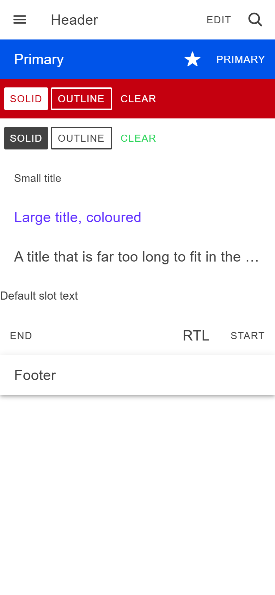
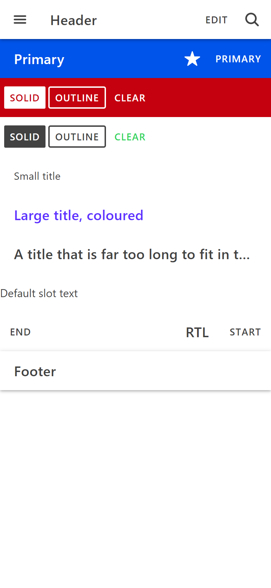
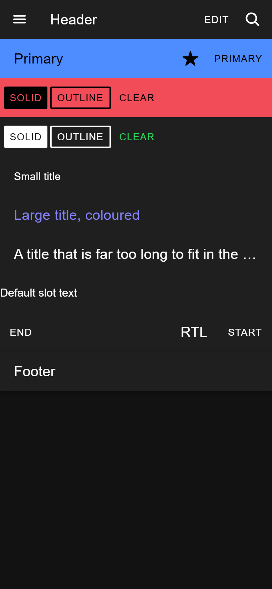
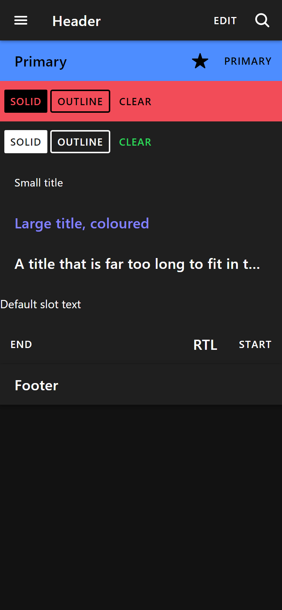

# ion-toolbar family — Comparison against the web component

> Ionic side, in [`ref/`](ref/) (Chromium, md, 390×844@2x): the command at the top of [`ref/README.md`](ref/README.md),
> `node tools/ionic-ref/render.js ion-toolbar --bare --html '<ion-app style="position:static;display:block;contain:none;overflow:visible">…</ion-app>'`,
> with the scene in [`ref/page.html`](ref/page.html). It's the scene called `s1` below.
>
> Two more scenes were measured with a throwaway Playwright script, kept outside the repo, that loads the same page as
> `render.js` with `ion-app` and reads boxes, computed styles and `::after` with `getComputedStyle`:
>
> - **`s2`**, with `--ion-safe-area-top: 20px; --ion-safe-area-bottom: 10px; --ion-safe-area-left: 7px; --ion-safe-area-right: 5px`
>   on `:root`:
>
>   ```html
>   <ion-header id="h" class="ion-no-border"><ion-toolbar id="t1"><ion-buttons id="bs1" slot="start"><ion-button id="ic1"><ion-icon slot="start" name="star"></ion-icon>Icon</ion-button></ion-buttons><ion-buttons id="bs2" slot="start"><ion-button id="ioo" fill="solid"><ion-icon slot="icon-only" name="star"></ion-icon></ion-button></ion-buttons><ion-title>Two</ion-title><ion-buttons id="be1" slot="end"><ion-button id="ic2">Icon<ion-icon slot="end" name="star"></ion-icon></ion-button></ion-buttons><ion-buttons id="be2" slot="end"><ion-button id="rnd" shape="round">Round</ion-button></ion-buttons></ion-toolbar><ion-toolbar id="t2"><ion-button id="loose" fill="solid">Loose</ion-button></ion-toolbar></ion-header><ion-footer id="f"><ion-toolbar id="t5"><ion-title>F1</ion-title></ion-toolbar><ion-toolbar id="t6"><ion-title>F2</ion-title></ion-toolbar></ion-footer>
>   ```
>
> - **`s3`**, for the keyboard, with Tab from the page:
>
>   ```html
>   <ion-toolbar><ion-buttons slot="end"><ion-button id="end">End</ion-button></ion-buttons><ion-buttons slot="primary"><ion-button id="pri">Pri</ion-button></ion-buttons><ion-button id="def">Def</ion-button><ion-buttons slot="secondary"><ion-button id="sec">Sec</ion-button></ion-buttons><ion-buttons slot="start"><ion-button id="sta">Sta</ion-button></ion-buttons></ion-toolbar><ion-toolbar color="primary"><ion-buttons slot="start"><ion-button id="cclear">C</ion-button><ion-button id="csolid" fill="solid">S</ion-button></ion-buttons></ion-toolbar>
>   ```
>
> - **`s4`**, pressed with the mouse held down for 200 ms:
>
>   ```html
>   <ion-toolbar><ion-button id="lo" fill="outline">Loose</ion-button><ion-buttons slot="end"><ion-button id="bo" fill="outline">In</ion-button></ion-buttons></ion-toolbar><ion-toolbar style="--background:#ffe0b0"><ion-buttons slot="start"><ion-button id="bo2" fill="outline">Tinted</ion-button><ion-button id="bc2">Clear</ion-button></ion-buttons></ion-toolbar><ion-toolbar color="danger"><ion-button id="lod" fill="outline" style="--border-color:green">Loose</ion-button><ion-buttons slot="end"><ion-button id="bod" fill="outline" style="--border-color:green">In</ion-button></ion-buttons></ion-toolbar>
>   ```
>
> Four more, for #89, with the same page in a Playwright context of 390×844 at 2×, mobile and touch, each wrapped in `<ion-app style="position:static;display:block;contain:none;overflow:visible">`:
>
> - **`s5`**, for `hostContext`, reading the button's classes and `.button-native`'s computed colours, in the light palette and with
>   `css/palettes/dark.always.css` too:
>
>   ```html
>   <ion-toolbar><ion-button id="a">A</ion-button><ion-button id="ao" fill="outline">AO</ion-button></ion-toolbar><ion-toolbar color="danger"><ion-button id="b">B</ion-button></ion-toolbar><ion-toolbar color="danger"><ion-toolbar id="inner1"><ion-button id="c">C</ion-button><ion-button id="co" fill="outline">CO</ion-button><ion-buttons><ion-button id="cb" fill="solid">CB</ion-button><ion-button id="cbc">CBC</ion-button></ion-buttons></ion-toolbar></ion-toolbar><ion-toolbar><ion-toolbar color="danger"><ion-button id="d">D</ion-button><ion-button id="do" fill="outline">DO</ion-button></ion-toolbar></ion-toolbar><ion-toolbar color=""><ion-button id="e">E</ion-button></ion-toolbar><ion-buttons><ion-button id="f">F</ion-button></ion-buttons><ion-item color="danger"><ion-buttons><ion-button id="g" fill="solid">G</ion-button></ion-buttons></ion-item><ion-button id="z">Z</ion-button>
>   ```
>
> - **`s6`**, the dark palette: `s1`'s page with `<link rel="stylesheet" href="/node_modules/@ionic/core/css/palettes/dark.always.css">`
>   after `ionic.bundle.css`, its screenshot in [`ref/page-dark.png`](ref/page-dark.png), and each toolbar's `--color`, `--border-color`,
>   `.toolbar-background` and buttons read.
> - **`s7`**, for a render later, with `:root { --ion-toolbar-color: red }` so that the `in-toolbar` rules show. After load, `#t1`'s
>   `color` is set to `danger`, then each button's `size` to `small`, which renders it; and, without the style, `#h` is moved out of a
>   danger toolbar and `#k` into an `ion-buttons`, each read before and after a prop of theirs changes:
>
>   ```html
>   <ion-toolbar id="t1"><ion-button id="loose">L</ion-button><ion-buttons><ion-button id="bs" fill="solid">S</ion-button><ion-button id="bc">C</ion-button></ion-buttons></ion-toolbar><ion-toolbar color="danger"><ion-toolbar id="t2"><ion-button id="nest">N</ion-button></ion-toolbar></ion-toolbar><ion-toolbar><ion-toolbar color="danger" id="t3"><ion-button id="nest2">N2</ion-button></ion-toolbar></ion-toolbar>
>   <ion-toolbar id="t2" color="danger"><ion-button id="h">H</ion-button></ion-toolbar><div id="out"><ion-button id="k">K</ion-button></div><ion-toolbar id="t3"><ion-buttons id="bs"></ion-buttons></ion-toolbar>
>   ```
>
> - **`s8`**, for review findings: a full clear icon-only button in `ion-buttons`, round and not; and with `ion-button { --color-focused: orange }`
>   and `ion-focused` added, a default and a clear button in `ion-buttons` in a toolbar, and a default one in `ion-buttons` alone:
>
>   ```html
>   <ion-toolbar><ion-buttons slot="start"><ion-button id="full" expand="full"><ion-icon slot="icon-only" name="star"></ion-icon></ion-button><ion-button id="fullround" expand="full" shape="round"><ion-icon slot="icon-only" name="star"></ion-icon></ion-button><ion-button id="def" fill="default">Default</ion-button><ion-button id="clr">Clear</ion-button></ion-buttons></ion-toolbar><ion-buttons><ion-button id="def2" fill="default">Default</ion-button></ion-buttons>
>   ```
>
> Avonic side: `AVONIC_CAPTURE_DIR=… dotnet test` → `AvonicToolbarCaptureTests.Reference_Page` (headless Skia, 2×, text at 16 as on
> a web page) → `avonic-toolbar-page.png`, copied to [`compare/avonic-page.png`](compare/avonic-page.png), and `Reference_Page_Dark`
> → `avonic-toolbar-page-dark.png`, copied to [`compare/avonic-page-dark.png`](compare/avonic-page-dark.png). **Headless only. Not tried
> in a real window,** and not on touch hardware.

## Frames

| Ionic | Avonic |
|---|---|
|  |  |

From the top: a header with a menu button, a title, Edit and search; a primary toolbar with secondary and primary buttons; solid,
outline and clear in a danger toolbar and in a plain one, the clear one `success`; a small title; a large, `tertiary` title; a long
title; text in the default slot; RTL; and a footer.

**Match,** apart from these visible differences:

- **Text.** Roboto isn't installed on this machine, so Chromium uses Arial and Avalonia uses Segoe UI. Arial has no weight 500, so
  Chromium draws the titles and buttons in regular, and Avalonia's look bolder. Both ask for 500. Segoe UI's lines are taller: a
  title is 27 high against 23, and a small one 20 against 17. Widths differ with the font: Edit is 49 wide against 51.25, so the
  header's title part is 233 against 230.75.
- **The ellipsis.** Chromium draws `…` after a space it keeps, and Avalonia trims to the last character that fits. Both end inside the
  title's 20 of padding.

### In the dark palette (#89)

| Ionic | Avonic |
|---|---|
|  |  |

`s6`: the same page with Ionic's dark palette merged, `Tokens/Palettes/Dark.axaml` on the Avonic side. **Match,** apart from the font
and the ellipsis, as above. Measured: every uncoloured toolbar's `--color` `#ffffff` and `--border-color` `#363636` on `#1f1f1f`, the
title white, a solid button in `ion-buttons` `rgb(31, 31, 31)` on white, outline and clear white. A border shows only with a width,
which md's is not; with `--border-width: 0 0 1px` it's `rgb(54, 54, 54)`. The header's shadow is the same as in light.

Boxes in `s1`, Ionic against Avonic (Avonic's are whole pixels, as layout rounding is on at 1×):

| | Ionic | Avonic |
|---|---|---|
| Header | 0,0 390×56 | 0,0 390×56 |
| Its start buttons, the menu | 4,4 48×48 | 4,4 48×48 |
| Its content part, the title | 52 to 282.75 | 52 to 285 |
| Its end buttons | 282.75,4 103.25×48 | 285,4 101×48 |
| Edit | 284.75,12 51.25×32 | 287,12 49×32 |
| Primary toolbar: content, secondary, primary | 0–248.58, 248.58–296.58, 296.58–386 | 0–252, 252–300, 300–386 |
| Danger toolbar's buttons | 4,124 227.67×32 | 4,124 217×32 |
| RTL: start, end | 317.19 and 4 | 320 and 4 |
| Footer | 0,504 390×56 | 0,504 390×56 |

## Behaviours

The numbers are from [PLAN.md](PLAN.md#behaviours). Each has tests in `AvonicToolbarTests` (T, H, F), `AvonicToolbarTitleTests` (Ti) and
`AvonicToolbarButtonsTests` (B), named after its number.

| # | Behaviour | Ionic | Result |
|---|---|---|---|
| T1 | The box | `s1` 390×56, `rgb(66, 66, 66)` on white, padding 0 | match |
| T2 | md's slot order | `s1`: start 4–52, content 52–282.75, end 282.75–386; secondary 248.58–296.58 after the content, primary 296.58–386 | match, with widths depending on the font |
| T3 | RTL | start at 317.19, end at 4 | match |
| T4 | Tab order | `s3`: `sta, sec, def, pri, end`, though secondary is drawn after the content | match |
| T5 | Long title | ends with an ellipsis inside its padding | match. See the ellipsis above |
| T6 | `color` | primary `rgb(0, 84, 233)` with white text; transparent and inherited for an unknown one | match |
| T7 | The variables | `toolbar.md.css` | match, except `--border-style`, which a `Border` can't do. See the plan |
| T8 | Global tokens | `var(--ion-toolbar-*, …)` | match |
| T9 | Safe area left and right | `s2` `#t1`: padding `20px 5px 0px 7px`, container at 7, 378 wide | match |
| T11 | `ionStyle` from a title, and any child | `s1`: `toolbar-title-default`, `toolbar-title-small` on `#tsmall`, `toolbar-title-large` on `#tlarge`; `childrenStyle` stops the event | match, as `:toolbar-title-*`, and `:toolbar-label` for a label. md has no rule on them |
| T12 | Dark palette | `s6`: `#ffffff` text, `#363636` border on `#1f1f1f`; solid in `ion-buttons` `rgb(31, 31, 31)` on white | match (#89) |
| T10 | 4 beside the first and last buttons | `s1`: margin-left 4 on start, margin-right 4 on end; `s2` `#bs1` and `#be2` only, not `#bs2` or `#be1`; primary when there's no end | match. Ionic works it out once, on load. Avonic follows the slots changing, which can only agree |
| H1 | A header stacks | `s2` `#h` 390×132: 76 + 56 | match |
| H2 | Shadow | `0 2px 4px -1px` 0.2, `0 4px 5px 0` 0.14, `0 1px 10px 0` 0.12, `z-index: 10`; `none` with `ion-no-border` | match. Drawn over the next sibling by `ZIndex` |
| H3 | Top safe area | `s2` `#t1` 76 high | match, also for a toolbar a template made |
| H4 | Landmark | `role="banner"` | match, as `AutomationLandmarkType.Banner`. Not tried with a screen reader |
| H5 | `collapse="condense"` | `display: none`; `getRoleType` gives `none` in md | match. `header-collapse-none`, `-condense` and `-fade` are `:collapse-none`, `:collapse-condense` and `:collapse-fade`, and `fade` has no md rule |
| F1 | A footer stacks, with the shadow | `s1`, `s2` `#f`: the same three shadows | match |
| F2 | Bottom safe area | `s2` `#t6` 66 high, `#t5` 56 | match, also for a toolbar a template made |
| F3 | Landmark | `role="contentinfo"` | match, as `ContentInfo` |
| Ti1 | Title | 20, 500, letter spacing 0.25 (0.0125 em), padding 0 20, `nowrap`, 23 high, inherits `rgb(66, 66, 66)` | match, 27 high in Segoe UI |
| Ti2 | Small | 15, 400, letter spacing 0.1875, `white-space: normal`, 17 high | match, 20 high |
| Ti3 | Large | the same as the default in md; host class `title-large` | match, with `:size-large` (and `:size-default`, `:size-small`) and no md rule on it |
| Ti4 | Title `color` | `tertiary` `rgb(96, 48, 255)` | match |
| B1 | Clear by default in `ion-buttons` | `s1` menu, Edit: `button-clear`; `s2` `#loose`: `button-solid`, 36 high, margin 4 2 | match |
| B2 | In `ion-buttons` | Edit 51.25×32, padding 3 8, margin 0 2, radius 2, no shadow even solid (`s1` danger solid) | match |
| B3 | Icon-only | clear: 48×48, padding 12, radius 50%, icon 25.2; solid (`s2` `#ioo`): 41.19×32, padding 0 8 | match |
| B4 | Start and end icons | `s2` `#ic1` 19.6 with 5.88 after; `#ic2` 19.6 with 7.84 before | match |
| B5 | Uncoloured toolbar | clear and outline `rgb(66, 66, 66)`, outline's border too; solid `rgb(66, 66, 66)` behind white text; `success` clear keeps `rgb(45, 213, 91)` | match |
| B6 | Coloured toolbar | danger: clear and outline white, outline's border white; solid white behind `rgb(197, 0, 15)`. `s4` `#lod`, directly in danger: its own green border, primary text | match. The second was found in review |
| B7 | Focus overlays | `s3`: clear `rgb(66, 66, 66)` at 0.12; in primary, clear white at 0.12 and solid `rgb(0, 74, 205)` at 0.24. Pressed, `--background-activated: transparent` | match. Pressed, found in review |
| B8 | Round, and full | `s2` `#rnd`: radius 999, padding 3 8; a full button's `border-radius: 0` beats `--border-radius`. `s8`: a full clear icon-only one is 48×48 with radius 0, and 50% when it's round too | match. The full one was found by deliberate breakage, and the icon-only one by review in #89 |
| B9 | `--ion-toolbar-color` | `button.md.css`'s `.in-toolbar` rules | match |
| B11 | `hostContext` | `s5`: `in-toolbar-color` on `#c`, `#co` (plain inside danger), `#d`, `#do` (danger inside plain) and `#e` (`color=""`), each its own white on primary, with `--ion-toolbar-color: red` too (`s7` `#nest`, `#nest2`). `s7`: after `#t1.color = 'danger'`, `#loose` stays red and `#bc`'s text red until each renders, then primary, and white; `#bs`'s text is danger at once (`:host-context(.ion-color)`). A moved `#h` keeps `in-toolbar-color`, and `#k` moved into `ion-buttons` gets none of the classes, until each renders | match (#89), except that a moved button reads them when it's attached, and a stale solid button in `ion-buttons` takes the coloured toolbar's background at once. See the plan |
| B10 | Pressed outline | `s4`: `#lo` directly in a toolbar fills with `rgb(0, 84, 233)`, its text the same; `#bo` and `#bo2` in `ion-buttons` stay transparent. All because `--ion-toolbar-background` is unset in the light palette | **deliberate difference:** Avonic's `Avonic.ToolbarBackgroundBrush` is always set, so all three are white, as Ionic's are with the key set. See the plan |

## Known differences

Recorded with their reasons in [PLAN.md](PLAN.md#deliberate-differences). The ones an app would notice:

- **A clear or outline button in `AvonicButtons`** keeps the toolbar's text when it's focused, hovered or pressed, even with an app's
  `Avonic.Button.ColorFocused` and the rest, which Ionic's follows (`s8` `#clr`).
- **`ion-buttons` in a coloured item**, not a toolbar, doesn't take the coloured rules (`s5` `#g`).
- **The footer's bottom safe area** stays while the keyboard is open.
- **A pressed outline button in an uncoloured toolbar** is white, where Ionic's light palette fills one directly in the toolbar with
  primary and leaves one in `ion-buttons` transparent, as B10 says.
- **The keyboard's order** comes from `TabIndex` on the slots, so an app's own `TabIndex` only orders things within a slot.
