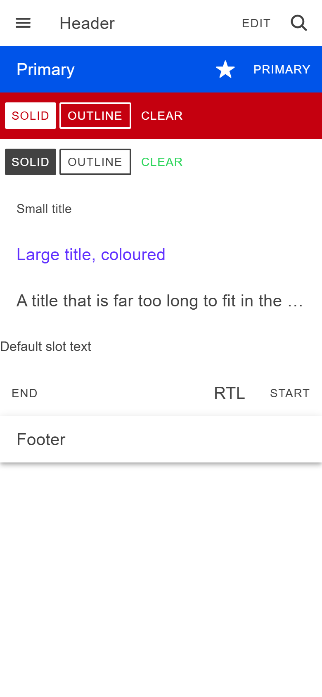

# ion-toolbar — reference render (Ionic 8.8.1, md, 390×844@2x)

Generated by `node tools/ionic-ref/render.js ion-toolbar --bare --html "<ion-app style=\"position:static;display:block;contain:none;overflow:visible\"><ion-header><ion-toolbar><ion-buttons slot=\"start\"><ion-button><ion-icon slot=\"icon-only\" name=\"menu\"></ion-icon></ion-button></ion-buttons><ion-title>Header</ion-title><ion-buttons slot=\"end\"><ion-button>Edit</ion-button><ion-button><ion-icon slot=\"icon-only\" name=\"search\"></ion-icon></ion-button></ion-buttons></ion-toolbar></ion-header><ion-toolbar color=\"primary\"><ion-buttons slot=\"secondary\"><ion-button><ion-icon slot=\"icon-only\" name=\"star\"></ion-icon></ion-button></ion-buttons><ion-buttons slot=\"primary\"><ion-button>Primary</ion-button></ion-buttons><ion-title>Primary</ion-title></ion-toolbar><ion-toolbar color=\"danger\"><ion-buttons slot=\"start\"><ion-button fill=\"solid\">Solid</ion-button><ion-button fill=\"outline\">Outline</ion-button><ion-button>Clear</ion-button></ion-buttons></ion-toolbar><ion-toolbar><ion-buttons slot=\"start\"><ion-button fill=\"solid\">Solid</ion-button><ion-button fill=\"outline\">Outline</ion-button><ion-button color=\"success\">Clear</ion-button></ion-buttons></ion-toolbar><ion-toolbar><ion-title size=\"small\">Small title</ion-title></ion-toolbar><ion-toolbar><ion-title size=\"large\" color=\"tertiary\">Large title, coloured</ion-title></ion-toolbar><ion-toolbar><ion-title>A title that is far too long to fit in the toolbar on one line</ion-title></ion-toolbar><ion-toolbar>Default slot text</ion-toolbar><div dir=\"rtl\"><ion-toolbar><ion-buttons slot=\"start\"><ion-button>Start</ion-button></ion-buttons><ion-title>RTL</ion-title><ion-buttons slot=\"end\"><ion-button>End</ion-button></ion-buttons></ion-toolbar></div><ion-footer><ion-toolbar><ion-title>Footer</ion-title></ion-toolbar></ion-footer></ion-app>"`

```html
<ion-app style="position:static;display:block;contain:none;overflow:visible"><ion-header><ion-toolbar><ion-buttons slot="start"><ion-button><ion-icon slot="icon-only" name="menu"></ion-icon></ion-button></ion-buttons><ion-title>Header</ion-title><ion-buttons slot="end"><ion-button>Edit</ion-button><ion-button><ion-icon slot="icon-only" name="search"></ion-icon></ion-button></ion-buttons></ion-toolbar></ion-header><ion-toolbar color="primary"><ion-buttons slot="secondary"><ion-button><ion-icon slot="icon-only" name="star"></ion-icon></ion-button></ion-buttons><ion-buttons slot="primary"><ion-button>Primary</ion-button></ion-buttons><ion-title>Primary</ion-title></ion-toolbar><ion-toolbar color="danger"><ion-buttons slot="start"><ion-button fill="solid">Solid</ion-button><ion-button fill="outline">Outline</ion-button><ion-button>Clear</ion-button></ion-buttons></ion-toolbar><ion-toolbar><ion-buttons slot="start"><ion-button fill="solid">Solid</ion-button><ion-button fill="outline">Outline</ion-button><ion-button color="success">Clear</ion-button></ion-buttons></ion-toolbar><ion-toolbar><ion-title size="small">Small title</ion-title></ion-toolbar><ion-toolbar><ion-title size="large" color="tertiary">Large title, coloured</ion-title></ion-toolbar><ion-toolbar><ion-title>A title that is far too long to fit in the toolbar on one line</ion-title></ion-toolbar><ion-toolbar>Default slot text</ion-toolbar><div dir="rtl"><ion-toolbar><ion-buttons slot="start"><ion-button>Start</ion-button></ion-buttons><ion-title>RTL</ion-title><ion-buttons slot="end"><ion-button>End</ion-button></ion-buttons></ion-toolbar></div><ion-footer><ion-toolbar><ion-title>Footer</ion-title></ion-toolbar></ion-footer></ion-app>
```

 

## Element 1

- attributes: `{"class":"toolbar-title-default md in-toolbar hydrated"}`
- classes: `toolbar-title-default md in-toolbar hydrated`
- rect: `{"x":0,"y":0,"w":390,"h":56}`

### CSS custom properties (resolved)

| var | value |
|---|---|
| `--background` | `#fff` |
| `--border-color` | `#c1c4cd` |
| `--border-style` | `solid` |
| `--border-width` | `0` |
| `--color` | `#424242` |
| `--min-height` | `56px` |
| `--opacity` | `1` |
| `--padding-bottom` | `0` |
| `--padding-end` | `0` |
| `--padding-start` | `0` |
| `--padding-top` | `0` |

### Host computed

| prop | value |
|---|---|
| display | `block` |
| position | `relative` |
| box-sizing | `border-box` |
| width | `390px` |
| height | `56px` |
| min-height | `0px` |
| min-width | `0px` |
| padding | `0px` |
| margin | `0px` |
| border | `0px none rgb(66, 66, 66)` |
| border-radius | `0px` |
| background-color | `rgba(0, 0, 0, 0)` |
| color | `rgb(66, 66, 66)` |
| font-size | `16px` |
| font-weight | `400` |
| font-family | `Roboto, "Helvetica Neue", sans-serif` |
| line-height | `normal` |
| letter-spacing | `normal` |
| text-transform | `none` |
| opacity | `1` |
| overflow | `visible` |
| contain | `content` |
| pointer-events | `auto` |
| transition | `all` |
| transform | `none` |
| box-shadow | `none` |
| outline | `rgb(66, 66, 66) none 0px` |
| cursor | `auto` |

### Shadow parts

#### part="background" (`div`) rect `{"x":0,"y":0,"w":390,"h":56}`

| prop | value |
|---|---|
| display | `block` |
| position | `absolute` |
| box-sizing | `content-box` |
| width | `390px` |
| height | `56px` |
| min-height | `0px` |
| min-width | `0px` |
| padding | `0px` |
| margin | `0px` |
| border | `0px solid rgb(193, 196, 205)` |
| border-radius | `0px` |
| background-color | `rgb(255, 255, 255)` |
| color | `rgb(66, 66, 66)` |
| font-size | `16px` |
| font-weight | `400` |
| font-family | `Roboto, "Helvetica Neue", sans-serif` |
| line-height | `normal` |
| letter-spacing | `normal` |
| text-transform | `none` |
| opacity | `1` |
| overflow | `visible` |
| contain | `strict` |
| pointer-events | `none` |
| transition | `all` |
| transform | `matrix(1, 0, 0, 1, 0, 0)` |
| box-shadow | `none` |
| outline | `rgb(66, 66, 66) none 0px` |
| cursor | `auto` |

#### part="container" (`div`) rect `{"x":0,"y":0,"w":390,"h":56}`

| prop | value |
|---|---|
| display | `flex` |
| position | `relative` |
| box-sizing | `border-box` |
| width | `390px` |
| height | `56px` |
| min-height | `56px` |
| min-width | `0px` |
| padding | `0px` |
| margin | `0px` |
| border | `0px none rgb(66, 66, 66)` |
| border-radius | `0px` |
| background-color | `rgba(0, 0, 0, 0)` |
| color | `rgb(66, 66, 66)` |
| font-size | `16px` |
| font-weight | `400` |
| font-family | `Roboto, "Helvetica Neue", sans-serif` |
| line-height | `normal` |
| letter-spacing | `normal` |
| text-transform | `none` |
| opacity | `1` |
| overflow | `hidden` |
| contain | `content` |
| pointer-events | `auto` |
| transition | `all` |
| transform | `none` |
| box-shadow | `none` |
| outline | `rgb(66, 66, 66) none 0px` |
| cursor | `auto` |

#### part="content" (`div`) rect `{"x":52,"y":16.5,"w":230.75,"h":23}`

| prop | value |
|---|---|
| display | `block` |
| position | `static` |
| box-sizing | `content-box` |
| width | `230.75px` |
| height | `23px` |
| min-height | `auto` |
| min-width | `0px` |
| padding | `0px` |
| margin | `0px` |
| border | `0px none rgb(66, 66, 66)` |
| border-radius | `0px` |
| background-color | `rgba(0, 0, 0, 0)` |
| color | `rgb(66, 66, 66)` |
| font-size | `16px` |
| font-weight | `400` |
| font-family | `Roboto, "Helvetica Neue", sans-serif` |
| line-height | `normal` |
| letter-spacing | `normal` |
| text-transform | `none` |
| opacity | `1` |
| overflow | `visible` |
| contain | `none` |
| pointer-events | `auto` |
| transition | `all` |
| transform | `none` |
| box-shadow | `none` |
| outline | `rgb(66, 66, 66) none 0px` |
| cursor | `auto` |

### DOM tree

```
<ion-toolbar>
  #shadow-root
    <div.toolbar-background part="background">
    <div.toolbar-container part="container">
      <slot name="start">
      <slot name="secondary">
      <div.toolbar-content part="content">
        <slot name="">
      <slot name="primary">
      <slot name="end">
  <ion-buttons.buttons-first-slot.sc-ion-buttons-md-h.md.sc-ion-buttons-md.sc-ion-buttons-md-s.hydrated slot="start">
    <ion-button.md.button.button-clear.in-toolbar.in-buttons.button-has-icon-only.ion-activatable.ion-focusable.hydrated>
      #shadow-root
        <button.button-native part="native">
          <span.button-inner>
            <slot name="icon-only">
            <slot name="start">
            <slot name="">
            <slot name="end">
          <ion-ripple-effect.md.unbounded.hydrated>
            #shadow-root
      <ion-icon.md.hydrated slot="icon-only">
        #shadow-root
          <div.icon-inner>
            <svg>
              <path>
  <ion-title.md.title-default.hydrated>
    #shadow-root
      <div.toolbar-title>
        <slot name="">
  <ion-buttons.buttons-last-slot.sc-ion-buttons-md-h.md.sc-ion-buttons-md.sc-ion-buttons-md-s.hydrated slot="end">
    <ion-button.md.button.button-clear.in-toolbar.in-buttons.ion-activatable.ion-focusable.hydrated>
      #shadow-root
        <button.button-native part="native">
          <span.button-inner>
            <slot name="icon-only">
            <slot name="start">
            <slot name="">
            <slot name="end">
          <ion-ripple-effect.md.hydrated>
            #shadow-root
    <ion-button.md.button.button-clear.in-toolbar.in-buttons.button-has-icon-only.ion-activatable.ion-focusable.hydrated>
      #shadow-root
        <button.button-native part="native">
          <span.button-inner>
            <slot name="icon-only">
            <slot name="start">
            <slot name="">
            <slot name="end">
          <ion-ripple-effect.md.unbounded.hydrated>
            #shadow-root
      <ion-icon.md.hydrated slot="icon-only">
        #shadow-root
          <div.icon-inner>
            <svg>
              <path>
```

## Element 2

- attributes: `{"color":"primary","class":"ion-color ion-color-primary md in-toolbar hydrated toolbar-title-default"}`
- classes: `ion-color ion-color-primary md in-toolbar hydrated toolbar-title-default`
- rect: `{"x":0,"y":56,"w":390,"h":56}`

### CSS custom properties (resolved)

| var | value |
|---|---|
| `--background` | `#fff` |
| `--border-color` | `#c1c4cd` |
| `--border-style` | `solid` |
| `--border-width` | `0` |
| `--color` | `#424242` |
| `--min-height` | `56px` |
| `--opacity` | `1` |
| `--padding-bottom` | `0` |
| `--padding-end` | `0` |
| `--padding-start` | `0` |
| `--padding-top` | `0` |

### Host computed

| prop | value |
|---|---|
| display | `block` |
| position | `relative` |
| box-sizing | `border-box` |
| width | `390px` |
| height | `56px` |
| min-height | `0px` |
| min-width | `0px` |
| padding | `0px` |
| margin | `0px` |
| border | `0px none rgb(255, 255, 255)` |
| border-radius | `0px` |
| background-color | `rgba(0, 0, 0, 0)` |
| color | `rgb(255, 255, 255)` |
| font-size | `16px` |
| font-weight | `400` |
| font-family | `Roboto, "Helvetica Neue", sans-serif` |
| line-height | `normal` |
| letter-spacing | `normal` |
| text-transform | `none` |
| opacity | `1` |
| overflow | `visible` |
| contain | `content` |
| pointer-events | `auto` |
| transition | `all` |
| transform | `none` |
| box-shadow | `none` |
| outline | `rgb(255, 255, 255) none 0px` |
| cursor | `auto` |

### Shadow parts

#### part="background" (`div`) rect `{"x":0,"y":56,"w":390,"h":56}`

| prop | value |
|---|---|
| display | `block` |
| position | `absolute` |
| box-sizing | `content-box` |
| width | `390px` |
| height | `56px` |
| min-height | `0px` |
| min-width | `0px` |
| padding | `0px` |
| margin | `0px` |
| border | `0px solid rgb(193, 196, 205)` |
| border-radius | `0px` |
| background-color | `rgb(0, 84, 233)` |
| color | `rgb(255, 255, 255)` |
| font-size | `16px` |
| font-weight | `400` |
| font-family | `Roboto, "Helvetica Neue", sans-serif` |
| line-height | `normal` |
| letter-spacing | `normal` |
| text-transform | `none` |
| opacity | `1` |
| overflow | `visible` |
| contain | `strict` |
| pointer-events | `none` |
| transition | `all` |
| transform | `matrix(1, 0, 0, 1, 0, 0)` |
| box-shadow | `none` |
| outline | `rgb(255, 255, 255) none 0px` |
| cursor | `auto` |

#### part="container" (`div`) rect `{"x":0,"y":56,"w":390,"h":56}`

| prop | value |
|---|---|
| display | `flex` |
| position | `relative` |
| box-sizing | `border-box` |
| width | `390px` |
| height | `56px` |
| min-height | `56px` |
| min-width | `0px` |
| padding | `0px` |
| margin | `0px` |
| border | `0px none rgb(255, 255, 255)` |
| border-radius | `0px` |
| background-color | `rgba(0, 0, 0, 0)` |
| color | `rgb(255, 255, 255)` |
| font-size | `16px` |
| font-weight | `400` |
| font-family | `Roboto, "Helvetica Neue", sans-serif` |
| line-height | `normal` |
| letter-spacing | `normal` |
| text-transform | `none` |
| opacity | `1` |
| overflow | `hidden` |
| contain | `content` |
| pointer-events | `auto` |
| transition | `all` |
| transform | `none` |
| box-shadow | `none` |
| outline | `rgb(255, 255, 255) none 0px` |
| cursor | `auto` |

#### part="content" (`div`) rect `{"x":0,"y":72.5,"w":248.58,"h":23}`

| prop | value |
|---|---|
| display | `block` |
| position | `static` |
| box-sizing | `content-box` |
| width | `248.578px` |
| height | `23px` |
| min-height | `auto` |
| min-width | `0px` |
| padding | `0px` |
| margin | `0px` |
| border | `0px none rgb(255, 255, 255)` |
| border-radius | `0px` |
| background-color | `rgba(0, 0, 0, 0)` |
| color | `rgb(255, 255, 255)` |
| font-size | `16px` |
| font-weight | `400` |
| font-family | `Roboto, "Helvetica Neue", sans-serif` |
| line-height | `normal` |
| letter-spacing | `normal` |
| text-transform | `none` |
| opacity | `1` |
| overflow | `visible` |
| contain | `none` |
| pointer-events | `auto` |
| transition | `all` |
| transform | `none` |
| box-shadow | `none` |
| outline | `rgb(255, 255, 255) none 0px` |
| cursor | `auto` |

### DOM tree

```
<ion-toolbar>
  #shadow-root
    <div.toolbar-background part="background">
    <div.toolbar-container part="container">
      <slot name="start">
      <slot name="secondary">
      <div.toolbar-content part="content">
        <slot name="">
      <slot name="primary">
      <slot name="end">
  <ion-buttons.sc-ion-buttons-md-h.md.sc-ion-buttons-md.sc-ion-buttons-md-s.hydrated slot="secondary">
    <ion-button.md.button.button-clear.in-toolbar.in-toolbar-color.in-buttons.button-has-icon-only.ion-activatable.ion-focusable.hydrated>
      #shadow-root
        <button.button-native part="native">
          <span.button-inner>
            <slot name="icon-only">
            <slot name="start">
            <slot name="">
            <slot name="end">
          <ion-ripple-effect.md.unbounded.hydrated>
            #shadow-root
      <ion-icon.md.hydrated slot="icon-only">
        #shadow-root
          <div.icon-inner>
            <svg>
              <path>
  <ion-buttons.buttons-last-slot.sc-ion-buttons-md-h.md.sc-ion-buttons-md.sc-ion-buttons-md-s.hydrated slot="primary">
    <ion-button.md.button.button-clear.in-toolbar.in-toolbar-color.in-buttons.ion-activatable.ion-focusable.hydrated>
      #shadow-root
        <button.button-native part="native">
          <span.button-inner>
            <slot name="icon-only">
            <slot name="start">
            <slot name="">
            <slot name="end">
          <ion-ripple-effect.md.hydrated>
            #shadow-root
  <ion-title.md.title-default.hydrated>
    #shadow-root
      <div.toolbar-title>
        <slot name="">
```

## Element 3

- attributes: `{"color":"danger","class":"ion-color ion-color-danger md in-toolbar hydrated"}`
- classes: `ion-color ion-color-danger md in-toolbar hydrated`
- rect: `{"x":0,"y":112,"w":390,"h":56}`

### CSS custom properties (resolved)

| var | value |
|---|---|
| `--background` | `#fff` |
| `--border-color` | `#c1c4cd` |
| `--border-style` | `solid` |
| `--border-width` | `0` |
| `--color` | `#424242` |
| `--min-height` | `56px` |
| `--opacity` | `1` |
| `--padding-bottom` | `0` |
| `--padding-end` | `0` |
| `--padding-start` | `0` |
| `--padding-top` | `0` |

### Host computed

| prop | value |
|---|---|
| display | `block` |
| position | `relative` |
| box-sizing | `border-box` |
| width | `390px` |
| height | `56px` |
| min-height | `0px` |
| min-width | `0px` |
| padding | `0px` |
| margin | `0px` |
| border | `0px none rgb(255, 255, 255)` |
| border-radius | `0px` |
| background-color | `rgba(0, 0, 0, 0)` |
| color | `rgb(255, 255, 255)` |
| font-size | `16px` |
| font-weight | `400` |
| font-family | `Roboto, "Helvetica Neue", sans-serif` |
| line-height | `normal` |
| letter-spacing | `normal` |
| text-transform | `none` |
| opacity | `1` |
| overflow | `visible` |
| contain | `content` |
| pointer-events | `auto` |
| transition | `all` |
| transform | `none` |
| box-shadow | `none` |
| outline | `rgb(255, 255, 255) none 0px` |
| cursor | `auto` |

### Shadow parts

#### part="background" (`div`) rect `{"x":0,"y":112,"w":390,"h":56}`

| prop | value |
|---|---|
| display | `block` |
| position | `absolute` |
| box-sizing | `content-box` |
| width | `390px` |
| height | `56px` |
| min-height | `0px` |
| min-width | `0px` |
| padding | `0px` |
| margin | `0px` |
| border | `0px solid rgb(193, 196, 205)` |
| border-radius | `0px` |
| background-color | `rgb(197, 0, 15)` |
| color | `rgb(255, 255, 255)` |
| font-size | `16px` |
| font-weight | `400` |
| font-family | `Roboto, "Helvetica Neue", sans-serif` |
| line-height | `normal` |
| letter-spacing | `normal` |
| text-transform | `none` |
| opacity | `1` |
| overflow | `visible` |
| contain | `strict` |
| pointer-events | `none` |
| transition | `all` |
| transform | `matrix(1, 0, 0, 1, 0, 0)` |
| box-shadow | `none` |
| outline | `rgb(255, 255, 255) none 0px` |
| cursor | `auto` |

#### part="container" (`div`) rect `{"x":0,"y":112,"w":390,"h":56}`

| prop | value |
|---|---|
| display | `flex` |
| position | `relative` |
| box-sizing | `border-box` |
| width | `390px` |
| height | `56px` |
| min-height | `56px` |
| min-width | `0px` |
| padding | `0px` |
| margin | `0px` |
| border | `0px none rgb(255, 255, 255)` |
| border-radius | `0px` |
| background-color | `rgba(0, 0, 0, 0)` |
| color | `rgb(255, 255, 255)` |
| font-size | `16px` |
| font-weight | `400` |
| font-family | `Roboto, "Helvetica Neue", sans-serif` |
| line-height | `normal` |
| letter-spacing | `normal` |
| text-transform | `none` |
| opacity | `1` |
| overflow | `hidden` |
| contain | `content` |
| pointer-events | `auto` |
| transition | `all` |
| transform | `none` |
| box-shadow | `none` |
| outline | `rgb(255, 255, 255) none 0px` |
| cursor | `auto` |

#### part="content" (`div`) rect `{"x":231.67,"y":140,"w":158.33,"h":0}`

| prop | value |
|---|---|
| display | `block` |
| position | `static` |
| box-sizing | `content-box` |
| width | `158.328px` |
| height | `0px` |
| min-height | `auto` |
| min-width | `0px` |
| padding | `0px` |
| margin | `0px` |
| border | `0px none rgb(255, 255, 255)` |
| border-radius | `0px` |
| background-color | `rgba(0, 0, 0, 0)` |
| color | `rgb(255, 255, 255)` |
| font-size | `16px` |
| font-weight | `400` |
| font-family | `Roboto, "Helvetica Neue", sans-serif` |
| line-height | `normal` |
| letter-spacing | `normal` |
| text-transform | `none` |
| opacity | `1` |
| overflow | `visible` |
| contain | `none` |
| pointer-events | `auto` |
| transition | `all` |
| transform | `none` |
| box-shadow | `none` |
| outline | `rgb(255, 255, 255) none 0px` |
| cursor | `auto` |

### DOM tree

```
<ion-toolbar>
  #shadow-root
    <div.toolbar-background part="background">
    <div.toolbar-container part="container">
      <slot name="start">
      <slot name="secondary">
      <div.toolbar-content part="content">
        <slot name="">
      <slot name="primary">
      <slot name="end">
  <ion-buttons.buttons-first-slot.sc-ion-buttons-md-h.md.sc-ion-buttons-md.sc-ion-buttons-md-s.hydrated slot="start">
    <ion-button.md.button.button-solid.in-toolbar.in-toolbar-color.in-buttons.ion-activatable.ion-focusable.hydrated>
      #shadow-root
        <button.button-native part="native">
          <span.button-inner>
            <slot name="icon-only">
            <slot name="start">
            <slot name="">
            <slot name="end">
          <ion-ripple-effect.md.hydrated>
            #shadow-root
    <ion-button.md.button.button-outline.in-toolbar.in-toolbar-color.in-buttons.ion-activatable.ion-focusable.hydrated>
      #shadow-root
        <button.button-native part="native">
          <span.button-inner>
            <slot name="icon-only">
            <slot name="start">
            <slot name="">
            <slot name="end">
          <ion-ripple-effect.md.hydrated>
            #shadow-root
    <ion-button.md.button.button-clear.in-toolbar.in-toolbar-color.in-buttons.ion-activatable.ion-focusable.hydrated>
      #shadow-root
        <button.button-native part="native">
          <span.button-inner>
            <slot name="icon-only">
            <slot name="start">
            <slot name="">
            <slot name="end">
          <ion-ripple-effect.md.hydrated>
            #shadow-root
```

## Element 4

- attributes: `{"class":"md in-toolbar hydrated"}`
- classes: `md in-toolbar hydrated`
- rect: `{"x":0,"y":168,"w":390,"h":56}`

### CSS custom properties (resolved)

| var | value |
|---|---|
| `--background` | `#fff` |
| `--border-color` | `#c1c4cd` |
| `--border-style` | `solid` |
| `--border-width` | `0` |
| `--color` | `#424242` |
| `--min-height` | `56px` |
| `--opacity` | `1` |
| `--padding-bottom` | `0` |
| `--padding-end` | `0` |
| `--padding-start` | `0` |
| `--padding-top` | `0` |

### Host computed

| prop | value |
|---|---|
| display | `block` |
| position | `relative` |
| box-sizing | `border-box` |
| width | `390px` |
| height | `56px` |
| min-height | `0px` |
| min-width | `0px` |
| padding | `0px` |
| margin | `0px` |
| border | `0px none rgb(66, 66, 66)` |
| border-radius | `0px` |
| background-color | `rgba(0, 0, 0, 0)` |
| color | `rgb(66, 66, 66)` |
| font-size | `16px` |
| font-weight | `400` |
| font-family | `Roboto, "Helvetica Neue", sans-serif` |
| line-height | `normal` |
| letter-spacing | `normal` |
| text-transform | `none` |
| opacity | `1` |
| overflow | `visible` |
| contain | `content` |
| pointer-events | `auto` |
| transition | `all` |
| transform | `none` |
| box-shadow | `none` |
| outline | `rgb(66, 66, 66) none 0px` |
| cursor | `auto` |

### Shadow parts

#### part="background" (`div`) rect `{"x":0,"y":168,"w":390,"h":56}`

| prop | value |
|---|---|
| display | `block` |
| position | `absolute` |
| box-sizing | `content-box` |
| width | `390px` |
| height | `56px` |
| min-height | `0px` |
| min-width | `0px` |
| padding | `0px` |
| margin | `0px` |
| border | `0px solid rgb(193, 196, 205)` |
| border-radius | `0px` |
| background-color | `rgb(255, 255, 255)` |
| color | `rgb(66, 66, 66)` |
| font-size | `16px` |
| font-weight | `400` |
| font-family | `Roboto, "Helvetica Neue", sans-serif` |
| line-height | `normal` |
| letter-spacing | `normal` |
| text-transform | `none` |
| opacity | `1` |
| overflow | `visible` |
| contain | `strict` |
| pointer-events | `none` |
| transition | `all` |
| transform | `matrix(1, 0, 0, 1, 0, 0)` |
| box-shadow | `none` |
| outline | `rgb(66, 66, 66) none 0px` |
| cursor | `auto` |

#### part="container" (`div`) rect `{"x":0,"y":168,"w":390,"h":56}`

| prop | value |
|---|---|
| display | `flex` |
| position | `relative` |
| box-sizing | `border-box` |
| width | `390px` |
| height | `56px` |
| min-height | `56px` |
| min-width | `0px` |
| padding | `0px` |
| margin | `0px` |
| border | `0px none rgb(66, 66, 66)` |
| border-radius | `0px` |
| background-color | `rgba(0, 0, 0, 0)` |
| color | `rgb(66, 66, 66)` |
| font-size | `16px` |
| font-weight | `400` |
| font-family | `Roboto, "Helvetica Neue", sans-serif` |
| line-height | `normal` |
| letter-spacing | `normal` |
| text-transform | `none` |
| opacity | `1` |
| overflow | `hidden` |
| contain | `content` |
| pointer-events | `auto` |
| transition | `all` |
| transform | `none` |
| box-shadow | `none` |
| outline | `rgb(66, 66, 66) none 0px` |
| cursor | `auto` |

#### part="content" (`div`) rect `{"x":231.67,"y":196,"w":158.33,"h":0}`

| prop | value |
|---|---|
| display | `block` |
| position | `static` |
| box-sizing | `content-box` |
| width | `158.328px` |
| height | `0px` |
| min-height | `auto` |
| min-width | `0px` |
| padding | `0px` |
| margin | `0px` |
| border | `0px none rgb(66, 66, 66)` |
| border-radius | `0px` |
| background-color | `rgba(0, 0, 0, 0)` |
| color | `rgb(66, 66, 66)` |
| font-size | `16px` |
| font-weight | `400` |
| font-family | `Roboto, "Helvetica Neue", sans-serif` |
| line-height | `normal` |
| letter-spacing | `normal` |
| text-transform | `none` |
| opacity | `1` |
| overflow | `visible` |
| contain | `none` |
| pointer-events | `auto` |
| transition | `all` |
| transform | `none` |
| box-shadow | `none` |
| outline | `rgb(66, 66, 66) none 0px` |
| cursor | `auto` |

### DOM tree

```
<ion-toolbar>
  #shadow-root
    <div.toolbar-background part="background">
    <div.toolbar-container part="container">
      <slot name="start">
      <slot name="secondary">
      <div.toolbar-content part="content">
        <slot name="">
      <slot name="primary">
      <slot name="end">
  <ion-buttons.buttons-first-slot.sc-ion-buttons-md-h.md.sc-ion-buttons-md.sc-ion-buttons-md-s.hydrated slot="start">
    <ion-button.md.button.button-solid.in-toolbar.in-buttons.ion-activatable.ion-focusable.hydrated>
      #shadow-root
        <button.button-native part="native">
          <span.button-inner>
            <slot name="icon-only">
            <slot name="start">
            <slot name="">
            <slot name="end">
          <ion-ripple-effect.md.hydrated>
            #shadow-root
    <ion-button.md.button.button-outline.in-toolbar.in-buttons.ion-activatable.ion-focusable.hydrated>
      #shadow-root
        <button.button-native part="native">
          <span.button-inner>
            <slot name="icon-only">
            <slot name="start">
            <slot name="">
            <slot name="end">
          <ion-ripple-effect.md.hydrated>
            #shadow-root
    <ion-button.ion-color.ion-color-success.md.button.button-clear.in-toolbar.in-buttons.ion-activatable.ion-focusable.hydrated>
      #shadow-root
        <button.button-native part="native">
          <span.button-inner>
            <slot name="icon-only">
            <slot name="start">
            <slot name="">
            <slot name="end">
          <ion-ripple-effect.md.hydrated>
            #shadow-root
```

## Element 5

- attributes: `{"class":"toolbar-title-small md in-toolbar hydrated"}`
- classes: `toolbar-title-small md in-toolbar hydrated`
- rect: `{"x":0,"y":224,"w":390,"h":56}`

### CSS custom properties (resolved)

| var | value |
|---|---|
| `--background` | `#fff` |
| `--border-color` | `#c1c4cd` |
| `--border-style` | `solid` |
| `--border-width` | `0` |
| `--color` | `#424242` |
| `--min-height` | `56px` |
| `--opacity` | `1` |
| `--padding-bottom` | `0` |
| `--padding-end` | `0` |
| `--padding-start` | `0` |
| `--padding-top` | `0` |

### Host computed

| prop | value |
|---|---|
| display | `block` |
| position | `relative` |
| box-sizing | `border-box` |
| width | `390px` |
| height | `56px` |
| min-height | `0px` |
| min-width | `0px` |
| padding | `0px` |
| margin | `0px` |
| border | `0px none rgb(66, 66, 66)` |
| border-radius | `0px` |
| background-color | `rgba(0, 0, 0, 0)` |
| color | `rgb(66, 66, 66)` |
| font-size | `16px` |
| font-weight | `400` |
| font-family | `Roboto, "Helvetica Neue", sans-serif` |
| line-height | `normal` |
| letter-spacing | `normal` |
| text-transform | `none` |
| opacity | `1` |
| overflow | `visible` |
| contain | `content` |
| pointer-events | `auto` |
| transition | `all` |
| transform | `none` |
| box-shadow | `none` |
| outline | `rgb(66, 66, 66) none 0px` |
| cursor | `auto` |

### Shadow parts

#### part="background" (`div`) rect `{"x":0,"y":224,"w":390,"h":56}`

| prop | value |
|---|---|
| display | `block` |
| position | `absolute` |
| box-sizing | `content-box` |
| width | `390px` |
| height | `56px` |
| min-height | `0px` |
| min-width | `0px` |
| padding | `0px` |
| margin | `0px` |
| border | `0px solid rgb(193, 196, 205)` |
| border-radius | `0px` |
| background-color | `rgb(255, 255, 255)` |
| color | `rgb(66, 66, 66)` |
| font-size | `16px` |
| font-weight | `400` |
| font-family | `Roboto, "Helvetica Neue", sans-serif` |
| line-height | `normal` |
| letter-spacing | `normal` |
| text-transform | `none` |
| opacity | `1` |
| overflow | `visible` |
| contain | `strict` |
| pointer-events | `none` |
| transition | `all` |
| transform | `matrix(1, 0, 0, 1, 0, 0)` |
| box-shadow | `none` |
| outline | `rgb(66, 66, 66) none 0px` |
| cursor | `auto` |

#### part="container" (`div`) rect `{"x":0,"y":224,"w":390,"h":56}`

| prop | value |
|---|---|
| display | `flex` |
| position | `relative` |
| box-sizing | `border-box` |
| width | `390px` |
| height | `56px` |
| min-height | `56px` |
| min-width | `0px` |
| padding | `0px` |
| margin | `0px` |
| border | `0px none rgb(66, 66, 66)` |
| border-radius | `0px` |
| background-color | `rgba(0, 0, 0, 0)` |
| color | `rgb(66, 66, 66)` |
| font-size | `16px` |
| font-weight | `400` |
| font-family | `Roboto, "Helvetica Neue", sans-serif` |
| line-height | `normal` |
| letter-spacing | `normal` |
| text-transform | `none` |
| opacity | `1` |
| overflow | `hidden` |
| contain | `content` |
| pointer-events | `auto` |
| transition | `all` |
| transform | `none` |
| box-shadow | `none` |
| outline | `rgb(66, 66, 66) none 0px` |
| cursor | `auto` |

#### part="content" (`div`) rect `{"x":0,"y":243.5,"w":390,"h":17}`

| prop | value |
|---|---|
| display | `block` |
| position | `static` |
| box-sizing | `content-box` |
| width | `390px` |
| height | `17px` |
| min-height | `auto` |
| min-width | `0px` |
| padding | `0px` |
| margin | `0px` |
| border | `0px none rgb(66, 66, 66)` |
| border-radius | `0px` |
| background-color | `rgba(0, 0, 0, 0)` |
| color | `rgb(66, 66, 66)` |
| font-size | `16px` |
| font-weight | `400` |
| font-family | `Roboto, "Helvetica Neue", sans-serif` |
| line-height | `normal` |
| letter-spacing | `normal` |
| text-transform | `none` |
| opacity | `1` |
| overflow | `visible` |
| contain | `none` |
| pointer-events | `auto` |
| transition | `all` |
| transform | `none` |
| box-shadow | `none` |
| outline | `rgb(66, 66, 66) none 0px` |
| cursor | `auto` |

### DOM tree

```
<ion-toolbar>
  #shadow-root
    <div.toolbar-background part="background">
    <div.toolbar-container part="container">
      <slot name="start">
      <slot name="secondary">
      <div.toolbar-content part="content">
        <slot name="">
      <slot name="primary">
      <slot name="end">
  <ion-title.md.title-small.hydrated>
    #shadow-root
      <div.toolbar-title>
        <slot name="">
```

## Element 6

- attributes: `{"class":"md in-toolbar hydrated toolbar-title-large"}`
- classes: `md in-toolbar hydrated toolbar-title-large`
- rect: `{"x":0,"y":280,"w":390,"h":56}`

### CSS custom properties (resolved)

| var | value |
|---|---|
| `--background` | `#fff` |
| `--border-color` | `#c1c4cd` |
| `--border-style` | `solid` |
| `--border-width` | `0` |
| `--color` | `#424242` |
| `--min-height` | `56px` |
| `--opacity` | `1` |
| `--padding-bottom` | `0` |
| `--padding-end` | `0` |
| `--padding-start` | `0` |
| `--padding-top` | `0` |

### Host computed

| prop | value |
|---|---|
| display | `block` |
| position | `relative` |
| box-sizing | `border-box` |
| width | `390px` |
| height | `56px` |
| min-height | `0px` |
| min-width | `0px` |
| padding | `0px` |
| margin | `0px` |
| border | `0px none rgb(66, 66, 66)` |
| border-radius | `0px` |
| background-color | `rgba(0, 0, 0, 0)` |
| color | `rgb(66, 66, 66)` |
| font-size | `16px` |
| font-weight | `400` |
| font-family | `Roboto, "Helvetica Neue", sans-serif` |
| line-height | `normal` |
| letter-spacing | `normal` |
| text-transform | `none` |
| opacity | `1` |
| overflow | `visible` |
| contain | `content` |
| pointer-events | `auto` |
| transition | `all` |
| transform | `none` |
| box-shadow | `none` |
| outline | `rgb(66, 66, 66) none 0px` |
| cursor | `auto` |

### Shadow parts

#### part="background" (`div`) rect `{"x":0,"y":280,"w":390,"h":56}`

| prop | value |
|---|---|
| display | `block` |
| position | `absolute` |
| box-sizing | `content-box` |
| width | `390px` |
| height | `56px` |
| min-height | `0px` |
| min-width | `0px` |
| padding | `0px` |
| margin | `0px` |
| border | `0px solid rgb(193, 196, 205)` |
| border-radius | `0px` |
| background-color | `rgb(255, 255, 255)` |
| color | `rgb(66, 66, 66)` |
| font-size | `16px` |
| font-weight | `400` |
| font-family | `Roboto, "Helvetica Neue", sans-serif` |
| line-height | `normal` |
| letter-spacing | `normal` |
| text-transform | `none` |
| opacity | `1` |
| overflow | `visible` |
| contain | `strict` |
| pointer-events | `none` |
| transition | `all` |
| transform | `matrix(1, 0, 0, 1, 0, 0)` |
| box-shadow | `none` |
| outline | `rgb(66, 66, 66) none 0px` |
| cursor | `auto` |

#### part="container" (`div`) rect `{"x":0,"y":280,"w":390,"h":56}`

| prop | value |
|---|---|
| display | `flex` |
| position | `relative` |
| box-sizing | `border-box` |
| width | `390px` |
| height | `56px` |
| min-height | `56px` |
| min-width | `0px` |
| padding | `0px` |
| margin | `0px` |
| border | `0px none rgb(66, 66, 66)` |
| border-radius | `0px` |
| background-color | `rgba(0, 0, 0, 0)` |
| color | `rgb(66, 66, 66)` |
| font-size | `16px` |
| font-weight | `400` |
| font-family | `Roboto, "Helvetica Neue", sans-serif` |
| line-height | `normal` |
| letter-spacing | `normal` |
| text-transform | `none` |
| opacity | `1` |
| overflow | `hidden` |
| contain | `content` |
| pointer-events | `auto` |
| transition | `all` |
| transform | `none` |
| box-shadow | `none` |
| outline | `rgb(66, 66, 66) none 0px` |
| cursor | `auto` |

#### part="content" (`div`) rect `{"x":0,"y":296.5,"w":390,"h":23}`

| prop | value |
|---|---|
| display | `block` |
| position | `static` |
| box-sizing | `content-box` |
| width | `390px` |
| height | `23px` |
| min-height | `auto` |
| min-width | `0px` |
| padding | `0px` |
| margin | `0px` |
| border | `0px none rgb(66, 66, 66)` |
| border-radius | `0px` |
| background-color | `rgba(0, 0, 0, 0)` |
| color | `rgb(66, 66, 66)` |
| font-size | `16px` |
| font-weight | `400` |
| font-family | `Roboto, "Helvetica Neue", sans-serif` |
| line-height | `normal` |
| letter-spacing | `normal` |
| text-transform | `none` |
| opacity | `1` |
| overflow | `visible` |
| contain | `none` |
| pointer-events | `auto` |
| transition | `all` |
| transform | `none` |
| box-shadow | `none` |
| outline | `rgb(66, 66, 66) none 0px` |
| cursor | `auto` |

### DOM tree

```
<ion-toolbar>
  #shadow-root
    <div.toolbar-background part="background">
    <div.toolbar-container part="container">
      <slot name="start">
      <slot name="secondary">
      <div.toolbar-content part="content">
        <slot name="">
      <slot name="primary">
      <slot name="end">
  <ion-title.ion-color.ion-color-tertiary.md.title-large.hydrated>
    #shadow-root
      <div.toolbar-title>
        <slot name="">
```

## Element 7

- attributes: `{"class":"md in-toolbar hydrated toolbar-title-default"}`
- classes: `md in-toolbar hydrated toolbar-title-default`
- rect: `{"x":0,"y":336,"w":390,"h":56}`

### CSS custom properties (resolved)

| var | value |
|---|---|
| `--background` | `#fff` |
| `--border-color` | `#c1c4cd` |
| `--border-style` | `solid` |
| `--border-width` | `0` |
| `--color` | `#424242` |
| `--min-height` | `56px` |
| `--opacity` | `1` |
| `--padding-bottom` | `0` |
| `--padding-end` | `0` |
| `--padding-start` | `0` |
| `--padding-top` | `0` |

### Host computed

| prop | value |
|---|---|
| display | `block` |
| position | `relative` |
| box-sizing | `border-box` |
| width | `390px` |
| height | `56px` |
| min-height | `0px` |
| min-width | `0px` |
| padding | `0px` |
| margin | `0px` |
| border | `0px none rgb(66, 66, 66)` |
| border-radius | `0px` |
| background-color | `rgba(0, 0, 0, 0)` |
| color | `rgb(66, 66, 66)` |
| font-size | `16px` |
| font-weight | `400` |
| font-family | `Roboto, "Helvetica Neue", sans-serif` |
| line-height | `normal` |
| letter-spacing | `normal` |
| text-transform | `none` |
| opacity | `1` |
| overflow | `visible` |
| contain | `content` |
| pointer-events | `auto` |
| transition | `all` |
| transform | `none` |
| box-shadow | `none` |
| outline | `rgb(66, 66, 66) none 0px` |
| cursor | `auto` |

### Shadow parts

#### part="background" (`div`) rect `{"x":0,"y":336,"w":390,"h":56}`

| prop | value |
|---|---|
| display | `block` |
| position | `absolute` |
| box-sizing | `content-box` |
| width | `390px` |
| height | `56px` |
| min-height | `0px` |
| min-width | `0px` |
| padding | `0px` |
| margin | `0px` |
| border | `0px solid rgb(193, 196, 205)` |
| border-radius | `0px` |
| background-color | `rgb(255, 255, 255)` |
| color | `rgb(66, 66, 66)` |
| font-size | `16px` |
| font-weight | `400` |
| font-family | `Roboto, "Helvetica Neue", sans-serif` |
| line-height | `normal` |
| letter-spacing | `normal` |
| text-transform | `none` |
| opacity | `1` |
| overflow | `visible` |
| contain | `strict` |
| pointer-events | `none` |
| transition | `all` |
| transform | `matrix(1, 0, 0, 1, 0, 0)` |
| box-shadow | `none` |
| outline | `rgb(66, 66, 66) none 0px` |
| cursor | `auto` |

#### part="container" (`div`) rect `{"x":0,"y":336,"w":390,"h":56}`

| prop | value |
|---|---|
| display | `flex` |
| position | `relative` |
| box-sizing | `border-box` |
| width | `390px` |
| height | `56px` |
| min-height | `56px` |
| min-width | `0px` |
| padding | `0px` |
| margin | `0px` |
| border | `0px none rgb(66, 66, 66)` |
| border-radius | `0px` |
| background-color | `rgba(0, 0, 0, 0)` |
| color | `rgb(66, 66, 66)` |
| font-size | `16px` |
| font-weight | `400` |
| font-family | `Roboto, "Helvetica Neue", sans-serif` |
| line-height | `normal` |
| letter-spacing | `normal` |
| text-transform | `none` |
| opacity | `1` |
| overflow | `hidden` |
| contain | `content` |
| pointer-events | `auto` |
| transition | `all` |
| transform | `none` |
| box-shadow | `none` |
| outline | `rgb(66, 66, 66) none 0px` |
| cursor | `auto` |

#### part="content" (`div`) rect `{"x":0,"y":352.5,"w":390,"h":23}`

| prop | value |
|---|---|
| display | `block` |
| position | `static` |
| box-sizing | `content-box` |
| width | `390px` |
| height | `23px` |
| min-height | `auto` |
| min-width | `0px` |
| padding | `0px` |
| margin | `0px` |
| border | `0px none rgb(66, 66, 66)` |
| border-radius | `0px` |
| background-color | `rgba(0, 0, 0, 0)` |
| color | `rgb(66, 66, 66)` |
| font-size | `16px` |
| font-weight | `400` |
| font-family | `Roboto, "Helvetica Neue", sans-serif` |
| line-height | `normal` |
| letter-spacing | `normal` |
| text-transform | `none` |
| opacity | `1` |
| overflow | `visible` |
| contain | `none` |
| pointer-events | `auto` |
| transition | `all` |
| transform | `none` |
| box-shadow | `none` |
| outline | `rgb(66, 66, 66) none 0px` |
| cursor | `auto` |

### DOM tree

```
<ion-toolbar>
  #shadow-root
    <div.toolbar-background part="background">
    <div.toolbar-container part="container">
      <slot name="start">
      <slot name="secondary">
      <div.toolbar-content part="content">
        <slot name="">
      <slot name="primary">
      <slot name="end">
  <ion-title.md.title-default.hydrated>
    #shadow-root
      <div.toolbar-title>
        <slot name="">
```

## Element 8

- attributes: `{"class":"md in-toolbar hydrated"}`
- classes: `md in-toolbar hydrated`
- rect: `{"x":0,"y":392,"w":390,"h":56}`

### CSS custom properties (resolved)

| var | value |
|---|---|
| `--background` | `#fff` |
| `--border-color` | `#c1c4cd` |
| `--border-style` | `solid` |
| `--border-width` | `0` |
| `--color` | `#424242` |
| `--min-height` | `56px` |
| `--opacity` | `1` |
| `--padding-bottom` | `0` |
| `--padding-end` | `0` |
| `--padding-start` | `0` |
| `--padding-top` | `0` |

### Host computed

| prop | value |
|---|---|
| display | `block` |
| position | `relative` |
| box-sizing | `border-box` |
| width | `390px` |
| height | `56px` |
| min-height | `0px` |
| min-width | `0px` |
| padding | `0px` |
| margin | `0px` |
| border | `0px none rgb(66, 66, 66)` |
| border-radius | `0px` |
| background-color | `rgba(0, 0, 0, 0)` |
| color | `rgb(66, 66, 66)` |
| font-size | `16px` |
| font-weight | `400` |
| font-family | `Roboto, "Helvetica Neue", sans-serif` |
| line-height | `normal` |
| letter-spacing | `normal` |
| text-transform | `none` |
| opacity | `1` |
| overflow | `visible` |
| contain | `content` |
| pointer-events | `auto` |
| transition | `all` |
| transform | `none` |
| box-shadow | `none` |
| outline | `rgb(66, 66, 66) none 0px` |
| cursor | `auto` |

### Shadow parts

#### part="background" (`div`) rect `{"x":0,"y":392,"w":390,"h":56}`

| prop | value |
|---|---|
| display | `block` |
| position | `absolute` |
| box-sizing | `content-box` |
| width | `390px` |
| height | `56px` |
| min-height | `0px` |
| min-width | `0px` |
| padding | `0px` |
| margin | `0px` |
| border | `0px solid rgb(193, 196, 205)` |
| border-radius | `0px` |
| background-color | `rgb(255, 255, 255)` |
| color | `rgb(66, 66, 66)` |
| font-size | `16px` |
| font-weight | `400` |
| font-family | `Roboto, "Helvetica Neue", sans-serif` |
| line-height | `normal` |
| letter-spacing | `normal` |
| text-transform | `none` |
| opacity | `1` |
| overflow | `visible` |
| contain | `strict` |
| pointer-events | `none` |
| transition | `all` |
| transform | `matrix(1, 0, 0, 1, 0, 0)` |
| box-shadow | `none` |
| outline | `rgb(66, 66, 66) none 0px` |
| cursor | `auto` |

#### part="container" (`div`) rect `{"x":0,"y":392,"w":390,"h":56}`

| prop | value |
|---|---|
| display | `flex` |
| position | `relative` |
| box-sizing | `border-box` |
| width | `390px` |
| height | `56px` |
| min-height | `56px` |
| min-width | `0px` |
| padding | `0px` |
| margin | `0px` |
| border | `0px none rgb(66, 66, 66)` |
| border-radius | `0px` |
| background-color | `rgba(0, 0, 0, 0)` |
| color | `rgb(66, 66, 66)` |
| font-size | `16px` |
| font-weight | `400` |
| font-family | `Roboto, "Helvetica Neue", sans-serif` |
| line-height | `normal` |
| letter-spacing | `normal` |
| text-transform | `none` |
| opacity | `1` |
| overflow | `hidden` |
| contain | `content` |
| pointer-events | `auto` |
| transition | `all` |
| transform | `none` |
| box-shadow | `none` |
| outline | `rgb(66, 66, 66) none 0px` |
| cursor | `auto` |

#### part="content" (`div`) rect `{"x":0,"y":411,"w":390,"h":18}`

| prop | value |
|---|---|
| display | `block` |
| position | `static` |
| box-sizing | `content-box` |
| width | `390px` |
| height | `18px` |
| min-height | `auto` |
| min-width | `0px` |
| padding | `0px` |
| margin | `0px` |
| border | `0px none rgb(66, 66, 66)` |
| border-radius | `0px` |
| background-color | `rgba(0, 0, 0, 0)` |
| color | `rgb(66, 66, 66)` |
| font-size | `16px` |
| font-weight | `400` |
| font-family | `Roboto, "Helvetica Neue", sans-serif` |
| line-height | `normal` |
| letter-spacing | `normal` |
| text-transform | `none` |
| opacity | `1` |
| overflow | `visible` |
| contain | `none` |
| pointer-events | `auto` |
| transition | `all` |
| transform | `none` |
| box-shadow | `none` |
| outline | `rgb(66, 66, 66) none 0px` |
| cursor | `auto` |

### DOM tree

```
<ion-toolbar>
  #shadow-root
    <div.toolbar-background part="background">
    <div.toolbar-container part="container">
      <slot name="start">
      <slot name="secondary">
      <div.toolbar-content part="content">
        <slot name="">
      <slot name="primary">
      <slot name="end">
```

## Element 9

- attributes: `{"class":"toolbar-title-default md in-toolbar hydrated"}`
- classes: `toolbar-title-default md in-toolbar hydrated`
- rect: `{"x":0,"y":448,"w":390,"h":56}`

### CSS custom properties (resolved)

| var | value |
|---|---|
| `--background` | `#fff` |
| `--border-color` | `#c1c4cd` |
| `--border-style` | `solid` |
| `--border-width` | `0` |
| `--color` | `#424242` |
| `--min-height` | `56px` |
| `--opacity` | `1` |
| `--padding-bottom` | `0` |
| `--padding-end` | `0` |
| `--padding-start` | `0` |
| `--padding-top` | `0` |

### Host computed

| prop | value |
|---|---|
| display | `block` |
| position | `relative` |
| box-sizing | `border-box` |
| width | `390px` |
| height | `56px` |
| min-height | `0px` |
| min-width | `0px` |
| padding | `0px` |
| margin | `0px` |
| border | `0px none rgb(66, 66, 66)` |
| border-radius | `0px` |
| background-color | `rgba(0, 0, 0, 0)` |
| color | `rgb(66, 66, 66)` |
| font-size | `16px` |
| font-weight | `400` |
| font-family | `Roboto, "Helvetica Neue", sans-serif` |
| line-height | `normal` |
| letter-spacing | `normal` |
| text-transform | `none` |
| opacity | `1` |
| overflow | `visible` |
| contain | `content` |
| pointer-events | `auto` |
| transition | `all` |
| transform | `none` |
| box-shadow | `none` |
| outline | `rgb(66, 66, 66) none 0px` |
| cursor | `auto` |

### Shadow parts

#### part="background" (`div`) rect `{"x":0,"y":448,"w":390,"h":56}`

| prop | value |
|---|---|
| display | `block` |
| position | `absolute` |
| box-sizing | `content-box` |
| width | `390px` |
| height | `56px` |
| min-height | `0px` |
| min-width | `0px` |
| padding | `0px` |
| margin | `0px` |
| border | `0px solid rgb(193, 196, 205)` |
| border-radius | `0px` |
| background-color | `rgb(255, 255, 255)` |
| color | `rgb(66, 66, 66)` |
| font-size | `16px` |
| font-weight | `400` |
| font-family | `Roboto, "Helvetica Neue", sans-serif` |
| line-height | `normal` |
| letter-spacing | `normal` |
| text-transform | `none` |
| opacity | `1` |
| overflow | `visible` |
| contain | `strict` |
| pointer-events | `none` |
| transition | `all` |
| transform | `matrix(1, 0, 0, 1, 0, 0)` |
| box-shadow | `none` |
| outline | `rgb(66, 66, 66) none 0px` |
| cursor | `auto` |

#### part="container" (`div`) rect `{"x":0,"y":448,"w":390,"h":56}`

| prop | value |
|---|---|
| display | `flex` |
| position | `relative` |
| box-sizing | `border-box` |
| width | `390px` |
| height | `56px` |
| min-height | `56px` |
| min-width | `0px` |
| padding | `0px` |
| margin | `0px` |
| border | `0px none rgb(66, 66, 66)` |
| border-radius | `0px` |
| background-color | `rgba(0, 0, 0, 0)` |
| color | `rgb(66, 66, 66)` |
| font-size | `16px` |
| font-weight | `400` |
| font-family | `Roboto, "Helvetica Neue", sans-serif` |
| line-height | `normal` |
| letter-spacing | `normal` |
| text-transform | `none` |
| opacity | `1` |
| overflow | `hidden` |
| contain | `content` |
| pointer-events | `auto` |
| transition | `all` |
| transform | `none` |
| box-shadow | `none` |
| outline | `rgb(66, 66, 66) none 0px` |
| cursor | `auto` |

#### part="content" (`div`) rect `{"x":56.09,"y":464.5,"w":261.09,"h":23}`

| prop | value |
|---|---|
| display | `block` |
| position | `static` |
| box-sizing | `content-box` |
| width | `261.094px` |
| height | `23px` |
| min-height | `auto` |
| min-width | `0px` |
| padding | `0px` |
| margin | `0px` |
| border | `0px none rgb(66, 66, 66)` |
| border-radius | `0px` |
| background-color | `rgba(0, 0, 0, 0)` |
| color | `rgb(66, 66, 66)` |
| font-size | `16px` |
| font-weight | `400` |
| font-family | `Roboto, "Helvetica Neue", sans-serif` |
| line-height | `normal` |
| letter-spacing | `normal` |
| text-transform | `none` |
| opacity | `1` |
| overflow | `visible` |
| contain | `none` |
| pointer-events | `auto` |
| transition | `all` |
| transform | `none` |
| box-shadow | `none` |
| outline | `rgb(66, 66, 66) none 0px` |
| cursor | `auto` |

### DOM tree

```
<ion-toolbar>
  #shadow-root
    <div.toolbar-background part="background">
    <div.toolbar-container part="container">
      <slot name="start">
      <slot name="secondary">
      <div.toolbar-content part="content">
        <slot name="">
      <slot name="primary">
      <slot name="end">
  <ion-buttons.buttons-first-slot.sc-ion-buttons-md-h.md.sc-ion-buttons-md.sc-ion-buttons-md-s.hydrated slot="start">
    <ion-button.md.button.button-clear.in-toolbar.in-buttons.ion-activatable.ion-focusable.hydrated>
      #shadow-root
        <button.button-native part="native">
          <span.button-inner>
            <slot name="icon-only">
            <slot name="start">
            <slot name="">
            <slot name="end">
          <ion-ripple-effect.md.hydrated>
            #shadow-root
  <ion-title.md.title-default.hydrated>
    #shadow-root
      <div.toolbar-title>
        <slot name="">
  <ion-buttons.buttons-last-slot.sc-ion-buttons-md-h.md.sc-ion-buttons-md.sc-ion-buttons-md-s.hydrated slot="end">
    <ion-button.md.button.button-clear.in-toolbar.in-buttons.ion-activatable.ion-focusable.hydrated>
      #shadow-root
        <button.button-native part="native">
          <span.button-inner>
            <slot name="icon-only">
            <slot name="start">
            <slot name="">
            <slot name="end">
          <ion-ripple-effect.md.hydrated>
            #shadow-root
```

## Element 10

- attributes: `{"class":"toolbar-title-default md in-toolbar hydrated"}`
- classes: `toolbar-title-default md in-toolbar hydrated`
- rect: `{"x":0,"y":504,"w":390,"h":56}`

### CSS custom properties (resolved)

| var | value |
|---|---|
| `--background` | `#fff` |
| `--border-color` | `#c1c4cd` |
| `--border-style` | `solid` |
| `--border-width` | `0` |
| `--color` | `#424242` |
| `--min-height` | `56px` |
| `--opacity` | `1` |
| `--padding-bottom` | `0` |
| `--padding-end` | `0` |
| `--padding-start` | `0` |
| `--padding-top` | `0` |

### Host computed

| prop | value |
|---|---|
| display | `block` |
| position | `relative` |
| box-sizing | `border-box` |
| width | `390px` |
| height | `56px` |
| min-height | `0px` |
| min-width | `0px` |
| padding | `0px` |
| margin | `0px` |
| border | `0px none rgb(66, 66, 66)` |
| border-radius | `0px` |
| background-color | `rgba(0, 0, 0, 0)` |
| color | `rgb(66, 66, 66)` |
| font-size | `16px` |
| font-weight | `400` |
| font-family | `Roboto, "Helvetica Neue", sans-serif` |
| line-height | `normal` |
| letter-spacing | `normal` |
| text-transform | `none` |
| opacity | `1` |
| overflow | `visible` |
| contain | `content` |
| pointer-events | `auto` |
| transition | `all` |
| transform | `none` |
| box-shadow | `none` |
| outline | `rgb(66, 66, 66) none 0px` |
| cursor | `auto` |

### Shadow parts

#### part="background" (`div`) rect `{"x":0,"y":504,"w":390,"h":56}`

| prop | value |
|---|---|
| display | `block` |
| position | `absolute` |
| box-sizing | `content-box` |
| width | `390px` |
| height | `56px` |
| min-height | `0px` |
| min-width | `0px` |
| padding | `0px` |
| margin | `0px` |
| border | `0px solid rgb(193, 196, 205)` |
| border-radius | `0px` |
| background-color | `rgb(255, 255, 255)` |
| color | `rgb(66, 66, 66)` |
| font-size | `16px` |
| font-weight | `400` |
| font-family | `Roboto, "Helvetica Neue", sans-serif` |
| line-height | `normal` |
| letter-spacing | `normal` |
| text-transform | `none` |
| opacity | `1` |
| overflow | `visible` |
| contain | `strict` |
| pointer-events | `none` |
| transition | `all` |
| transform | `matrix(1, 0, 0, 1, 0, 0)` |
| box-shadow | `none` |
| outline | `rgb(66, 66, 66) none 0px` |
| cursor | `auto` |

#### part="container" (`div`) rect `{"x":0,"y":504,"w":390,"h":56}`

| prop | value |
|---|---|
| display | `flex` |
| position | `relative` |
| box-sizing | `border-box` |
| width | `390px` |
| height | `56px` |
| min-height | `56px` |
| min-width | `0px` |
| padding | `0px` |
| margin | `0px` |
| border | `0px none rgb(66, 66, 66)` |
| border-radius | `0px` |
| background-color | `rgba(0, 0, 0, 0)` |
| color | `rgb(66, 66, 66)` |
| font-size | `16px` |
| font-weight | `400` |
| font-family | `Roboto, "Helvetica Neue", sans-serif` |
| line-height | `normal` |
| letter-spacing | `normal` |
| text-transform | `none` |
| opacity | `1` |
| overflow | `hidden` |
| contain | `content` |
| pointer-events | `auto` |
| transition | `all` |
| transform | `none` |
| box-shadow | `none` |
| outline | `rgb(66, 66, 66) none 0px` |
| cursor | `auto` |

#### part="content" (`div`) rect `{"x":0,"y":520.5,"w":390,"h":23}`

| prop | value |
|---|---|
| display | `block` |
| position | `static` |
| box-sizing | `content-box` |
| width | `390px` |
| height | `23px` |
| min-height | `auto` |
| min-width | `0px` |
| padding | `0px` |
| margin | `0px` |
| border | `0px none rgb(66, 66, 66)` |
| border-radius | `0px` |
| background-color | `rgba(0, 0, 0, 0)` |
| color | `rgb(66, 66, 66)` |
| font-size | `16px` |
| font-weight | `400` |
| font-family | `Roboto, "Helvetica Neue", sans-serif` |
| line-height | `normal` |
| letter-spacing | `normal` |
| text-transform | `none` |
| opacity | `1` |
| overflow | `visible` |
| contain | `none` |
| pointer-events | `auto` |
| transition | `all` |
| transform | `none` |
| box-shadow | `none` |
| outline | `rgb(66, 66, 66) none 0px` |
| cursor | `auto` |

### DOM tree

```
<ion-toolbar>
  #shadow-root
    <div.toolbar-background part="background">
    <div.toolbar-container part="container">
      <slot name="start">
      <slot name="secondary">
      <div.toolbar-content part="content">
        <slot name="">
      <slot name="primary">
      <slot name="end">
  <ion-title.md.title-default.hydrated>
    #shadow-root
      <div.toolbar-title>
        <slot name="">
```
