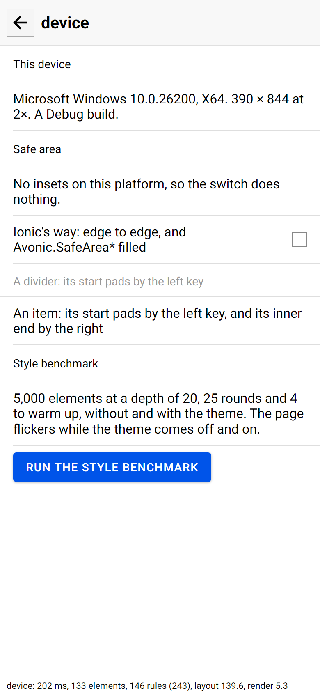

# The sample on Android

The sample on a phone, for what can only be tried on one: real touch, scrolling momentum, the safe area, shadows at a phone's density,
the back button, an overlay in a single view, and the style benchmark. The decisions are in [PLAN.md](PLAN.md). **It builds, and it
hasn't run on a device yet,** so this has no status line until the checklist below has been done.



The device page, headless on desktop, where there are no insets.

## The projects

| Project | What it is |
|---|---|
| `samples/Avonic.Sample` | The sample, a library: `App`, `SampleShell` (the page list, a page, Back), `MainWindow` (a `SampleShell` in a phone-sized window), the pages, Roboto and the pictures |
| `samples/Avonic.Sample.Desktop` | `Program.cs`: the desktop app. `tools/real-window` runs this one |
| `samples/Avonic.Sample.Android` | `MainActivity` and `SampleApplication`: the Android app. Not in `Avonic.sln` |

On Android, `App` gives the single-view lifetime a `SampleShell` as its `MainView`. The package id is `io.github.wdcossey.avonic.sample`,
the app is called Avonic, and it has no icon of its own, so Android shows its default. Minimum Android 7 (API 24), target API 36.

## Build

It needs the .NET 10 SDK's `android` workload (`dotnet workload install android`), an Android SDK with platform 36, and JDK 17 or 21.
The build finds the ones Visual Studio installs. Otherwise pass them:

```
dotnet build samples/Avonic.Sample.Android -c Debug
dotnet build samples/Avonic.Sample.Android -c Debug -p:AndroidSdkDirectory="%LOCALAPPDATA%\Android\Sdk" -p:JavaSdkDirectory="C:\Program Files\Android\openjdk\jdk-21.0.8"
```

| Build | APK | Size, 2026-11-09 |
|---|---|---|
| Debug | `samples/Avonic.Sample.Android/bin/Debug/net10.0-android/io.github.wdcossey.avonic.sample-Signed.apk` | 76.8 MB: arm64 and x64, with the assemblies and their symbols in it, so that `adb install` is enough |
| Release | `samples/Avonic.Sample.Android/bin/Release/net10.0-android/io.github.wdcossey.avonic.sample-Signed.apk` | 31.5 MB: AOT, Avalonia's own assemblies trimmed (`TrimMode` partial), Avonic's kept whole |

Both are signed with the SDK's debug key, so either installs over the other. CI's `android` job builds the Debug one, and keeps it as
the run's `avonic-sample-apk` artifact.

## Install and run

On the phone, once: **Settings → About phone → tap Build number seven times**, then **Settings → System → Developer options → USB
debugging** on, and allow this PC when the phone asks. `adb install` doesn't need "install unknown apps".

```
adb devices
adb install -r samples\Avonic.Sample.Android\bin\Debug\net10.0-android\io.github.wdcossey.avonic.sample-Signed.apk
adb shell am start -n io.github.wdcossey.avonic.sample/io.github.wdcossey.avonic.sample.MainActivity
```

`adb uninstall io.github.wdcossey.avonic.sample` removes it. A Debug build turns on Avalonia's diagnostics, for the performance line along
the bottom, as on desktop. The benchmark needs Release.

## The log

Everything the app writes, from PowerShell, once it's running:

```
adb logcat --pid=$(adb shell pidof -s io.github.wdcossey.avonic.sample)
```

`Console.WriteLine` goes to logcat under the tag `DOTNET`, a crash under `AndroidRuntime`, and .NET's runtime under `monodroid`, so
`adb logcat -s DOTNET AndroidRuntime monodroid` also works before it starts. Avalonia warns once, at start, that a `MainView` "is not fully
supported on Android": that's expected (PLAN.md, section 2). The benchmark's row is the line starting `AvonicBenchmark`.

## On the device

Do these on the Pixel and record what you see in a `COMPARISON.md` here, with the phone's model and Android version, and the screenshots
in `compare/`. The **device** page, last on the list, shows the screen's size and density, the build, and the insets. A screenshot from
the PC: `adb exec-out screencap -p > shot.png`. A recording: `adb shell screenrecord /sdcard/a.mp4` (Ctrl+C to stop), then
`adb pull /sdcard/a.mp4`.

1. **Touch and the ripple.** On `ion-ripple-effect` and `ion-button`, tap, press and hold, and press then slide off. The ripple should
   start under the finger, grow while held, and fade on release; sliding off should cancel the press, and a click should count once. Record a
   screen recording of each, and say whether the ripple starts at the finger, and whether a tap ever counts twice or not at all.
2. **Scrolling momentum.** On `ion-content`, the status line says `Top N, v px/ms` while it scrolls and `Ended at N` when it stops. Do the
   same drag as the Windows run (300 dp in 240 ms), from the device itself so that the timing doesn't cross USB. Take the density `d` from the
   device page, pick `X` and `Y1` in pixels near the middle of the screen, and `Y2` = `Y1` − 300 × `d`:
   ```
   adb shell "input swipe X Y1 X Y2 240 && sleep 0.8 && screencap -p /sdcard/m800.png"
   adb pull /sdcard/m800.png
   ```
   Record the velocity 800 ms after the release (on Windows it was still 0.15 px/ms), where it ended, and how long it took to stop, from a
   recording. Then flick by hand a few times and say how it feels beside a native list, such as Settings. There's no bounce, by decision.
3. **Safe areas.** On the device page, in portrait and landscape, screenshot both ways: Avalonia's (the switch off) and Ionic's (on). Off,
   the whole app should sit between the system bars. On, the header's grey should reach under the status bar with its title below it, the
   page should run under the navigation bar, and in landscape the divider and the item should pad their start by the side's inset, with the
   inset numbers matching. Record the insets the page shows, and anything under a bar or the camera cutout that shouldn't be.
4. **Shadows at the phone's density.** On `ion-card` and `ion-button` (a solid button), screenshot, and compare with the headless frames in
   `docs/components/ion-card/compare/` and `docs/components/ion-button/compare/`. A shadow's offset doesn't scale with density, which is
   accepted as best effort: say whether it looks wrong at this density, with a crop of each.
5. **Back.** On any page, Android's back (the gesture or the button) should go to the list, and on the list leave the app. On `overlays`,
   present one, and back should dismiss it and stay on the page; present "the backdrop can't dismiss", and back should go to the list with the
   overlay still up, as in Ionic, where the router goes back when no overlay takes it. Record each.
6. **An overlay in a single view.** On `overlays`, **Present one through the app**, which calls `Present()` with no `TopLevel`, so that the
   single-view lifetime's `MainView` finds it. It should present like the others, and the status should say "Overlay N presented". If it says
   "wasn't presented", record the message.
7. **The benchmark.** Install the Release build, open the device page, and tap **Run the style benchmark**. It takes several minutes, and
   the page flickers while the theme's templates come off and on: leave the phone alone, screen on. Copy the row from the page, or from the log line
   starting `AvonicBenchmark`. For a row to compare it with, run the same thing in the desktop sample's Release build on the PC
   (`dotnet run --project samples/Avonic.Sample.Desktop -c Release`, device page), as the phone's row includes the sample's base theme and a
   real layout, where the test's doesn't. Add both rows to the trend in [performance](../performance/README.md), saying which machine.
   Issue #66's comment also asks for the frame cost of `ion-progress-bar`'s buffer stream beside a bar with no stream. The sample has no
   per-frame measure: its performance line is the cost of opening a page. So that one is still to do, with a tool of its own.
8. **Rotation,** if it's quick. Rotate on a page and on the list: the layout should follow, the page should stay open, and nothing should
   restart, as the activity handles the change itself.

Also, on any page: the text should be Roboto, as on desktop, and the pictures on `ion-img` should load, both from the sample's assembly.

## Known gaps

- **Not run on a device.** Everything above is to do.
- **`AvonicOverlay.Present()` with no `TopLevel` throws on Android with Avalonia's recommended `MainViewFactory`,** as
  `OverlayHost.TopLevelOf` reads `ISingleViewApplicationLifetime.MainView`, which the factory leaves null. The sample sets `MainView`
  instead, so that the single-view branch is tried. An app that follows Avalonia's docs has to call `Present(TopLevel)`. Reported, not
  changed here.
- **CI's `android` job** hasn't run before this PR.
- **A recreated activity** gets the same main view back, which Avalonia warns about. The activity handles rotation, resizing, display
  size and keyboards itself, so that's only after the system destroys it in the background, or with "Don't keep activities" on. Then the safe-area switch also keeps
  following the old activity's insets until it's turned off and on.
