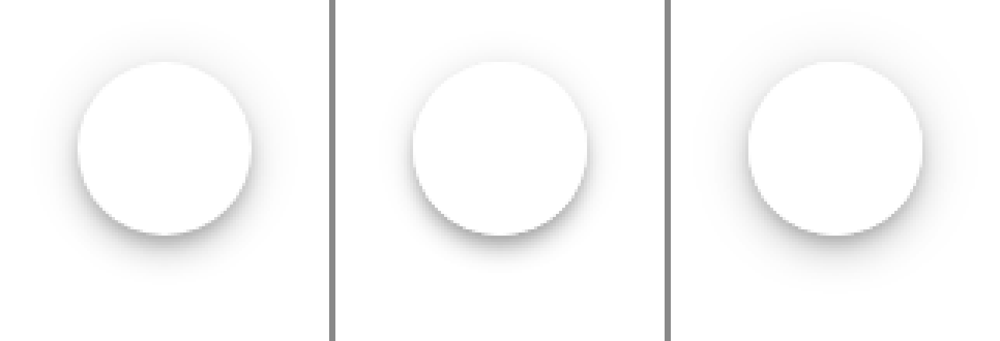
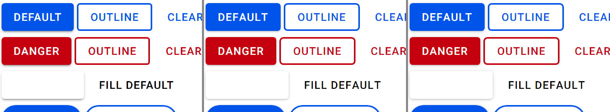
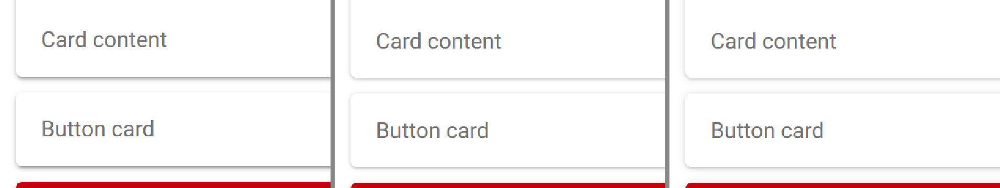
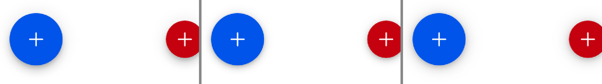

# box-shadow

Status: done · [#139](https://github.com/wdcossey/Avonic/issues/139)

A theme token, or an app's resource, holds Ionic's CSS `box-shadow` exactly as the `.md.css` has it, read by one converter:

```xml
<!-- xmlns:a="using:Avonic.Components.Animation" -->
<a:CssShadow x:Key="Avonic.Card.BoxShadow">0 3px 1px -2px rgba(0, 0, 0, 0.2), 0 2px 2px 0 rgba(0, 0, 0, 0.14), 0 1px 5px 0 rgba(0, 0, 0, 0.12)</a:CssShadow>

<Setter Property="BoxShadow" Value="{a:CssShadow '0 0 10px rgba(0, 0, 0, 0.4)'}" />
```

The resource is the `BoxShadows`, not the extension. In code, `CssBoxShadow.Parse(css)` gives the same, and `CssBoxShadow.Blur(b)`
converts one blur. It reads `none`, or shadows between commas, each with two to four lengths (`px` or unitless), `inset`, and a colour
before or after them: `rgb()`/`rgba()` (commas, or spaces and `/ alpha`, numbers or percentages), `#rgb`, `#rgba`, `#rrggbb`,
`#rrggbbaa` (CSS's order, alpha last, where Avalonia's own `#aarrggbb` has it first), `transparent` (`rgba(0, 0, 0, 0)`, where
Avalonia's `Transparent` is white), and names and `hsl()` as Avalonia reads them. A shadow with no colour, which CSS draws in
`currentColor`, is refused: a `BoxShadow` can't follow the text colour. So are other units, a negative blur, and anything else CSS
rejects.

Avalonia's own `BoxShadow="0 0 10 0 #66000000"` reads the blur as its own, about two thirds as wide as CSS's. Don't write one in a
theme: write CSS through `CssShadow`.

## The formula

Only the blur differs. A CSS blur `B` becomes Avalonia's

```
A = 2√3 · ((B + 0.05) / (3√(2π)/4) − 0.5)  ≈  1.8426 B − 1.6399,  and 0 below B ≈ 0.89
```

Why that shape, read from where the fit lands rather than from Skia's source: Avalonia hands Skia a blur `A` as a Gaussian of sigma
`A / (2√3) + 0.5`, and Skia's CPU rasteriser draws a Gaussian of sigma `s` as three box blurs of a whole number of pixels,
`floor(s · 3√(2π)/4 + 0.5)` wide, which is a Gaussian of about half that width. CSS's blur `B` is a Gaussian of sigma `B / 2`, so the
box Avalonia needs is `B` pixels wide, and `s` is `B / (3√(2π)/4)`. The edges of the measured windows agree with both: the best range
for each blur starts where the box widens by one, at `A = 2√3 ((k − 0.5) / 1.88 − 0.5)`, 1.03, 2.87, …, 15.77, and the measured
ranges start at 1.05, 2.90, …, 15.80 on a grid of 0.05. `B` alone puts `A` in the middle of the window for a whole-pixel blur, and
a half-pixel blur exactly on the edge between two, where float rounding in Avalonia or Skia would pick either. The twentieth of a
pixel added makes it the wider, which measured closer (1.5 px: 7 out with a 2 px window, 27 with none), and moves nothing else: the
whole table below is the same with and without it, but for a 1 px inset at 2×, 38 out without it and 30 with.

This is fitted to Skia's CPU rasteriser, which is what the headless tests and the compare step draw with. A GPU renderer (a real
window, Android) draws a true Gaussian of the sigma Avalonia asks for instead; there the plain sigma-for-sigma rule below would be
exact, and this formula's sigma is about 6% wider than CSS's. Not measured; see the last point under "What's left".

The rule in `CLAUDE.md` before this was sigma for sigma, `(B / 2 − 0.5) / 0.288675`, which lands one window narrow for 9 px and up
(max error 2 to 5 where this has 1). The reorder's hand-made 15.6 for CSS's 10 was that; the refresher's 9.4 for 6 was a ratio of 1.56.

## How it was measured

Throwaway scripts, kept out of the repo: one scene per shadow, a white box on a white 400 × 400 page with its top left at (140, 140),
drawn by Chromium (`playwright-core`, as `tools/ionic-ref/render.js` uses it) and by a headless Avalonia window (Skia, `Avalonia.Headless`,
`UseHeadlessDrawing = false`), at 1× and at 2× (`deviceScaleFactor`, `SetRenderScaling`). Every pixel and channel of the two frames is
compared. 55 scenes: blurs of 0, 0.5, 1, 1.5, 2, 2.5, 3 to 10, 12, 14, 16, 17, 18, 20, 22, 25, 30 and 40 px in black at 0.4; spreads of
10, 5 and −2 and −5 with blurs; offsets of `0 10px`, `0 4px` and `5px 8px`; black at 1 and red at 0.5; each layer of md's 2 dp
elevation on a 120 × 36 box with a radius of 4, and all three; the pressed button's, the fab's (round 56) and pressed fab's, the
header's, the refresher's; rounded boxes with a spread of ±4; and insets. For each single shadow, every Avalonia blur from 0 up in
steps of 0.05 was tried, to find the range that drew closest.

The largest difference of any channel of any pixel, against Chromium, with Avalonia's own reading of CSS's numbers ("as-is"), the old
sigma-for-sigma rule, and this formula. In brackets: the same, leaving out the box's own antialiased edge (see below).

| Scene | 1× as-is | 1× sigma | **1× this** | 2× as-is | 2× sigma | **2× this** |
|---|---|---|---|---|---|---|
| blur 0.5 | 2 | 2 | **2** | 17 | 17 | **17** |
| blur 1 | 17 | 17 | **17** | 8 | 33 | **1** |
| blur 1.5 | 7 | 27 | **7** | 8 | 2 | **2** |
| blur 2 | 1 | 1 | **1** | 2 | 2 | **2** |
| blur 3 | 2 | 2 | **2** | 5 | 2 | **2** |
| blur 4 | 9 | 2 | **2** | 6 | 1 | **1** |
| blur 6 | 8 | 2 | **2** | 9 | 3 | **1** |
| blur 8 | 12 | 1 | **1** | 10 | 2 | **1** |
| blur 10 | 12 | 3 | **1** | 11 | 2 | **1** |
| blur 14 | 11 | 2 | **1** | 13 | 2 | **1** |
| blur 20 | 12 | 2 | **1** | 13 | 2 | **1** |
| blur 22 | 13 | 2 | **1** | 13 | 3 | **1** |
| blur 25 | 13 | 3 | **1** | 14 | 2 | **1** |
| blur 30 | 13 | 1 | **3** | 13 | 1 | **3** |
| blur 40 | 13 | 1 | **2** | 13 | 1 | **3** |
| spread 10, no blur | 0 | 0 | **0** | 0 | 0 | **0** |
| `0 0 10px 5px` | 21 | 5 | **1** | 19 | 3 | **1** |
| `0 0 4px -2px` | 7 | 2 | **2** | 6 | 1 | **1** |
| `0 0 20px -5px` | 12 | 2 | **1** | 13 | 2 | **1** |
| `0 10px`, no blur | 0 | 0 | **0** | 102 | 102 | **102** |
| `0 4px 10px` | 20 | 5 | **1** | 25 | 16 | **16** |
| `5px 8px 6px` | 15 | 3 | **3** | 57 | 52 | **51** |
| black at 1, blur 6 | 22 | 3 | **3** | 24 | 7 | **2** |
| red at 0.5, blur 8 | 16 | 2 | **2** | 12 | 3 | **1** |
| md 2 dp, three layers | 13 (7) | 14 (7) | **14 (7)** | 41 | 48 | **45** |
| md 8 dp, pressed button | 10 | 11 (3) | **11 (4)** | 22 | 23 | **24** |
| fab, 6 dp | 17 (7) | 18 (4) | **18 (4)** | 22 (20) | 25 (18) | **25 (18)** |
| fab pressed, 12 dp | 16 (13) | 19 (3) | **20 (3)** | 24 (17) | 27 (22) | **28 (23)** |
| header | 7 | 3 | **3** | 23 | 17 | **16** |
| refresher icon | 4 (2) | 4 (1) | **4 (1)** | 5 (3) | 5 (2) | **5 (3)** |
| round, `0 0 8px 4px` | 17 | 21 (1) | **21 (1)** | 20 (11) | 22 (1) | **22 (3)** |
| round, `0 0 8px -4px` | 12 | 4 (1) | **4 (1)** | 7 | 4 (1) | **3** |

So, from 4 px up to 25, this formula is within 1 to 3 of Chromium for a lone shadow at 1×, and at 2× when it has no offset, where Avalonia's own reading is 4 to 22
out. What's left:

- **Offsets at 2× and above.** Avalonia doesn't scale a shadow's offset with the render scale (a separate entry in
  [`avalonia-issues.md`](../avalonia-issues.md)); every 2× row with an offset is that. Doubling the offsets by hand in the same
  scenes, every one of them is within 5 of Chromium away from the box's edge (md 2 dp 5, pressed button 4, fab 4, pressed fab 4,
  header 3, `5px 8px 6px` 3). Not fixed here: the extension doesn't know the scale. On a phone, until it is, md's elevations sit
  higher than Ionic's, and the wider blur now reaches a little further above a card than before: rows above a card at 2×, from its
  edge, Chromium 246, 248, 250, 252; before 240, 245, 250, 252; now 239, 243, 247, 249. At 1×, Chromium 247, 250, 253, 254, now
  246, 250, 253, 254.
- **The smallest blurs at 1×.** Avalonia draws no blur below a blur of 1.03 (one box of 1 px), and a 2 px box above it. Chromium's
  1 px blur falls between: 238 in the one row outside, where no blur gives 255 and the 2 px box 221 then 247. Either is 17 out at
  alpha 0.4, and md's `0 3px 1px -2px` at alpha 0.2 is 6 out (the 7 in md 2 dp). The formula gives 0.20, no blur, which is the closer
  of the two for md's shadows. At 2× the same blur is a 2 px box in device pixels, and within 1.
- **Blurs over 25.** Chromium's are narrower than a Gaussian of `B / 2` there: 30 and 40 matched best one or two windows down, 3 out
  with this formula. md's largest blur is 22.
- **The box's own antialiased edge.** On a curve, Chromium's edge pixels show more of the shadow under them than Avalonia's: up to 21
  on the round boxes, with any blur, and with Avalonia's own numbers too. It's the edge, not the shadow; the bracketed numbers leave
  out the pixels the box itself only partly covers.
- **Insets.** Chromium draws an inset shadow narrower than an outer one: sigma for sigma fitted insets best (2 to 4 out from 3 px up;
  1 px is 19 out either way), and this formula is up to 6 out (blur 10, alpha 0.4). Kept one formula, as no md shadow is inset.
- **Only Skia's CPU rasteriser was measured,** as the tests and the compare step draw. A GPU renderer (a real window, Android) draws
  a true Gaussian of the sigma Avalonia asks for, which this formula makes about 6% wider than CSS's `B / 2`: by the Gaussian's
  slope, about 1.6 levels at most for a shadow at alpha 0.4, less at md's 0.12 to 0.2. Not measured: not tried in a real window or on
  a device.

Spread and offset need no conversion: a spread of 10 and an offset of 10 with no blur match to the pixel at 1×, and a spread follows
the corners as CSS's does (the round spread rows, 1 away from the edge). Colours with alpha match within 2 to 3.

## 1×: Chromium, Avalonia's own reading, this

`0 0 10px rgba(0, 0, 0, 0.4)`, 3× zoom:


md's fab elevation on a round 56, 4× zoom:



## 2×, the compare step's frames: Ionic, before, after

The md elevations at 2×, where the offset is the difference left: the first buttons, cards and fabs of each control's reference
page, 1.5× zoom.







## Tests

`tests/Avonic.Components.Tests/Animation/CssShadowTests.cs`: the formula against each measured window from 2 to 25 px, columns drawn
through the converter against Chromium's within its measured error, the reading of CSS's syntax and what's refused, and both XAML
forms (`CssShadowUsage.axaml`). The controls' tests that pin a shadow take Ionic's CSS through the converter.
