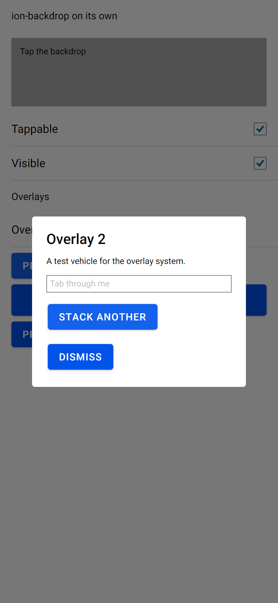

# Overlay system and animation utility

Status: done · [#5](https://github.com/wdcossey/Avonic/issues/5)

Ionic's `utils/overlays` and `utils/animation` on Avalonia, in `Avonic.Components.Overlays` and `Avonic.Components.Animation`:
presenting and dismissing an overlay, its events and awaitables, stacking, the focus trap, Escape, the back button and a backdrop
tap, and `createAnimation` on Avonic's clock. It's what `ion-alert`, `ion-action-sheet`, `ion-loading`, `ion-modal`,
`ion-popover`, `ion-toast` and `ion-menu` are built on. The design, the measurements and what's deferred are in
[PLAN.md](PLAN.md). `AvonicBackdrop` is in [`docs/components/ion-backdrop/`](../../components/ion-backdrop/README.md).



## An overlay control

Derive from `AvonicOverlay`, give it a template with an `AvonicBackdrop` and its wrapper, and its md animations. What only some
overlays have is a protected member to override; declare the Ionic property on the control and return it.

```csharp
public class AvonicLoading : AvonicOverlay
{
    public static readonly StyledProperty<bool> BackdropDismissProperty =
        AvaloniaProperty.Register<AvonicLoading, bool>(nameof(BackdropDismiss), defaultValue: false);

    public bool BackdropDismiss { get => GetValue(BackdropDismissProperty); set => SetValue(BackdropDismissProperty, value); }

    protected override bool BackdropDismissEnabled => BackdropDismiss;  // Escape, back, and the backdrop's tap
    protected override int ZIndexBase => 40000;                          // loading's
    protected override Control? FocusTrapWrapper => _wrapper;            // scoped, as loading has no shadow root

    protected override AnimationBuilder MdEnterAnimation => (baseEl, _) => AvonicAnimation.Create()
        .AddElement(baseEl)
        .Easing("ease-in-out")
        .Duration(200)
        .AddAnimation(
            AvonicAnimation.Create().AddElement(_backdrop).FromTo("opacity", 0.01, BackdropOpacity)
                .BeforeStyles(new() { ["pointer-events"] = "none" }).AfterClearStyles(["pointer-events"]),
            AvonicAnimation.Create().AddElement(_wrapper).Keyframes([
                new AnimationKeyframe(0) { ["opacity"] = 0.01, ["transform"] = "scale(1.1)" },
                new AnimationKeyframe(1) { ["opacity"] = 1, ["transform"] = "scale(1)" },
            ]));

    protected override AnimationBuilder MdLeaveAnimation => /* md.leave.js, the same way */;
}
```

Bind the backdrop's `Tappable` to `BackdropDismiss` in the template, as Ionic's overlays do; a tap on any `AvonicBackdrop` inside
the overlay calls `OnBackdropTap()`, which dismisses with the `backdrop` role. A scoped overlay (alert, action sheet, loading,
picker) puts two focusable sentinels around its wrapper, as Ionic's `tabindex="0"` divs, so Tab wraps at them.

| Member | Ionic | What it does |
|---|---|---|
| `Animated`, `KeyboardClose`, `EnterAnimation`, `LeaveAnimation` | the props every overlay has | public properties |
| `Present()`, `Present(TopLevel)` | `present()` | shows it in the application's top level (below), or the one given |
| `Dismiss(data, role)` | `dismiss()` | `true` if it dismissed |
| `OnWillDismiss()`, `OnDidDismiss()` | the same | the next event's `OverlayEventDetail(Data, Role)` |
| `WillPresent`, `DidPresent`, `WillDismiss`, `DidDismiss` | `willPresent` and the rest | routed events, bubbling; the dismiss ones carry `Data` and `Role` |
| `BackdropDismissEnabled` | `backdropDismiss` | protected; `false` |
| `StealsFocus` | not a toast | protected; `true`. False: no blur, no focus given back, no trap |
| `FocusTrapEnabled` | not `ion-disable-focus-trap` | protected; `true` |
| `FocusTrapWrapper` | `.ion-overlay-wrapper` | protected; null for the shadow variant (modal, popover) |
| `ZIndexBase` | the inline z-index | protected; 20000 |
| `MdEnterAnimation`, `MdLeaveAnimation`, `AnimationOptions` | `md.enter.js`, `md.leave.js`, `opts` | protected |
| `OnBackdropTap()` | `onIonBackdropTap` | protected; dismisses with `OverlayRoles.Backdrop` |
| `OverlayRoles.Backdrop`, `.Gesture`, `.IsCancel()` | `BACKDROP`, `GESTURE`, `isCancel` | `Gesture` skips the leave animation |

Per-control events (each overlay adds its own `Ion<Name>WillPresent`, `Ion<Name>DidPresent`, `Ion<Name>WillDismiss` and
`Ion<Name>DidDismiss`, as `ionAlertWillPresent` → `IonAlertWillPresent`, raised with the base's generic ones), controllers, `isOpen`, `trigger` and inline overlays are each overlay's
issue: see [PLAN.md](PLAN.md#deferred).

## What it does, in short

- **Which top level**: `Present()` takes a desktop's active window, else its main one; a single view's main view's (iOS, the
  browser, Android when the app sets `MainView`); under Android's `MainViewFactory`, which leaves `MainView` null, the last top level
  to come that's still loaded, which is the current activity's. A top level comes when its template is applied, and goes when it
  unloads; Avonic listens from when its assembly loads, with `AvonicTheme`. With none, it throws, in its task: use
  `Present(TopLevel)`.
- **Where**: in a panel of Avonic's in the `TopLevel`'s `OverlayLayer`, the window's size, below Avalonia's popups. A top level
  without one (a template with no `VisualLayerManager`) throws. `ZIndex` is the base plus a counter from 1, given at each present.
- **Present**: blurs the focused element (unless `StealsFocus` is false), `WillPresent`, shows the overlay and plays the enter
  animation, with a duration of 0 if `Animated` or `AvonicConfig.Animated` is false, `DidPresent`, then focuses the overlay with
  `KeyboardClose`, unless focus is already inside.
- **Dismiss**: not hit-testable, `WillDismiss`, the leave animation (not for `gesture`), `DidDismiss`, every animation it
  played destroyed, hidden and removed; focus given back to what had it at present, if nothing has it now.
- **Top overlay**: the last presented that's showing. Escape and `TopLevel.BackRequested` (Android's back, Alt+Left, the mouse's
  back button) dismiss it with the `backdrop` role when its `BackdropDismissEnabled` is true; back is then handled. An Escape a
  control inside has handled, as a `ComboBox` closing its drop-down does, is left alone.
- **Focus trap**: the top overlay that steals focus. Shadow variant: focus anywhere outside comes back inside, to the first focusable
  element, or the last if the first was where it came from. Scoped: focus outside is left alone, and the sentinels wrap. A popup
  opened from inside (a `ComboBox`'s drop-down) counts as inside, by its logical parent.

## `AvonicAnimation`

`AvonicAnimation.Create()` is `createAnimation()`, with Ionic's members in PascalCase. It animates `opacity` and `transform`
(`translateX`, `translateY`, `translate`, `scale`, `scaleX`, `scaleY`, `rotate`; `px`, `%`, `deg`), and styles `opacity` and
`pointer-events`. Easing is `linear`, `ease`, `ease-in`, `ease-out`, `ease-in-out` or `cubic-bezier()`, solved as Chromium does by
`CubicBezierEasing`, which is also an Avalonia `Easing` for transitions. `CubicBezier.GetTimeGivenProgression` is Ionic's
`cubic-bezier.js`. Anything else throws when it's given.

The timing is Web Animations', on `AvonicConfig.Now` and `AvonicConfig.RequestFrame`, so tests run it on `TestClock`: an animation
played at 0 shows its first values at once, starts at the frame at 16, and shows local time t at 16 + t. Its values beat every
style, and with the default `fill: both` the last stays until `Destroy()` or `Stop()`.

## Extensions

Avonic additions, which shadow no Ionic name:

- `Present(TopLevel)`: presents in a given top level, for an app with several windows. `Present()` is Ionic's, in the
  application's.
- `CubicBezierEasing` is an Avalonia `Easing`, so a transition can use the exact CSS curve too.

## Known gaps

- **Async exceptions**: Ionic catches an error during `dismiss()`, logs it and removes the overlay anyway. Here the overlay is
  still hidden and removed, but the exception reaches the `Dismiss()` task, as .NET expects.
- **The overlay index** is given at present, where Ionic's controller gives it at `create()`. Until the controllers come, an
  overlay made first and presented second is on top.
- **Transforms** whose lists differ switch at the midpoint, where CSS interpolates matrices. No md enter or leave animation has one.
- **Single-view and Android lifetimes** are tested with doubles emitted at run time, as C# can't implement Avalonia's lifetime
  interfaces, and Android's `EmbeddableControlRoot` on a headless window's platform view. The single-view branch was tried on a
  Pixel 8 ([#66](../android/COMPARISON.md)); `MainViewFactory` hasn't been tried on a device
  ([#114](https://github.com/wdcossey/Avonic/issues/114)).
- **Several Avalonia activities** under `MainViewFactory`: the current one is taken to be the last to come that's still loaded,
  which holds while the one on top is the newest. An app that brings an older activity forward with `FLAG_ACTIVITY_REORDER_TO_FRONT`,
  or shows two of its activities in split screen, would need `Present(TopLevel)`. So would `Present()` from a view's constructor
  under the factory, which runs before its activity's top level exists, and an app that loads Avonic's assembly only after its first
  activity, with no `AvonicTheme` in its `App.axaml`.
- Not tried in a real window: `tools/real-window/drive.ps1` has a section for the sample page, which the batch's runner runs.
