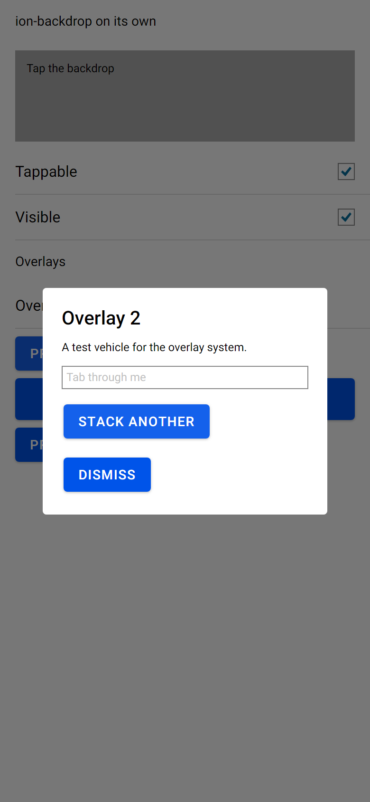

# Overlay system and animation utility

Status: done · [#5](https://github.com/wdcossey/Avonic/issues/5)

Ionic's `utils/overlays` and `utils/animation` on Avalonia, in `Avonic.Components.Overlays` and `Avonic.Components.Animation`:
presenting and dismissing an overlay, its events and awaitables, stacking, the focus trap, Escape, the back button and a backdrop
tap, and `createAnimation` on Avonic's clock. It's what `ion-alert`, `ion-action-sheet`, `ion-loading`, `ion-modal`,
`ion-popover`, `ion-toast` and `ion-menu` are built on. The design, the measurements and what's deferred are in
[PLAN.md](PLAN.md). `AvonicBackdrop` is in [`docs/components/ion-backdrop/`](../../components/ion-backdrop/README.md).



## An overlay control

Derive from `AvonicOverlay`, give it a template with an `AvonicBackdrop` and its wrapper, and its md animations. What only some
overlays have is a protected member to override; declare the Ionic property on the control and return it.

```csharp
public class AvonicLoading : AvonicOverlay
{
    public static readonly StyledProperty<bool> BackdropDismissProperty =
        AvaloniaProperty.Register<AvonicLoading, bool>(nameof(BackdropDismiss), defaultValue: false);

    public bool BackdropDismiss { get => GetValue(BackdropDismissProperty); set => SetValue(BackdropDismissProperty, value); }

    protected override bool BackdropDismissEnabled => BackdropDismiss;  // Escape, back, and the backdrop's tap
    protected override int ZIndexBase => 40000;                          // loading's
    protected override Control? FocusTrapWrapper => _wrapper;            // scoped, as loading has no shadow root

    protected override AnimationBuilder MdEnterAnimation => (baseEl, _) => AvonicAnimation.Create()
        .AddElement(baseEl)
        .Easing("ease-in-out")
        .Duration(200)
        .AddAnimation(
            AvonicAnimation.Create().AddElement(_backdrop).FromTo("opacity", 0.01, BackdropOpacity)
                .BeforeStyles(new() { ["pointer-events"] = "none" }).AfterClearStyles(["pointer-events"]),
            AvonicAnimation.Create().AddElement(_wrapper).Keyframes([
                new AnimationKeyframe(0) { ["opacity"] = 0.01, ["transform"] = "scale(1.1)" },
                new AnimationKeyframe(1) { ["opacity"] = 1, ["transform"] = "scale(1)" },
            ]));

    protected override AnimationBuilder MdLeaveAnimation => /* md.leave.js, the same way */;
}
```

Bind the backdrop's `Tappable` to `BackdropDismiss` in the template, as Ionic's overlays do; a tap on any `AvonicBackdrop` inside
the overlay calls `OnBackdropTap()`, which dismisses with the `backdrop` role. A scoped overlay (alert, action sheet, loading,
picker) puts two focusable sentinels around its wrapper, as Ionic's `tabindex="0"` divs, so Tab wraps at them.

| Member | Ionic | What it does |
|---|---|---|
| `Animated`, `KeyboardClose`, `EnterAnimation`, `LeaveAnimation` | the props every overlay has | public properties |
| `Present()`, `Present(TopLevel)` | `present()` | shows it in the application's top level (below), or the one given |
| `Dismiss(data, role)` | `dismiss()` | `true` if it dismissed |
| `OnWillDismiss()`, `OnDidDismiss()` | the same | the next event's `OverlayEventDetail(Data, Role)` |
| `WillPresent`, `DidPresent`, `WillDismiss`, `DidDismiss` | `willPresent` and the rest | routed events, bubbling; the dismiss ones carry `Data` and `Role` |
| `BackdropDismissEnabled` | `backdropDismiss` | protected; `false` |
| `StealsFocus` | not a toast | protected; `true`. False: no blur, no focus given back, no trap |
| `FocusTrapEnabled` | not `ion-disable-focus-trap` | protected; `true` |
| `FocusTrapWrapper` | `.ion-overlay-wrapper` | protected; null for the shadow variant (modal, popover) |
| `ZIndexBase` | the inline z-index | protected; 20000 |
| `MdEnterAnimation`, `MdLeaveAnimation`, `AnimationOptions` | `md.enter.js`, `md.leave.js`, `opts` | protected |
| `OnBackdropTap()` | `onIonBackdropTap` | protected; dismisses with `OverlayRoles.Backdrop` |
| `OverlayRoles.Backdrop`, `.Gesture`, `.IsCancel()` | `BACKDROP`, `GESTURE`, `isCancel` | `Gesture` skips the leave animation |
| `OverlayRoles.ParentRemoved`, `.ParentDismissed`, `.Handler` | the modal's `'parent-removed'`, `'parent-dismissed'`, `'handler'` | |
| `IsOpen` | `isOpen` | public; false to true presents, true to false dismisses, once it's attached; true at its first attach presents at the next frame. A dismiss doesn't clear it (#42) |
| `Trigger` | `trigger` (`createTriggerController`) | public; the name of a control in its name scope, whose own `Click` routed event or a tap presents it, as a DOM `click` comes from a key on a button and a tap on anything (#42). Looked up through a presented overlay around it to its placeholder, so a popover in another's content finds its trigger in the page (#43) |
| `AddTriggerListeners(trigger)`, `TriggerElement`, `ConfigureTrigger()` | `configureTriggerInteraction`, `triggerEl` | protected: the listeners the trigger gets, a click by default, returning what removes them; the control found; looking it up again, as a watcher on a prop the listeners read does (the popover's `triggerAction`, #43) |
| `ControlWillPresentEvent` and the other three | `ion<Name>WillPresent` and the rest | protected; raised just before the generic one, as Ionic does |
| `OnPresenting()`, `OnPresented()`, `OnDismissing(data, role)`, `OnDismissed(bool)` | what an overlay's own `present()` and `dismiss()` do around the shared ones | protected, under the lock; `OnPresenting` once it's in the host (an inline one's place is `Placeholder`); `OnPresented` after the enter, the events and the focus (the modal's sheet gesture, #42; the alert's focus on its wrapper or its one button, #39); `OnDismissing` returning false stops the dismiss (the modal's `canDismiss`) |
| `PresentFocusTarget` | `[role="dialog"][tabindex]` | protected; what present focuses, the overlay if null (the modal's wrapper) |

**Inline overlays** (`CoreDelegate`, #42): an overlay with a parent when it's presented is moved to the overlay host, with an
invisible placeholder in its place (in a `Panel`, a `Decorator`, a `ContentControl` or a `ContentPresenter`; anything else throws),
and moved back after its dismiss. `Present()` uses its own top level, or, in a popup, the one the popup belongs to. It keeps the page's `DataContext` through a style-priority
binding to the placeholder's, but not the page's own `Styles` and `Resources`, which it's out of the reach of; a placeholder that leaves the visual tree while it's out dismisses it with `parent-removed`. See
[ion-modal](../../components/ion-modal/README.md).

Per-control events are each overlay's own (`ionAlertWillPresent` → `IonAlertWillPresent`, through `ControlWillPresentEvent`), as
are controllers: see [PLAN.md](PLAN.md#deferred).

## What it does, in short

- **Which top level**: `Present()` takes a desktop's active window, else its main one; a single view's main view's (iOS, the
  browser, Android when the app sets `MainView`); under Android's `MainViewFactory`, which leaves `MainView` null, the last top level
  to come that's still open, which is the current activity's. A top level comes when its template is applied, and goes when it
  closes; Avonic listens from when its assembly loads, with `AvonicTheme`. With none, it throws, in its task: use
  `Present(TopLevel)`.
- **Where**: in a panel of Avonic's in the `TopLevel`'s `OverlayLayer`, the window's size, below Avalonia's popups. A top level
  without one (a template with no `VisualLayerManager`) throws. `ZIndex` is the base plus a counter from 1, given at each present.
- **Present**: blurs the focused element (unless `StealsFocus` is false), `WillPresent`, shows the overlay and plays the enter
  animation, with a duration of 0 if `Animated` or `AvonicConfig.Animated` is false, `DidPresent`, then focuses the overlay with
  `KeyboardClose`, unless focus is already inside.
- **Dismiss**: not hit-testable, `WillDismiss`, the leave animation (not for `gesture`), `DidDismiss`, every animation it
  played destroyed, hidden and removed; focus given back to what had it at present, if nothing has it now.
- **Top overlay**: the last presented that's showing. Escape and `TopLevel.BackRequested` (Android's back, Alt+Left, the mouse's
  back button) dismiss the top one that isn't a toast (#38: Ionic's take a toast on top, which then stops them, recorded in
  `docs/infra/ionic-issues.md`) with the `backdrop` role when its `BackdropDismissEnabled` is true; back is then handled. In an
  [`AvonicApp`](../../components/ion-app/README.md), back goes through `HardwareBackButton.IonBackButtonEvent`, where the overlay
  registers at 100 (`OverlayBackButtonPriority`), so an app's own handler above that comes first; without one, the overlay takes
  the back request itself. Neither with `AvonicConfig.HardwareBackButton` off. An Escape a control inside has handled, as a
  `ComboBox` closing its drop-down does, is left alone.
- **Focus trap**: the top overlay that steals focus. Shadow variant: focus anywhere outside comes back inside, to the first focusable
  element, or the last if the first was where it came from. Scoped: focus outside is left alone, and the sentinels wrap. A popup
  opened from inside (a `ComboBox`'s drop-down) counts as inside, by its logical parent.

## Sizes from CSS variables

Each overlay's wrapper is sized by its `--width`, `--height` and their `--min-*` and `--max-*`, which take any CSS length. One
reader, `Behaviors/CssLength`, turns them into pixels for every panel: a number (px), `px`, a percentage of the panel's basis,
`vw` and `vh` of the top level's client size, sums and differences, `calc()` and `min()`; `auto`, `none` and the content
sizes are no length, and leave the panel's own rule. The modal and the popover had a reader of their own with no `vw`, `vh` or
`min()`, until #266.

The panels stay apart, with no base class: each lays its wrapper out as a different CSS layout, and only the six properties and the
clamp would be shared.

| Panel | Ionic's CSS | Width with no length | Height with no length | Place |
|---|---|---|---|---|
| `AlertPanel` (alert, loading) | a flex item, centred | fit-content: the max-content, at most the room | the content's | centred |
| `ActionSheetPanel` | absolute, `left`, `right` and `bottom` 0 | the room | the content's | bottom, centred across |
| `ModalPanel` | a flex item, centred; a sheet's absolute at the bottom | the content's, within the room | the content's, or a sheet's `calc()` | centred, or bottom |
| `PopoverPanel` | absolute, at the place its animation works out | the content's | the content's, or between top and bottom | placed |
| `MenuPanel` | absolute, `top: 0; bottom: 0` at a side | fit-content | the host's | the start or the end side |
| `ToastPanel` | absolute, `start`, `end` and a position | between start and end | the content's | top, middle or bottom |

## `AvonicAnimation`

`AvonicAnimation.Create()` is `createAnimation()`, with Ionic's members in PascalCase. It animates `opacity` and `transform`
(`translateX`, `translateY`, `translate`, `scale`, `scaleX`, `scaleY`, `rotate`; `px`, `%`, `deg`), and styles `opacity` and
`pointer-events`. Easing is `linear`, `ease`, `ease-in`, `ease-out`, `ease-in-out` or `cubic-bezier()`, solved as Chromium does by
`CubicBezierEasing`, which is also an Avalonia `Easing` for transitions. `CubicBezier.GetTimeGivenProgression` is Ionic's
`cubic-bezier.js`. Anything else throws when it's given.

The timing is Web Animations', on `AvonicConfig.Now` and `AvonicConfig.RequestFrame`, so tests run it on `TestClock`: an animation
played at 0 shows its first values at once, starts at the frame at 16, and shows local time t at 16 + t. Its values beat every
style, and with the default `fill: both` the last stays until `Destroy()` or `Stop()`.

For a gesture to drive one (#42, the sheet modal): `ProgressStart(forceLinearEasing, step)` holds it at a step, linear if asked;
`ProgressStep(step)` moves the hold (clamped to 0..0.9999 of the duration, after the delay, as `setAnimationStep`);
`ProgressEnd(playTo, step, duration)` plays from the step to the end (1) or back to the start (0, which finishes at step 0), with
its easing back, over the duration given, and the coercions are gone before the `OnFinish` callbacks. `Keyframes` on an animation
that has started replace them where it is (`setKeyframes`). `maxHeight` is a keyframe property too: px, or a percentage of the
visual parent's height.

## Extensions

Avonic additions, which shadow no Ionic name:

- `Present(TopLevel)`: presents in a given top level, for an app with several windows. `Present()` is Ionic's, in the
  application's.
- `CubicBezierEasing` is an Avalonia `Easing`, so a transition can use the exact CSS curve too.

## Known gaps

- **Async exceptions**: Ionic catches an error during `dismiss()`, logs it and removes the overlay anyway. Here the overlay is
  still hidden and removed, but the exception reaches the `Dismiss()` task, as .NET expects.
- **The overlay index** is given at present, where Ionic's controller gives it at `create()`. Until the controllers come, an
  overlay made first and presented second is on top.
- **Transforms** whose lists differ switch at the midpoint, where CSS interpolates matrices. No md enter or leave animation has one.
- **Single-view and Android lifetimes** are tested with doubles emitted at run time, as C# can't implement Avalonia's lifetime
  interfaces, and Android's `EmbeddableControlRoot` on a headless window's platform view. The single-view branch was tried on a
  Pixel 8 ([#66](../android/COMPARISON.md)), and `MainViewFactory` on the same phone on 2026-11-10: `Present()` with no top level
  presented in the activity's, and Back dismissed it ([#114](https://github.com/wdcossey/Avonic/issues/114)).
- **Several Avalonia activities** under `MainViewFactory`: the current one is taken to be the last to come that's still open,
  which holds while the one on top is the newest. An app that brings an older activity forward with `FLAG_ACTIVITY_REORDER_TO_FRONT`,
  or shows two of its activities in split screen, would need `Present(TopLevel)`. So would `Present()` from a view's constructor
  under the factory, which runs before its activity's top level exists, and an app that adds `AvonicTheme` or
  `AvonicComponentsStyles` only after its first activity, rather than in its `App.axaml`.
- **Focus at present.** Since Ionic 8.8.19, `present()` with `keyboardClose` focuses the first element in the overlay's root with
  `role="dialog"` and a `tabindex`, and the host only when there's none. Of Ionic's overlays, only `ion-modal`'s `.modal-wrapper`
  is one, which `AvonicModal` gives as `PresentFocusTarget` (#42). Whether focusing it scrolls a sheet that's partly off screen is
  for the sheet. The modal's padding of its content's end by the bottom safe area is a gap of `AvonicContent`'s, in
  [ion-modal](../../components/ion-modal/README.md#known-gaps).
- Not tried in a real window: `tools/real-window/drive.ps1` has a section for the sample page, which the batch's runner runs.
