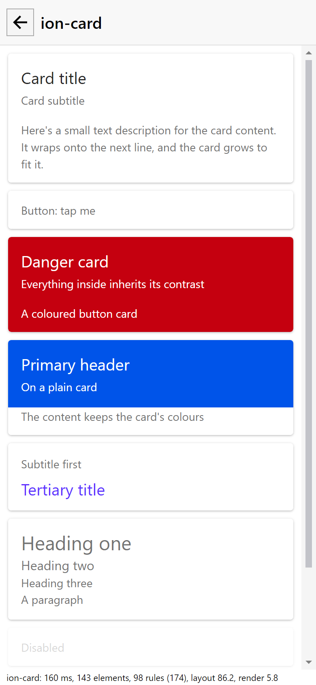

# Performance

Status: done

What the theme costs an app, and what stops that creeping up unnoticed. The evidence and the options tried are in
[PLAN.md](PLAN.md).

## What it costs

Avalonia checks **every global style rule against every element**, in any app, even one that uses none of these controls. It
keeps no cache by type, and it visits nested rules whether or not the parent matched. Global rules are the ones in
`src/Avonic.Themes/Styles/`. Rules in a `ControlTheme` only cost that control.

| Against an element it can't match, by the form of the rule | Per element, per rule |
|---|---|
| Targets a type of ours, even through a template and a slot | about 7 to 16 ns |
| A comma of 5 of those | about 84 ns |
| Could match the element, such as `c\|Foo > TextBlock` or `:is(Control)` | about 55 ns |
| A descendant selector on the element, at a depth of 20 | about 385 ns |

Across the real theme it comes to **about 30 ns for each alternative between commas**, whichever kind it is, and 27 to 33 across
runs. That's why alternatives are what's budgeted. These times are from this machine, and the small differences are close to the noise. The
counts are exact.

## The budget

`StyleBudgetTests` fails CI when:

| Check | Now | Limit |
|---|---|---|
| Alternatives in all global rules | 176 | 200 |
| Alternatives getting past a `TextBlock`'s type | 51 | 60 |
| Alternatives getting past the type of any other common element, at most (`Border`) | 19 | 25 |
| Alternatives that look at every ancestor of a common element | 0 | 0 |

**When a control goes over,** the failure lists the largest rules. First see whether the commas can go. If they can't, raise
the limit in that PR and say so in its description, with the new total. The limits are meant to be raised. The point is that
it's a decision.

A selector with `> :is(Panel) >` is two alternatives for each thing it targets, so it's worth a thought.

**600 alternatives is a checkpoint,** about 18 µs per element, decided in [ADR 0002](../../decisions/0002-decisions-from-the-first-swarm.md). A test stops the limit going past it. About 67
Ionic tags remain, and at today's 10 or so each the library ends near 820, or about 25 µs, so **we expect to reach it, after about 44 more.** When we do, stop, and
run the benchmark on a real phone, to decide on real numbers. The way out is controls working out their host's state in code, with the theme reading a pseudoclass,
which removes most of the cost but adds code to every control. Otherwise, raise the checkpoint.

## The trend

Run by hand at each tier's roll-up, on the same machine, and add a row. Timings in CI would mean nothing.

```
AVONIC_BENCHMARK=/absolute/path/row.md dotnet test tests/Avonic.Components.Tests -c Release --filter FullyQualifiedName~StyleCostBenchmark
```

It alternates with and without the theme, 25 rounds, attaching 5,000 elements at a depth of 20, with Avalonia's diagnostics off,
as an app has them. Times are µs per element. A row can go straight in the table.

| When | Controls | Rules | Alternatives | `TextBlock` | `Border` |
|---|---|---|---|---|---|
| 2026-11-06 | 18 | 98 | 174 | 18.5 to 24.2 (+5.6) | 2.2 to 8.0 (+5.8) |

### On a phone

A phone can't run the test, so the sample's **device** page runs the same thing in the app (`Diagnostics/StyleCostRunner.cs`): the
same trees, rounds and row, from `Diagnostics/StyleCost.cs`, which the test uses too. It takes the app's `AvonicTheme` out of
`Application.Styles` and puts it back, attaches into the page and lays out. So its times include the sample's `SimpleTheme`, which the
test's don't, and **a phone's row is compared with a desktop row from the same page**, in the desktop sample's Release build, not with
the rows above. It says when a row isn't for the table: a Debug build, or Avalonia's diagnostics on. How to run it on the Pixel is in
[the Android docs](../android/README.md#on-the-device). None has been run yet.

## In a Debug build

The sample shows a line along the bottom when a page opens:

```
ion-card: 160 ms, 143 elements, 98 rules (174), layout 86.2, render 5.8
```



This one is from headless capture, and it hasn't been tried in a real window yet.

That's the time to open the page, from before it's made, the elements in it, the global rules and their alternatives, and Avalonia's own layout and
render times over that time. A Release build doesn't have it. **Nothing is added to the library,** because Avalonia has this
built in, behind a switch that's off by default:

- `AppContext.SetSwitch("Avalonia.Diagnostics.Diagnostic.IsEnabled", true)`, before Avalonia starts
- Meter `Avalonia.Diagnostic.Meter`: `avalonia.ui.measure.time`, `.arrange.time`, `.render.time`, `.input.time`,
  `avalonia.comp.render.time`, `.update.time`, `avalonia.ui.visual.count`, `avalonia.ui.event.handler.count`
- Activity source `Avalonia.Diagnostic.Source`: `Avalonia.AttachingStyle`, with the selector and its result, and
  `EvaluatingStyle`, `FindingResource`, `MeasuringLayoutable`, `ArrangingLayoutable`, `PerformingHitTest`, `RaisingRoutedEvent`

Tracing activities costs far more than the checks being traced, so use its counts and not its times. The sample's line doesn't
trace.

## Known limits

- **`render` can read low,** if a page opens within a frame of the last one, because its own render pass hasn't happened yet.
- **Only style checks are budgeted.** A slow control, layout or animation wouldn't show here. The line in the sample is how
  to spot those.
- **The numbers are from one desktop PC.** Nothing has been measured on a phone yet, though the sample can now do it.
- **`ItemsControl`, virtualising and scrolling** haven't been measured. These are all times to attach.
