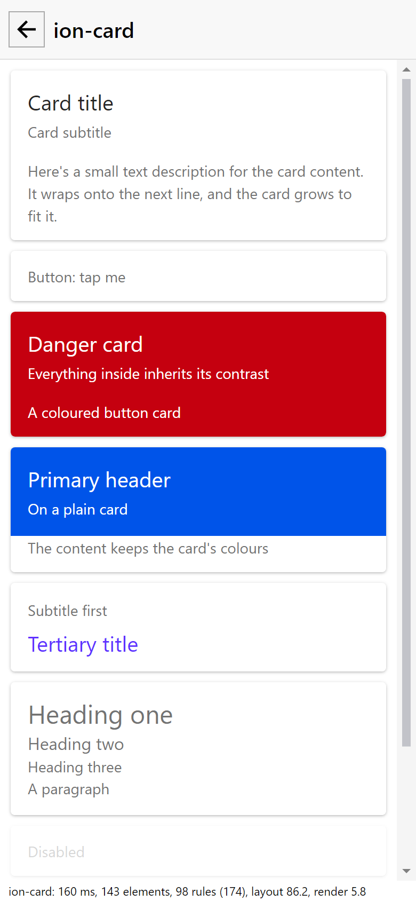

# Performance

Status: done

What the theme costs an app, and what stops that creeping up unnoticed. The evidence and the options tried are in
[PLAN.md](PLAN.md).

## What it costs

Avalonia checks **every global style rule against every element**, in any app, even one that uses none of these controls. It
keeps no cache by type, and it visits nested rules whether or not the parent matched. Global rules are the ones in
`src/Avonic.Themes/Styles/`. Rules in a `ControlTheme` only cost that control.

| Against an element it can't match, by the form of the rule | Per element, per rule |
|---|---|
| Targets a type of ours, even through a template and a slot | about 7 to 16 ns |
| A comma of 5 of those | about 84 ns |
| Could match the element, such as `c\|Foo > TextBlock` or `:is(Control)` | about 55 ns |
| A descendant selector on the element, at a depth of 20 | about 385 ns |

Across the real theme it comes to **about 30 ns for each alternative between commas**, whichever kind it is, and 27 to 33 across
runs. That's why alternatives are what's budgeted. These times are from this machine, and the small differences are close to the noise. The
counts are exact.

## The budget

`StyleBudgetTests` fails CI when:

| Check | Now | Limit |
|---|---|---|
| Alternatives in all global rules | 176 | 200 |
| Alternatives getting past a `TextBlock`'s type | 51 | 60 |
| Alternatives getting past the type of any other common element, at most (`Border`) | 19 | 25 |
| Alternatives that look at every ancestor of a common element | 0 | 0 |

**When a control goes over,** the failure lists the largest rules. First see whether the commas can go. If they can't, raise
the limit in that PR and say so in its description, with the new total. The limits are meant to be raised. The point is that
it's a decision.

A selector with `> :is(Panel) >` is two alternatives for each thing it targets, so it's worth a thought.

**What the trace counts.** `StyleTrace` counts an element's own checks, made as it joins the tree. Its template's parts are
elements with counts of their own, styled later in layout, and aren't added to it. A `ControlTheme`'s checks are counted, as an
opt-in file's are a real cost ([below](#opt-in-files)). Any type of Avonic's own stops an ancestor walk, with or without the prefix
(`FlexSlot`, `LabelledControlPanel`), and a `#` in a property's value isn't a name. With Avalonia's diagnostics off, as the
benchmark's variable leaves them, it refuses to run, where it would see nothing and pass every budget. From CornflowerUI's copy.

**600 alternatives is a checkpoint,** about 18 µs per element, decided in [ADR 0002](../../decisions/0002-decisions-from-the-first-swarm.md). A test stops the limit going past it. About 67
Ionic tags remain, and at today's 10 or so each the library ends near 820, or about 25 µs, so **we expect to reach it, after about 44 more.** When we do, stop, and
run the benchmark on a real phone, to decide on real numbers. The way out is controls working out their host's state in code, with the theme reading a pseudoclass,
which removes most of the cost but adds code to every control. Otherwise, raise the checkpoint.

## The trend

Run by hand at each tier's roll-up, on the same machine, and add a row. Timings in CI would mean nothing.

```
AVONIC_BENCHMARK=/absolute/path/row.md dotnet test tests/Avonic.Components.Tests -c Release --filter FullyQualifiedName~StyleCostBenchmark
```

It alternates with and without the theme, 25 rounds, attaching 5,000 elements at a depth of 20, with Avalonia's diagnostics off,
as an app has them. Times are µs per element. A row can go straight in the table.

| When | Controls | Rules | Alternatives | `TextBlock` | `Border` |
|---|---|---|---|---|---|
| 2026-11-06 | 18 | 98 | 174 | 18.5 to 24.2 (+5.6) | 2.2 to 8.0 (+5.8) |
| 2026-11-09 (after P1) | 35 | 146 | 243 | 20.2 to 27.1 (+6.9) | 2.3 to 10.1 (+7.8) |

### On a phone

A phone can't run the test, so the sample's **device** page runs the same thing in the app (`Diagnostics/StyleCostRunner.cs`): the
same trees, rounds and row, from `Diagnostics/StyleCost.cs`, which the test uses too. Without the theme means
`AvonicComponentsStyles` in the app's `AvonicTheme`'s place, as the test's app has, so that Avonic's controls keep a template. It
attaches into a panel in the shell, outside Avonic's controls, so that a tree's ancestors are the same both ways, and lays out. So its times include the sample's `SimpleTheme`, which the
test's don't, and **a phone's row is compared with a desktop row from the same page**, in the desktop sample's Release build, not with
the rows above. It says when a row isn't for the table: a Debug build, or Avalonia's diagnostics on. How to run it on the Pixel is in
[the Android docs](../android/README.md#on-the-device).

| Where | When | Controls | Rules | Alternatives | `TextBlock` | `Border` |
|---|---|---|---|---|---|---|
| Pixel 8, Android 17 | 2026-11-09 | 35 | 146 | 243 | 55.3 to 107.7 (+52.4) | 15.1 to 53.6 (+38.4) |
| The PC, Windows 11 | 2026-11-09 | 35 | 146 | 243 | 9.7 to 26.8 (+17.1) | 2.7 to 10.2 (+7.6) |

The phone is 3 to 6 times slower than the PC, which is in line with their CPUs ([comparison](../android/COMPARISON.md#the-benchmark)). The cost
is style matching on the UI thread, before anything is drawn, so a different renderer wouldn't change it.

## Scrolling a virtualised list

Measured for [#68](https://github.com/wdcossey/Avonic/issues/68), by hand, in counts from Avalonia's diagnostics, as times
from tracing mean nothing:

```
AVONIC_SCROLL_COST=/absolute/path/rows.md dotnet test tests/Avonic.Components.Tests -c Release --filter FullyQualifiedName~AvonicListScrollCostTests
```

It scrolls a list of 1,000 items in a `VirtualizingStackPanel`, in a `ScrollViewer` 390 by 844, from the top to the end and back,
48 at a time, about 2,000 steps, after the first screen. Each column is a total over the whole run: layout passes, containers the
panel prepared, controls the `ItemTemplate` made, measures, arranges, and style rules checked against an element.

| List | When | Passes | Prepared | Made | Measures | Arranges | Style checks |
|---|---|---|---|---|---|---|---|
| A sticky divider every 20 rows | before #68 | 1,930 | 1,981 | 3,962 | 34,350 | 60,237 | 6,181,072 |
| | after | 2,030 | 1,981 | 4,258 | 35,440 | 61,328 | 6,405,274 |
| A divider every 20 rows, not sticky | before and after | 1,930 | 1,981 | 3,962 | 34,350 | 60,237 | 6,181,072 |
| Inset lists of one item | before #68 | 3,964 | 1,982 | 3,964 | 37,658 | 69,370 | 8,136,110 |
| | after | 5,275 | 1,978 | 4,944 | 50,776 | 89,057 | 8,119,690 |

**Sticky dividers cost 2 to 7% more on each count** to scroll than before, which didn't keep them stuck: the list's copy of the stuck divider
is made again at each change of section, and that's a layout pass and its styles. Dividers that don't stick cost nothing more.
**Inset lists cost about a third more layout,** and the same in styles: a new row reads the one before only once the pass is
over, as the panel gives it an index only then, and so it's laid out again when its margin changes. A row whose item before isn't
realised makes that item from its template to read it: about one a row, scrolling up. A guess before the pass, tried, laid out
once where the sections are alike, but where they differ the panel recycled and remade the top row for ever.

**A jump** from the top to row 9,000 of 10,000, in the same test: the time of that pass in a Release build, with
diagnostics on, and the rows the `ItemTemplate` made. A list only looks for a section's divider once a sticky one has been a
row, so a plain list pays nothing. It makes rows the panel never realised only within 200 rows of the first one realised.

| List | Unbounded | Bounded, now |
|---|---|---|
| 10,000 plain rows | 7.9 ms, 37 made | 8.3 ms, 37 made |
| A sticky divider every 50 | 8.3 ms, 70 made | 8.2 ms, 70 made |
| One sticky divider, at the top | 40.6 ms, 10,002 made | 17.6 ms, 236 made |

In both, about 3,000 style checks a step are the rows the panel makes as they come in, whatever they are. That's what
`StyleBudgetTests` keeps down.

## In a Debug build

The sample shows a line along the bottom when a page opens:

```
ion-card: 160 ms, 143 elements, 98 rules (174), layout 86.2, render 5.8
```



This one is from headless capture, and it hasn't been tried in a real window yet.

That's the time to open the page, from before it's made, the elements in it, the global rules and their alternatives, and Avalonia's own layout and
render times over that time. The rules are the application's and those in the `Styles` of the page and each of its ancestors, counted
for each page; rules further down cost only their own part, and aren't counted. With Avalonia's diagnostics off, the line says so,
rather than show zeros. A Release build doesn't have it, unless it's built for [page costs](#page-costs-on-a-device). **Nothing is added to the library,** because Avalonia has this
built in, behind a switch that's off by default:

- `AppContext.SetSwitch("Avalonia.Diagnostics.Diagnostic.IsEnabled", true)`, before Avalonia starts
- Meter `Avalonia.Diagnostic.Meter`: `avalonia.ui.measure.time`, `.arrange.time`, `.render.time`, `.input.time`,
  `avalonia.comp.render.time`, `.update.time`, `avalonia.ui.visual.count`, `avalonia.ui.event.handler.count`
- Activity source `Avalonia.Diagnostic.Source`: `Avalonia.AttachingStyle`, with the selector and its result, and
  `EvaluatingStyle`, `FindingResource`, `MeasuringLayoutable`, `ArrangingLayoutable`, `PerformingHitTest`, `RaisingRoutedEvent`

Tracing activities costs far more than the checks being traced, so use its counts and not its times. The sample's line doesn't
trace.

## Page costs on a device

A build with `-p:AvonicPerf=true` is a Release build (AOT and trimmed on Android, as an app ships) with the line on, which
opens every page by itself, three rounds, back to the list between, and writes each line, prefixed `AVONIC-PERF`, to the
console (`SampleShell.PageCosts.cs`). The device page is left out, as its benchmark is its own. The first round pays for
first use; the later rounds are what a user pays each time.

After the sample's pages, each round opens three pages that only this build has (`Diagnostics/PageCostSet.cs`), for the
cost of one datetime (#248): `datetime-x1`, `datetime-x2` and `datetime-x4`, with 1, 2 and 4 plain `AvonicDatetime`s
(`Diagnostics/DatetimeCostView.cs`), the default calendar and time, with `Locale="en-US"` and `Value="2023-06-15T13:47:00"`
pinned, so that every run shows June 2023. The sample's own list doesn't show them.

```
dotnet build samples/Avonic.Sample.Android -c Release -p:AvonicPerf=true
adb install -r samples/Avonic.Sample.Android/bin/Release/net10.0-android/io.github.wdcossey.avonic.sample-Signed.apk
adb logcat -c
adb shell am start -S -n io.github.wdcossey.avonic.sample/io.github.wdcossey.avonic.sample.MainActivity
adb logcat -v raw -s DOTNET    # until "AVONIC-PERF done": about 3 minutes on a Pixel 8, and a minute more of month changes
```

On desktop, `AVONIC_PERF_OUT` names a file to append the lines to, and `AVONIC_PERF_EXIT=1` closes the window after. From
PowerShell 7, on any of the three:

```
$env:AVONIC_PERF_OUT = "$PWD/run.txt"; $env:AVONIC_PERF_EXIT = "1"
dotnet run --project samples/Avonic.Sample.Desktop -c Release -p:AvonicPerf=true
```

### Only some pages

`AVONIC_PERF_ONLY` keeps the pages whose titles hold any of its terms, split by commas, ignoring case. Unset, every page
opens. The run's second line says which it kept. `datetime` keeps `ion-datetime`, `ion-datetime-button` and the three above,
about a minute and a half on the phone, most of it the month changes; `datetime-x` only the three; `datetime-x1` only the one
with the month changes.

On desktop it's the environment variable (`$env:AVONIC_PERF_ONLY = "datetime"`, and `Remove-Item Env:AVONIC_PERF_ONLY` for
every page again). On Android it's an intent extra of the same name, which `MainActivity` reads before the shell starts:

```
adb shell am start -S -n io.github.wdcossey.avonic.sample/io.github.wdcossey.avonic.sample.MainActivity -e AVONIC_PERF_ONLY datetime
```

### Month changes

On `datetime-x1`, after its line, each round changes month 10 times forward and 10 back, as a tap on the calendar's next
and previous month buttons does (`Diagnostics/MonthChangeTiming.cs`). It finds the buttons by their automation names,
`Next month` and `Previous month`, and invokes them through their automation peers, which raise the button's click, so a
new design of the calendar is timed the same way as long as it keeps those names. Each change is a line, and each round
ends with a summary:

```
datetime-month: round 2, next 3, August 2023 to September 2023, first 23.4 ms, heading 412.0 ms, 61 frames, longest 48.0 ms, gap median 8.3 ms, 3 over 16.7 ms, 1 over 33 ms
datetime-month: round 2, 20 changes, first median 21.0 max 35.0 ms, heading median 405.0 max 460.0 ms, longest median 40.0 max 120.0 ms, gap median 8.3 ms, 1212 frames, 33 over 16.7 ms, 12 over 33 ms
```

- **first**: from the click until the first frame with it is drawn: the compositor's next batch, whose `Rendered` task
  completes on the render thread.
- **heading**: from the click until a frame in which the month heading, a `TextBlock` reading the month as en-US's
  `MMMM yyyy`, shows the new month. Ionic's calendar changes it once its scroll has rested; a design that changes it at
  once will read low here, and its transition is in the frames instead.
- **frames**, **longest**, **gap median**, **over 16.7 ms**, **over 33 ms**: the top level's frame callbacks
  (`RequestAnimationFrame`), asked for again from each one, over a window of at least 1 s from the click, and until the
  heading shows the month (5 s at most). Avalonia paces them by its composition batches, one a frame of the render loop, so a
  frame the UI thread was too busy to give shows as a long gap. The first gap is from the click. The median gap is the
  display's frame when nothing is slow: 8.3 ms at 120 Hz. At 60 Hz an ordinary frame is near 16.7 ms, and some count as
  over it, so read the 33 ms column there.

The frame callbacks need no meter, so they work with `MetricsSupport` off ([below](#on-android-only-the-total-is-measured));
`PageCostTests` drives the same code headlessly, but it hasn't yet run on the phone.

### Keeping a run

Each run worth keeping goes in [`page-costs/`](page-costs/README.md), with the device, the build and the commit, and
`node tools/page-costs/table.js` puts one run, or a run before and after, in tables: the pages, and the month changes per
round and over the later rounds. Comparing two runs, its last row sums only the pages both have, so a filtered run compares
with a full one.

Keep the phone unlocked and untouched for the whole run: a touch, a dimmed screen or a lock shows as pages several times
slower.

### On Android only the total is measured

.NET for Android builds with `MetricsSupport` off, so Avalonia's meter is silent and the layout and render columns read 0.
Turned on, it fills them, but makes every page 6 to 10 times slower (Pixel 8, measured 2026-11-20: the datetime page 10 s
instead of 1 s), so the perf build leaves it off. The share of the time that is layout comes from the desktop run, where the
meter costs little.

CI builds the desktop sample and the Android head with `-p:AvonicPerf=true`, so that this code can't rot.

## Opt-in files

[Global typography](../typography/README.md) (`Css/Typography.axaml`) isn't in `AvonicTheme`, so the budget above doesn't count it.
It's a `ControlTheme` for `TextBlock`: merged, it adds 6 alternatives to each `TextBlock` and none to anything else, which
`TypographyBudgetTests` holds.

## Known limits

- **`render` can read low,** if a page opens within a frame of the last one, because its own render pass hasn't happened yet.
- **Only style checks are budgeted.** A slow control, layout or animation wouldn't show here. The line in the sample is how
  to spot those.
- **The table's numbers are from one desktop PC.** A Pixel 8's row and the PC's from the same page are above.
- **Scrolling** is measured in counts only, for a virtualised list: [above](#scrolling-a-virtualised-list). The times are all times to attach.
