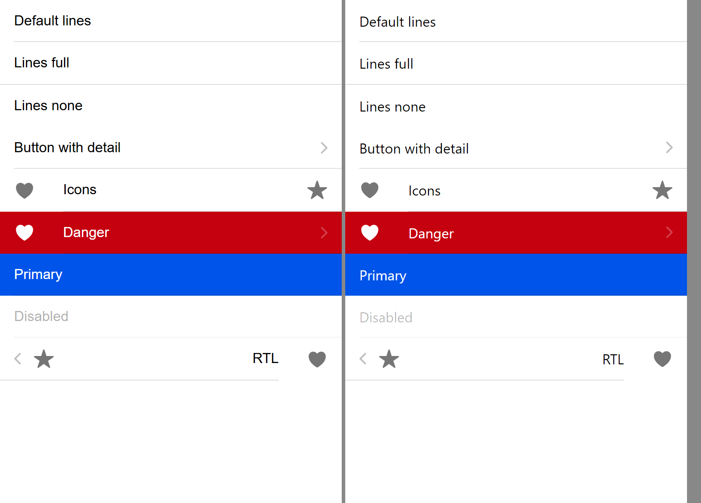
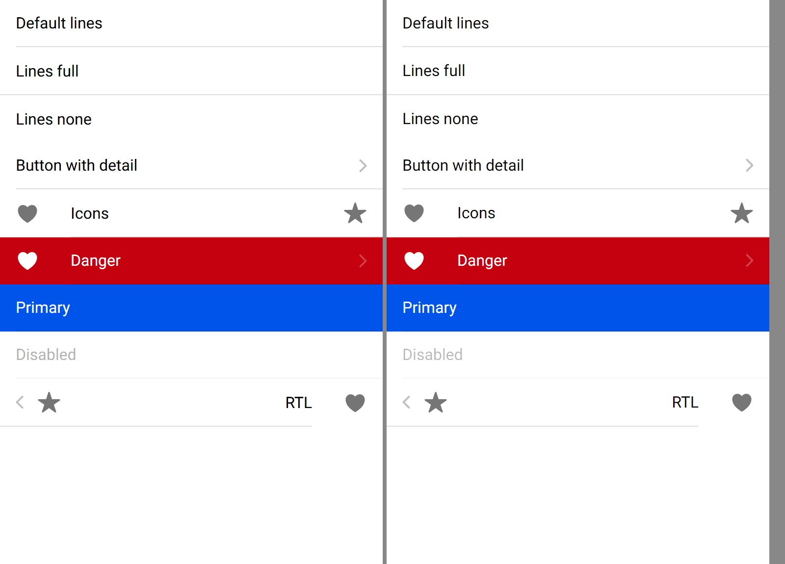
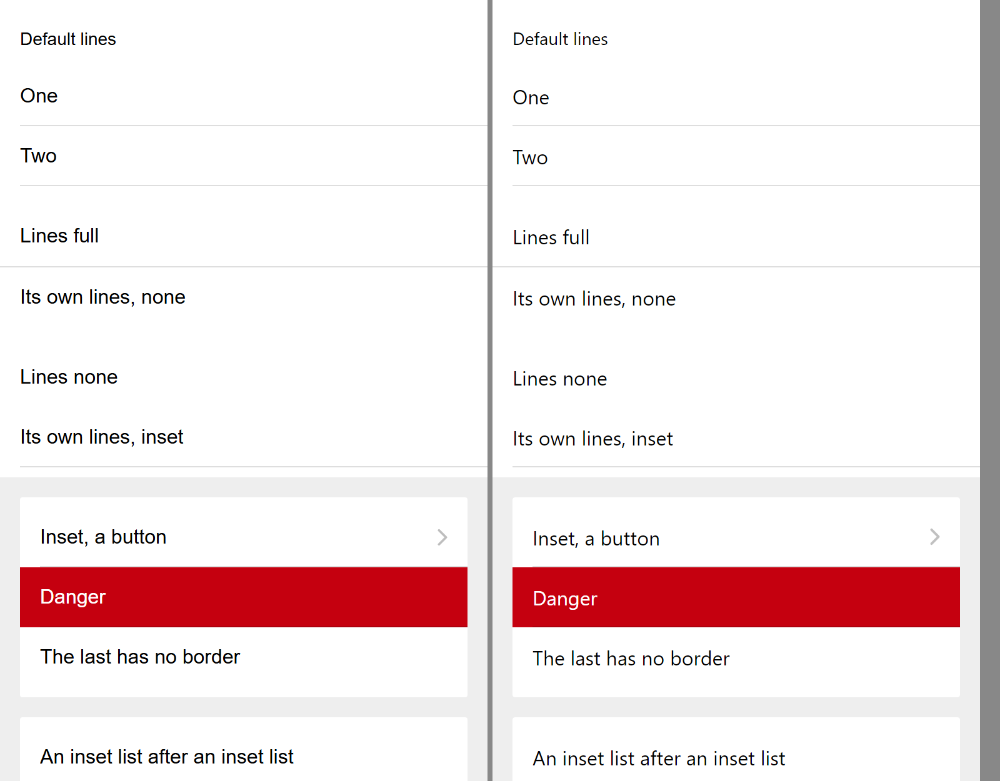
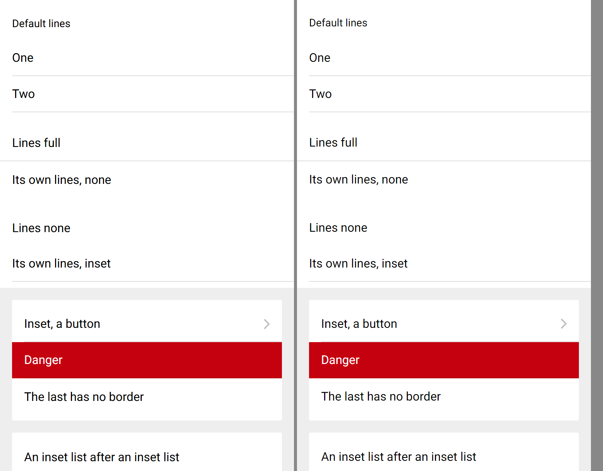
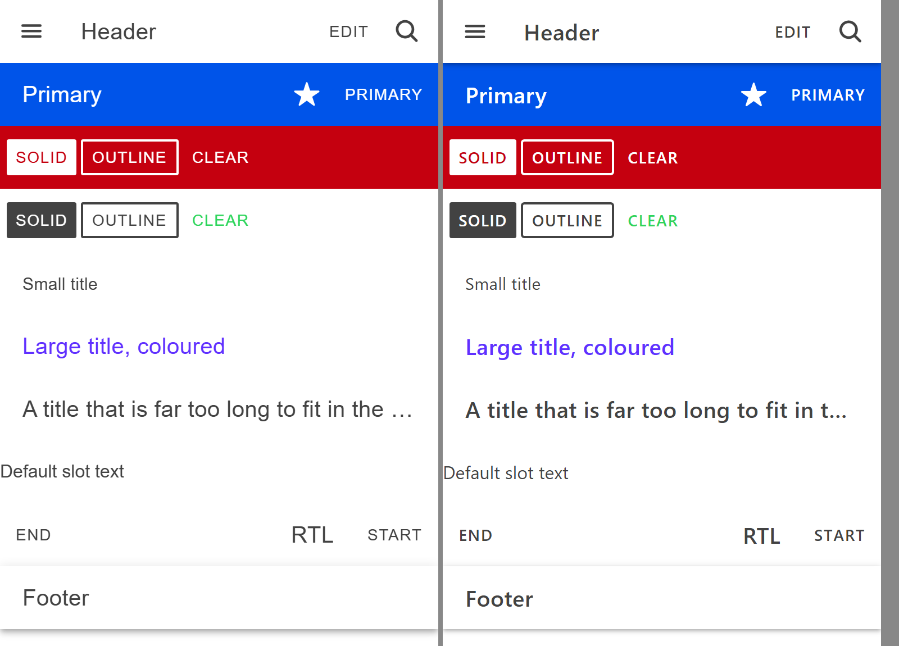
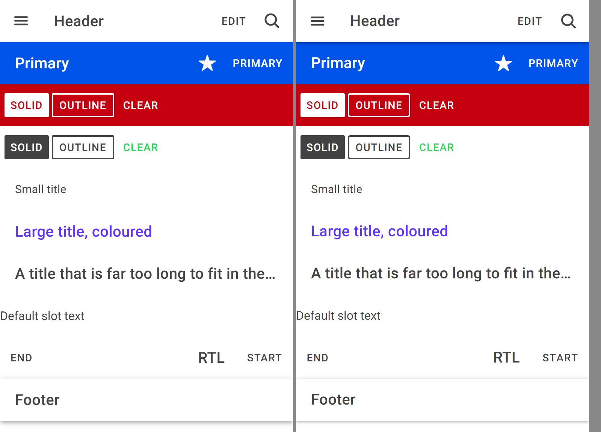

# Roboto on both sides

Status: done · [#100](https://github.com/wdcossey/Avonic/issues/100)

The tests, the sample and the Chromium tools draw text with the same Roboto files, from
[`tools/fonts/roboto/`](../../../tools/fonts/roboto/README.md), which says where they come from, how each side loads them, and
what's left between them. The libraries don't ship Roboto, as Ionic doesn't.

Before, with Arial in Chromium and Segoe UI in Avalonia, Ionic on the left:

After, in Roboto on both sides:

The list and the toolbar, before and after:

