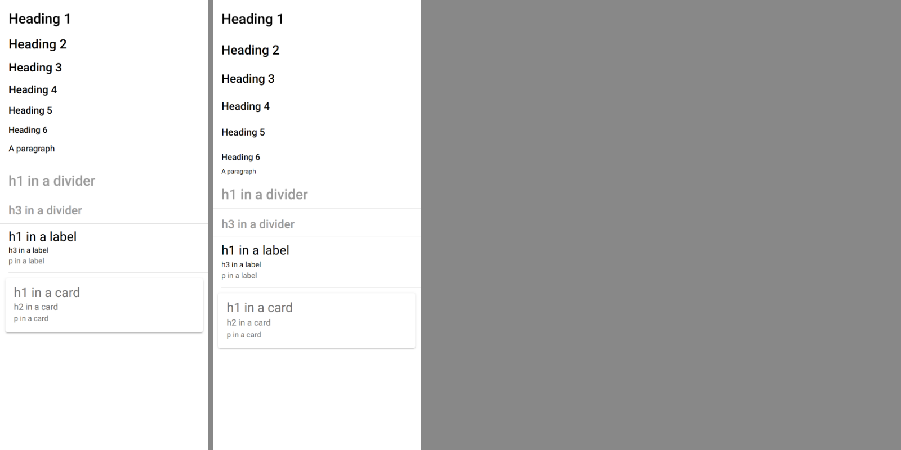
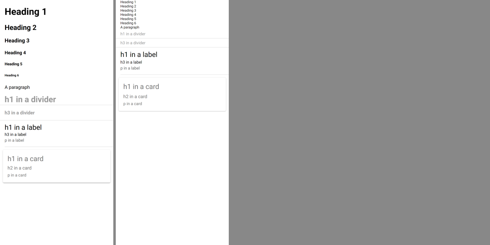

# Global typography: comparison

Ionic's frames: `node compare.js <repo> <out> scene.html`, a variant of the plan's `measure.js` kept out of the repo, which
renders this with `core.css`, `normalize.css` and `structure.css`, with and without `typography.css`, at 390 × 844 and a scale of 2,
with the repo's Roboto, in `ion-app`:

```html
<ion-content style="height:844px"><div style="padding:0 16px"><h1>Heading 1</h1><h2>Heading 2</h2><h3>Heading 3</h3><h4>Heading 4</h4><h5>Heading 5</h5><h6>Heading 6</h6><p>A paragraph</p></div><ion-item-divider><h1>h1 in a divider</h1></ion-item-divider><ion-item-divider><h3>h3 in a divider</h3></ion-item-divider><ion-item><ion-label><h1>h1 in a label</h1><h3>h3 in a label</h3><p>p in a label</p></ion-label></ion-item><ion-card><ion-card-content><h1>h1 in a card</h1><h2>h2 in a card</h2><p>p in a card</p></ion-card-content></ion-card></ion-content>
```

`render.js` isn't used, as it always loads `ionic.bundle.css`, which includes `typography.css`. Avonic's frames are the sample's
`typography` page, from `TypographyCaptureTests` (`AVONIC_CAPTURE_DIR`), with the page's merged file and without it.

## With the file

Ionic on the left, Avonic on the right.



| Text | Ionic top, height | Avonic top, height | |
|---|---|---|---|
| Heading 1 | 20, 31.2 | 20, 31.5 | Match. Avonic's frame is snapped to half pixels |
| Heading 2 … 6 | heights 28.8, 26.4, 24, 21.6, 19.2 | 29, 26.5, 24, 22, 19.5 | Match |
| Heading 2 … 6, tops | 69.2, 114, 156.4, 196.4, 234 | 79.5, 134.5, 187, 237, 285 | Deliberate: margins don't collapse (10 + 18, not 18) |
| A paragraph | 16 px, 16 px margins | Avalonia's default size, no margin | Deliberate: `typography.css` has no `p` rule, and outside a host the UA's isn't recreated (ADR 0002) |
| h1 in a divider, to h3 in a divider | 31.2 high, 58.1 apart | 31.5, 58.5 apart | Match: the file beats the divider's `::slotted(h1)` |
| h1 in a label | 28.8 | 29 | Match: the label's size and weight, the file's line height |
| h3 in a label, p | 16, 20 | 16.5, 20 | Match |
| h1, h2 in a card | 28.8, 19.2 | 29, 19.5 | Match: the card's size and weight, the file's line height |
| p in a card | 21 | 21 | Match |

## Without the file



| Text | Ionic | Avonic | |
|---|---|---|---|
| Headings outside a host | The UA's: 2em … bold, Times | Avalonia's defaults | Deliberate (ADR 0002). The `html` font isn't the point here: without the file there's no rule |
| In a divider | The UA's sizes, bold, `h1` margin 0 / 2 | The divider's 14, no margin | Deliberate: see the plan's known differences |
| h1 in a label | 28 (normal) | 28.5 | Match |
| h1, h2 in a card | 36, 24 (1.5) | 36, 24 | Match |

Numbers: Ionic's in [ref/boxes-on.json](ref/boxes-on.json) and [ref/boxes-off.json](ref/boxes-off.json); every heading's computed
values in [ref/measure.json](ref/measure.json). The frames are in `ref/` and `compare/`.

Not tried in a real window, and not on a device.
