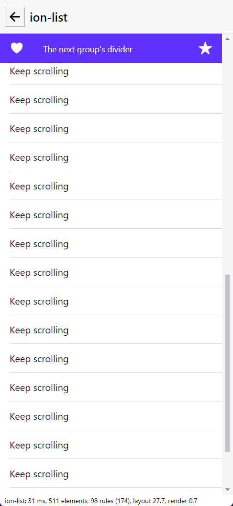

# Real window

Headless tests can't see everything. The first run of this by hand found a control bug that 1,486 tests had missed, so it runs
on each batch before it's called ready to merge.

**It takes over the cursor and focus for about four minutes, so ask first.** It puts the cursor back and closes only the window
it opened.

```
pwsh -ExecutionPolicy Bypass -File tools/real-window/drive.ps1
```

Windows PowerShell 5.1 (`powershell`) runs it too. Windows only, for now (#133).

It builds the sample first, from the repo so that `global.json` picks the SDK: a stale build runs the old code, and fails checks
the new code passes. `-Configuration Release` builds and runs Release instead of Debug; only a Debug build checks the performance
line. `-NoBuild` runs the build as it is, and `-Exe <path>` runs another build or copy of the sample as it is. **Close the sample
first** if it's open: it locks its files, so the script stops rather than build. Frames go to a new folder in the temp folder for
each run, which it prints, unless you pass `-Out`. `-Only 'ion-picker,ion-re*'` runs only the sections with those titles, to work
on one, and fails if none matches; the whole run is the one that counts. It exits 1 if a check fails.

**If something takes the focus, it stops sending input** rather than type into another app, and fails those checks. It stops at
once if the window doesn't fit on the screen.

## What it does

- **Every page on the index,** with nothing to add for a new control: opens it, saves a frame, and fails on a button with no
  size, which is how the invisible button showed up, and on a missing performance line in a Debug build.
- **Real input on the pages that take it:** counts clicks, double clicks, Enter, Space and touch taps, and checks keyboard focus
  by pixel and sticky dividers by position. A new interactive control should get a section here. The P2 controls each have one:
  - `ion-item-sliding`: touch and mouse swipes open each side, a tap on an option clicks it, a tap outside leaves it open and a
    press on another sliding item closes it, as Ionic's `canStart` does, `CloseOpened()`, a full swipe's `IonSwipe`, the disabled
    row, and a drag up a row scrolling the page.
  - `ion-reorder`: touch and mouse drags on a handle, the page scrolling under a drag held near its bottom, a drag off the handles
    scrolling, and the toggle turning it off.
  - `ion-refresher`: a pull past the threshold refreshes, with the spinner, and completes; a short one cancels; a pull when
    scrolled down only scrolls; Disabled stops it. Since #176, four checks: after `Cancel the refresh`, a pull held still
    past the cancel's end and let go leaves it on, so the next pull refreshes (Ionic's C3), and a refresh begun while cancelling goes
    on past the cancel's end until the page completes it (C9). The held pull is updated in place every 40 ms (`TouchHold`), as a real
    screen reports a still finger: Windows drops an injected contact left 100 ms without an update, and the lift then fails (1460).
  - `ion-picker`: a wheel notch moving three rows and back, as in Chromium, a tap on an option, the arrows on the focused column
    skipping a disabled option, and a touch drag that snaps.
  - `ion-searchbar`: focus showing the cancel arrow, typing with the debounce, the clear button by mouse and touch keeping the
    focus, Escape, and the cancel button.
  - `ion-textarea`: Enter, auto grow, the counter (read from a line on the page, and by pixel) and clear on edit.
  - `ion-input-otp`: typing box to box, Backspace, `IonComplete`, a paste and `IonChange` on leaving. The paste puts the
    clipboard's text back afterwards, and is skipped if the clipboard holds anything else.
  - `ion-alert` (#39): a real click on the trigger presents the page's alert, Tab stays inside, Escape dismisses it with
    `backdrop`; a radio alert made in code returns `red` after a pick and OK; a text alert's Save handler returning false keeps it
    open, Enter in its field does nothing (Ionic's has no form), and Enter on Save submits `{name: "Ann"}`; the `IsOpen` alert with
    `BackdropDismiss` off stays on Escape and closes from a button. Not run yet.
  - `ion-action-sheet` (#40): a real click on the trigger presents the page's sheet; Share dismisses it with `share` and no role,
    Delete with `delete` and `destructive`; a handler returning false keeps a sheet open, and its Cancel dismisses it with `cancel`;
    Escape and a click on the backdrop dismiss with `backdrop`; a radio sheet made in code, as `ion-select` builds one, has Banana
    checked and returns `cherry` after a click on Cherry; the `IsOpen` sheet with `BackdropDismiss` off stays on Escape and closes
    from its Close button. Not run yet.
  - `typography`: frames only.
  - `ion-app` (#65): Alt+Left taken by the page's handler at priority 10 over the shell's 0, and with it off, the shell going back
    to the list at 0; a frame of `SetFocus`'s ring on row 1.
  - `ion-app: the touch keyboard` (#189): the page's `Input pane:` line shows a closed pane and the shims on; a touch tap on the
    last row's field, or failing that `ITipInvocation` (the taskbar's keyboard button), opens Windows' touch keyboard; the line
    then says `Open`, with the rect in the client's DIPs and on the screen. What the keyboard covers is the overlap both ways, as
    `KeyboardAssist` takes it. A keyboard beside the window has to pad nothing; the window is then moved over the keyboard
    (`SetWindowPos`, put back at the end) and the keyboard opened again, and the field has to end above the keyboard's top, 50
    above it with the content padded by what the keyboard covers when it had to move. It closes the keyboard again, and checks the
    padding goes with it, with the field still focused. Frames: `app-touch-keyboard`, `-moved`, and `-around` ones of the window and
    the keyboard together. A keyboard the pane never reports it can't tell open from closed, so it leaves it with a note. Skipped,
    not failed, when no keyboard comes or it won't cover the window. First run on `1f5064e` (2026-11-17, Windows 11 at 125%): the
    floating keyboard opened beside the window, which the shims rightly left alone, and the old checks, taking the heights alone,
    failed 2 of 7; the move over the keyboard came after, not run yet.
  - `ion-content: keys and the scroll indicator` (#67): a press on a row, then Down, Home, Page Down, Space, Shift+Space and End,
    read from the page's `Ended at` line; and a strip at the end edge that a wheel changes until the indicator fades, and a key
    doesn't. Since #182, the same strip at the top differs at load from after the wheel's fade, as the thumb is there from load:
    run on `192cf20`, 13 of 13, and it fails (0 pixels) on `2f8eb1e`, before #182.
  - `ion-content: the scroll bar` (#175): the page's `Scroll bar` toggle on, then a mouse drag of the thumb, which has to scroll the
    content, and a click on the down arrow, 40 more, read from the `Ended at` line; then the toggle off. Run in the full sweep
    on `28c4288`.
  - `focus indicators` (#188): a checkbox in a multi-input item, focused by Shift+Tab then Tab, shows its circle 5 past the default
    slot's end (the item's room), and a letter clears it; a toggle in a multi-input item shows its circle beside the handle, told
    from the item's own focus overlay. Run in the full sweep on `28c4288`.
  - `ion-modal: trigger, focus trap, Escape, back, backdrop, canDismiss` (#42): the trigger, Tab staying inside, Escape and
    Alt+Left; with a nested modal open, the nested one's `Close the modal under this one` (the full-screen nested modal covers the
    parent's own Close, which a real click can't reach: 6 of 10 on `a1cd601`), read from the two status lines as `cancel` and
    `parent-dismissed`; `CanDismiss` against a touch tap on the backdrop; a modal made in code.
  - `ion-modal: the sheet` (#42): the trigger opens it at 0.5; four clicks on the handle cycle 0.75, 1, 0.25, 0.5; a slow finger drag
    down from the header, held still before the lift, settles at 0.25; a mouse drag up takes it to 1; a fast finger drag down
    closes it with `gesture`. Each breakpoint read from the page's `The sheet is at` line, and the sheet's top from its title, within
    12 dips of where the breakpoint puts it. Not run yet.
- **239 checks** run on v2 `28c4288` (2026-11-17), all 239 passing; no section added since.

**Look at the frames as well.** It saves a frame of each page, and most of what's wrong with a page isn't something it checks.

Proved on a clone with three bugs put back: the fixed slot measuring its children at zero, a nested `ScrollViewer`, and no
`FocusVisible` on a card. It failed on all three. The P2 sections found that no mouse could open an `ion-item-sliding`: Windows
sends a mouse move when the capture changes, which reached the gesture with no delta (see `docs/infra/gesture/README.md`).



## What it can't tell you

- **Touch** goes through Windows' touch injection, which is the real path through the OS, but it isn't a finger or a phone.
- **Scale** is whatever this PC's display is set to.
- **Windows only.** CI doesn't run it, as CI has no display.

The frames come from the screen, not `PrintWindow`, which offsets this window by its invisible border, and that looks like a bug
in the app.
