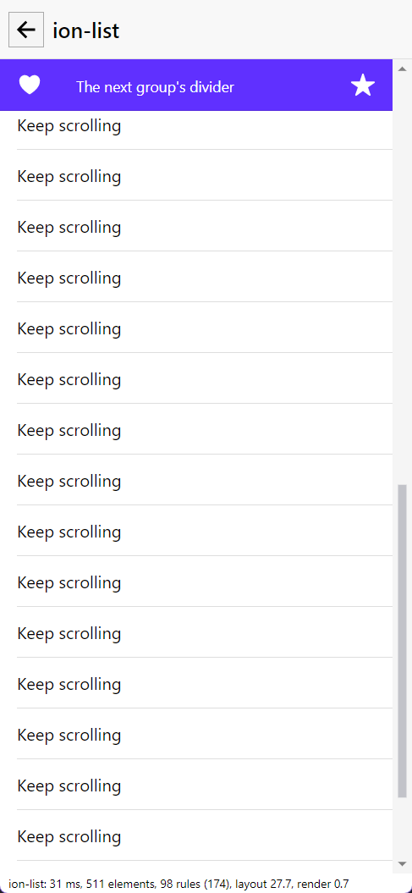

# Real window

Headless tests can't see everything. The first run of this by hand found a control bug that 1,486 tests had missed, so it runs
on each batch before it's called ready to merge.

**It takes over the cursor and focus for about four minutes, so ask first.** It puts the cursor back and closes only the window
it opened.

```
dotnet build samples/Avonic.Sample.Desktop
powershell -ExecutionPolicy Bypass -File tools/real-window/drive.ps1
```

A Debug build also checks the performance line. For a Release build, pass `-Exe`. Frames go to a new folder in the temp folder for
each run, which it prints, unless you pass `-Out`. `-Only 'ion-picker,ion-re*'` runs only the sections with those titles, to work
on one, and fails if none matches; the whole run is the one that counts. It exits 1 if a check fails.

**If something takes the focus, it stops sending input** rather than type into another app, and fails those checks. It stops at
once if the window doesn't fit on the screen.

## What it does

- **Every page on the index,** with nothing to add for a new control: opens it, saves a frame, and fails on a button with no
  size, which is how the invisible button showed up, and on a missing performance line in a Debug build.
- **Real input on the pages that take it:** counts clicks, double clicks, Enter, Space and touch taps, and checks keyboard focus
  by pixel and sticky dividers by position. A new interactive control should get a section here. The P2 controls each have one:
  - `ion-item-sliding`: touch and mouse swipes open each side, a tap on an option clicks it, a tap outside leaves it open and a
    press on another sliding item closes it, as Ionic's `canStart` does, `CloseOpened()`, a full swipe's `IonSwipe`, the disabled
    row, and a drag up a row scrolling the page.
  - `ion-reorder`: touch and mouse drags on a handle, the page scrolling under a drag held near its bottom, a drag off the handles
    scrolling, and the toggle turning it off.
  - `ion-refresher`: a pull past the threshold refreshes, with the spinner, and completes; a short one cancels; a pull when
    scrolled down only scrolls; Disabled stops it.
  - `ion-picker`: a wheel notch moving three rows and back, as in Chromium, a tap on an option, the arrows on the focused column
    skipping a disabled option, and a touch drag that snaps.
  - `ion-searchbar`: focus showing the cancel arrow, typing with the debounce, the clear button by mouse and touch keeping the
    focus, Escape, and the cancel button.
  - `ion-textarea`: Enter, auto grow, the counter (read from a line on the page, and by pixel) and clear on edit.
  - `ion-input-otp`: typing box to box, Backspace, `IonComplete`, a paste and `IonChange` on leaving. The paste puts the
    clipboard's text back afterwards, and is skipped if the clipboard holds anything else.
  - `typography`: frames only.
- **198 checks** in all, in about four minutes.

**Look at the frames as well.** It saves a frame of each page, and most of what's wrong with a page isn't something it checks.

Proved on a clone with three bugs put back: the fixed slot measuring its children at zero, a nested `ScrollViewer`, and no
`FocusVisible` on a card. It failed on all three. The P2 sections found that no mouse could open an `ion-item-sliding`: Windows
sends a mouse move when the capture changes, which reached the gesture with no delta (see `docs/infra/gesture/README.md`).



## What it can't tell you

- **Touch** goes through Windows' touch injection, which is the real path through the OS, but it isn't a finger or a phone.
- **Scale** is whatever this PC's display is set to.
- **Windows only.** CI doesn't run it, as CI has no display.

The frames come from the screen, not `PrintWindow`, which offsets this window by its invisible border, and that looks like a bug
in the app.
